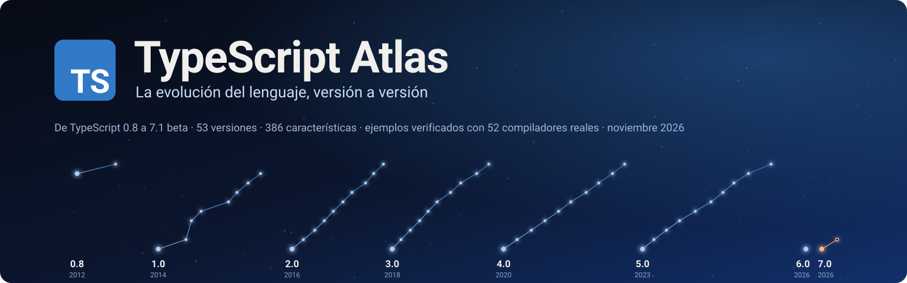
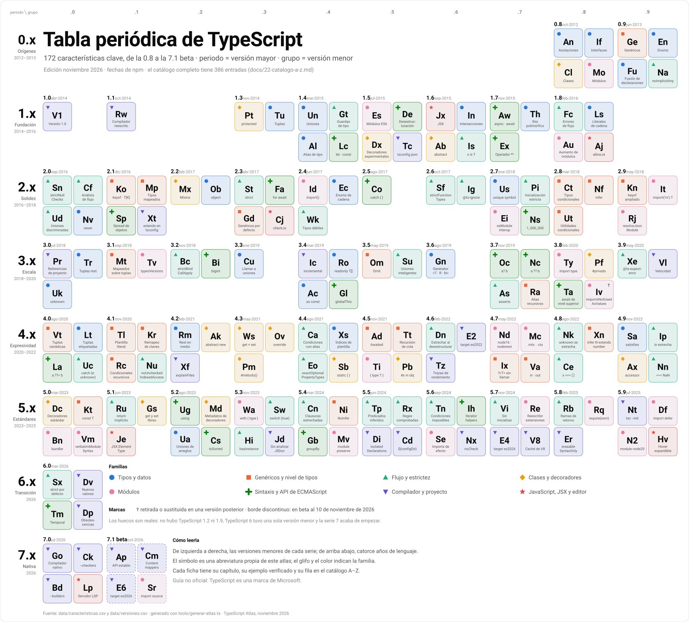
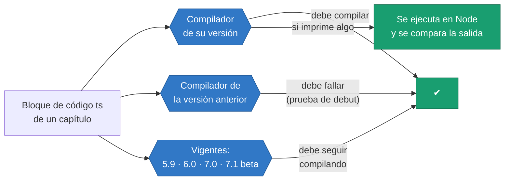

<div align="center">



<!-- atlas:inicio insignias -->
<p align="center">
  
  
  
  
  
  
  
  
</p>
<!-- atlas:fin insignias -->

**Catorce años de TypeScript —de la 0.8 de 2012 a la 7.1 beta de 2026— contados versión a versión, con cada ejemplo comprobado contra el compilador real de su época.**

[Empezar a leer](docs/01-modelo-de-versiones.md) · [Índice](#índice) · [Catálogo A–Z](docs/22-catalogo-a-z.md) · [Cómo se verifica](#cómo-se-verifica) · [El laboratorio](#el-laboratorio)

</div>

---

## Qué es este repositorio

**TypeScript Atlas** es una guía en español de la evolución de TypeScript: qué trajo cada versión, por qué, cómo se usa hoy y qué rompió por el
camino. Tiene tres rasgos que la distinguen de un resumen de notas de versión:

| | |
|---|---|
| 🧪 **Cada ejemplo está verificado** | Los bloques de código se compilan con los compiladores **reales** de cada época, descargados de npm: el de la versión que introdujo la característica, el de la anterior (donde debe fallar) y los vigentes (5.9, 6.0, 7.0 y la 7.1 beta). Los que imprimen algo se ejecutan en Node y su salida se compara con la anotada |
| 📊 **Los datos son la fuente** | Fechas tomadas del registro de npm, un catálogo de 386 características en CSV y las opciones de `tsconfig.json` extraídas preguntando a cada compilador. Las tablas y los gráficos se generan a partir de ellos |
| 🗓️ **Está al día** | Edición de noviembre de 2026: TypeScript 6.0 (el puente), 7.0 (el compilador nativo en Go) y la 7.1 beta |

El repositorio empezó como un **laboratorio** de aprendizaje con Vite —once lecciones en [`src/topics/`](src/topics)— y sigue siéndolo: el
[capítulo 26](docs/26-laboratorio-del-repositorio.md) recorre esas lecciones con el atlas en la mano.

---

## TypeScript en noviembre de 2026

| | |
|---|---|
| **Versión estable** | **7.0.2** (8 de julio de 2026): el compilador portado a Go, entre 8 y 12 veces más rápido ([12](docs/12-typescript-7-el-compilador-nativo.md)) |
| **En beta** | **7.1** (20 de octubre de 2026): API estable, *content mappers*, `es2026` por defecto ([12 § 7.1](docs/12-typescript-7-el-compilador-nativo.md#8-typescript-71-beta-la-api-y-los-content-mappers)) |
| **Versión puente** | **6.0** (23 de marzo de 2026): el último compilador en TypeScript, con valores por defecto nuevos y lo obsoleto marcado ([11](docs/11-typescript-6.0-el-puente.md)) |
| **Qué instalar** | `npm install -D typescript@~7.0.2`, y `@typescript/typescript6` si alguna herramienta necesita la API ([21 § 9](docs/21-guias-de-decision.md#9-qué-versión-de-typescript-usar)) |
| **Valores por defecto** | `strict: true`, `module: esnext`, `target` flotante (`es2025`), `types: []` ([11 § 3](docs/11-typescript-6.0-el-puente.md#3-los-nuevos-valores-por-defecto)) |
| **Ejecutar `.ts` sin compilar** | Node 22.18+ y 23.6+ borran los tipos; `erasableSyntaxOnly` asegura que se pueda ([10 § 8](docs/10-typescript-5.5-5.9-inferencia-y-sintaxis-borrable.md#8-typescript-58-erasablesyntaxonly-y-la-sintaxis-borrable)) |

---

## La tabla periódica de TypeScript

<picture>
  <source media="(prefers-color-scheme: dark)" srcset="assets/ts-atlas-tabla-periodica-oscuro.svg">
  
</picture>

Cada celda es una característica, colocada en la columna de la versión que la introdujo. El catálogo completo, con las 386 entradas, está en
[22 · Catálogo A–Z](docs/22-catalogo-a-z.md).

---

## Índice

### I · Fundamentos

| # | Capítulo | De qué trata |
|---|---|---|
| 01 | [El modelo de versiones](docs/01-modelo-de-versiones.md) | Compilador, `target`, `lib`, módulos, runtime y editor; la tabla maestra de las 53 versiones; por qué TypeScript no sigue SemVer |

### II · La evolución, versión a versión

| # | Capítulo | Versiones | Años |
|---|---|---|---|
| 02 | [Orígenes y TypeScript 1](docs/02-origenes-y-typescript-1.md) | 0.8 – 1.8 | 2012–2016 |
| 03 | [Nulos y flujo de control](docs/03-typescript-2.0-2.2-nulos-y-flujo.md) | 2.0 – 2.2 | 2016–2017 |
| 04 | [Estrictez y tipos condicionales](docs/04-typescript-2.3-2.9-estricto-y-condicionales.md) | 2.3 – 2.9 | 2017–2018 |
| 05 | [Proyectos y tuplas](docs/05-typescript-3.0-3.4-proyectos-y-tuplas.md) | 3.0 – 3.4 | 2018–2019 |
| 06 | [Encadenamiento opcional y aserciones](docs/06-typescript-3.5-3.9-encadenamiento-y-aserciones.md) | 3.5 – 3.9 | 2019–2020 |
| 07 | [Tuplas variádicas y plantillas literales](docs/07-typescript-4.0-4.4-tuplas-variadicas-y-plantillas.md) | 4.0 – 4.4 | 2020–2021 |
| 08 | [ESM en Node y `satisfies`](docs/08-typescript-4.5-4.9-esm-y-satisfies.md) | 4.5 – 4.9 | 2021–2022 |
| 09 | [Decoradores estándar y `using`](docs/09-typescript-5.0-5.4-decoradores-y-using.md) | 5.0 – 5.4 | 2023–2024 |
| 10 | [Inferencia y sintaxis borrable](docs/10-typescript-5.5-5.9-inferencia-y-sintaxis-borrable.md) | 5.5 – 5.9 | 2024–2025 |
| 11 | [TypeScript 6.0: el puente](docs/11-typescript-6.0-el-puente.md) | 6.0 🔵 | 2026 |
| 12 | [TypeScript 7: el compilador nativo](docs/12-typescript-7-el-compilador-nativo.md) | 7.0 🟢 · 7.1 🟡 | 2025–2026 |

### III · Temas transversales

| # | Capítulo | De qué trata |
|---|---|---|
| 13 | [Hilos evolutivos](docs/13-hilos-evolutivos.md) | Diez problemas contados de principio a fin: nulos, estrechamiento, tuplas, cadenas, clases, módulos, `strict`… |
| 14 | [El sistema de tipos a fondo](docs/14-sistema-de-tipos-a-fondo.md) | Conjuntos, tipado estructural, asignabilidad, varianza, agujeros de solidez y marcas nominales |
| 15 | [Programación a nivel de tipos](docs/15-programacion-a-nivel-de-tipos.md) | Mapeados, condicionales, `infer`, recursión (con sus límites medidos), plantillas y utilitarios |
| 16 | [Módulos y resolución](docs/16-modulos-y-resolucion.md) | `module`, `moduleResolution`, ESM y CommonJS en Node, `exports`, `paths` y recetas |
| 17 | [`tsconfig` de referencia](docs/17-tsconfig-de-referencia.md) | Seis recetas probadas con 6.0 y 7.0, la familia `strict` y todas las opciones con su ciclo de vida |
| 18 | [Bajo el capó y rendimiento](docs/18-bajo-el-capo-y-rendimiento.md) | Fases del compilador, diagnóstico, tipos baratos, historia del rendimiento y una medición propia 6.0 frente a 7.0 |
| 19 | [TypeScript y ECMAScript](docs/19-typescript-y-ecmascript.md) | TC39, lo que TypeScript adelantó, las bibliotecas `lib` y la saga de los decoradores |
| 20 | [Ecosistema y runtimes](docs/20-ecosistema-y-runtimes.md) | Node, Deno, Bun, DefinitelyTyped, transpiladores, *linters*, JSDoc y validación |
| 21 | [Guías de decisión](docs/21-guias-de-decision.md) | `interface` o `type`, `enum` o unión, `private` o `#`, uno o varios proyectos, qué versión usar |

### IV · Referencia

| # | Capítulo | De qué trata |
|---|---|---|
| 22 | [Catálogo A–Z](docs/22-catalogo-a-z.md) | Las 386 características, con versión, familia, requisitos y prueba (generado) |
| 23 | [Migración y ciclo de vida](docs/23-migracion-y-ciclo-de-vida.md) | Soporte, estrategia, cambios incompatibles y recetas para pasar a 5.x, 6.0 y 7.0 |
| 24 | [Referencia rápida y glosario](docs/24-referencia-rapida-y-glosario.md) | Sintaxis, operadores, utilitarios, errores frecuentes, línea de órdenes y glosario |
| 25 | [Pruebas de debut](docs/25-pruebas-de-debut.md) | El cuaderno de laboratorio: cada característica compila en su versión y falla en la anterior |

### V · El laboratorio

| # | Capítulo | De qué trata |
|---|---|---|
| 26 | [El laboratorio del repositorio](docs/26-laboratorio-del-repositorio.md) | Las once lecciones de `src/topics/`, revisadas y comprobadas con 5.7 y 7.0 |

---

## Rutas de lectura

| Si… | Lee |
|---|---|
| Empiezas con TypeScript | [01](docs/01-modelo-de-versiones.md) → [14](docs/14-sistema-de-tipos-a-fondo.md) → [21](docs/21-guias-de-decision.md) → [17](docs/17-tsconfig-de-referencia.md) → [26](docs/26-laboratorio-del-repositorio.md) |
| Vas a actualizar un proyecto a la 6.0 o la 7.0 | [11](docs/11-typescript-6.0-el-puente.md) → [12](docs/12-typescript-7-el-compilador-nativo.md) → [23](docs/23-migracion-y-ciclo-de-vida.md) → [17](docs/17-tsconfig-de-referencia.md) |
| Mantienes código de hace años y no reconoces la sintaxis | [13](docs/13-hilos-evolutivos.md) y el capítulo de la era correspondiente (02–10) |
| Escribes bibliotecas | [15](docs/15-programacion-a-nivel-de-tipos.md) → [16](docs/16-modulos-y-resolucion.md) → [17 § D](docs/17-tsconfig-de-referencia.md#d--biblioteca-publicada-en-npm) → [20 § 4](docs/20-ecosistema-y-runtimes.md#4-definitelytyped-y-los-paquetes-types) |
| Te interesa la historia | De [02](docs/02-origenes-y-typescript-1.md) a [12](docs/12-typescript-7-el-compilador-nativo.md), en orden, y después [19](docs/19-typescript-y-ecmascript.md) |
| Solo necesitas un dato | [24](docs/24-referencia-rapida-y-glosario.md) o [22](docs/22-catalogo-a-z.md) |

---

## Cómo se verifica

TypeScript no tiene un `-langversion`: **cada versión del compilador es una versión del lenguaje**. Por eso el atlas no se fía de la memoria ni de
los anuncios. El verificador descarga de npm los compiladores de cada época —de la 0.8.3 de 2012 a la 7.1.0-beta— y comprueba con ellos cada
bloque de código de los capítulos.



| Marca en el bloque | Qué se comprueba |
|---|---|
| `ts=4.1` | Compila con TypeScript 4.1 y con los vigentes |
| `debut` | Además, **falla** con la versión menor anterior |
| `err=TS2322` | Falla con ese código de error |
| `run` | Se emite, se ejecuta en Node y la salida debe coincidir con los comentarios `// →` |
| `hasta=5.9` · `luego=TS5107` | Compila hasta esa versión y falla después (lo retirado) |
| `// ^? tipo` | El editor debe mostrar exactamente ese tipo |

### Órdenes

Requieren **Node 22.18 o posterior**: las herramientas están escritas en TypeScript con sintaxis borrable y Node las ejecuta sin compilar.

```bash
npm run atlas:verificar                          # todos los capítulos (la primera vez descarga ~52 compiladores)
node tools/verificar-ejemplos.ts --beta          # incluye la 7.1 beta
node tools/verificar-ejemplos.ts --solo 07-      # un solo capítulo
npm run atlas:generar                            # regenera el catálogo, los SVG y las tablas inyectadas
node tools/extraer-opciones.ts                   # vuelve a preguntar a los compiladores por sus opciones
```

### Estado de la última verificación

<!-- Cifras de data/verificacion.json, escrito por tools/verificar-ejemplos.ts -->

| | |
|---|---|
| **Fecha de corte** | 10 de noviembre de 2026 |
| **Runtime** | Node v26.13.0 |
| **Compiladores reales** | 52, de `0.8.3` a `7.1.0-beta` |
| **Bloques de código** | 595 (586 verificables y 9 ilustrativos) |
| **Comprobaciones** | 3191, **todas correctas** |
| **Pruebas de debut** | 422 |
| **Ejemplos ejecutados en Node** | 115 (229 ejecuciones) |
| **Errores esperados** | 100 bloques que deben fallar con un código concreto |
| **Tipos consultados** | 88 consultas `// ^?` |

---

## Estructura del repositorio

```text
TypescriptLabs/
├── README.md                     este índice
├── docs/                         los 26 capítulos del atlas
├── data/
│   ├── versiones.csv             una fila por versión menor, con fechas de npm
│   ├── caracteristicas.csv       386 características: versión, familia, clase, estado
│   ├── opciones.csv              ciclo de vida de cada opción de tsconfig.json (extraído)
│   ├── valores-de-opciones.csv   ciclo de vida de cada valor de target, module, lib… (extraído)
│   └── verificacion.json         informe de la última verificación
├── tools/
│   ├── verificar-ejemplos.ts     el verificador multiversión
│   ├── obrero-compilador.ts      carga un compilador en proceso y compila lotes de ejemplos
│   ├── generar-atlas.ts          catálogo, SVG, tablas e insignias
│   ├── extraer-opciones.ts       pregunta a cada compilador por sus opciones
│   └── comun.ts                  utilidades compartidas
├── assets/                       portada, tabla periódica y línea de tiempo (claro y oscuro)
├── src/                          el laboratorio Vite: main.ts y src/topics/01…11
├── index.html · package.json · tsconfig.json
└── .atlas-cache/                 compiladores descargados (ignorado por git)
```

---

## El laboratorio

El proyecto Vite original sigue funcionando:

```bash
npm install
npm run dev        # abre la lección activa en el navegador; la salida está en la consola
```

`src/main.ts` importa una lección de `src/topics/` cada vez. Las once —tipos básicos, interfaces, funciones, desestructuración, módulos, clases,
genéricos, decoradores y encadenamiento opcional— están comentadas en el [capítulo 26](docs/26-laboratorio-del-repositorio.md), junto con
los errores de compilación que tenían y cómo se corrigieron: hoy `npm run build` termina sin errores, y `tsc` 7.0 tampoco da ninguno.

---

## Repositorio hermano: TypeSpaghetti

> **[CristianSifuentes/TypeSpaghetti](https://github.com/CristianSifuentes/TypeSpaghetti)** desenreda el sistema de tipos nivel a nivel —de las
> anotaciones básicas a los entresijos del compilador— con código ejecutable en cada etapa.

| Nivel | Contenido | En este atlas |
|---|---|---|
| Básico | Tipado estático, anotaciones, tipos primitivos, funciones e interfaces | [02](docs/02-origenes-y-typescript-1.md) · [26](docs/26-laboratorio-del-repositorio.md) |
| Medio | Uniones, intersecciones, opcionales, genéricos, guardas de tipo | [14](docs/14-sistema-de-tipos-a-fondo.md) · [13 § Estrechamiento](docs/13-hilos-evolutivos.md#3-estrechamiento) |
| Avanzado | Tipos mapeados y condicionales, uniones discriminadas, decoradores, utilitarios | [15](docs/15-programacion-a-nivel-de-tipos.md) · [09](docs/09-typescript-5.0-5.4-decoradores-y-using.md) |
| Experto | `infer`, tipos recursivos, varianza, internos del compilador | [15 § `infer`](docs/15-programacion-a-nivel-de-tipos.md#5-infer) · [14 § Varianza](docs/14-sistema-de-tipos-a-fondo.md#7-varianza) · [18](docs/18-bajo-el-capo-y-rendimiento.md) |

---

## Fuentes

- Registro npm del paquete [`typescript`](https://www.npmjs.com/package/typescript?activeTab=versions): fuente de todas las fechas
- [Notas de versión de TypeScript](https://www.typescriptlang.org/docs/handbook/release-notes/overview.html) y [blog oficial](https://devblogs.microsoft.com/typescript/)
- Los compiladores mismos: cada afirmación sobre qué compila y qué no se comprobó ejecutándolos
- [TC39](https://github.com/tc39/proposals) y sus [notas de reuniones](https://github.com/tc39/notes) para el estado de las propuestas de ECMAScript
- [Hoja de ruta oficial de TypeScript](https://github.com/microsoft/TypeScript/wiki/Roadmap)
