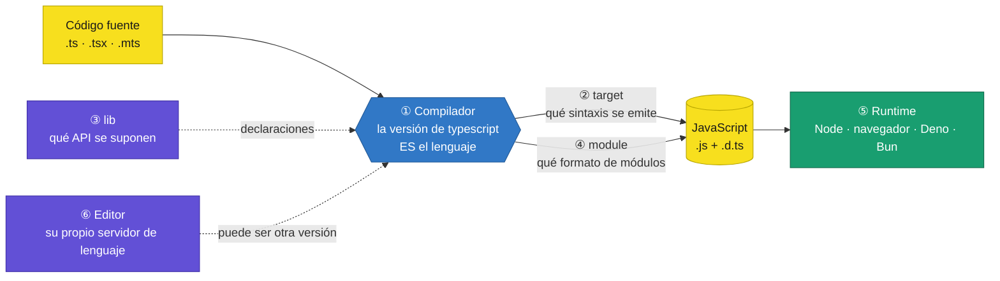
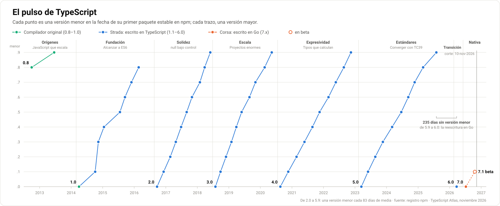
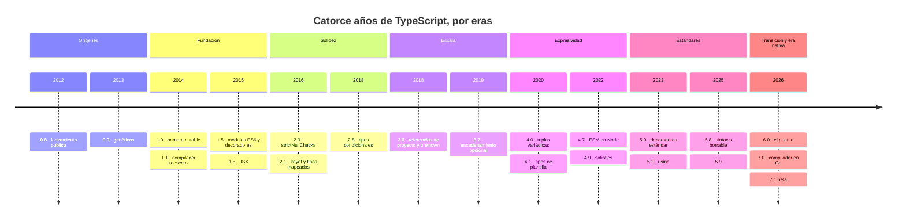
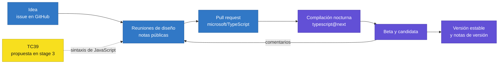

<div align="center">

# 01 · El modelo de versiones de TypeScript

**Compilador, `target`, `lib`, módulos, runtime y editor: seis relojes que no marcan la misma hora**

[🏠 Índice](../README.md) · [02 · Orígenes y TypeScript 1 ➡](02-origenes-y-typescript-1.md)

</div>

> [!IMPORTANT]
> **TypeScript no tiene un `LangVersion`.** En C# o en Java puedes pedirle a un compilador nuevo que acepte solo la sintaxis de una versión antigua;
> en TypeScript, **la versión del lenguaje es la versión del compilador**. TypeScript 7 no sabe comportarse como TypeScript 4.1. Lo que sí se elige
> por separado es qué JavaScript se emite (`target`), qué API se suponen disponibles (`lib`) y qué sistema de módulos se usa (`module`).
> Confundir esos mandos es el origen de buena parte de los errores de configuración.

---

## Contenido

1. [Los seis relojes](#1-los-seis-relojes)
2. [Tabla maestra de versiones](#2-tabla-maestra-de-versiones)
3. [TypeScript no sigue SemVer](#3-typescript-no-sigue-semver)
4. [Cadencia: del goteo inicial al ritmo trimestral](#4-cadencia-del-goteo-inicial-al-ritmo-trimestral)
5. [Qué exige cada característica](#5-qué-exige-cada-característica)
6. [Cómo se elige la versión](#6-cómo-se-elige-la-versión)
7. [`target` y `lib`: el JavaScript que sale y el que se supone](#7-target-y-lib-el-javascript-que-sale-y-el-que-se-supone)
8. [Cómo nace una característica](#8-cómo-nace-una-característica)
9. [Referencias](#9-referencias)

---

## 1. Los seis relojes



| Reloj | Qué versiona | Dónde se fija | Ejemplo |
|---|---|---|---|
| **① Compilador** | La gramática, el comprobador de tipos y sus reglas: **el lenguaje** | `devDependencies` de `package.json` | `"typescript": "~7.0.2"` |
| **② `target`** | La sintaxis de JavaScript que se emite | `tsconfig.json` | `"target": "es2022"` |
| **③ `lib`** | Las API que el compilador da por existentes | `tsconfig.json` | `"lib": ["es2023", "dom"]` |
| **④ `module`** | El formato de los módulos y cómo se resuelven las importaciones | `tsconfig.json` | `"module": "nodenext"` |
| **⑤ Runtime** | Lo que de verdad ejecuta el JavaScript | La máquina o el navegador | Node 26.13 |
| **⑥ Editor** | El servidor de lenguaje que da errores y autocompletado | VS Code trae el suyo; se puede usar el del proyecto | «Usar la versión del área de trabajo» |

Tres consecuencias prácticas:

- **El compilador nunca viaja a producción.** Los tipos se borran; lo que llega al runtime es JavaScript. Por eso un error de tipos no impide,
  por defecto, que se genere el `.js`.
- **`target` transforma sintaxis, pero no añade API.** Con `target: es2015`, TypeScript reescribe `a ?? b`, pero no inventa `Array.prototype.includes`.
- **El editor y la terminal pueden discrepar.** Si VS Code usa su TypeScript integrado y el proyecto otro, verás errores distintos en cada sitio.

El segundo punto se puede demostrar. Con destino ES2015, la sintaxis moderna compila, pero una API de ES2016 no existe para el compilador:

```ts ts=4.0 opts=target:es2015 err=TS2550/TS2339
const colores = ["rojo", "verde"];
const hayRojo = colores.includes("rojo");   // error TS2550: ¿necesitas cambiar `lib`?
```

```ts ts=4.0 opts=target:es2015,lib:es2016+dom
const colores = ["rojo", "verde"];
const hayRojo = colores.includes("rojo");   // compila… y el runtime debe tener `includes`: TypeScript no añade polyfills
```

---

## 2. Tabla maestra de versiones

<picture>
  <source media="(prefers-color-scheme: dark)" srcset="../assets/ts-atlas-linea-de-tiempo-oscuro.svg">
  
</picture>

Todas las fechas son las del **primer paquete estable publicado en npm**, la fuente más precisa y verificable. 🟢 estable actual · 🔵 puente · 🟡 beta.
La columna «días» mide el tiempo desde la versión estable anterior.

<!-- atlas:inicio tabla-maestra -->
| TS | Publicación | Beta | RC | Días desde la anterior | Motor | Tema dominante | Capítulo |
|---|---|---|---|---:|---|---|---|
| **0.8** | 1-oct-2012 | — | — | — | Original | Lanzamiento público: clases, módulos e interfaces | [02](02-origenes-y-typescript-1.md) |
| **0.9** | 18-jun-2013 | — | — | 260 | Original | Genéricos, enums y fusión de declaraciones | [02](02-origenes-y-typescript-1.md) |
| **1.0** | 2-abr-2014 | — | — | 288 | Original | Primera versión estable | [02](02-origenes-y-typescript-1.md) |
| **1.1** | 6-oct-2014 | — | — | 187 | Strada | Compilador reescrito, cuatro veces más rápido | [02](02-origenes-y-typescript-1.md) |
| **1.3** | 12-nov-2014 | — | — | 37 | Strada | protected y tuplas | [02](02-origenes-y-typescript-1.md) |
| **1.4** | 16-ene-2015 | — | — | 65 | Strada | Uniones, guardas de tipo, alias, let y const | [02](02-origenes-y-typescript-1.md) |
| **1.5** | 20-jul-2015 | 30-abr-2015 | — | 185 | Strada | Módulos ES6, decoradores y tsconfig.json | [02](02-origenes-y-typescript-1.md) |
| **1.6** | 16-sep-2015 | 2-sep-2015 | — | 58 | Strada | JSX, intersecciones y clases abstractas | [02](02-origenes-y-typescript-1.md) |
| **1.7** | 30-nov-2015 | — | — | 75 | Strada | async/await y this polimórfico | [02](02-origenes-y-typescript-1.md) |
| **1.8** | 22-feb-2016 | 28-ene-2016 | — | 84 | Strada | Literales de cadena, allowJs y errores de flujo | [02](02-origenes-y-typescript-1.md) |
| **2.0** | 22-sep-2016 | 11-jul-2016 | 30-ago-2016 | 213 | Strada | strictNullChecks, análisis de flujo y never | [03](03-typescript-2.0-2.2-nulos-y-flujo.md) |
| **2.1** | 7-dic-2016 | — | 8-nov-2016 | 76 | Strada | keyof, tipos mapeados y spread de objetos | [03](03-typescript-2.0-2.2-nulos-y-flujo.md) |
| **2.2** | 22-feb-2017 | — | 2-feb-2017 | 77 | Strada | Mixins y el tipo object | [03](03-typescript-2.0-2.2-nulos-y-flujo.md) |
| **2.3** | 27-abr-2017 | — | 10-abr-2017 | 64 | Strada | --strict, iteración asíncrona y genéricos con valor por defecto | [04](04-typescript-2.3-2.9-estricto-y-condicionales.md) |
| **2.4** | 27-jun-2017 | — | 12-jun-2017 | 61 | Strada | import() dinámico y enums de cadena | [04](04-typescript-2.3-2.9-estricto-y-condicionales.md) |
| **2.5** | 31-ago-2017 | — | 17-ago-2017 | 65 | Strada | catch sin variable | [04](04-typescript-2.3-2.9-estricto-y-condicionales.md) |
| **2.6** | 31-oct-2017 | — | 12-oct-2017 | 61 | Strada | strictFunctionTypes y @ts-ignore | [04](04-typescript-2.3-2.9-estricto-y-condicionales.md) |
| **2.7** | 31-ene-2018 | — | 17-ene-2018 | 92 | Strada | unique symbol e inicialización estricta de propiedades | [04](04-typescript-2.3-2.9-estricto-y-condicionales.md) |
| **2.8** | 27-mar-2018 | — | 15-mar-2018 | 55 | Strada | Tipos condicionales e infer | [04](04-typescript-2.3-2.9-estricto-y-condicionales.md) |
| **2.9** | 31-may-2018 | — | 16-may-2018 | 65 | Strada | keyof ampliado y tipos import() | [04](04-typescript-2.3-2.9-estricto-y-condicionales.md) |
| **3.0** | 30-jul-2018 | — | 12-jul-2018 | 60 | Strada | Referencias de proyecto, unknown y tuplas en rest | [05](05-typescript-3.0-3.4-proyectos-y-tuplas.md) |
| **3.1** | 27-sep-2018 | — | 13-sep-2018 | 59 | Strada | Tipos mapeados sobre tuplas y typesVersions | [05](05-typescript-3.0-3.4-proyectos-y-tuplas.md) |
| **3.2** | 29-nov-2018 | — | 15-nov-2018 | 63 | Strada | strictBindCallApply y BigInt | [05](05-typescript-3.0-3.4-proyectos-y-tuplas.md) |
| **3.3** | 31-ene-2019 | — | 22-ene-2019 | 63 | Strada | Llamadas sobre uniones de funciones | [05](05-typescript-3.0-3.4-proyectos-y-tuplas.md) |
| **3.4** | 29-mar-2019 | — | 15-mar-2019 | 57 | Strada | as const, --incremental y readonly en arreglos | [05](05-typescript-3.0-3.4-proyectos-y-tuplas.md) |
| **3.5** | 29-may-2019 | — | 16-may-2019 | 61 | Strada | Omit y comprobación de uniones más inteligente | [06](06-typescript-3.5-3.9-encadenamiento-y-aserciones.md) |
| **3.6** | 28-ago-2019 | 19-jul-2019 | 16-ago-2019 | 91 | Strada | Generadores estrictos | [06](06-typescript-3.5-3.9-encadenamiento-y-aserciones.md) |
| **3.7** | 5-nov-2019 | 1-oct-2019 | 24-oct-2019 | 69 | Strada | Encadenamiento opcional, fusión nula y funciones de aserción | [06](06-typescript-3.5-3.9-encadenamiento-y-aserciones.md) |
| **3.8** | 20-feb-2020 | 10-ene-2020 | 6-feb-2020 | 107 | Strada | import type, campos #privados y await de nivel superior | [06](06-typescript-3.5-3.9-encadenamiento-y-aserciones.md) |
| **3.9** | 12-may-2020 | 27-mar-2020 | 28-abr-2020 | 82 | Strada | @ts-expect-error y rendimiento | [06](06-typescript-3.5-3.9-encadenamiento-y-aserciones.md) |
| **4.0** | 20-ago-2020 | 26-jun-2020 | 6-ago-2020 | 100 | Strada | Tuplas variádicas y elementos etiquetados | [07](07-typescript-4.0-4.4-tuplas-variadicas-y-plantillas.md) |
| **4.1** | 19-nov-2020 | 18-sep-2020 | 3-nov-2020 | 91 | Strada | Tipos de plantilla literal y remapeo de claves | [07](07-typescript-4.0-4.4-tuplas-variadicas-y-plantillas.md) |
| **4.2** | 23-feb-2021 | 13-ene-2021 | 11-feb-2021 | 96 | Strada | Elementos rest en cualquier posición de una tupla | [07](07-typescript-4.0-4.4-tuplas-variadicas-y-plantillas.md) |
| **4.3** | 26-may-2021 | 1-abr-2021 | 12-may-2021 | 92 | Strada | override y tipos de escritura separados | [07](07-typescript-4.0-4.4-tuplas-variadicas-y-plantillas.md) |
| **4.4** | 26-ago-2021 | 1-jul-2021 | 12-ago-2021 | 92 | Strada | Flujo de control con alias y exactOptionalPropertyTypes | [07](07-typescript-4.0-4.4-tuplas-variadicas-y-plantillas.md) |
| **4.5** | 17-nov-2021 | 1-oct-2021 | 2-nov-2021 | 83 | Strada | Awaited y modificador type en importaciones | [08](08-typescript-4.5-4.9-esm-y-satisfies.md) |
| **4.6** | 28-feb-2022 | 21-ene-2022 | 11-feb-2022 | 103 | Strada | Flujo de control en uniones desestructuradas | [08](08-typescript-4.5-4.9-esm-y-satisfies.md) |
| **4.7** | 24-may-2022 | 8-abr-2022 | 11-may-2022 | 85 | Strada | ESM en Node y anotaciones de varianza | [08](08-typescript-4.5-4.9-esm-y-satisfies.md) |
| **4.8** | 25-ago-2022 | 21-jun-2022 | 11-ago-2022 | 93 | Strada | Mejor estrechamiento de unknown y {} | [08](08-typescript-4.5-4.9-esm-y-satisfies.md) |
| **4.9** | 15-nov-2022 | 23-sep-2022 | 1-nov-2022 | 82 | Strada | satisfies y accessor | [08](08-typescript-4.5-4.9-esm-y-satisfies.md) |
| **5.0** | 16-mar-2023 | 26-ene-2023 | 1-mar-2023 | 121 | Strada | Decoradores estándar, parámetros const y bundler | [09](09-typescript-5.0-5.4-decoradores-y-using.md) |
| **5.1** | 1-jun-2023 | 18-abr-2023 | 18-may-2023 | 77 | Strada | Retornos undefined implícitos | [09](09-typescript-5.0-5.4-decoradores-y-using.md) |
| **5.2** | 24-ago-2023 | 30-jun-2023 | 9-ago-2023 | 84 | Strada | using y metadatos de decoradores | [09](09-typescript-5.0-5.4-decoradores-y-using.md) |
| **5.3** | 20-nov-2023 | 3-oct-2023 | 3-nov-2023 | 88 | Strada | Atributos de importación y switch (true) | [09](09-typescript-5.0-5.4-decoradores-y-using.md) |
| **5.4** | 6-mar-2024 | 29-ene-2024 | 22-feb-2024 | 107 | Strada | NoInfer y estrechamiento preservado en clausuras | [09](09-typescript-5.0-5.4-decoradores-y-using.md) |
| **5.5** | 20-jun-2024 | 25-abr-2024 | 6-jun-2024 | 106 | Strada | Predicados de tipo inferidos e isolatedDeclarations | [10](10-typescript-5.5-5.9-inferencia-y-sintaxis-borrable.md) |
| **5.6** | 9-sep-2024 | 26-jul-2024 | 23-ago-2024 | 81 | Strada | Comprobaciones de verdad y nulidad | [10](10-typescript-5.5-5.9-inferencia-y-sintaxis-borrable.md) |
| **5.7** | 22-nov-2024 | 9-oct-2024 | 8-nov-2024 | 74 | Strada | Variables nunca inicializadas y reescritura de extensiones | [10](10-typescript-5.5-5.9-inferencia-y-sintaxis-borrable.md) |
| **5.8** | 28-feb-2025 | 29-ene-2025 | 13-feb-2025 | 98 | Strada | erasableSyntaxOnly y require(esm) | [10](10-typescript-5.5-5.9-inferencia-y-sintaxis-borrable.md) |
| **5.9** | 31-jul-2025 | 8-jul-2025 | 24-jul-2025 | 153 | Strada | import defer y tsc --init mínimo | [10](10-typescript-5.5-5.9-inferencia-y-sintaxis-borrable.md) |
| **6.0** 🔵 | 23-mar-2026 | 11-feb-2026 | 6-mar-2026 | 235 | Strada | El puente: nuevos valores por defecto y obsolescencias | [11](11-typescript-6.0-el-puente.md) |
| **7.0** 🟢 | 8-jul-2026 | 21-abr-2026 | 18-jun-2026 | 107 | Corsa (Go) | El compilador nativo en Go | [12](12-typescript-7-el-compilador-nativo.md) |
| **7.1** 🟡 | — | 20-oct-2026 | — | — | Corsa (Go) | API estable, content mappers y es2026 | [12](12-typescript-7-el-compilador-nativo.md) |
<!-- atlas:fin tabla-maestra -->

> [!NOTE]
> **Los huecos son reales.** No hubo TypeScript 1.2 ni 1.9: la rama 1.9 se convirtió en la 2.0. La 1.1 solo se publicó en npm como `1.1.0-1` y se
> distribuyó sobre todo con Visual Studio. Y la beta de la 7.0 no salió bajo el paquete `typescript`, sino como `@typescript/native-preview@beta`.



---

## 3. TypeScript no sigue SemVer

El número de versión de TypeScript **no promete compatibilidad**. Es un contador decimal: tras la `.9` viene la siguiente `.0`.

| Salto | ¿Qué cambió en el número? | ¿Fue especialmente rompedor? |
|---|---|---|
| 2.9 → 3.0 | El contador dio la vuelta | No más que 2.8 → 2.9 |
| 3.9 → 4.0 | El contador dio la vuelta | No: el equipo lo anunció como «una versión más» |
| 4.9 → 5.0 | El contador dio la vuelta | Algo más: primera ronda de opciones obsoletas |
| 5.9 → 6.0 | El contador dio la vuelta | **Sí**: valores por defecto nuevos y una lista larga de obsolescencias |
| 6.0 → 7.0 | **Excepción**: no hubo 6.1 | **Sí**: compilador nuevo; lo obsoleto en 6.0 desaparece |

Dos reglas se desprenden de esto:

1. **Cualquier versión menor puede romper código.** Casi todas las notas oficiales terminan con una sección de cambios incompatibles
   (a partir de la 5.4, «cambios de comportamiento notables»). El resumen por versión está en [23 · Migración](23-migracion-y-ciclo-de-vida.md).
2. **Fija la versión menor.** Usa la tilde (`~7.0.2`: solo parches) y no el acento circunflejo (`^7.0.2`), que aceptaría una 7.1 con sus cambios.
   Es lo que ya hace el `package.json` de este repositorio.

```json
{
  "devDependencies": {
    "typescript": "~7.0.2"
  }
}
```

> [!WARNING]
> Los parches también pueden traer novedades. La prueba de debut de `--emitDeclarationOnly` falló porque el **parche 2.7.2 ya incluía** una opción que
> las notas presentan con la 2.8 ([25 § TypeScript 2.8](25-pruebas-de-debut.md#typescript-28)). Un proyecto reproducible fija el parche exacto en su archivo de bloqueo.

---

## 4. Cadencia: del goteo inicial al ritmo trimestral

| Era | Versiones | Años | Ritmo | Motor | Lo que la define |
|---|---|---|---|---|---|
| **Orígenes** | 0.8 – 0.9 | 2012–2013 | Irregular: 260 días entre ambas | Original | JavaScript con tipos opcionales y clases |
| **Fundación** | 1.0 – 1.8 | 2014–2016 | Irregular | Original → Strada | Alcanzar a ES6; `tsconfig.json`; JSX; decoradores |
| **Solidez** | 2.0 – 2.9 | 2016–2018 | Cada dos o tres meses | Strada | `null` bajo control; tipos mapeados y condicionales |
| **Escala** | 3.0 – 3.9 | 2018–2020 | Trimestral | Strada | Monorrepos, `unknown`, compilación incremental |
| **Expresividad** | 4.0 – 4.9 | 2020–2022 | Trimestral | Strada | Tipos que calculan: tuplas variádicas y plantillas literales |
| **Estándares** | 5.0 – 5.9 | 2023–2025 | Trimestral, cada vez más lento | Strada | Converger con TC39 y con Node |
| **Transición** | 6.0 | 2026 | Una sola versión | Strada | El puente: preparar el salto |
| **Nativa** | 7.0 – | 2026– | Por definir | **Corsa** | El compilador en Go |

Los datos del registro npm dicen que, de la 2.0 a la 5.9, hubo **una versión menor cada 83 días de media** (mediana, 82; mínimo, 55; máximo, 153).
Cada versión pasa por tres etapas públicas:


Desde la 3.6, la beta precede a la versión estable en una mediana de **46 días**, y la candidata en **14**. Por norma, solo la versión más reciente
recibe parches: TypeScript no tiene versiones con soporte extendido.

La pausa de **235 días** entre la 5.9 (31 de julio de 2025) y la 6.0 (23 de marzo de 2026) es la más larga desde 2016, y tiene explicación: el equipo estaba
reescribiendo el compilador en Go ([12 · TypeScript 7](12-typescript-7-el-compilador-nativo.md)).

---

## 5. Qué exige cada característica

En C# conviene preguntarse si una característica necesita compilador, biblioteca o runtime. En TypeScript la pregunta útil es otra:
**¿qué queda de esto cuando se borran los tipos?** El [catálogo A–Z](22-catalogo-a-z.md) clasifica así sus entradas:

| Clase | Qué es | Ejemplos | ¿Sobrevive a la eliminación de tipos de Node? |
|---|---|---|---|
| **Solo tipos** | Desaparece al compilar | `interface`, uniones, `keyof`, `satisfies`, genéricos | ✅ Sí |
| **Sintaxis ES** | JavaScript estándar; se emite tal cual o se transforma según `target` | `?.`, `async`/`await`, `#privado`, `using` | ✅ Si el runtime la entiende |
| **Emisión propia** | Sintaxis de TypeScript que **genera código** | `enum`, `namespace`, propiedades de parámetro, decoradores experimentales | ❌ No: hay que compilar |
| **Biblioteca** | Declaraciones de tipos de una API | `Object.groupBy`, `Temporal`, `Set.prototype.union` | ✅ Si el runtime la implementa |
| **Opción** | Un interruptor de `tsconfig.json` | `strict`, `noUncheckedIndexedAccess` | — |
| **Herramienta** | Capacidad del compilador o del editor | `--incremental`, sugerencias incrustadas | — |

La diferencia entre las dos primeras filas y la tercera se ve en lo que emite el compilador. Una interfaz no deja rastro; un `enum` es un objeto:

```ts run
interface Punto { x: number; y: number }            // solo tipos: 0 bytes de JavaScript
enum Color { Rojo, Verde }                           // emisión propia: un objeto real

const p: Punto = { x: 1, y: 2 };
console.log(Object.keys(p).join());                  // → x,y
console.log(Object.keys(Color).join());              // → 0,1,Rojo,Verde
console.log(Color[0], Color.Rojo);                   // → Rojo 0
```

> [!TIP]
> Desde TypeScript 5.8, la opción `erasableSyntaxOnly` convierte en error toda la fila «emisión propia». Es la opción que recomienda Node para ejecutar
> archivos `.ts` directamente: [10 § `erasableSyntaxOnly`](10-typescript-5.5-5.9-inferencia-y-sintaxis-borrable.md#8-typescript-58-erasablesyntaxonly-y-la-sintaxis-borrable).

---

## 6. Cómo se elige la versión

### 6.1 Etiquetas de npm

Estado del paquete `typescript` al 10 de noviembre de 2026:

| Etiqueta | Versión | Publicada | Para qué sirve |
|---|---|---|---|
| `latest` | **7.0.2** | 8-jul-2026 | Producción |
| `beta` | **7.1.0-beta** | 20-oct-2026 | Probar la próxima versión menor |
| `rc` | 7.0.1-rc | 18-jun-2026 | Quedó atrás: es la candidata de la 7.0 |
| `next` | 7.1.0-dev.20261109.1 | 9-nov-2026 | Compilación nocturna |

```bash
npm install --save-dev typescript          # última estable: 7.0.2
```

```bash
npm install --save-dev typescript@beta     # 7.1.0-beta
```

```bash
npm install --save-dev typescript@~6.0     # el último compilador escrito en TypeScript
```

### 6.2 Dos compiladores a la vez

La 7.0 no incluye todavía la API de programación estable en la que se apoyan herramientas como typescript-eslint o los complementos de Vue y Svelte.
Para convivir, Microsoft publica el compilador 6.0 en un paquete aparte, con un ejecutable distinto:

```json
{
  "devDependencies": {
    "typescript": "~7.0.2",
    "@typescript/typescript6": "~6.0.2"
  },
  "scripts": {
    "comprobar": "tsc --noEmit",
    "comprobar:6": "tsc6 --noEmit"
  }
}
```

| Paquete | Ejecutable | Contenido | Estado |
|---|---|---|---|
| `typescript@7` | `tsc` | Binario nativo por plataforma (20 plataformas) | 🟢 Actual |
| `typescript@6` | `tsc`, `tsserver` | Compilador en JavaScript, 24 MB | 🔵 Puente |
| `@typescript/typescript6` | `tsc6` | El mismo 6.0, con otro nombre de ejecutable; reexporta su API | 🔵 Compatibilidad |
| `@typescript/native-preview` | `tsgo` | Vistas previas de la 7.0 (22-may-2025 a 7-jul-2026) | ⛔ Sustituido por `typescript@7` |

### 6.3 El editor

VS Code incluye su propia versión del servidor de lenguaje, que puede no coincidir con la del proyecto.

| Compilador del proyecto | Cómo se alinea el editor |
|---|---|
| **TypeScript 6 o anterior** | Orden *TypeScript: Select TypeScript Version* → **Use Workspace Version**, o `"typescript.tsdk": "node_modules/typescript/lib"` |
| **TypeScript 7** | Extensión **TypeScript 7** (editor `TypeScriptTeam`), que aporta el servicio de lenguaje nativo; se activa con la orden *TypeScript: Enable TypeScript 7* |

```jsonc
// .vscode/settings.json, con TypeScript 7
{
  "js/ts.experimental.useTsgo": true,
  // Opcional: usar el paquete del proyecto en lugar del que trae la extensión
  "js/ts.tsdk.path": "./node_modules/typescript"
}
```

Al 10 de noviembre de 2026 el ajuste conserva el prefijo `experimental` en su nombre. El paquete `typescript@7` ya no trae `tsserver`: el editor
habla con el binario nativo por el protocolo LSP ([12 § El editor](12-typescript-7-el-compilador-nativo.md#6-el-editor-de-tsserver-a-lsp)).

### 6.4 Quien publica bibliotecas

Una biblioteca no elige el compilador de sus consumidores. Dos mecanismos ayudan:

- [`typesVersions`](05-typescript-3.0-3.4-proyectos-y-tuplas.md#5-typescript-31-tipos-mapeados-sobre-tuplas-y-typesversions) (3.1) en `package.json` ofrece declaraciones distintas según la versión del compilador que las lee.
- [DefinitelyTyped](20-ecosistema-y-runtimes.md#4-definitelytyped-y-los-paquetes-types) prueba sus paquetes `@types` contra las versiones de TypeScript publicadas en los **dos últimos años**; las anteriores dejan de estar garantizadas.

---

## 7. `target` y `lib`: el JavaScript que sale y el que se supone

Cada valor de `target` llegó con una versión concreta del compilador, y algunos ya se han ido:

<!-- atlas:inicio tabla-target -->
| `target` | Edición | Disponible desde | Sintaxis que deja de transformarse | Estado |
|---|---|---|---|---|
| `es3` | ES3 (1999) | **0.8** | — | ⛔ Obsoleto en 5.0, retirado en 5.6 |
| `es5` | ES5 (2009) | **0.8** | *Getters* y *setters* | ⛔ Obsoleto en 6.0, retirado en 7.0 |
| `es6` | ES2015 | **1.4** | Clases, `let`/`const`, flechas, plantillas, módulos | 🟢 Mínimo actual |
| `es2015` | ES2015 | **1.7** | Alias de `es6` | 🟢 |
| `es2016` | ES2016 | **2.1** | `**` | 🟢 |
| `es2017` | ES2017 | **2.1** | `async` / `await` | 🟢 |
| `es2018` | ES2018 | **2.7** | Propagación de objetos, iteración asíncrona | 🟢 |
| `es2019` | ES2019 | **3.4** | `catch` sin variable | 🟢 |
| `es2020` | ES2020 | **3.5** | `?.`, `??`, `bigint`, `import()` | 🟢 |
| `es2021` | ES2021 | **4.3** | `&&=`, `\|\|=`, `??=`, separadores numéricos | 🟢 |
| `es2022` | ES2022 | **4.6** | Campos de clase, `#privado`, bloques `static`, `await` de nivel superior | 🟢 |
| `es2023` | ES2023 | **5.5** | — (solo API: `toSorted`, `findLast`) | 🟢 |
| `es2024` | ES2024 | **5.7** | — (solo API: `Object.groupBy`, `Promise.withResolvers`) | 🟢 |
| `es2025` | ES2025 | **6.0** | — (solo API: auxiliares de iteradores, métodos de `Set`) | 🟢 Por defecto en 6.0 y 7.0 |
| `es2026` | ES2026 | **7.1** | — (solo API: `Array.fromAsync`, `Error.isError`) | 🟡 Por defecto en la 7.1 beta |
| `esnext` | Lo último | **2.1** | `using`, decoradores | 🟢 |
<!-- atlas:fin tabla-target -->

Esta tabla no se escribió de memoria: `tools/extraer-opciones.ts` se la pregunta a cada compilador. Y la memoria se equivocaba. Las notas de la 3.8
presentan «`es2020` para `target` y `module`», pero el valor de `target` ya existía en la 3.5; `es2021` no llegó con la 4.2, sino con la 4.3; y
`es2023`, que suele asociarse a la 5.0, no fue un destino válido hasta la 5.5. Las cuatro pruebas siguientes lo demuestran por compilación diferencial:

```ts ts=3.4 debut opts=target:es2019
export const destino = "es2019";
```

```ts ts=3.5 debut opts=target:es2020
export const destino = "es2020";
```

```ts ts=4.3 debut opts=target:es2021
export const destino = "es2021";
```

```ts ts=5.5 debut opts=target:es2023
export const destino = "es2023";
```

### El valor por defecto de `target` a través del tiempo

| Versiones | `target` por defecto | Comentario |
|---|---|---|
| 0.8 – 4.9 | `es3` | Diez años apuntando a Internet Explorer 8 si no se configuraba nada |
| 5.0 – 5.9 | `es5` | `es3` quedó obsoleto en la 5.0; el compilador lo rechaza sin remedio desde la 5.6 |
| 6.0 – 7.0 | `es2025` | **Flotante**: «la última edición publicada». Ya no es un valor fijo |
| 7.1 (beta) | `es2026` | El valor flotante avanza una edición |

> [!CAUTION]
> Desde la 6.0, **no escribir `target` significa «lo último»**, y ese significado cambia con cada versión del compilador. Si tu código corre en un
> runtime concreto, escribe el destino explícitamente. Guía en [17 · `tsconfig` de referencia](17-tsconfig-de-referencia.md).

### `lib` no es `target`

`lib` es una lista de **declaraciones**: le dice al compilador qué API puede usar tu código. Si no la escribes, se deduce de `target`
(e incluye las del DOM). Separarlas permite emitir sintaxis antigua para un runtime que, gracias a *polyfills*, tiene API nuevas; lo contrario
—declarar API que el runtime no tiene— compila y falla en ejecución.

---

## 8. Cómo nace una característica



Dos tipos de características siguen caminos distintos:

| | Características de tipos | Características de JavaScript |
|---|---|---|
| **Quién decide** | El equipo de TypeScript | **TC39**, el comité de ECMAScript |
| **Requisito** | Diseño aceptado y una implementación | Que la propuesta llegue a **stage 3** |
| **Ejemplos** | `satisfies`, tipos condicionales, `NoInfer` | `?.`, `using`, atributos de importación |
| **Riesgo** | Bajo: los tipos se borran | Que la propuesta cambie después |

La regla del stage 3 nació de una lección cara. TypeScript 1.5 adoptó los **decoradores** en 2015, cuando la propuesta estaba en una fase temprana;
TC39 la rediseñó por completo y TypeScript tuvo que convivir con dos sistemas de decoradores a partir de la 5.0. Y la historia no ha terminado: el
19 de mayo de 2026 el comité **reclasificó los decoradores a stage 2.7**. La cronología completa está en
[19 · TypeScript y ECMAScript](19-typescript-y-ecmascript.md#5-la-saga-de-los-decoradores).

> [!NOTE]
> Este atlas **no documenta rumores**. Lo que está en camino se describe solo si existe en un compilador publicado (la 7.1 beta, por ejemplo)
> o en el registro público de TC39, y siempre con su estado.

---

## 9. Referencias

- Registro npm del paquete [`typescript`](https://www.npmjs.com/package/typescript?activeTab=versions): fuente de todas las fechas de este capítulo
- [Notas de versión de TypeScript](https://www.typescriptlang.org/docs/handbook/release-notes/overview.html) · [Blog oficial](https://devblogs.microsoft.com/typescript/)
- [Referencia de `tsconfig`](https://www.typescriptlang.org/tsconfig/): [`target`](https://www.typescriptlang.org/tsconfig/#target) · [`lib`](https://www.typescriptlang.org/tsconfig/#lib) · [`module`](https://www.typescriptlang.org/tsconfig/#module)
- [Repositorio `microsoft/TypeScript`](https://github.com/microsoft/TypeScript) · [Propuestas de TC39](https://github.com/tc39/proposals)
- Paquetes [`@typescript/typescript6`](https://www.npmjs.com/package/@typescript/typescript6) y [`@typescript/native-preview`](https://www.npmjs.com/package/@typescript/native-preview)
