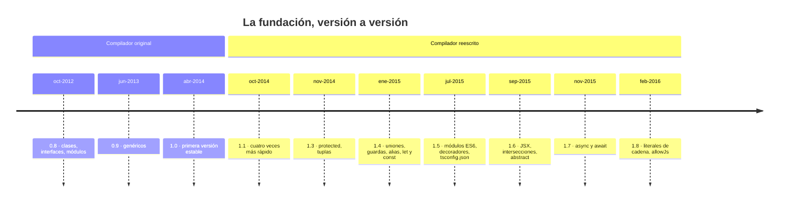

<div align="center">

# 02 · Orígenes y TypeScript 1: la fundación

**De la 0.8 a la 1.8: tipos opcionales sobre JavaScript, genéricos, uniones, módulos ES6, decoradores y JSX (2012–2016)**

[⬅ 01 · Modelo de versiones](01-modelo-de-versiones.md) · [🏠 Índice](../README.md) · [03 · TypeScript 2.0–2.2 ➡](03-typescript-2.0-2.2-nulos-y-flujo.md)

</div>

<!-- ts=1.8 -->

| Ficha | TypeScript 0.8 – 1.8 |
|---|---|
| **Publicación** | Del 1 de octubre de 2012 (0.8) al 22 de febrero de 2016 (1.8) |
| **Versiones** | 0.8 · 0.9 · 1.0 · 1.1 · 1.3 · 1.4 · 1.5 · 1.6 · 1.7 · 1.8 |
| **Motor** | Compilador original (0.8–1.0) y, desde la 1.1, el reescrito, base de todo lo que vino hasta la 6.0 |
| **Destino por defecto** | `es3` |
| **Compiladores de este capítulo** | `0.8.3`, `0.9.7`, `1.0.1`, `1.3.0`, `1.4.1`, `1.5.3`, `1.6.2`, `1.7.5` y `1.8.10`, descargados de npm |
| **Clase de cambio** | Sobre todo **sintaxis de ECMAScript adelantada** y los cimientos del sistema de tipos |

> [!IMPORTANT]
> Todo lo que aparece en este capítulo **sigue compilando hoy**, catorce años después, con TypeScript 7.0, salvo dos fósiles que se señalan: el tipo
> `bool` y la palabra clave `module` para módulos internos. Los ejemplos se compilaron con el compilador de su época y, además, con las versiones 5.9, 6.0 y 7.0.

---

## Contenido

1. [El problema de 2012](#1-el-problema-de-2012)
2. [TypeScript 0.8: el punto de partida](#2-typescript-08-el-punto-de-partida)
3. [TypeScript 0.9: genéricos](#3-typescript-09-genéricos)
4. [TypeScript 1.0 y 1.1: estabilidad y un compilador nuevo](#4-typescript-10-y-11-estabilidad-y-un-compilador-nuevo)
5. [TypeScript 1.3 y 1.4: uniones y guardas de tipo](#5-typescript-13-y-14-uniones-y-guardas-de-tipo)
6. [TypeScript 1.5: ES6, decoradores y `tsconfig.json`](#6-typescript-15-es6-decoradores-y-tsconfigjson)
7. [TypeScript 1.6: JSX, intersecciones y clases abstractas](#7-typescript-16-jsx-intersecciones-y-clases-abstractas)
8. [TypeScript 1.7: `async`/`await` y `this` polimórfico](#8-typescript-17-asyncawait-y-this-polimórfico)
9. [TypeScript 1.8: tipos literales y aumento de módulos](#9-typescript-18-tipos-literales-y-aumento-de-módulos)
10. [Lo que esta era dejó sin resolver](#10-lo-que-esta-era-dejó-sin-resolver)
11. [Fósiles y notas de migración](#11-fósiles-y-notas-de-migración)
12. [Referencias](#12-referencias)

---

## 1. El problema de 2012

En 2012, JavaScript había dejado de ser un lenguaje para validar formularios. Equipos enteros escribían con él aplicaciones de cientos de miles de
líneas, y el lenguaje —todavía ES5— no tenía clases, ni módulos, ni forma alguna de saber qué recibía una función sin leerla entera.

Microsoft presentó **TypeScript 0.8 el 1 de octubre de 2012**. Su arquitecto principal era Anders Hejlsberg, autor de Turbo Pascal y diseñador de
Delphi y de C#. La apuesta, que entonces resultaba extraña, tenía tres partes:

| Decisión | Qué significa | Alternativa descartada |
|---|---|---|
| **Superconjunto de JavaScript** | Todo programa JavaScript es ya un programa TypeScript | Un lenguaje nuevo que compila a JavaScript (CoffeeScript, Dart) |
| **Tipos opcionales y borrables** | Los tipos desaparecen al compilar; no hay coste en ejecución | Comprobaciones de tipos en tiempo de ejecución |
| **Tipado estructural** | Dos tipos son compatibles si tienen la misma forma | Tipado nominal, como en Java o C# |

Las tres siguen intactas. Los [objetivos de diseño](https://github.com/microsoft/TypeScript/wiki/TypeScript-Design-Goals) del proyecto las recogen, y
son igual de reveladores los **no objetivos**:

| Objetivos | No objetivos |
|---|---|
| Detectar de forma estática las construcciones que probablemente son errores | Imitar el diseño de lenguajes existentes |
| No imponer **ningún coste en ejecución** al programa emitido | Optimizar el rendimiento en ejecución de los programas |
| Emitir JavaScript limpio, idiomático y reconocible | **Aplicar un sistema de tipos sólido o «demostrablemente correcto»** |
| Alinearse con las propuestas actuales y futuras de ECMAScript | Añadir información de tipos en ejecución, o emitir código distinto según los tipos |
| Usar un sistema de tipos coherente, estructural y **totalmente borrable** | Aportar funcionalidad o bibliotecas en ejecución |

> [!NOTE]
> La tercera fila de la derecha explica muchas rarezas que verás en este atlas. TypeScript **no pretende ser sólido**: prefiere que el código
> habitual de JavaScript compile a rechazar todo lo que no puede demostrar. Los agujeros concretos están en [14 § Solidez](14-sistema-de-tipos-a-fondo.md#10-los-agujeros-deliberados-de-solidez).



---

## 2. TypeScript 0.8: el punto de partida

Este programa lo compila el binario original de 2012. Tiene ya los cuatro pilares de la primera versión: anotaciones, interfaces, clases y funciones flecha.

```ts ts=0.8 script run
interface Saludable {
    saludar(): string;
}

class Animal implements Saludable {
    constructor(public nombre: string) { }
    saludar(): string { return "Soy " + this.nombre; }
}

class Perro extends Animal {
    saludar(): string { return super.saludar() + " y ladro"; }
}

var mascotas: Animal[] = [new Animal("Mishi"), new Perro("Rex")];
var frases = mascotas.map((m) => m.saludar());
console.log(frases.join(" | "));   // → Soy Mishi | Soy Rex y ladro
```

Las clases no existían en JavaScript: llegarían con ES2015, tres años después. TypeScript las compilaba a funciones constructoras y prototipos, con un
auxiliar `__extends` para la herencia. Esto es lo que emite para `Perro` con destino ES5 (forma abreviada):

```js
var Perro = (function (_super) {
    __extends(Perro, _super);
    function Perro() {
        _super.apply(this, arguments);
    }
    Perro.prototype.saludar = function () {
        return _super.prototype.saludar.call(this) + " y ladro";
    };
    return Perro;
})(Animal);
```

### Tipado estructural

La compatibilidad se decide por la **forma**. `mascota` nunca declaró que implementara `ConNombre`, y aun así sirve:

```ts ts=0.8 script run
interface ConNombre { nombre: string; }

function presentar(alguien: ConNombre): string {
    return "Hola, " + alguien.nombre;
}

var mascota = { nombre: "Rex", patas: 4 };
console.log(presentar(mascota));   // → Hola, Rex
```

### Qué había ya en la 0.8

| Característica | Ejemplo | Hoy |
|---|---|---|
| Anotaciones de tipo | `var edad: number = 30;` | Igual |
| Interfaces | `interface Punto { x: number }` | Igual |
| Clases y herencia | `class B extends A { }` | Sintaxis de ES2015 |
| Propiedades de parámetro | `constructor(public x: number)` | Igual, pero **no es sintaxis borrable** |
| Funciones flecha | `(x) => x * 2` | Sintaxis de ES2015 |
| Módulos internos | `module Geometria { }` | Se escribe `namespace`; `module` es un error desde la 6.0 |
| Módulos externos | `import m = require("m")` | Se prefieren los módulos ES |
| Archivos de declaración | `declare var $: any;` | Igual |
| Enums | `enum Color { Rojo }` | Igual; se anunciaron con la 0.9, pero la 0.8.3 ya los compila |

---

## 3. TypeScript 0.9: genéricos

### El problema

Sin genéricos, una función que devuelve lo mismo que recibe solo podía tiparse con `any`, y el tipo se perdía por el camino.

```ts ts=0.8 script
function identidad(valor: any): any { return valor; }
var texto = identidad("hola");   // texto es any: el compilador ya no sabe que es una cadena
var largo: number = texto.inexistente;   // compila, y falla en ejecución
```

### La solución

```ts ts=0.9 script run debut
function identidad<T>(valor: T): T { return valor; }

interface Pila<T> {
    apilar(elemento: T): void;
    cima(): T;
}

class PilaDeArreglo<T> implements Pila<T> {
    private elementos: T[] = [];
    apilar(elemento: T): void { this.elementos.push(elemento); }
    cima(): T { return this.elementos[this.elementos.length - 1]; }
}

var pila = new PilaDeArreglo<string>();
pila.apilar(identidad("genéricos"));
console.log(pila.cima().toUpperCase());   // → GENÉRICOS
```

Los genéricos de TypeScript son **solo tipos**: se borran. No hay especialización en ejecución como en C#, ni un equivalente a `typeof(T)`: `T` no existe
cuando el programa corre.

### Lo demás de la 0.9

| Característica | Qué aporta |
|---|---|
| Compilador nuevo | La 0.9 reescribió el compilador para dar cabida a los genéricos |
| `bool` → `boolean` | El tipo se renombra para coincidir con la propuesta de ECMAScript |
| Fusión de declaraciones | Una función o una clase se combina con un módulo interno del mismo nombre |
| `export =` | Una única exportación, compatible con CommonJS y AMD |
| `typeof` como tipo | `var copia: typeof original` |
| Sobrecarga por constantes | `crear(tipo: "cuadrado"): Cuadrado`, el germen de los tipos literales de la 1.8 |
| `--noImplicitAny` (0.9.1) | El primer interruptor de estrictez |

`--noImplicitAny` merece una pausa: es el primer paso de una escalera que termina, catorce años después, con `strict` activado por defecto en la 6.0.

```ts ts=0.9 script opts=noImplicitAny err=TS7006
function duplicar(n) { return n * 2; }   // error TS7006: el parámetro 'n' tiene implícitamente el tipo 'any'
```

---

## 4. TypeScript 1.0 y 1.1: estabilidad y un compilador nuevo

**TypeScript 1.0** se publicó el 2 de abril de 2014. No añadió sintaxis: fijó la especificación y marcó el momento en que el proyecto empezó a aceptar
contribuciones externas. Ese mismo año el desarrollo se trasladó a GitHub.

**TypeScript 1.1** (octubre de 2014) fue un cambio invisible y enorme: un **compilador reescrito desde cero**, que según sus notas era «unas cuatro
veces más rápido». Esa base de código es la que evolucionó sin interrupción hasta TypeScript 6.0. Cuando en 2025 el equipo decidió portarlo a Go, a la
implementación en TypeScript se la empezó a llamar por su viejo nombre en clave, **Strada**, y a la nueva, **Corsa**.

| | Compilador original | Strada (1.1 – 6.0) | Corsa (7.0+) |
|---|---|---|---|
| **Escrito en** | TypeScript | TypeScript | Go |
| **Vigencia** | 2012 – 2014 | 2014 – 2026 | 2026 – |
| **Cómo se usa desde código** | Solo línea de comandos | API de JavaScript (`require("typescript")`) | Binario nativo; API estable con la 7.1 |
| **En este atlas** | Se invoca `tsc.js` | Se carga en proceso | Se invoca el binario |

---

## 5. TypeScript 1.3 y 1.4: uniones y guardas de tipo

La 1.3 añadió `protected` y los **tipos tupla**. La 1.4, las **uniones**: por fin se podía describir una función de JavaScript que acepta
«una cadena o un arreglo» sin recurrir a `any`.

```ts ts=1.4 script run debut
type Entrada = string | string[];

function contarPalabras(entrada: Entrada): number {
    if (typeof entrada === "string") {
        return entrada.split(" ").length;      // aquí `entrada` es string
    } else {
        return entrada.length;                 // y aquí, string[]
    }
}

var par: [string, number] = ["palabras", contarPalabras("una dos tres")];
console.log(par[0] + ": " + par[1]);                    // → palabras: 3
console.log(contarPalabras(["una", "dos"]));            // → 2
```

El `if` de arriba es una **guarda de tipo**: dentro de cada rama, el compilador estrecha la unión. En la 1.4 ese estrechamiento solo valía *dentro del
bloque* de la guarda. El análisis de flujo completo no llegó hasta la 2.0, y la diferencia se puede medir: la función siguiente falla con la 1.4 y
compila con la 2.0.

```ts ts=2.0 debut
function longitud(entrada: string | number): number {
    if (typeof entrada === "number") { return entrada; }
    return entrada.length;   // 1.4 – 1.8: error, `entrada` sigue siendo string | number
}
```

| Versión | Característica | Ejemplo |
|---|---|---|
| 1.3 | `protected` | `protected saldo: number` |
| 1.3 | Tuplas | `[string, number]` |
| 1.4 | Uniones | `string \| number` |
| 1.4 | Guardas de tipo | `typeof x === "string"`, `x instanceof Fecha` |
| 1.4 | Alias de tipo | `type Id = string \| number` |
| 1.4 | `let` y `const` | Solo con destino ES6; para ES5, desde la 1.5 |
| 1.4 | Plantillas de cadena | `` `Hola, ${nombre}` `` |
| 1.4 | `const enum` | Se sustituye por sus valores al compilar |

---

## 6. TypeScript 1.5: ES6, decoradores y `tsconfig.json`

La 1.5 (20 de julio de 2015) es la versión más grande de la era. ECMAScript 2015 se había aprobado un mes antes, y TypeScript llegó con casi todo.

### Módulos ES6 y `namespace`

Hasta entonces, «módulo» significaba dos cosas distintas en TypeScript. La 1.5 adoptó la sintaxis estándar y rebautizó los módulos internos:

| Antes | Desde la 1.5 | Hoy |
|---|---|---|
| `module Geometria { }` (interno) | `namespace Geometria { }` | `namespace`, o mejor un módulo ES |
| `import m = require("m")` (externo) | `import { f } from "m"` | Módulos ES |

```ts ts=1.5 run debut
// @filename: geometria.ts
export function area(radio: number): number { return Math.PI * radio * radio; }
export default function perimetro(radio: number): number { return 2 * Math.PI * radio; }

// @filename: principal.ts
import perimetro, { area } from "./geometria";

var { ancho, alto } = { ancho: 3, alto: 4 };          // desestructuración
var medidas = [area(1), perimetro(1), ...[ancho, alto]];   // propagación

for (var medida of medidas) {
    console.log(medida.toFixed(2));
    // → 3.14
    // → 6.28
    // → 3.00
    // → 4.00
}
```

### Decoradores

En marzo de 2015 los equipos de Angular y TypeScript anunciaron que Angular 2 se escribiría en TypeScript. Angular traía su propio dialecto, AtScript,
con anotaciones; el acuerdo fue llevarlas a TypeScript como **decoradores**, siguiendo una propuesta de ECMAScript que entonces daba sus primeros pasos.

```ts ts=1.5 run opts=experimentalDecorators
function registrar(destino: any, clave: string, descriptor: PropertyDescriptor): PropertyDescriptor {
    var original = descriptor.value;
    descriptor.value = function () {
        console.log("llamando a " + clave);
        return original.apply(this, arguments);
    };
    return descriptor;
}

class Calculadora {
    @registrar
    sumar(a: number, b: number): number { return a + b; }
}

console.log(new Calculadora().sumar(2, 3));
// → llamando a sumar
// → 5
```

> [!WARNING]
> Esos decoradores son los de **2015**. La propuesta de ECMAScript cambió por completo después, y TypeScript 5.0 implementó la versión nueva sin retirar
> la antigua. Hoy conviven dos sistemas incompatibles: [09 § Decoradores estándar](09-typescript-5.0-5.4-decoradores-y-using.md#2-decoradores-estándar)
> y [19 § La saga de los decoradores](19-typescript-y-ecmascript.md#5-la-saga-de-los-decoradores).

### `tsconfig.json`

Antes de la 1.5, un proyecto era una línea de comandos larguísima o una configuración de Visual Studio. `tsconfig.json` convirtió el proyecto en un
archivo que cualquier editor podía leer:

```json
{
  "compilerOptions": {
    "target": "es5",
    "module": "commonjs",
    "noImplicitAny": true,
    "experimentalDecorators": true
  },
  "files": ["principal.ts"]
}
```

Ese archivo de 2015 ya no sirve tal cual: `target: es5` quedó obsoleto en la 6.0. La versión de 2026 está en [17 · `tsconfig` de referencia](17-tsconfig-de-referencia.md).

---

## 7. TypeScript 1.6: JSX, intersecciones y clases abstractas

### JSX

React había popularizado JSX, y TypeScript 1.6 lo incorporó con archivos `.tsx` y una opción `--jsx`. De paso nació el operador `as`: la aserción
clásica `<Tipo>valor` es ambigua dentro de JSX.

```tsx ts=1.6 script
declare namespace JSX {
    interface Element { }
    interface IntrinsicElements {
        boton: { etiqueta: string; deshabilitado?: boolean };
    }
}

var correcto = <boton etiqueta="Enviar" />;
var entrada: any = "texto";
var largo: number = (entrada as string).length;
```

El compilador comprueba los atributos como comprobaría una llamada a función:

```tsx ts=1.6 script err=TS2322
declare namespace JSX {
    interface Element { }
    interface IntrinsicElements { boton: { etiqueta: string }; }
}
var mal = <boton etiqueta={42} />;   // error TS2322: 'number' no es asignable a 'string'
```

### Intersecciones, guardas propias y clases abstractas

```ts ts=1.6 run debut
interface ConId { id: number; }
interface ConFecha { creado: Date; }
type Entidad = ConId & ConFecha;                       // intersección: debe cumplir ambos

abstract class Figura {
    abstract area(): number;                           // la derivada está obligada a implementarlo
    describir(): string { return "área " + this.area().toFixed(1); }
}
class Circulo extends Figura {
    constructor(private radio: number) { super(); }
    area(): number { return Math.PI * this.radio * this.radio; }
}

function esCirculo(f: Figura): f is Circulo {          // guarda de tipo definida por el usuario
    return f instanceof Circulo;
}

var figura: Figura = new Circulo(1);
if (esCirculo(figura)) {
    console.log(figura.describir());                   // → área 3.1
}
```

### Comprobación de propiedades sobrantes

Un cambio pequeño que atrapó muchísimos errores de tecleo. Desde la 1.6, un **literal de objeto** no puede traer propiedades que su tipo de destino no conoce:

```ts ts=1.6 debut err=TS2322/TS2353/TS2561
interface Opciones { color?: string; ancho?: number; }
var opciones: Opciones = { colour: "rojo" };   // error: 'colour' no existe en 'Opciones'
```

La regla solo afecta a los literales «frescos». Si el objeto pasa antes por una variable, vuelve a mandar el tipado estructural:

```ts ts=1.6
interface Opciones { color?: string; ancho?: number; }
var intermedio = { color: "rojo", extra: true };
var opciones: Opciones = intermedio;   // correcto: `intermedio` tiene, como mínimo, la forma pedida
```

---

## 8. TypeScript 1.7: `async`/`await` y `this` polimórfico

`async`/`await` llegó a TypeScript dos años antes de entrar en el estándar (ES2017). En la 1.7 exigía destino ES6, porque se apoyaba en los generadores;
la versión para ES5 tuvo que esperar a la 2.1.

```ts ts=1.7 run debut
function esperar(ms: number): Promise<number> {
    return new Promise<number>((resolver) => { setTimeout(() => resolver(ms), ms); });
}

async function secuencia(): Promise<number> {
    var a = await esperar(5);
    var b = await esperar(10);
    return a + b;
}

secuencia().then((total) => console.log("esperados " + total + " ms"));   // → esperados 15 ms
```

### `this` como tipo

Las API fluidas se rompían al heredar: un método que devolvía `Calculadora` hacía perder los métodos de la clase derivada. El tipo `this` resuelve el problema:

```ts ts=1.7 run debut
class Calculadora {
    constructor(protected valor = 0) { }
    sumar(n: number): this { this.valor += n; return this; }
    resultado(): number { return this.valor; }
}

class Cientifica extends Calculadora {
    potencia(exponente: number): this { this.valor = this.valor ** exponente; return this; }
}

console.log(new Cientifica(2).sumar(1).potencia(2).sumar(1).resultado());   // → 10
```

`sumar` devuelve `this`, así que tras llamarlo sobre una `Cientifica` se puede seguir con `potencia`. El `**` del ejemplo también debutó en la 1.7.

---

## 9. TypeScript 1.8: tipos literales y aumento de módulos

### Tipos literales de cadena

La sobrecarga por constantes de la 0.9 se generaliza: una cadena concreta pasa a ser un tipo, y una unión de ellas, un conjunto cerrado de opciones.

```ts ts=1.8 run debut
type Alineacion = "izquierda" | "centro" | "derecha";

function alinear(texto: string, ancho: number, donde: Alineacion): string {
    var espacio = ancho - texto.length;
    if (donde === "izquierda") { return texto + Array(espacio + 1).join("."); }
    if (donde === "derecha") { return Array(espacio + 1).join(".") + texto; }
    var mitad = Math.floor(espacio / 2);
    return Array(mitad + 1).join(".") + texto + Array(espacio - mitad + 1).join(".");
}

console.log(alinear("ts", 6, "centro"));   // → ..ts..
```

```ts ts=1.8 err=TS2345
type Alineacion = "izquierda" | "centro" | "derecha";
declare function alinear(texto: string, donde: Alineacion): string;
alinear("ts", "arriba");   // error TS2345: '"arriba"' no es asignable a 'Alineacion'
```

Es la primera piedra de las uniones discriminadas de la 2.0 y, mucho después, de los tipos de plantilla literal de la 4.1.

### Lo demás de la 1.8

| Característica | Qué resuelve |
|---|---|
| Parámetros de tipo como restricciones | `function asignar<T extends U, U>(…)`: un genérico acotado por otro |
| Errores de flujo de control | Código inalcanzable, `--noImplicitReturns`, `--noFallthroughCasesInSwitch` |
| Aumento de módulos | `declare module "./mascota" { … }` añade miembros a tipos de otro archivo |
| `declare global` | Ampliar tipos globales desde dentro de un módulo |
| `--allowJs` | Mezclar archivos `.js` en el proyecto: la puerta de entrada a la migración gradual |
| Guardas basadas en `this` | `esHoja(): this is Hoja` |
| `let` y `const` en bucles para ES5 | Cada iteración conserva su propio valor al capturarlo |

`noImplicitReturns` detecta una función que a veces devuelve algo y a veces nada:

```ts ts=1.8 debut opts=noImplicitReturns err=TS7030
function signo(n: number) {
    if (n > 0) { return 1; }
    if (n < 0) { return -1; }
}   // error TS7030: no todas las rutas de código devuelven un valor
```

---

## 10. Lo que esta era dejó sin resolver

Al terminar 2015, TypeScript ya describía bien la *forma* de los datos. Le faltaba lo más difícil: describir la **ausencia** de datos.

```ts ts=1.8 hasta=1.8
function buscar(nombres: string[], inicial: string): string {
    for (var i = 0; i < nombres.length; i++) {
        if (nombres[i].charAt(0) === inicial) { return nombres[i]; }
    }
    return null;      // con la 1.8 compila: null pertenece a todos los tipos
}

var largo: number = buscar(["Ana", "Luis"], "Z").length;   // TypeError en ejecución
```

Ese bloque compila con TypeScript 1.8 y revienta al ejecutarse. Con la 2.0 y `strictNullChecks`, el compilador rechaza el `return null`. Las carencias
de la era, y la versión que resolvió cada una:

| Carencia en la 1.8 | Consecuencia | Se resuelve en |
|---|---|---|
| `null` y `undefined` pertenecen a todos los tipos | El error más común de JavaScript era invisible | **2.0** · `strictNullChecks` |
| Las guardas solo valen dentro de su bloque | Había que anidar `if` o usar aserciones | **2.0** · análisis de flujo |
| No se puede transformar un tipo en otro | `Partial<T>` o `Readonly<T>` se escribían a mano, una y otra vez | **2.1** · tipos mapeados |
| No hay tipo «cualquier cosa» seguro | Solo `any`, que desactiva todo | **3.0** · `unknown` |
| Un proyecto es un único bloque | Cada cambio recompila todo | **3.0** · referencias de proyecto |

---

## 11. Fósiles y notas de migración

| Fósil | Vigencia | Qué ocurre hoy | Sustituto |
|---|---|---|---|
| Tipo `bool` | Solo 0.8 | `TS2095: Could not find symbol 'bool'` ya en la 0.9 | `boolean` |
| `module X { }` para módulos internos | 0.8 – 5.9 | `TS1540` desde la 6.0 | `namespace X { }` |
| `/// <reference path="…" />` | 0.8 – hoy | Sigue funcionando; innecesario con módulos | `import` |
| `import x = require("x")` | 0.8 – hoy | Vigente con `module: commonjs` o `nodenext`; prohibido con `erasableSyntaxOnly` | `import x from "x"` |
| `--module amd`, `umd`, `system` | 0.8 / 1.5 – 6.0 | Obsoletos en la 6.0, retirados en la 7.0 | Módulos ES y un empaquetador |
| `--out` | 0.8 – 5.5 | Obsoleta en la 5.0, retirada en la 5.6 | `outFile`, también retirada en la 7.0 |
| `--experimentalAsyncFunctions` | Solo 1.6 | La opción desaparece en la 1.7 | `async` sin opción |
| Decoradores de 2015 | 1.5 – hoy | Vigentes con `experimentalDecorators` | Decoradores estándar (5.0), si tu *framework* los admite |

Los dos primeros se pueden comprobar. El compilador 0.8.3 acepta `bool`; el 0.9.7 ya no:

```ts ts=0.8 script hasta=0.8
var activo: bool = true;
```

```ts ts=0.8 script hasta=5.9 luego=TS1540
module Geometria {
    export var PI = 3.14;
}
```

> [!TIP]
> Si mantienes código de esta época, el orden de migración que menos duele es: `module` → `namespace` (automático), después `noImplicitAny`, y solo
> entonces `strictNullChecks`. El método completo está en [23 · Migración](23-migracion-y-ciclo-de-vida.md).

---

## 12. Referencias

- Notas oficiales: [1.1](https://www.typescriptlang.org/docs/handbook/release-notes/typescript-1-1.html) · [1.3](https://www.typescriptlang.org/docs/handbook/release-notes/typescript-1-3.html) · [1.4](https://www.typescriptlang.org/docs/handbook/release-notes/typescript-1-4.html) · [1.5](https://www.typescriptlang.org/docs/handbook/release-notes/typescript-1-5.html) · [1.6](https://www.typescriptlang.org/docs/handbook/release-notes/typescript-1-6.html) · [1.7](https://www.typescriptlang.org/docs/handbook/release-notes/typescript-1-7.html) · [1.8](https://www.typescriptlang.org/docs/handbook/release-notes/typescript-1-8.html)
- [Objetivos de diseño de TypeScript](https://github.com/microsoft/TypeScript/wiki/TypeScript-Design-Goals)
- [Decoradores experimentales](https://www.typescriptlang.org/docs/handbook/decorators.html) · [JSX](https://www.typescriptlang.org/docs/handbook/jsx.html) · [Espacios de nombres](https://www.typescriptlang.org/docs/handbook/namespaces.html)
- Pruebas de debut de esta era: [25 · TypeScript 0.8 a 1.8](25-pruebas-de-debut.md#typescript-08)
