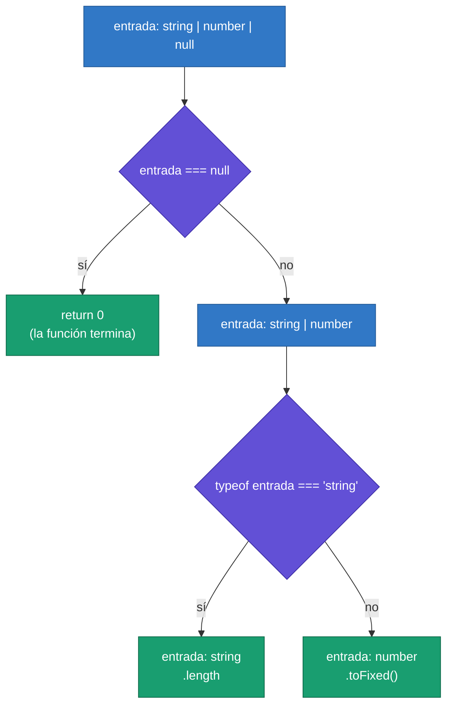
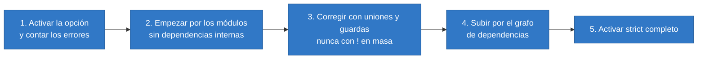

<div align="center">

# 03 · TypeScript 2.0–2.2: nulos, flujo de control y tipos mapeados

**`strictNullChecks`, análisis de flujo, uniones discriminadas, `never`, `keyof`, tipos mapeados y mixins (2016–2017)**

[⬅ 02 · Orígenes y TypeScript 1](02-origenes-y-typescript-1.md) · [🏠 Índice](../README.md) · [04 · TypeScript 2.3–2.9 ➡](04-typescript-2.3-2.9-estricto-y-condicionales.md)

</div>

<!-- ts=2.0 -->

| Ficha | TypeScript 2.0 | TypeScript 2.1 | TypeScript 2.2 |
|---|---|---|---|
| **Publicación** | 22 de septiembre de 2016 | 7 de diciembre de 2016 | 22 de febrero de 2017 |
| **Tema** | `null` bajo control | Tipos que se derivan de otros | Mixins y `object` |
| **Compilador de este capítulo** | `2.0.10` | `2.1.6` | `2.2.2` |
| **Clase de cambio** | Solo tipos y opciones | Solo tipos, y sintaxis ES2017/ES2018 | Solo tipos |

> [!IMPORTANT]
> **TypeScript 2.0 es la versión más importante de su historia.** Antes de ella, el compilador describía la forma de los datos, pero no su ausencia:
> `null` cabía en cualquier tipo. Con `strictNullChecks` y el análisis de flujo, el error más frecuente de JavaScript —*cannot read properties of
> undefined*— pasó a detectarse al compilar. Casi todo lo que el lenguaje ha añadido después se apoya en esas dos piezas.

---

## Contenido

1. [El error de los mil millones de dólares](#1-el-error-de-los-mil-millones-de-dólares)
2. [`strictNullChecks`](#2-strictnullchecks)
3. [Análisis de flujo de control](#3-análisis-de-flujo-de-control)
4. [Uniones discriminadas y `never`](#4-uniones-discriminadas-y-never)
5. [`readonly` y el tipo de `this`](#5-readonly-y-el-tipo-de-this)
6. [La infraestructura de la 2.0: `@types`, `lib` y `paths`](#6-la-infraestructura-de-la-20-types-lib-y-paths)
7. [TypeScript 2.1: `keyof` y tipos mapeados](#7-typescript-21-keyof-y-tipos-mapeados)
8. [TypeScript 2.1: propagación de objetos y `async` para ES5](#8-typescript-21-propagación-de-objetos-y-async-para-es5)
9. [TypeScript 2.2: mixins y `object`](#9-typescript-22-mixins-y-object)
10. [Notas de migración](#10-notas-de-migración)
11. [Referencias](#11-referencias)

---

## 1. El error de los mil millones de dólares

Tony Hoare llamó así a su invención de la referencia nula. En TypeScript 1.x, el problema tenía esta forma:

```ts ts=1.8 hasta=1.8
function inicial(nombre: string): string {
    return nombre.charAt(0);
}

var usuario: string = null;       // la 1.8 lo acepta: null cabe en string
inicial(usuario);                 // TypeError en ejecución
```

El compilador 1.8.10 no ve nada raro. El 2.0, con `strictNullChecks`, rechaza la segunda línea:

```ts err=TS2322
var usuario: string = null;       // error TS2322: 'null' no es asignable a 'string'
```

La solución no fue añadir un tipo `Opcional<T>`, como en otros lenguajes, sino algo más natural para JavaScript: `null` y `undefined` pasan a ser
**tipos corrientes**, y la posibilidad de ausencia se escribe con una unión.

---

## 2. `strictNullChecks`

```ts run debut
function inicial(nombre: string | null): string {
    if (nombre === null) {
        return "?";
    }
    return nombre.charAt(0);          // aquí `nombre` es string
}

console.log(inicial("Ana"));          // → A
console.log(inicial(null));           // → ?
```

### Las reglas

| Regla | Ejemplo | Consecuencia |
|---|---|---|
| `null` y `undefined` son tipos | `let x: string \| null` | La ausencia se declara |
| Un parámetro opcional añade `undefined` | `f(x?: number)` → `number \| undefined` | Hay que comprobarlo antes de usarlo |
| Una propiedad opcional añade `undefined` | `{ apodo?: string }` | Igual |
| No se usa una variable antes de asignarla | `let x: number; x + 1` | Error TS2454 |
| `x!` afirma que no es nulo | `mapa.get(k)!` | **Sin comprobación en ejecución** |

```ts err=TS2454
let total: number;
console.log(total + 1);   // error TS2454: la variable 'total' se usa antes de asignarla
```

### El operador `!` es una promesa, no una comprobación

```ts run
function largoSeguro(texto: string | undefined): number {
    return texto === undefined ? 0 : texto.length;
}

function largoOptimista(texto: string | undefined): number {
    return texto!.length;             // compila; si texto es undefined, falla en ejecución
}

console.log(largoSeguro(undefined));  // → 0
try {
    largoOptimista(undefined);
} catch (e) {
    console.log("TypeError");         // → TypeError
}
```

> [!WARNING]
> `x!` se borra al compilar. No lanza una excepción clara ni registra nada: solo calla al compilador. Cada `!` es un punto donde el sistema de tipos
> deja de protegerte. Úsalo cuando sepas algo que el compilador no puede saber, y nunca para «hacer que compile».

### Qué cambia al activarla

| Sin `strictNullChecks` | Con `strictNullChecks` |
|---|---|
| `null` y `undefined` pertenecen a todos los tipos | Solo a `null`, `undefined`, `unknown` y `any` |
| `string` significa «texto o nada» | `string` significa texto |
| `arr.find(...)` devuelve `T` | Devuelve `T \| undefined` |
| El compilador no ve el 90 % de los fallos por nulos | Los ve casi todos |

Los límites que quedan —el acceso por índice a un arreglo, por ejemplo— no se cerraron hasta `noUncheckedIndexedAccess`, en la
[4.1](07-typescript-4.0-4.4-tuplas-variadicas-y-plantillas.md#5-nouncheckedindexedaccess).

---

## 3. Análisis de flujo de control

`strictNullChecks` sería insoportable sin la otra mitad de la 2.0. Hasta la 1.8, una guarda solo estrechaba el tipo dentro de su bloque; desde la 2.0,
el compilador **sigue el programa**: cada `return`, `throw`, asignación o comparación cambia lo que sabe de una variable.



```ts run debut
function medir(entrada: string | number | null): number {
    if (entrada === null) {
        return 0;
    }
    // Aquí ya no puede ser null: la rama anterior terminó con return
    if (typeof entrada === "string") {
        return entrada.length;
    }
    return Math.round(entrada);
}

console.log(medir(null), medir("cuatro"), medir(3.7));   // → 0 6 4
```

El análisis también sigue las **asignaciones**: el tipo de una variable en un punto es el de lo último que se le asignó.

```ts run
let valor: string | number;

valor = "texto";
console.log(valor.toUpperCase());     // → TEXTO
//          ^? let valor: string

valor = 42;
console.log(valor.toFixed(1));        // → 42.0
//          ^? let valor: number
```

### La escalera del estrechamiento

Cada versión posterior ha enseñado al análisis de flujo a entender una construcción más. Es el hilo más largo del lenguaje
([13 § Estrechamiento](13-hilos-evolutivos.md#3-estrechamiento)).

| Versión | Lo que el compilador aprende a seguir |
|---|---|
| 1.4 | `typeof` e `instanceof`, dentro del bloque |
| 1.6 | Guardas definidas por el usuario: `x is T` |
| **2.0** | **Todo el flujo: `return`, `throw`, asignaciones, `null`** y uniones discriminadas |
| 2.7 | El operador `in` |
| 3.7 | Funciones de aserción y funciones que devuelven `never` |
| 4.4 | Condiciones guardadas en una constante |
| 4.6 | Uniones discriminadas desestructuradas |
| 4.9 | `in` sobre propiedades que el tipo no declara |
| 5.3 | `switch (true)` |
| 5.4 | Clausuras creadas después de la última asignación |
| 5.5 | Predicados de tipo **inferidos**: `filter` por fin estrecha |

### El límite: las funciones capturadas

El compilador no puede saber cuándo se ejecutará una función anidada, así que dentro de ella descarta lo que había estrechado fuera (salvo que la
variable sea `const`).

```ts err=TS2531/TS18047
function temporizar(mensaje: string | null): void {
    if (mensaje !== null) {
        mensaje = Math.random() > 0.5 ? mensaje : null;   // se reasigna más abajo: la variable no es estable
        setTimeout(() => {
            console.log(mensaje.length);   // error: 'mensaje' posiblemente es null
        }, 0);
    }
}
```

La regla se relajó en la [5.4](09-typescript-5.0-5.4-decoradores-y-using.md#9-typescript-54-estrechamiento-en-clausuras-y-noinfer) para el caso más habitual.

---

## 4. Uniones discriminadas y `never`

Combinando tipos literales (1.8), uniones (1.4) y análisis de flujo (2.0) aparece el patrón más importante de TypeScript: la **unión discriminada**.
Cada variante lleva una propiedad literal —el discriminante— que el compilador usa para saber cuál es.

```ts run debut
interface Cuadrado { tipo: "cuadrado"; lado: number; }
interface Rectangulo { tipo: "rectangulo"; ancho: number; alto: number; }
interface Circulo { tipo: "circulo"; radio: number; }
type Figura = Cuadrado | Rectangulo | Circulo;

function area(figura: Figura): number {
    switch (figura.tipo) {
        case "cuadrado": return figura.lado * figura.lado;
        case "rectangulo": return figura.ancho * figura.alto;
        case "circulo": return Math.PI * figura.radio * figura.radio;
    }
}

const figuras: Figura[] = [
    { tipo: "cuadrado", lado: 2 },
    { tipo: "rectangulo", ancho: 2, alto: 3 },
    { tipo: "circulo", radio: 1 },
];
console.log(figuras.map((f) => area(f).toFixed(2)).join(" "));   // → 4.00 6.00 3.14
```

### `never`: el tipo sin valores

`never` es el tipo de lo que no puede ocurrir: una función que siempre lanza, o una variable en una rama a la que es imposible llegar. Eso permite
pedirle al compilador que **demuestre que un `switch` es exhaustivo**:

```ts run
type Evento = { tipo: "alta"; nombre: string } | { tipo: "baja"; nombre: string; motivo: string };

function nunca(valor: never): never {
    throw new Error("Caso sin tratar: " + JSON.stringify(valor));
}

function describir(evento: Evento): string {
    switch (evento.tipo) {
        case "alta": return "+ " + evento.nombre;
        case "baja": return "- " + evento.nombre + " (" + evento.motivo + ")";
        default: return nunca(evento);     // si falta un caso, esto deja de compilar
    }
}

console.log(describir({ tipo: "alta", nombre: "Ana" }));                       // → + Ana
console.log(describir({ tipo: "baja", nombre: "Luis", motivo: "impago" }));    // → - Luis (impago)
```

Si mañana se añade una tercera variante y se olvida el `case`, el compilador lo señala en el `default`:

```ts err=TS2345
type Evento = { tipo: "alta" } | { tipo: "baja" } | { tipo: "pausa" };
declare function nunca(valor: never): never;

function describir(evento: Evento): string {
    switch (evento.tipo) {
        case "alta": return "+";
        case "baja": return "-";
        default: return nunca(evento);   // error TS2345: '{ tipo: "pausa" }' no es asignable a 'never'
    }
}
```

> [!TIP]
> La función `nunca` es el patrón estándar de exhaustividad. Vale la pena tenerla en cualquier proyecto: convierte «me olvidé de un caso» en un
> error de compilación en el sitio exacto. Desde la 4.9 hay una forma aún más corta: `evento satisfies never`.

---

## 5. `readonly` y el tipo de `this`

### `readonly`

```ts err=TS2540/TS2450
interface Punto {
    readonly x: number;
    readonly y: number;
}
const origen: Punto = { x: 0, y: 0 };
origen.x = 1;   // error TS2540: no se puede asignar a 'x' porque es de solo lectura
```

`readonly` es **superficial** y **solo de tipos**: no congela el objeto en ejecución, y un objeto anidado sigue siendo mutable.

```ts run
interface Configuracion {
    readonly servidor: { puerto: number };
}
const config: Configuracion = { servidor: { puerto: 80 } };
config.servidor.puerto = 8080;        // compila: `readonly` protege la referencia, no su contenido
console.log(config.servidor.puerto);  // → 8080
```

### `this` como parámetro

En JavaScript, `this` depende de cómo se llama a la función. La 2.0 permite declararlo como un pseudoparámetro, que se borra al compilar:

```ts run debut
interface Contador { cuenta: number; }

function incrementar(this: Contador, paso: number): number {
    this.cuenta += paso;
    return this.cuenta;
}

const contador: Contador = { cuenta: 10 };
console.log(incrementar.call(contador, 5));   // → 15
```

Con `noImplicitThis` (parte de `strict` desde la 2.3), usar `this` en una función que no lo declara es un error, en lugar de un `any` silencioso.

---

## 6. La infraestructura de la 2.0: `@types`, `lib` y `paths`

La 2.0 también cambió la forma de trabajar. Tres piezas siguen siendo la base de cualquier proyecto:

| Pieza | Antes de la 2.0 | Desde la 2.0 |
|---|---|---|
| **Tipos de bibliotecas** | Herramientas aparte: `tsd`, `typings` | `npm install @types/lodash`: paquetes npm generados desde DefinitelyTyped |
| **API del runtime** | Un `lib.d.ts` único según el destino | `--lib`: se elige por piezas (`es2015.promise`, `dom`…) |
| **Alias de importación** | Rutas relativas interminables | `paths`: `@app/*` → `src/app/*` |
| **Archivos del proyecto** | Lista explícita en `files` | `include` y `exclude` con comodines |

```json
{
  "compilerOptions": {
    "strictNullChecks": true,
    "lib": ["es2015", "dom"],
    "paths": { "@app/*": ["./src/app/*"] },
    "types": ["node"]
  },
  "include": ["src/**/*"]
}
```

> [!CAUTION]
> `paths` es un asunto **solo del compilador**: no reescribe las importaciones en el JavaScript emitido. Quien ejecute ese código (Node, un empaquetador)
> necesita su propia configuración de alias. La opción `baseUrl`, que nació junto a `paths`, quedó obsoleta en la 6.0:
> [11 § `baseUrl`](11-typescript-6.0-el-puente.md#5-lo-que-queda-obsoleto).

---

<!-- ts=2.1 -->

## 7. TypeScript 2.1: `keyof` y tipos mapeados

### El problema

Una función como `obtener(objeto, "propiedad")` era imposible de tipar: el nombre de la propiedad llegaba como una cadena cualquiera y el resultado
era `any`. Y cada variante de un tipo —todo opcional, todo de solo lectura— había que escribirla a mano y mantenerla sincronizada.

### `keyof` y el acceso indexado

`keyof T` es la unión de las claves de `T`. `T[K]` es el tipo de la propiedad `K`. Juntos conectan una cadena con la propiedad que nombra:

```ts run debut
interface Persona { nombre: string; edad: number; }

function obtener<T, K extends keyof T>(objeto: T, clave: K): T[K] {
    return objeto[clave];
}

const ana: Persona = { nombre: "Ana", edad: 30 };
const nombre = obtener(ana, "nombre");
//    ^? const nombre: string
const edad = obtener(ana, "edad");
//    ^? const edad: number
console.log(nombre, edad);   // → Ana 30
```

```ts err=TS2345
interface Persona { nombre: string; edad: number; }
declare function obtener<T, K extends keyof T>(objeto: T, clave: K): T[K];
declare const ana: Persona;
obtener(ana, "apellido");   // error TS2345: '"apellido"' no es asignable a '"nombre" | "edad"'
```

### Tipos mapeados

Un tipo mapeado recorre las claves de otro tipo y construye una propiedad nueva para cada una. Es un `for` a nivel de tipos:

```ts run debut
type Opcional<T> = { [K in keyof T]?: T[K] };
type SoloLectura<T> = { readonly [K in keyof T]: T[K] };
type Anulable<T> = { [K in keyof T]: T[K] | null };

interface Tarea { titulo: string; hecha: boolean; }

function actualizar(tarea: Tarea, cambios: Opcional<Tarea>): Tarea {
    return { ...tarea, ...cambios };
}

const tarea = actualizar({ titulo: "Escribir el atlas", hecha: false }, { hecha: true });
console.log(tarea.titulo, tarea.hecha);   // → Escribir el atlas true
```

La biblioteca estándar incorporó los cuatro más útiles. Sus definiciones caben en una línea cada una, y siguen siendo las mismas en TypeScript 7:

| Tipo utilitario | Definición | Uso típico |
|---|---|---|
| `Partial<T>` | `{ [K in keyof T]?: T[K] }` | Argumentos de actualización |
| `Readonly<T>` | `{ readonly [K in keyof T]: T[K] }` | Estado inmutable |
| `Pick<T, K>` | `{ [P in K]: T[P] }` | Un subconjunto de propiedades |
| `Record<K, V>` | `{ [P in K]: V }` | Diccionarios con claves conocidas |

```ts run
interface Producto { id: number; nombre: string; precio: number; }

const resumen: Pick<Producto, "id" | "nombre"> = { id: 1, nombre: "Teclado" };
const existencias: Record<"norte" | "sur", number> = { norte: 12, sur: 0 };
const borrador: Partial<Producto> = { nombre: "Ratón" };

console.log(Object.keys(resumen).length, existencias.norte, borrador.precio);   // → 2 12 undefined
```

> [!NOTE]
> Los tipos mapeados sobre `keyof T` son **homomórficos**: conservan los modificadores `readonly` y `?` de las propiedades originales. La capacidad de
> *quitarlos* (`-readonly`, `-?`) llegó en la 2.8, y la de renombrar claves, en la 4.1. La galería completa está en
> [15 · Programación a nivel de tipos](15-programacion-a-nivel-de-tipos.md).

---

## 8. TypeScript 2.1: propagación de objetos y `async` para ES5

### Propagación y resto de objetos

```ts run debut
const base = { host: "localhost", puerto: 80, seguro: false };
const produccion = { ...base, host: "atlas.dev", seguro: true };      // copia superficial con cambios
const { host, ...resto } = produccion;                                // todo menos `host`

console.log(host, resto.puerto, resto.seguro);   // → atlas.dev 80 true
```

La propagación de objetos no entró en ECMAScript hasta ES2018; TypeScript la compilaba con `Object.assign` o con un auxiliar `__assign`.

### `async`/`await` en cualquier destino

En la 1.7, `async` exigía destino ES6. La 2.1 lo llevó a ES5 y ES3 compilando cada función asíncrona a una **máquina de estados**. Estas dos funciones
hacen lo mismo; la segunda es, simplificada, lo que el compilador generaba a partir de la primera:

```ts run
function esperar(ms: number): Promise<void> {
    return new Promise<void>((resolver) => setTimeout(resolver, ms));
}

async function conAwait(): Promise<string> {
    await esperar(1);
    await esperar(1);
    return "listo";
}

function comoMaquinaDeEstados(): Promise<string> {
    let estado = 0;
    function paso(): Promise<string> {
        switch (estado++) {
            case 0: return esperar(1).then(paso);
            case 1: return esperar(1).then(paso);
            default: return Promise.resolve("listo");
        }
    }
    return paso();
}

Promise.all([conAwait(), comoMaquinaDeEstados()]).then((r) => console.log(r.join(" = ")));   // → listo = listo
```

Los auxiliares reales (`__awaiter`, `__generator`) se repetían en cada archivo. Por eso la misma versión introdujo `tslib` y la opción `importHelpers`,
que los importa de un paquete en lugar de duplicarlos.

### Otras mejoras de la 2.1

| Mejora | Ejemplo | Por qué importa |
|---|---|---|
| Literales inferidos en `const` | `const modo = "oscuro"` tiene el tipo `"oscuro"` | Las uniones discriminadas dejan de necesitar anotaciones |
| `any` por flujo de control | `let x;` toma el tipo de cada asignación | Menos `any` accidentales |
| Importaciones sin tipos | `import x from "sin-tipos"` es `any` | Se puede usar un paquete sin declaraciones |
| `extends` en `tsconfig.json` | `"extends": "./base.json"` | Configuración compartida |
| Destinos `ES2016`, `ES2017`, `ESNext` | `"target": "es2017"` | El destino deja de ser solo ES3, ES5 o ES6 |

```ts run debut
const modo = "oscuro";
//    ^? const modo: "oscuro"
let tema = "oscuro";
//  ^? let tema: string
const exacto: "oscuro" = modo;        // con la 2.0, `modo` era string y esta línea no compilaba
console.log(exacto === tema);         // → true
```

---

<!-- ts=2.2 -->

## 9. TypeScript 2.2: mixins y `object`

### Mixins

JavaScript solo tiene herencia simple. Un *mixin* es una función que recibe una clase y devuelve otra que la extiende; la 2.2 enseñó al compilador a
entender ese patrón.

```ts run debut
type Constructor<T> = new (...args: any[]) => T;

function ConMarcaDeTiempo<TBase extends Constructor<{}>>(Base: TBase) {
    return class extends Base {
        creado = 1700000000000;
        antiguedad(): string { return "creado en " + this.creado; }
    };
}

function Activable<TBase extends Constructor<{}>>(Base: TBase) {
    return class extends Base {
        activo = false;
        activar(): void { this.activo = true; }
    };
}

class Usuario {
    constructor(public nombre: string) { }
}

const UsuarioCompleto = Activable(ConMarcaDeTiempo(Usuario));
const u = new UsuarioCompleto("Ana");
u.activar();
console.log(u.nombre, u.activo, u.antiguedad());   // → Ana true creado en 1700000000000
```

### El tipo `object`

`object` es «cualquier cosa que no sea un primitivo». Sirve para API como `Object.create` o `WeakMap`, que fallan con números o cadenas.

```ts err=TS2345
declare function congelar(valor: object): void;
congelar({ a: 1 });      // correcto
congelar([1, 2, 3]);     // correcto
congelar("texto");       // error TS2345: 'string' no es asignable a 'object'
```

| Tipo | Admite | No admite |
|---|---|---|
| `object` | Objetos, arreglos, funciones | Primitivos |
| `{}` | Todo menos `null` y `undefined` | `null`, `undefined` |
| `Object` | Lo mismo que `{}`, por la interfaz global | — (evítalo) |
| `unknown` (3.0) | Todo | — |

---

## 10. Notas de migración

### Cambios incompatibles destacados

| Versión | Cambio | Síntoma | Qué hacer |
|---|---|---|---|
| 2.0 | Los módulos se emiten con `"use strict"` | Código que dependía del modo no estricto falla en ejecución | Corregir el código |
| 2.0 | Las propiedades con *getter* y sin *setter* son `readonly` | Error TS2540 al asignarlas | Añadir el *setter* |
| 2.0 | No se estrecha una variable capturada por una función | Errores nuevos de «posiblemente null» en *callbacks* | Copiar a una `const` |
| 2.0 | Las comprobaciones de código inalcanzable se activan por defecto | Errores TS7027 y TS7028 | Borrar el código muerto o `allowUnreachableCode` |
| 2.1 | Un `const` infiere su tipo literal | Errores al comparar con otros valores | Anotar el tipo más amplio |
| 2.1 | El valor que devuelve `super(...)` sustituye a `this` | Extender `Error`, `Array` o `Map` con destino ES5 pierde el prototipo | `Object.setPrototypeOf(this, new.target.prototype)` |
| 2.2 | Operar con posibles nulos es un error | `x * 2` con `x: number \| undefined` | Comprobar antes |

### Cómo adoptar `strictNullChecks` en código existente



| Tentación | Por qué es mala idea | Alternativa |
|---|---|---|
| Añadir `!` donde haga falta | Traslada el fallo a ejecución | Una guarda o un valor por defecto |
| `as any` | Desactiva todo el análisis | `unknown` y estrechar |
| `// @ts-ignore` (2.6) | Oculta también los errores futuros | `// @ts-expect-error` (3.9), que avisa cuando deja de hacer falta |

---

## 11. Referencias

- Notas oficiales: [TypeScript 2.0](https://www.typescriptlang.org/docs/handbook/release-notes/typescript-2-0.html) · [2.1](https://www.typescriptlang.org/docs/handbook/release-notes/typescript-2-1.html) · [2.2](https://www.typescriptlang.org/docs/handbook/release-notes/typescript-2-2.html)
- Manual: [Estrechamiento](https://www.typescriptlang.org/docs/handbook/2/narrowing.html) · [Tipos mapeados](https://www.typescriptlang.org/docs/handbook/2/mapped-types.html) · [`keyof`](https://www.typescriptlang.org/docs/handbook/2/keyof-types.html) · [Mixins](https://www.typescriptlang.org/docs/handbook/mixins.html)
- Opciones: [`strictNullChecks`](https://www.typescriptlang.org/tsconfig/#strictNullChecks) · [`lib`](https://www.typescriptlang.org/tsconfig/#lib) · [`paths`](https://www.typescriptlang.org/tsconfig/#paths)
- Pruebas de debut: [25 · TypeScript 2.0](25-pruebas-de-debut.md#typescript-20) · [2.1](25-pruebas-de-debut.md#typescript-21) · [2.2](25-pruebas-de-debut.md#typescript-22)
