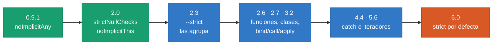
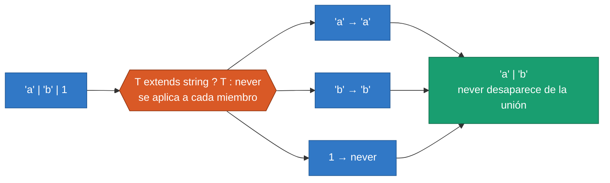

<div align="center">

# 04 · TypeScript 2.3–2.9: modo estricto y tipos condicionales

**`--strict`, iteración asíncrona, `import()`, varianza de funciones, `unique symbol`, tipos condicionales e `infer` (2017–2018)**

[⬅ 03 · TypeScript 2.0–2.2](03-typescript-2.0-2.2-nulos-y-flujo.md) · [🏠 Índice](../README.md) · [05 · TypeScript 3.0–3.4 ➡](05-typescript-3.0-3.4-proyectos-y-tuplas.md)

</div>

<!-- ts=2.3 -->

| Ficha | 2.3 | 2.4 | 2.5 | 2.6 | 2.7 | 2.8 | 2.9 |
|---|---|---|---|---|---|---|---|
| **Publicación** | 27-abr-2017 | 27-jun-2017 | 31-ago-2017 | 31-oct-2017 | 31-ene-2018 | 27-mar-2018 | 31-may-2018 |
| **Protagonista** | `--strict` | `import()` | `catch { }` | `strictFunctionTypes` | `unique symbol` | Tipos condicionales | `keyof` ampliado |
| **Compilador** | `2.3.4` | `2.4.2` | `2.5.3` | `2.6.2` | `2.7.2` | `2.8.4` | `2.9.2` |

> [!IMPORTANT]
> En estas siete versiones TypeScript adquiere su ritmo —una cada dos meses— y su segunda gran idea. La primera fue controlar `null` (2.0); la segunda
> son los **tipos condicionales** (2.8), que convierten el sistema de tipos en un lenguaje capaz de calcular. `ReturnType`, `Exclude`, `Awaited` y casi
> todas las bibliotecas con tipos avanzados descienden de ahí.

---

## Contenido

1. [TypeScript 2.3: `--strict`](#1-typescript-23---strict)
2. [TypeScript 2.3: iteración asíncrona y genéricos con valor por defecto](#2-typescript-23-iteración-asíncrona-y-genéricos-con-valor-por-defecto)
3. [TypeScript 2.4: `import()` y enums de cadena](#3-typescript-24-import-y-enums-de-cadena)
4. [TypeScript 2.5 y 2.6: varianza y `@ts-ignore`](#4-typescript-25-y-26-varianza-y-ts-ignore)
5. [TypeScript 2.7: clases estrictas y `unique symbol`](#5-typescript-27-clases-estrictas-y-unique-symbol)
6. [TypeScript 2.7: `esModuleInterop`](#6-typescript-27-esmoduleinterop)
7. [TypeScript 2.8: tipos condicionales](#7-typescript-28-tipos-condicionales)
8. [TypeScript 2.8: `infer` y los utilitarios condicionales](#8-typescript-28-infer-y-los-utilitarios-condicionales)
9. [TypeScript 2.9: `keyof` ampliado y tipos `import()`](#9-typescript-29-keyof-ampliado-y-tipos-import)
10. [Notas de migración](#10-notas-de-migración)
11. [Referencias](#11-referencias)

---

## 1. TypeScript 2.3: `--strict`

Para 2017 había ya cuatro opciones de estrictez, y cada versión prometía más. `--strict` las agrupa bajo un solo nombre, con una regla deliberada:
**su significado crece con cada versión**. Activarla es aceptar, de antemano, las comprobaciones que vengan.

| Opción | Debuta en | Se une a `strict` en | Qué detecta |
|---|---|---|---|
| `noImplicitAny` | 0.9.1 | 2.3 | Tipos que se quedarían en `any` sin que nadie lo pidiera |
| `noImplicitThis` | 2.0 | 2.3 | `this` con tipo `any` implícito |
| `strictNullChecks` | 2.0 | 2.3 | `null` y `undefined` fuera de su sitio |
| `alwaysStrict` | 2.1 | 2.3 | Analiza en modo estricto y emite `"use strict"` |
| `strictFunctionTypes` | 2.6 | 2.6 | Parámetros de función comparados sin rigor |
| `strictPropertyInitialization` | 2.7 | 2.7 | Propiedades de clase sin inicializar |
| `strictBindCallApply` | 3.2 | 3.2 | Argumentos erróneos en `bind`, `call` y `apply` |
| `useUnknownInCatchVariables` | 4.4 | 4.4 | La variable de `catch` deja de ser `any` |
| `strictBuiltinIteratorReturn` | 5.6 | 5.6 | El valor final de los iteradores nativos deja de ser `any` |



La escalera termina en 2026: con TypeScript 6.0, `strict` pasa a estar **activado por defecto**
([11 § Valores por defecto](11-typescript-6.0-el-puente.md#3-los-nuevos-valores-por-defecto)).

> [!TIP]
> Tres opciones estrictas **no** forman parte de `strict` y merece la pena activarlas a mano: `noUncheckedIndexedAccess` (4.1),
> `exactOptionalPropertyTypes` (4.4) y `noImplicitOverride` (4.3). El conjunto recomendado está en [17 · `tsconfig` de referencia](17-tsconfig-de-referencia.md).

---

## 2. TypeScript 2.3: iteración asíncrona y genéricos con valor por defecto

### Iteración asíncrona

Un generador asíncrono produce valores que tardan en llegar, y `for await` los consume uno a uno. Llegó a TypeScript un año antes que a ES2018.

```ts run debut
function esperar(ms: number): Promise<void> {
    return new Promise<void>((resolver) => setTimeout(resolver, ms));
}

async function* lecturas(total: number): AsyncIterableIterator<number> {
    for (let i = 1; i <= total; i++) {
        await esperar(1);            // E/S simulada
        yield i * 10;
    }
}

async function principal(): Promise<void> {
    let suma = 0;
    for await (const valor of lecturas(3)) {
        suma += valor;
    }
    console.log(suma);               // → 60
}
principal();
```

### Valores por defecto de parámetros de tipo

```ts run debut
interface Respuesta<TDatos = string[], TError = Error> {
    datos?: TDatos;
    error?: TError;
}

const porDefecto: Respuesta = { datos: ["a", "b"] };          // Respuesta<string[], Error>
const concreta: Respuesta<number> = { datos: 42 };            // Respuesta<number, Error>
console.log(porDefecto.datos ? porDefecto.datos.length : 0, concreta.datos);   // → 2 42
```

Un valor por defecto evita romper a quien ya usaba un tipo genérico cuando se le añade un parámetro nuevo: el código antiguo sigue compilando.

### `checkJs`: TypeScript sin TypeScript

La 2.3 extendió el comprobador a archivos JavaScript. Con `// @ts-check` al principio de un `.js`, o con `checkJs` en el proyecto, el compilador lee
los tipos de los comentarios JSDoc:

```js
// @ts-check

/**
 * @param {string} nombre
 * @param {number} [veces]
 * @returns {string}
 */
function repetir(nombre, veces = 2) {
    return nombre.repeat(veces);
}

repetir("ts", "3");   // error: 'string' no es asignable a 'number'
```

Es la base del «modo JSDoc» que usan proyectos como Svelte o webpack para tener tipos sin paso de compilación
([20 § JavaScript con tipos](20-ecosistema-y-runtimes.md#7-javascript-con-tipos-el-modo-jsdoc)).

---

<!-- ts=2.4 -->

## 3. TypeScript 2.4: `import()` y enums de cadena

### `import()` dinámico

```ts run esm debut
// @filename: informe.ts
export function generar(titulo: string): string {
    return "# " + titulo;
}

// @filename: principal.ts
async function exportar(): Promise<void> {
    const modulo = await import("./informe.js");      // se carga solo cuando hace falta
    console.log(modulo.generar("Ventas"));            // → # Ventas
}
exportar();
```

El compilador tipa el resultado como `Promise<typeof import("./informe")>`: la carga diferida no pierde ni un tipo.

### Enums de cadena

```ts run debut
enum Nivel { Bajo, Alto }                                  // numérico: con mapeo inverso
enum Direccion { Norte = "NORTE", Sur = "SUR" }            // de cadena: sin mapeo inverso

console.log(Object.keys(Nivel).join());                    // → 0,1,Bajo,Alto
console.log(Object.keys(Direccion).join());                // → Norte,Sur
console.log(Nivel[0], Direccion.Sur);                      // → Bajo SUR
```

| | `enum` numérico | `enum` de cadena | `const enum` | Unión de literales |
|---|---|---|---|---|
| **Desde** | 0.8 | 2.4 | 1.4 | 1.8 |
| **Objeto en ejecución** | Sí, con mapeo inverso | Sí, sin mapeo inverso | No: se sustituye por el valor | No |
| **Acepta cualquier número** | Sí, hasta la 5.0 | — | Sí, hasta la 5.0 | No |
| **Legible en un *log*** | `0`, `1`… | `"NORTE"` | El valor | El valor |
| **Sintaxis borrable** | ❌ | ❌ | ❌ | ✅ |

> [!TIP]
> Si no necesitas el objeto en ejecución, una unión de literales (`type Direccion = "NORTE" | "SUR"`) hace lo mismo sin generar código. La comparación
> completa está en [21 § `enum` o unión](21-guias-de-decision.md#2-enum-unión-de-literales-u-objeto-as-const).

### Tipos débiles

Un tipo «débil» es aquel cuyas propiedades son todas opcionales. Cualquier objeto encajaba en él, también uno con un error de tecleo. Desde la 2.4,
pasarle algo que no comparte **ninguna** propiedad es un error:

```ts debut err=TS2559
interface Opciones { tiempo?: number; reintentos?: number; }
function enviar(opciones: Opciones): void { }

const mal = { timepo: 300 };
enviar(mal);   // error TS2559: el tipo no tiene propiedades en común con 'Opciones'
```

---

<!-- ts=2.6 -->

## 4. TypeScript 2.5 y 2.6: varianza y `@ts-ignore`

La 2.5 fue pequeña: `catch` sin variable (`try { … } catch { … }`, de ES2019) y poco más. La 2.6 trajo una de las opciones estrictas más sutiles.

### `strictFunctionTypes`

¿Cuándo se puede usar una función donde se espera otra? La respuesta correcta es que sus **parámetros** deben ser *más generales*, no más específicos:
quien sabe cuidar de cualquier animal puede cuidar de un perro, pero no al revés. Es la **contravarianza**. TypeScript, hasta la 2.6, aceptaba las dos
direcciones (*bivarianza*).

```ts run debut opts=strictFunctionTypes
interface Animal { nombre: string; }
interface Perro extends Animal { ladrar(): string; }

type Cuidador<T> = (animal: T) => string;

const cuidarAnimal: Cuidador<Animal> = (a) => "cuido a " + a.nombre;
const cuidarPerro: Cuidador<Perro> = cuidarAnimal;     // correcto: acepta más de lo que se le pide

const rex: Perro = { nombre: "Rex", ladrar: () => "guau" };
console.log(cuidarPerro(rex));                          // → cuido a Rex
```

```ts debut opts=strictFunctionTypes err=TS2322
interface Animal { nombre: string; }
interface Perro extends Animal { ladrar(): string; }

declare let cuidarAnimal: (animal: Animal) => void;
declare let cuidarPerro: (perro: Perro) => void;
cuidarAnimal = cuidarPerro;   // error TS2322: no todo animal sabe ladrar
```

### La excepción deliberada: los métodos

La comprobación estricta se aplica a las propiedades de tipo función, **no a los métodos**. La diferencia está en cómo se escribe:

```ts opts=strictFunctionTypes err=TS2322
interface Animal { nombre: string; }
interface Perro extends Animal { ladrar(): string; }

interface ConMetodo<T> { cuidar(animal: T): void; }             // sintaxis de método: bivariante
interface ConPropiedad<T> { cuidar: (animal: T) => void; }      // sintaxis de propiedad: contravariante

declare let metodoPerro: ConMetodo<Perro>;
declare let propiedadPerro: ConPropiedad<Perro>;

const a: ConMetodo<Animal> = metodoPerro;          // compila (y es inseguro)
const b: ConPropiedad<Animal> = propiedadPerro;    // error TS2322
```

> [!NOTE]
> La excepción existe para que `Array<Perro>` siga siendo asignable a `Array<Animal>`, algo que casi todo el código JavaScript da por hecho. Es uno de
> los agujeros de solidez deliberados del lenguaje. Si quieres la comprobación estricta en tus propias interfaces, declara las funciones como
> propiedades. La teoría completa está en [14 § Varianza](14-sistema-de-tipos-a-fondo.md#7-varianza).

### `// @ts-ignore`

```ts debut
// @ts-ignore
const puerto: number = "8080";
```

`@ts-ignore` silencia los errores de la línea siguiente, **sean los que sean y aunque no haya ninguno**. Por eso la 3.9 añadió `@ts-expect-error`,
que falla si el error desaparece. La regla de estilo hoy es usar siempre el segundo.

---

<!-- ts=2.7 -->

## 5. TypeScript 2.7: clases estrictas y `unique symbol`

### `strictPropertyInitialization`

`strictNullChecks` tenía un hueco: una propiedad de clase declarada como `string` podía valer `undefined` si nadie la inicializaba.

```ts debut err=TS2564
class Usuario {
    nombre: string;          // error TS2564: no tiene inicializador ni se asigna en el constructor
    apodo?: string;          // correcto: declara que puede faltar
    edad = 0;                // correcto: tiene inicializador
}
```

| Forma de cumplir la regla | Código | Cuándo |
|---|---|---|
| Inicializador | `edad = 0` | Hay un valor por defecto sensato |
| Constructor | `constructor(nombre: string) { this.nombre = nombre; }` | El valor llega al crear el objeto |
| Opcional | `apodo?: string` | Puede faltar de verdad |
| Aserción de asignación definida | `conexion!: Conexion` | Lo inicializa algo externo: un *framework*, un método `init()` |

```ts run debut
class Componente {
    servicio!: { saludar(): string };       // lo asigna la inyección de dependencias, no el constructor

    conectar(): void {
        this.servicio = { saludar: () => "hola" };
    }
}

const c = new Componente();
c.conectar();
console.log(c.servicio.saludar());          // → hola
```

Es el mismo trato que con `x!`: el `!` es una promesa del programador, sin comprobación en ejecución.

### `unique symbol`

Cada símbolo declarado con `const` tiene un tipo propio e irrepetible, y puede usarse como nombre de propiedad con seguridad de tipos.

```ts run debut
const ID_INTERNO = Symbol("id");

class Entidad {
    [ID_INTERNO] = 42;
    nombre = "público";
}

const e = new Entidad();
console.log(e[ID_INTERNO], Object.keys(e).join());   // → 42 nombre
```

Los símbolos únicos son también la base del patrón de **tipos marcados**, la forma habitual de simular tipado nominal
([14 § Tipado nominal](14-sistema-de-tipos-a-fondo.md#11-tipado-nominal-simulado-las-marcas)).

### Tuplas de longitud fija y guardas con `in`

```ts run debut
interface Pez { nadar(): string; }
interface Ave { volar(): string; }

function mover(animal: Pez | Ave): string {
    if ("nadar" in animal) {
        return animal.nadar();           // Pez
    }
    return animal.volar();               // Ave
}

const punto: [number, number] = [3, 4];
console.log(mover({ volar: () => "vuelo" }), punto.length);   // → vuelo 2
```

Desde la 2.7, `[number, number]` tiene `length: 2`, y una tupla de tres elementos ya no cabe en una de dos. También debutan aquí los separadores
numéricos (`1_000_000`), un año antes que en ES2021.

---

## 6. TypeScript 2.7: `esModuleInterop`

### El problema

Un módulo CommonJS exporta **un valor**: `module.exports = express`. Un módulo ES exporta **enlaces con nombre**. TypeScript llevaba años haciendo
coincidir ambos mundos de una forma que el estándar no permitía:

```ts ts=2.7 omitir
import * as express from "express";
const app = express();     // según el estándar, un espacio de nombres no se puede invocar
```

Babel, webpack y después Node eligieron otra convención: lo que un módulo CommonJS exporta es su exportación **por defecto**.

### La solución

| | Sin `esModuleInterop` | Con `esModuleInterop` |
|---|---|---|
| Importar un CommonJS | `import * as express from "express"` | `import express from "express"` |
| Código emitido | `var express = require("express")` | `var express = __importDefault(require("express"))` |
| Coincide con Node y los empaquetadores | No | Sí |
| Estado en 2026 | ⛔ `false` es obsoleto en la 6.0 | 🟢 Siempre activo |

```js
// Lo que añade esModuleInterop al JavaScript emitido (forma abreviada)
var __importDefault = function (mod) {
    return mod && mod.__esModule ? mod : { default: mod };
};
```

La 6.0 dio por cerrada la discusión: `esModuleInterop: false` y `allowSyntheticDefaultImports: false` son valores obsoletos. El panorama completo de
la interoperabilidad está en [16 · Módulos y resolución](16-modulos-y-resolucion.md).

---

<!-- ts=2.8 -->

## 7. TypeScript 2.8: tipos condicionales

### El problema

Hasta la 2.8, los tipos se podían combinar (`|`, `&`), indexar (`T[K]`) y recorrer (tipos mapeados), pero no se podía **decidir**. No había manera de
escribir «si `T` es una función, su tipo de retorno; si no, `T`».

### La solución

Un tipo condicional es un operador ternario para tipos: `T extends U ? X : Y`.

```ts debut
type EsCadena<T> = T extends string ? "sí" : "no";

type A = EsCadena<"hola">;
//   ^? type A = "sí"
type B = EsCadena<42>;
//   ^? type B = "no"

type NombreDeTipo<T> =
    T extends string ? "cadena" :
    T extends number ? "número" :
    T extends boolean ? "booleano" :
    T extends Function ? "función" :
    "objeto";

type C = NombreDeTipo<() => void>;
//   ^? type C = "función"
```

### Distributividad

Cuando el tipo comprobado es un **parámetro de tipo desnudo** y recibe una unión, la condición se aplica a cada miembro por separado, y los resultados
se unen. Es lo que hace posible filtrar uniones.

```ts debut
type EnArreglo<T> = T extends any ? T[] : never;
type SinDistribuir<T> = [T] extends [any] ? T[] : never;

type D = EnArreglo<string | number>;
//   ^? type D = string[] | number[]
type E = SinDistribuir<string | number>;
//   ^? type E = (string | number)[]

type Filtrar<T, U> = T extends U ? T : never;
type F = Filtrar<"a" | "b" | 1 | 2, string>;
//   ^? type F = "a" | "b"
```



> [!WARNING]
> La distributividad sorprende con `never`: como `never` es la unión vacía, `EnArreglo<never>` es `never`, no `never[]`. Y con `boolean`, que es
> `true | false`: la condición se evalúa dos veces. Para desactivarla, envuelve ambos lados en una tupla: `[T] extends [U]`.

---

## 8. TypeScript 2.8: `infer` y los utilitarios condicionales

`infer` declara, dentro de la condición, una variable de tipo que el compilador debe **deducir**. Es la forma de *desmontar* un tipo y quedarse con
una de sus piezas.

```ts debut
type Retorno<T> = T extends (...args: any[]) => infer R ? R : never;
type Elemento<T> = T extends (infer U)[] ? U : T;
type Resuelto<T> = T extends Promise<infer V> ? V : T;
type PrimerArgumento<T> = T extends (primero: infer P, ...resto: any[]) => any ? P : never;

declare function buscar(id: number, estricto: boolean): Promise<string[]>;

type G = Retorno<typeof buscar>;
//   ^? type G = Promise<string[]>
type H = Resuelto<G>;
//   ^? type H = string[]
type I = Elemento<H>;
//   ^? type I = string
type J = PrimerArgumento<typeof buscar>;
//   ^? type J = number
```

Con estas piezas la biblioteca estándar ganó cinco utilitarios que hoy usa todo el mundo:

| Tipo utilitario | Definición | Ejemplo |
|---|---|---|
| `Exclude<T, U>` | `T extends U ? never : T` | `Exclude<"a" \| "b", "a">` → `"b"` |
| `Extract<T, U>` | `T extends U ? T : never` | `Extract<"a" \| 1, string>` → `"a"` |
| `NonNullable<T>` | `T extends null \| undefined ? never : T` | `NonNullable<string \| null>` → `string` |
| `ReturnType<T>` | `T extends (...args: any) => infer R ? R : any` | El tipo que devuelve una función |
| `InstanceType<T>` | `T extends abstract new (...args: any) => infer R ? R : any` | El tipo que construye una clase |

```ts run debut
function crearUsuario(nombre: string) {
    return { id: 1, nombre, creado: new Date(0) };
}

type Usuario = ReturnType<typeof crearUsuario>;       // el tipo sale de la implementación
type SinFecha = Pick<Usuario, Exclude<keyof Usuario, "creado">>;

const resumen: SinFecha = { id: 7, nombre: "Ana" };
console.log(Object.keys(resumen).join());             // → id,nombre
```

Ese `Pick<T, Exclude<keyof T, K>>` se escribió tantas veces que la 3.5 lo bautizó `Omit<T, K>`.

### Modificadores en tipos mapeados

La 2.8 también permitió **quitar** modificadores: `-readonly` y `-?`. De ahí sale `Required<T>`.

```ts run debut
type Mutable<T> = { -readonly [K in keyof T]: T[K] };

interface Ajustes { readonly tema?: string; readonly tamano?: number; }

const completos: Required<Ajustes> = { tema: "oscuro", tamano: 14 };
const editables: Mutable<Required<Ajustes>> = { ...completos };
editables.tamano = 16;
console.log(completos.tamano, editables.tamano);   // → 14 16
```

---

<!-- ts=2.9 -->

## 9. TypeScript 2.9: `keyof` ampliado y tipos `import()`

### `keyof` con claves numéricas y símbolos

Hasta la 2.8, `keyof T` era siempre un subconjunto de `string`. Desde la 2.9 refleja lo que JavaScript permite: `string | number | symbol`.

```ts debut
const marca = Symbol("marca");
interface Mixto {
    nombre: string;
    0: boolean;
    [marca]: number;
}

const numerica: keyof Mixto = 0;           // con la 2.8, error: keyof solo daba cadenas
const simbolica: keyof Mixto = marca;
type SoloTexto = Extract<keyof Mixto, string>;
//   ^? type SoloTexto = "nombre"
```

> [!WARNING]
> Es el cambio incompatible más recordado de la serie 2. Código como `function f<T>(clave: keyof T) { clave.toUpperCase(); }` dejó de compilar.
> La solución canónica es `Extract<keyof T, string>` o `string & keyof T`.

### Tipos `import()`

```ts debut
// @filename: modelos.ts
export interface Factura { numero: number; total: number; }

// @filename: principal.ts
function imprimir(factura: import("./modelos").Factura): string {
    return "#" + factura.numero;
}
```

`import("./modelos").Factura` nombra un tipo sin importar el módulo. Es imprescindible en archivos de declaración globales, donde una sentencia
`import` convertiría el archivo en un módulo.

### Lo demás de la 2.9

| Característica | Qué aporta |
|---|---|
| `import.meta` | Metadatos del módulo actual (`import.meta.url`) |
| `--resolveJsonModule` | `import config from "./config.json"`, con los tipos inferidos del contenido |
| `--declarationMap` | «Ir a la definición» lleva al `.ts` original, no al `.d.ts` |
| Argumentos de tipo en JSX y en plantillas etiquetadas | `<Lista<Usuario> />` |
| `--pretty` por defecto | Errores con color y contexto en la terminal |

---

## 10. Notas de migración

| Versión | Cambio | Síntoma | Qué hacer |
|---|---|---|---|
| 2.4 | Tipos débiles | TS2559 al pasar objetos sin propiedades en común | Corregir el nombre de la propiedad, o declarar una firma de índice |
| 2.4 | Los genéricos se comprueban con más rigor | Errores nuevos en *callbacks* genéricos | Anotar el *callback* |
| 2.6 | `strictFunctionTypes` entra en `strict` | TS2322 al asignar funciones | Corregir, o usar sintaxis de método si la bivarianza es intencionada |
| 2.6 | Las referencias de solo escritura cuentan como «sin usar» | Errores con `noUnusedLocals` | Borrar la variable |
| 2.7 | `strictPropertyInitialization` entra en `strict` | TS2564 en clases | Inicializar, hacer opcional o usar `!` |
| 2.7 | Las tuplas tienen longitud fija | TS2322 al asignar tuplas más largas | Ajustar el tipo |
| 2.7 | `in` actúa como guarda de tipo | Tipos distintos tras un `in` | Normalmente es lo deseado |
| 2.8 | Los parámetros de tipo sin usar se comprueban con `noUnusedParameters` | Errores nuevos | Borrarlos o prefijarlos con `_` |
| 2.9 | `keyof` incluye `number` y `symbol` | TS2322 donde se esperaba `string` | `Extract<keyof T, string>`; como parche temporal existió `keyofStringsOnly` (retirada en la 5.6) |

> [!TIP]
> Si saltas de la 2.2 a la 2.9 de una vez, el orden que menos duele es: `strict` con `strictFunctionTypes: false` y
> `strictPropertyInitialization: false`; después, activar cada una por separado.

---

## 11. Referencias

- Notas oficiales: [2.3](https://www.typescriptlang.org/docs/handbook/release-notes/typescript-2-3.html) · [2.4](https://www.typescriptlang.org/docs/handbook/release-notes/typescript-2-4.html) · [2.5](https://www.typescriptlang.org/docs/handbook/release-notes/typescript-2-5.html) · [2.6](https://www.typescriptlang.org/docs/handbook/release-notes/typescript-2-6.html) · [2.7](https://www.typescriptlang.org/docs/handbook/release-notes/typescript-2-7.html) · [2.8](https://www.typescriptlang.org/docs/handbook/release-notes/typescript-2-8.html) · [2.9](https://www.typescriptlang.org/docs/handbook/release-notes/typescript-2-9.html)
- Manual: [Tipos condicionales](https://www.typescriptlang.org/docs/handbook/2/conditional-types.html) · [Tipos utilitarios](https://www.typescriptlang.org/docs/handbook/utility-types.html) · [Enums](https://www.typescriptlang.org/docs/handbook/enums.html)
- Opciones: [`strict`](https://www.typescriptlang.org/tsconfig/#strict) · [`strictFunctionTypes`](https://www.typescriptlang.org/tsconfig/#strictFunctionTypes) · [`esModuleInterop`](https://www.typescriptlang.org/tsconfig/#esModuleInterop)
- Pruebas de debut: [25 · TypeScript 2.3](25-pruebas-de-debut.md#typescript-23) a [2.9](25-pruebas-de-debut.md#typescript-29)
