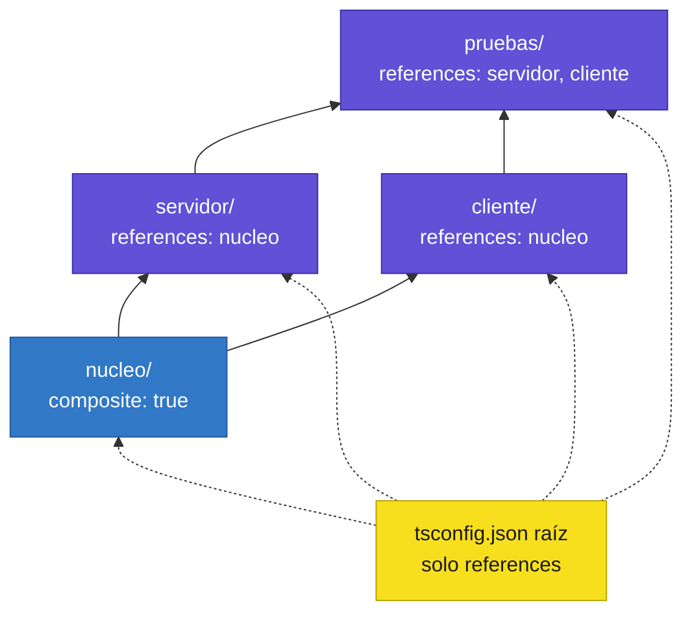

<div align="center">

# 05 · TypeScript 3.0–3.4: proyectos, `unknown` y tuplas

**Referencias de proyecto, `unknown`, tuplas en parámetros rest, `bigint`, `--incremental` y `as const` (2018–2019)**

[⬅ 04 · TypeScript 2.3–2.9](04-typescript-2.3-2.9-estricto-y-condicionales.md) · [🏠 Índice](../README.md) · [06 · TypeScript 3.5–3.9 ➡](06-typescript-3.5-3.9-encadenamiento-y-aserciones.md)

</div>

<!-- ts=3.0 -->

| Ficha | 3.0 | 3.1 | 3.2 | 3.3 | 3.4 |
|---|---|---|---|---|---|
| **Publicación** | 30-jul-2018 | 27-sep-2018 | 29-nov-2018 | 31-ene-2019 | 29-mar-2019 |
| **Protagonista** | Referencias de proyecto, `unknown` | Tuplas mapeadas | `strictBindCallApply`, `bigint` | Llamar a uniones | `as const`, `--incremental` |
| **Compilador** | `3.0.3` | `3.1.8` | `3.2.4` | `3.3.4000` | `3.4.5` |

> [!IMPORTANT]
> La serie 3 trata de **escala**. Para 2018, TypeScript compilaba repositorios de millones de líneas, y un proyecto ya no podía seguir siendo un único
> bloque que se comprueba entero cada vez. Las referencias de proyecto (3.0) y la compilación incremental (3.4) son la respuesta del compilador escrito
> en JavaScript; ocho años después, la respuesta definitiva sería reescribirlo en Go.

---

## Contenido

1. [Referencias de proyecto](#1-referencias-de-proyecto)
2. [El tipo `unknown`](#2-el-tipo-unknown)
3. [Tuplas en parámetros rest](#3-tuplas-en-parámetros-rest)
4. [TypeScript 3.1: tipos mapeados sobre tuplas y `typesVersions`](#4-typescript-31-tipos-mapeados-sobre-tuplas-y-typesversions)
5. [TypeScript 3.2: `strictBindCallApply` y `bigint`](#5-typescript-32-strictbindcallapply-y-bigint)
6. [TypeScript 3.3: llamar a una unión de funciones](#6-typescript-33-llamar-a-una-unión-de-funciones)
7. [TypeScript 3.4: `as const` y `readonly` en arreglos](#7-typescript-34-as-const-y-readonly-en-arreglos)
8. [TypeScript 3.4: `--incremental` e inferencia de orden superior](#8-typescript-34---incremental-e-inferencia-de-orden-superior)
9. [Notas de migración](#9-notas-de-migración)
10. [Referencias](#10-referencias)

---

## 1. Referencias de proyecto

### El problema

Un `tsconfig.json` describe **un programa**. En un monorrepo con una biblioteca, un servidor y un cliente, había dos opciones malas: un único programa
gigantesco (lento, y sin fronteras: cualquier archivo importaba cualquier otro) o tres programas sueltos que recompilaban la biblioteca cada uno por su cuenta.

### La solución

Un proyecto puede **referenciar** a otros. El compilador entiende el grafo, compila cada pieza una sola vez y en orden, y los proyectos que dependen de
una biblioteca leen sus archivos `.d.ts`, no su código fuente.



```json
{
  "compilerOptions": {
    "composite": true,
    "declaration": true,
    "declarationMap": true,
    "rootDir": "./src",
    "outDir": "./dist"
  },
  "include": ["src"]
}
```

```json
{
  "compilerOptions": { "outDir": "./dist", "rootDir": "./src" },
  "references": [{ "path": "../nucleo" }],
  "include": ["src"]
}
```

El primer bloque es `nucleo/tsconfig.json`; el segundo, `servidor/tsconfig.json`. La orden que entiende el grafo es `tsc --build`, abreviada `tsc -b`:

```bash
tsc --build                 # compila lo que haya cambiado, en orden de dependencias
```

```bash
tsc --build --verbose       # explica por qué recompila (o no) cada proyecto
```

```bash
tsc --build --clean         # borra las salidas
```

| Regla | Detalle |
|---|---|
| `composite: true` | Obligatorio en todo proyecto referenciado; activa `declaration` y exige que cada archivo esté en `include` o `files` |
| Frontera real | Un proyecto solo ve de otro lo que este exporta en sus `.d.ts` |
| `declarationMap` | Hace que «ir a la definición» salte al código fuente de la biblioteca y no a su declaración |
| Proyecto «de solución» | Un `tsconfig.json` raíz con `"files": []` y solo `references` |

### La línea que sigue

| Versión | Avance |
|---|---|
| **3.0** | `references`, `composite`, `tsc --build` |
| 3.3 | `--build --watch` recompila solo los proyectos afectados |
| **3.4** | `--incremental`: la misma idea para un proyecto suelto |
| 3.7 | El editor trabaja con el código fuente de los proyectos referenciados sin compilarlos antes |
| 4.0 | `--incremental` con `--noEmit` |
| 5.6 | `--build` sigue adelante aunque un proyecto intermedio tenga errores |
| **7.0** | `--builders`: los proyectos se compilan **en paralelo** |

La guía para decidir cuándo trocear un repositorio está en [21 § Proyectos](21-guias-de-decision.md#7-un-proyecto-o-varios).

---

## 2. El tipo `unknown`

### El problema

`any` hace dos cosas a la vez: acepta cualquier valor **y** permite hacer cualquier cosa con él. Lo primero es necesario —el resultado de `JSON.parse`
puede ser cualquier cosa—; lo segundo es lo peligroso, y además contagioso: todo lo que toca un `any` se vuelve `any`.

```ts
function analizar(json: string): any { return JSON.parse(json); }

const usuario = analizar('{"nombre":"Ana"}');
const largo: number = usuario.nombre.apellido.length;   // compila; falla en ejecución
```

### La solución

`unknown` conserva la primera mitad y elimina la segunda: se le puede asignar cualquier cosa, pero **no se puede usar** hasta haber demostrado qué es.

```ts run debut
interface Usuario { nombre: string; }

function esUsuario(valor: unknown): valor is Usuario {
    return typeof valor === "object" && valor !== null && typeof (valor as Usuario).nombre === "string";
}

function analizar(json: string): unknown {
    return JSON.parse(json);
}

const dato = analizar('{"nombre":"Ana"}');
if (esUsuario(dato)) {
    console.log(dato.nombre.toUpperCase());     // → ANA
}
console.log(esUsuario(analizar("42")));         // → false
```

```ts err=TS2571/TS18046
declare const dato: unknown;
dato.nombre;   // error: 'dato' es de tipo 'unknown'
```

| | `any` | `unknown` | `never` |
|---|---|---|---|
| **Se le puede asignar** | Todo | Todo | Nada |
| **Es asignable a** | Todo | Solo a `unknown` y `any` | Todo |
| **Operaciones permitidas** | Todas | Ninguna, hasta estrechar | — (no hay valores) |
| **Papel en el sistema** | Salida de emergencia | **Tipo superior** | **Tipo inferior** |
| **Se contagia** | Sí | No | No |

> [!TIP]
> Regla práctica: lo que entra desde fuera del programa —red, disco, `JSON.parse`, `catch`— es `unknown`. Desde la 4.4, con
> `useUnknownInCatchVariables`, la variable de un `catch` ya lo es por defecto.

---

## 3. Tuplas en parámetros rest

### El problema

Funciones como `bind`, `call` o un `curry` reciben «los argumentos de otra función». Antes de la 3.0 no había forma de describir una lista de
argumentos como un todo; las bibliotecas escribían decenas de sobrecargas («para 1 argumento, para 2, para 3…»).

### La solución

Una lista de parámetros es una **tupla**. Con un parámetro de tipo acotado a un arreglo, se captura entera, con sus tipos y su número:

```ts run debut
function despues<A extends unknown[], R>(ms: number, funcion: (...args: A) => R, ...args: A): R {
    return funcion(...args);
}

function etiquetar(nombre: string, cantidad: number, urgente?: boolean): string {
    return nombre + " x" + cantidad + (urgente ? " (!)" : "");
}

console.log(despues(0, etiquetar, "tornillos", 3));           // → tornillos x3
console.log(despues(0, etiquetar, "tuercas", 5, true));       // → tuercas x5 (!)
```

```ts err=TS2345
declare function despues<A extends unknown[], R>(ms: number, funcion: (...args: A) => R, ...args: A): R;
declare function etiquetar(nombre: string, cantidad: number): string;
despues(0, etiquetar, "tornillos", "tres");   // error TS2345: 'string' no es asignable a 'number'
```

Las tuplas ganaron además elementos **opcionales** y un elemento **rest** final:

```ts debut
type Punto = [number, number, number?];             // el tercero puede faltar
type Registro = [string, ...number[]];              // una etiqueta y cualquier cantidad de números

const plano: Punto = [1, 2];
const espacio: Punto = [1, 2, 3];
const fila: Registro = ["ventas", 10, 20, 30];
```

Este es el primer peldaño de una escalera que termina en las tuplas variádicas de la
[4.0](07-typescript-4.0-4.4-tuplas-variadicas-y-plantillas.md#1-tuplas-variádicas).

---

<!-- ts=3.1 -->

## 4. TypeScript 3.1: tipos mapeados sobre tuplas y `typesVersions`

### Tipos mapeados sobre tuplas

Hasta la 3.0, aplicar un tipo mapeado a una tupla la convertía en un objeto con claves `"0"`, `"1"`, `"length"`… Desde la 3.1, un tipo mapeado
homomórfico **conserva la forma de tupla**:

```ts debut
type EnPromesas<T> = { [K in keyof T]: Promise<T[K]> };

type Entradas = EnPromesas<[number, string]>;
//   ^? type Entradas = [Promise<number>, Promise<string>]

const pendientes: Entradas = [Promise.resolve(1), Promise.resolve("a")];
```

Es lo que permite tipar con exactitud `Promise.all` o cualquier función que transforma cada argumento.

### Propiedades sobre funciones

```ts run debut
function contador(): number {
    return ++contador.llamadas;
}
contador.llamadas = 0;      // la asignación declara la propiedad

contador();
contador();
console.log(contador.llamadas);   // → 2
```

### `typesVersions`

Una biblioteca que quiere usar tipos modernos sin romper a quien sigue con un compilador antiguo puede publicar varias declaraciones:

```json
{
  "name": "mi-biblioteca",
  "types": "./index.d.ts",
  "typesVersions": {
    ">=4.1": { "*": ["ts4.1/*"] },
    ">=3.1": { "*": ["ts3.1/*"] }
  }
}
```

El compilador recorre las entradas en orden y usa la primera cuyo rango incluye su propia versión. Desde la 4.9, el campo `exports` de `package.json`
tiene prioridad sobre `typesVersions`.

---

<!-- ts=3.2 -->

## 5. TypeScript 3.2: `strictBindCallApply` y `bigint`

### `strictBindCallApply`

Con las tuplas de la 3.0 por fin se podían tipar `bind`, `call` y `apply`, que hasta entonces devolvían `any` y aceptaban cualquier cosa.

```ts run
function saludar(this: { cortesia: string }, nombre: string, veces: number): string {
    return (this.cortesia + " " + nombre + "! ").repeat(veces).trim();
}

const formal = saludar.bind({ cortesia: "Buenos días," });
console.log(formal("Ana", 1));                                    // → Buenos días, Ana!
console.log(saludar.call({ cortesia: "Hola," }, "Luis", 2));      // → Hola, Luis! Hola, Luis!
```

```ts debut err=TS2345
function sumar(a: number, b: number): number { return a + b; }
sumar.call(undefined, 1, "2");   // error TS2345: 'string' no es asignable a 'number'
```

### `bigint`

```ts run debut
const limite = Number.MAX_SAFE_INTEGER;            // 9007199254740991
const impreciso = limite + 2;                      // number: pierde precisión
const exacto = BigInt(limite) + 2n;                // bigint: no la pierde

console.log(impreciso);                            // → 9007199254740992
console.log(exacto.toString());                    // → 9007199254740993
console.log(typeof exacto);                        // → bigint
```

`number` y `bigint` no se mezclan: `1 + 1n` es un error de tipos (y en JavaScript, una excepción). TypeScript **no transforma** `bigint` para destinos
antiguos: los literales `100n` exigen `target: es2020` o posterior.

### Otras mejoras de la 3.2

| Mejora | Ejemplo |
|---|---|
| Propagación de objetos genéricos | `{ ...objeto, id: 1 }` con `objeto: T` produce `T & { id: number }` |
| Discriminantes no unitarios | Una unión se distingue también por una propiedad que es `null` en una variante |
| `extends` desde `node_modules` | `"extends": "@empresa/tsconfig/base.json"` |
| `--showConfig` | Imprime la configuración final, ya resuelta la herencia |

```ts run debut
type Resultado<T> = { error: Error; dato: null } | { error: null; dato: T };

function desenvolver<T>(resultado: Resultado<T>): T {
    if (resultado.error) {
        throw resultado.error;
    }
    return resultado.dato;          // aquí `dato` es T: el discriminante es `error`
}

console.log(desenvolver({ error: null, dato: 42 }));   // → 42
```

---

<!-- ts=3.3 -->

## 6. TypeScript 3.3: llamar a una unión de funciones

Si una variable puede ser una de dos funciones, ¿se puede llamar? Antes de la 3.3, solo si las firmas eran idénticas. Desde entonces, sí: los
**parámetros se intersecan** (el argumento debe valer para ambas) y los resultados se unen.

```ts run debut
type Fruta = "manzana" | "naranja";
type Color = "rojo" | "naranja";

const pesar = (fruta: Fruta): number => fruta.length;
const nombrar = (color: Color): string => color.toUpperCase();

const operacion: ((f: Fruta) => number) | ((c: Color) => string) = Math.random() < 2 ? pesar : nombrar;
const resultado = operacion("naranja");      // solo "naranja" es a la vez Fruta y Color
//    ^? const resultado: string | number
console.log(resultado);                      // → 7
```

```ts err=TS2345
declare const operacion: ((f: "manzana" | "naranja") => number) | ((c: "rojo" | "naranja") => string);
operacion("manzana");   // error TS2345: '"manzana"' no es asignable a '"naranja"'
```

---

<!-- ts=3.4 -->

## 7. TypeScript 3.4: `as const` y `readonly` en arreglos

### El problema

Al inferir, el compilador **ensancha**: `"GET"` se convierte en `string`, `[1, 2]` en `number[]`. Tiene sentido para variables que van a cambiar, pero
obliga a anotar a mano cada configuración, cada tabla de constantes, cada acción de Redux.

```ts
const peticion = { metodo: "GET", reintentos: [1, 2, 5] };
//    ^? const peticion: { metodo: string; reintentos: number[]; }
```

### La solución

`as const` le pide al compilador lo contrario: el tipo más estrecho posible. Los literales no se ensanchan, las propiedades son `readonly` y los
arreglos se convierten en tuplas de solo lectura.

```ts run debut
const peticion = { metodo: "GET", reintentos: [1, 2, 5] } as const;
//    ^? const peticion: { readonly metodo: "GET"; readonly reintentos: readonly [1, 2, 5]; }

const NIVELES = ["bajo", "medio", "alto"] as const;
type Nivel = typeof NIVELES[number];
//   ^? type Nivel = "alto" | "bajo" | "medio"

function esNivel(valor: string): valor is Nivel {
    return (NIVELES as readonly string[]).indexOf(valor) >= 0;
}

console.log(peticion.metodo, NIVELES.length, esNivel("medio"), esNivel("extremo"));   // → GET 3 true false
```

El patrón `typeof NIVELES[number]` —una lista en ejecución y su tipo unión, escritos una sola vez— es la alternativa habitual a los `enum`.

> [!NOTE]
> El editor muestra `"alto" | "bajo" | "medio"`, no el orden en que se escribió la lista. No es un error: desde TypeScript 7.0 los miembros de una unión
> se ordenan de forma **determinista** por su contenido, y los tipos de este atlas se consultan con esa ordenación
> ([12 § Orden determinista](12-typescript-7-el-compilador-nativo.md#5-orden-determinista-de-tipos)).

### `readonly` en arreglos y tuplas

```ts debut err=TS2339
function total(numeros: readonly number[]): number {
    numeros.push(0);                       // error TS2339: 'push' no existe en 'readonly number[]'
    return numeros.length;
}
```

| Forma | Equivale a | Desde |
|---|---|---|
| `readonly string[]` | `ReadonlyArray<string>` | 3.4 |
| `readonly [number, number]` | Tupla de solo lectura | 3.4 |
| `ReadonlyArray<T>` | Arreglo sin métodos que muten | 2.0 |

> [!WARNING]
> Como todo `readonly` en TypeScript, es **solo de tipos**. `as const` no congela nada: si necesitas inmutabilidad en ejecución, usa `Object.freeze`.
> Y un arreglo mutable se puede pasar donde se espera uno `readonly`, pero no al revés.

---

## 8. TypeScript 3.4: `--incremental` e inferencia de orden superior

### `--incremental`

Con `incremental: true`, el compilador guarda en un archivo `.tsbuildinfo` el grafo del programa y las firmas de cada archivo. En la siguiente
compilación solo vuelve a comprobar lo que cambió y lo que depende de ello.

```json
{
  "compilerOptions": {
    "incremental": true,
    "tsBuildInfoFile": "./.cache/proyecto.tsbuildinfo"
  }
}
```

| | Sin `incremental` | Con `incremental` | Con `composite` (3.0) |
|---|---|---|---|
| **Guarda estado entre ejecuciones** | No | Sí, en `.tsbuildinfo` | Sí |
| **Sirve para** | Proyectos pequeños | Un proyecto suelto | Proyectos referenciados |
| **Exige** | — | — | `declaration` y fronteras explícitas |

En la 3.4 la opción solo se podía escribir en `tsconfig.json`: pasarla por línea de comandos era el error TS6064.

### Inferencia de orden superior

Componer funciones genéricas perdía los parámetros de tipo: el resultado quedaba fijado a `{}`. Desde la 3.4 se propagan.

```ts run debut
function componer<A, B, C>(f: (a: A) => B, g: (b: B) => C): (a: A) => C {
    return (x) => g(f(x));
}

interface Caja<T> { valor: T; }
function enArreglo<T>(x: T): T[] { return [x]; }
function enCaja<U>(valor: U): Caja<U> { return { valor }; }

const envolver = componer(enArreglo, enCaja);
//    ^? const envolver: <T>(a: T) => Caja<T[]>

const caja: Caja<string[]> = envolver("hola");     // con la 3.3 era Caja<{}[]> y no compilaba
console.log(caja.valor[0].toUpperCase(), envolver(7).valor[0].toFixed(1));   // → HOLA 7.0
```

### `globalThis`

```ts run debut
const temporizador = globalThis.setTimeout;
console.log(typeof temporizador);   // → function
```

`globalThis` es el objeto global en cualquier entorno (ES2020). El compilador lo tipa: `globalThis.noExiste` es un error.

---

## 9. Notas de migración

| Versión | Cambio | Síntoma | Qué hacer |
|---|---|---|---|
| 3.0 | `unknown` es palabra reservada | Un tipo propio llamado `unknown` deja de compilar | Renombrarlo |
| 3.1 | Estrechar con `typeof x === "function"` interseca en lugar de reemplazar | Tipos distintos tras la guarda | Normalmente inocuo |
| 3.2 | `strictBindCallApply` entra en `strict` | TS2345 en llamadas a `call`, `apply` y `bind` | Corregir los argumentos |
| 3.4 | El `this` de nivel superior tiene tipo | `this.algo` en un script global puede fallar | Usar `globalThis` |
| 3.4 | Los argumentos de tipo se propagan al componer | Inferencias más precisas… y algún error nuevo | Anotar el genérico |
| 3.4 | `readonly` en arreglos | Un arreglo `readonly` no se puede pasar a una API que pide uno mutable | Cambiar la firma de la API a `readonly T[]` |

> [!TIP]
> Al escribir una función que **solo lee** un arreglo, declara el parámetro como `readonly T[]`. Acepta tanto arreglos mutables como de solo lectura
> (los de `as const`, por ejemplo), y documenta que la función no lo modifica.

---

## 10. Referencias

- Notas oficiales: [3.0](https://www.typescriptlang.org/docs/handbook/release-notes/typescript-3-0.html) · [3.1](https://www.typescriptlang.org/docs/handbook/release-notes/typescript-3-1.html) · [3.2](https://www.typescriptlang.org/docs/handbook/release-notes/typescript-3-2.html) · [3.3](https://www.typescriptlang.org/docs/handbook/release-notes/typescript-3-3.html) · [3.4](https://www.typescriptlang.org/docs/handbook/release-notes/typescript-3-4.html)
- Manual: [Referencias de proyecto](https://www.typescriptlang.org/docs/handbook/project-references.html) · [Tuplas](https://www.typescriptlang.org/docs/handbook/2/objects.html#tuple-types)
- Opciones: [`composite`](https://www.typescriptlang.org/tsconfig/#composite) · [`incremental`](https://www.typescriptlang.org/tsconfig/#incremental) · [`strictBindCallApply`](https://www.typescriptlang.org/tsconfig/#strictBindCallApply)
- Pruebas de debut: [25 · TypeScript 3.0](25-pruebas-de-debut.md#typescript-30) a [3.4](25-pruebas-de-debut.md#typescript-34)
