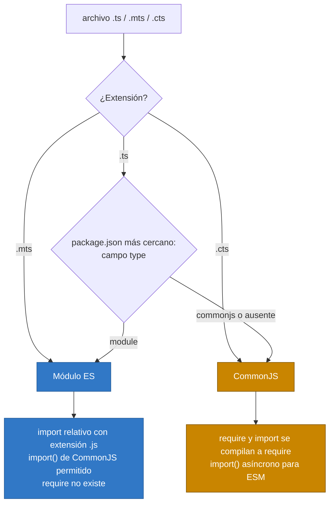

<div align="center">

# 08 · TypeScript 4.5–4.9: ESM en Node y `satisfies`

**`Awaited`, `type` en las importaciones, estrechamiento al desestructurar, `node16`, varianza explícita, `unknown` como `{} | null | undefined` y `satisfies` (2021–2022)**

[⬅ 07 · TypeScript 4.0–4.4](07-typescript-4.0-4.4-tuplas-variadicas-y-plantillas.md) · [🏠 Índice](../README.md) · [09 · TypeScript 5.0–5.4 ➡](09-typescript-5.0-5.4-decoradores-y-using.md)

</div>

<!-- ts=4.5 -->

| Ficha | 4.5 | 4.6 | 4.7 | 4.8 | 4.9 |
|---|---|---|---|---|---|
| **Publicación** | 17-nov-2021 | 28-feb-2022 | 24-may-2022 | 25-ago-2022 | 15-nov-2022 |
| **Protagonista** | `Awaited` | Desestructuración | ESM en Node | `unknown` y `{}` | `satisfies` |
| **Compilador** | `4.5.5` | `4.6.4` | `4.7.4` | `4.8.4` | `4.9.5` |

> [!IMPORTANT]
> La segunda mitad de la serie 4 tiene un protagonista que no es una característica del lenguaje: **Node.js y sus módulos ES**. El soporte de
> `node16` estaba listo para la 4.5, se retiró a última hora porque el ecosistema no lo estaba, y llegó por fin en la 4.7. Alrededor, el
> análisis de flujo aprende a seguir valores desestructurados y la 4.9 trae `satisfies`, probablemente el operador más útil desde `?.`.

---

## Contenido

1. [TypeScript 4.5: `Awaited` y recursión de cola](#1-typescript-45-awaited-y-recursión-de-cola)
2. [TypeScript 4.5: `type` en cada importación y `#x in obj`](#2-typescript-45-type-en-cada-importación-y-x-in-obj)
3. [TypeScript 4.6: estrechar lo desestructurado](#3-typescript-46-estrechar-lo-desestructurado)
4. [TypeScript 4.7: módulos ECMAScript en Node](#4-typescript-47-módulos-ecmascript-en-node)
5. [TypeScript 4.7: expresiones de instanciación y varianza explícita](#5-typescript-47-expresiones-de-instanciación-y-varianza-explícita)
6. [TypeScript 4.8: `unknown`, `{}` y `NonNullable`](#6-typescript-48-unknown--y-nonnullable)
7. [TypeScript 4.9: `satisfies`](#7-typescript-49-satisfies)
8. [TypeScript 4.9: `in`, `accessor` y `NaN`](#8-typescript-49-in-accessor-y-nan)
9. [Notas de migración](#9-notas-de-migración)
10. [Referencias](#10-referencias)

---

## 1. TypeScript 4.5: `Awaited` y recursión de cola

### `Awaited`

`await` desenvuelve promesas **de forma recursiva**: `await` sobre una `Promise<Promise<number>>` da un `number`. El tipo de `Promise.all` y de
las funciones `async` no sabía expresarlo, y cada biblioteca escribía su propio `Unwrap<T>` con resultados distintos. La 4.5 lo incorpora.

```ts debut
type A = Awaited<Promise<string>>;
//   ^? type A = string
type B = Awaited<Promise<Promise<number>>>;
//   ^? type B = number
type C = Awaited<boolean | Promise<number>>;
//   ^? type C = number | boolean

async function cargar<T>(valor: T | Promise<T>): Promise<Awaited<T>> {
    return await valor as Awaited<T>;
}
```

`Awaited` también entiende los objetos *thenable* (con un método `then`), como hace el runtime. Y desde la 4.5, `Promise.all`, `Promise.race` y
compañía están declarados con él.

### Eliminación de recursión de cola en condicionales

Un tipo condicional recursivo tenía un límite de 50 niveles. Desde la 4.5, si la llamada recursiva está **en posición de cola** —es el resultado
completo de una rama, sin envolverla en nada—, el compilador la evalúa como un bucle y el límite sube a 1000.

```ts debut
type SinEspaciosIniciales<T extends string> = T extends ` ${infer Resto}` ? SinEspaciosIniciales<Resto> : T;

// Cien espacios: imposible antes de la 4.5
type Limpio = SinEspaciosIniciales<"                                                                                                    x">;
const limpio: Limpio = "x";
```

```ts omitir
// En posición de cola: el resultado ES la llamada recursiva
type Cola<T> = T extends [infer _, ...infer R] ? Cola<R> : T;

// NO está en cola: la llamada queda dentro de una tupla
type NoCola<T> = T extends [infer C, ...infer R] ? [C, ...NoCola<R>] : [];
```

Para convertir lo segundo en lo primero se usa un **acumulador**, como en programación funcional. El patrón completo está en
[15 · Programación a nivel de tipos](15-programacion-a-nivel-de-tipos.md#6-recursión-límites-y-acumuladores).

### Lo demás de la 4.5

| Característica | Detalle |
|---|---|
| `module: es2022` | Formato de módulos con `await` de nivel superior |
| Plantillas como discriminantes | Una unión se estrecha por una propiedad cuyo tipo es un patrón `` `${string}Error` `` |
| `lib` desde `node_modules` | Un paquete `@typescript/lib-dom` sustituye a la biblioteca integrada; la 5.8 lo puso tras `libReplacement` y la 6.0 lo desactivó por defecto |
| Aserciones de importación | `import datos from "./d.json" assert { type: "json" }`; la propuesta cambió a `with` y `assert` es un error desde la 6.0 |
| Completado de JSX y de miembros de clase | El editor escribe el atributo con sus llaves y las firmas de los métodos a sobrescribir |

---

## 2. TypeScript 4.5: `type` en cada importación y `#x in obj`

### Modificador `type` por nombre

La 3.8 permitió `import type { … }` para la sentencia entera ([06 § `import type`](06-typescript-3.5-3.9-encadenamiento-y-aserciones.md#6-typescript-38-import-type)).
Si un módulo exporta tipos y valores, había que escribir dos importaciones. La 4.5 permite marcar cada nombre:

```ts debut
// @filename: modelo.ts
export interface Usuario { nombre: string; }
export function crear(nombre: string): Usuario { return { nombre }; }

// @filename: principal.ts
import { type Usuario, crear } from "./modelo";

const u: Usuario = crear("Ana");
```

| Forma | Desde | ¿Qué queda en el JavaScript con `verbatimModuleSyntax`? |
|---|---|---|
| `import type { Usuario } from "./m"` | 3.8 | Nada: la sentencia entera desaparece |
| `import { type Usuario, crear } from "./m"` | 4.5 | `import { crear } from "./m"` |
| `import { type Usuario } from "./m"` | 4.5 | `import {} from "./m"`: el módulo **se evalúa** |

La última fila es una sutileza que importa: con `verbatimModuleSyntax` (5.0), una importación con todos sus nombres marcados como `type`
conserva el efecto de cargar el módulo. Si no se quiere, se escribe `import type`.

### Comprobación de marca privada: `#x in obj`

ES2022 permite preguntar si un objeto tiene un campo `#privado` **sin** lanzar una excepción. TypeScript lo usa para estrechar:

```ts run debut
class Persona {
    #nombre: string;
    constructor(nombre: string) { this.#nombre = nombre; }

    static esPersona(valor: unknown): valor is Persona {
        return typeof valor === "object" && valor !== null && #nombre in valor;
    }

    igualA(otra: unknown): boolean {
        return Persona.esPersona(otra) && otra.#nombre === this.#nombre;
    }
}

const ana = new Persona("Ana");
console.log(ana.igualA(new Persona("Ana")), ana.igualA({ nombre: "Ana" }));   // → true false
```

A diferencia de `instanceof`, la comprobación funciona con objetos de otro *realm* (otro `iframe`, otro contexto de `vm`) y no se puede
falsificar alterando la cadena de prototipos.

---

<!-- ts=4.6 -->

## 3. TypeScript 4.6: estrechar lo desestructurado

### Uniones discriminadas desestructuradas

Desestructurar una unión discriminada rompía la relación entre sus propiedades: estrechar `tipo` no estrechaba `dato`. La 4.6 la conserva cuando
las variables son `const` (o parámetros que no se reasignan).

```ts run debut
type Accion =
    | { tipo: "sumar"; dato: number }
    | { tipo: "renombrar"; dato: string };

function aplicar(accion: Accion, total: number): string {
    const { tipo, dato } = accion;
    if (tipo === "sumar") {
        return String(total + dato);      // `dato` es number
    }
    return dato.toUpperCase();            // `dato` es string
}

console.log(aplicar({ tipo: "sumar", dato: 2 }, 40), aplicar({ tipo: "renombrar", dato: "ok" }, 0));   // → 42 OK
```

### Parámetros dependientes

Con un parámetro rest cuyo tipo es una **unión de tuplas**, estrechar el primer argumento estrecha los demás:

```ts debut
type Manejador = (...args: ["sumar", number] | ["gritar", string]) => string;

const manejar: Manejador = (operacion, valor) => {
    if (operacion === "sumar") {
        return valor.toFixed(1);     // number
    }
    return valor.toUpperCase();      // string
};
```

Es la manera de tipar un emisor de eventos sin sobrecargas: `on(evento, carga)` donde la carga depende del nombre del evento.

### Código antes de `super()`

En una clase derivada con campos inicializados, el compilador exigía que `super()` fuera la **primera** sentencia del constructor. La 4.6 permite
código antes, siempre que no use `this`:

```ts debut opts=target:es2015
class Base { }

class Derivada extends Base {
    creado = 0;
    constructor(marca: number) {
        const validada = Math.max(0, marca);   // permitido: no toca `this`
        super();
        this.creado = validada;
    }
}
```

### Lo demás de la 4.6

| Característica | Detalle |
|---|---|
| `target: es2022` | Campos de clase nativos, `Array.prototype.at`, `Object.hasOwn`, `cause` en los errores |
| Inferencia en accesos indexados | `T[K]` se infiere correctamente al recorrer claves genéricas |
| Detección de expansiones infinitas | Menos «Type instantiation is excessively deep» falsos |
| `@typescript/analyze-trace` | Herramienta que lee la salida de `--generateTrace` y señala los puntos calientes ([18 § Diagnosticar](18-bajo-el-capo-y-rendimiento.md#3-diagnosticar-una-compilación-lenta)) |
| Errores de sintaxis en `.js` | El editor señala redeclaraciones y modificadores inválidos también en JavaScript |

---

<!-- ts=4.7 -->

## 4. TypeScript 4.7: módulos ECMAScript en Node

### El problema

Node 12 añadió los módulos ES con unas reglas propias: el formato de cada archivo lo decide la extensión (`.mjs`, `.cjs`) o el campo `type` de
`package.json`; las importaciones relativas llevan **extensión obligatoria**; y los paquetes declaran sus puntos de entrada en `exports`. Nada de
eso existía en `moduleResolution: node` (hoy `node10`), que imitaba el `require` clásico.

### La solución

Dos valores nuevos para `module` y `moduleResolution`: `node16` (fijo) y `nodenext` (lo último que el compilador conozca). Con ellos,
TypeScript aplica exactamente las reglas de Node.



```ts debut opts=module:node16,moduleResolution:node16 err=TS2835
// @filename: package.json
{ "name": "demo", "type": "module" }

// @filename: util.ts
export const version = 1;

// @filename: principal.ts
import { version } from "./util";      // error TS2835: en ESM hace falta la extensión: "./util.js"
```

```ts opts=module:node16,moduleResolution:node16
// @filename: package.json
{ "name": "demo", "type": "module" }

// @filename: util.ts
export const version = 1;

// @filename: principal.ts
import { version } from "./util.js";   // se escribe .js aunque el archivo sea util.ts
const v: number = version;
```

> [!NOTE]
> La extensión `.js` en una importación de un archivo `.ts` desconcierta a todo el mundo la primera vez. La razón: TypeScript **no reescribía**
> las rutas, y lo que se escribe es lo que Node ejecutará después de compilar. La 5.7 añadió `rewriteRelativeImportExtensions` para quien prefiere
> escribir `.ts` ([10 § TypeScript 5.7](10-typescript-5.5-5.9-inferencia-y-sintaxis-borrable.md#6-typescript-57-variables-nunca-inicializadas-y-reescritura-de-extensiones)).

| Lo que entiende `node16` | Ejemplo |
|---|---|
| Campo `type` de `package.json` | `"type": "module"` |
| Extensiones `.mts` / `.cts` y sus declaraciones `.d.mts` / `.d.cts` | `servidor.mts` |
| `exports` y condiciones | `"exports": { ".": { "import": "./esm.js", "require": "./cjs.js" } }` |
| `imports` (subrutas privadas) | `import { log } from "#interno/log"` |
| `import.meta` y `await` de nivel superior en ESM | `const datos = await cargar()` |
| `resolution-mode` | `/// <reference types="x" resolution-mode="require" />` |

El capítulo [16 · Módulos y resolución](16-modulos-y-resolucion.md) trata todas las combinaciones, incluidas las que llegaron después: `bundler`
(5.0), `preserve` (5.4), `node18` (5.8) y `node20` (5.9).

### `moduleDetection`

Un archivo sin `import` ni `export` es un **script**: sus declaraciones son globales y chocan con las de otros scripts. Era una fuente constante
de errores en ejemplos y pruebas. `moduleDetection: force` trata cualquier archivo como módulo.

| Valor | Un archivo es módulo si… |
|---|---|
| `auto` (por defecto) | Tiene `import`/`export`, o el `package.json` dice `"type": "module"`, o es `.mts`/`.cts`, o es JSX con `react-jsx` |
| `legacy` | Tiene `import` o `export` (el comportamiento anterior a la 4.7) |
| `force` | Siempre |

Este atlas comprueba todos sus ejemplos con `force` a partir de la 4.7.

---

## 5. TypeScript 4.7: expresiones de instanciación y varianza explícita

### Expresiones de instanciación

Una función o clase genérica se puede **especializar** sin llamarla:

```ts run debut
const MapaDeErrores = Map<string, Error>;
const errores = new MapaDeErrores();
errores.set("fatal", new Error("disco lleno"));

function caja<T>(valor: T) { return { valor }; }
const cajaDeTexto = caja<string>;
//    ^? const cajaDeTexto: (valor: string) => { valor: string; }

console.log(errores.get("fatal")?.message, cajaDeTexto("hola").valor);   // → disco lleno hola
```

### Restricciones en `infer`

`infer X extends Restriccion` captura solo si lo capturado cumple la restricción, sin un condicional anidado:

```ts debut
type PrimeroSiTexto<T> = T extends [infer S extends string, ...unknown[]] ? S : never;

type A = PrimeroSiTexto<["hola", 1]>;
//   ^? type A = "hola"
type B = PrimeroSiTexto<[1, "hola"]>;
//   ^? type B = never
```

### Anotaciones de varianza

El compilador **deduce** la varianza de cada parámetro de tipo ([14 § Varianza](14-sistema-de-tipos-a-fondo.md#7-varianza)). Con tipos muy
recursivos, la deducción es lenta o se equivoca. Desde la 4.7 se puede declarar:

```ts debut
interface Productor<out T> { producir(): T; }
interface Consumidor<in T> { consumir(valor: T): void; }
interface Celda<in out T> { leer(): T; escribir(valor: T): void; }

declare let deAnimales: Productor<{ nombre: string }>;
declare let deGatos: Productor<{ nombre: string; maulla: true }>;
deAnimales = deGatos;      // covariante: un productor de gatos sirve como productor de animales
```

```ts err=TS2636
interface Caja<out T> {
    guardar: (valor: T) => void;    // error TS2636: T aparece en posición de entrada
}
```

El ejemplo usa una **propiedad** de tipo función a propósito. Si `guardar` se declarara como método (`guardar(valor: T): void`), el compilador no
protestaría: los parámetros de los métodos son bivariantes incluso con `strictFunctionTypes`
([04 § La excepción de los métodos](04-typescript-2.3-2.9-estricto-y-condicionales.md#la-excepción-deliberada-los-métodos)).

> [!WARNING]
> Las anotaciones `in` y `out` **no cambian** la relación estructural: el compilador comprueba que son coherentes con el uso y luego las usa
> como atajo. Su utilidad real es de **rendimiento** en bibliotecas con tipos muy recursivos, y de documentación. En código de aplicación casi
> nunca hacen falta.

### Lo demás de la 4.7

| Característica | Detalle |
|---|---|
| Estrechamiento en accesos con corchetes | `obj[clave]` se estrecha cuando `clave` es un literal o un `unique symbol` |
| Inferencia en objetos y métodos | En `{ producir() {…}, consumir: x => … }`, lo inferido de la primera propiedad llega a la segunda |
| `moduleSuffixes` | `[".ios", ""]` busca `boton.ios.ts` antes que `boton.ts`: pensado para React Native |
| Ir a la definición en el código fuente | Salta al `.js` o `.ts` real en lugar del `.d.ts` |
| Agrupación de importaciones | «Organizar importaciones» respeta los grupos separados por líneas en blanco |

---

<!-- ts=4.8 -->

## 6. TypeScript 4.8: `unknown`, `{}` y `NonNullable`

### El cambio

`{}` es el tipo de «cualquier valor que no sea `null` ni `undefined`» (no «un objeto vacío»). La 4.8 sacó las consecuencias:

| Antes de la 4.8 | Desde la 4.8 |
|---|---|
| `unknown` era un tipo opaco | `unknown` se comporta como `{} \| null \| undefined` |
| `NonNullable<T>` era `T extends null \| undefined ? never : T` | `NonNullable<T>` es `T & {}` |
| Comprobar `!== null && !== undefined` no estrechaba un `T` genérico | Lo estrecha a `T & {}` |

```ts debut
function intercambiar(x: unknown, y: {} | null | undefined): void {
    x = y;
    y = x;                 // 4.7: error; 4.8: son el mismo conjunto de valores
}

function exigirValor<T>(valor: T): {} {
    if (valor !== null && valor !== undefined) {
        return valor;      // 4.7: error; 4.8: `valor` es T & {}
    }
    throw new Error("vacío");
}
```

```ts run
function exigirValor<T>(valor: T): NonNullable<T> {
    if (valor === null || valor === undefined) {
        throw new Error("vacío");
    }
    return valor;          // T & {}, que es exactamente NonNullable<T>
}

function describir(x: unknown): string {
    if (x) {
        return typeof x;   // `x` es {}: cualquier cosa verdadera
    }
    return "falso o vacío";
}

console.log(exigirValor(0), describir("a"), describir(null));   // → 0 string falso o vacío
```

### `infer` en plantillas con restricción

Con la 4.7, `infer N extends number` dentro de una plantilla daba `number` a secas. La 4.8 lo convierte en el **literal**:

```ts debut
type ANumero<S> = S extends `${infer N extends number}` ? N : never;
type ABooleano<S> = S extends `${infer B extends boolean}` ? B : never;

type Cuarenta = ANumero<"42">;
//   ^? type Cuarenta = 42
type Cierto = ABooleano<"true">;
//   ^? type Cierto = true

// Con la 4.7, Cuarenta era `number` y esta línea no compilaba:
const esLiteral: number extends Cuarenta ? "no" : "sí" = "sí";
```

### Comparaciones imposibles

```ts debut err=TS2839
declare const lista: number[];
if (lista === []) {        // error TS2839: siempre es falso; los objetos se comparan por referencia
    console.log("vacía");
}
```

La 4.8 también aceleró un **10–25 %** las reconstrucciones con `--build`, `--watch` e `--incremental`, y añadió la preferencia del editor
`autoImportFileExcludePatterns` para que la importación automática ignore ciertos archivos.

---

<!-- ts=4.9 -->

## 7. TypeScript 4.9: `satisfies`

### El problema

Anotar un valor **comprueba** que encaja en el tipo, pero también **ensancha** el tipo de la variable al anotado y se pierde información. No
anotarlo conserva la información y no comprueba nada. Había que elegir.

```ts ts=4.8 err=TS2339
type Color = string | [number, number, number];

const paleta: Record<"rojo" | "verde", Color> = {
    rojo: [255, 0, 0],
    verde: "#00ff00",
};

paleta.verde.toUpperCase();     // error TS2339: para el compilador, `verde` es Color, no string
```

### La solución

`expresion satisfies Tipo` comprueba que la expresión es asignable al tipo y **deja el tipo inferido intacto**:

```ts run debut
type Color = string | [number, number, number];

const paleta = {
    rojo: [255, 0, 0],
    verde: "#00ff00",
} satisfies Record<"rojo" | "verde", Color>;

console.log(paleta.verde.toUpperCase(), paleta.rojo[0]);   // → #00FF00 255
```

Y sigue detectando los errores, incluidas las erratas en las claves:

```ts err=TS2561/TS2353/TS1360
type Color = string | [number, number, number];

const paleta = {
    rojo: [255, 0, 0],
    verdee: "#00ff00",          // error: la clave no existe en el tipo
} satisfies Record<"rojo" | "verde", Color>;
```

### Anotación, `as` y `satisfies`

| | `const x: T = valor` | `const x = valor as T` | `const x = valor satisfies T` |
|---|---|---|---|
| **¿Comprueba que `valor` encaja en `T`?** | Sí | Solo que no sean incompatibles | Sí |
| **¿Detecta propiedades sobrantes?** | Sí | No | Sí |
| **Tipo resultante de `x`** | `T` | `T` | El inferido de `valor` |
| **Uso típico** | Fijar un contrato | Saber más que el compilador (con cuidado) | Validar sin perder precisión |

Una combinación habitual es `as const satisfies T`: literales exactos e inmutables, validados contra un tipo:

```ts
type Ruta = { ruta: `/${string}`; publica: boolean };

const rutas = [
    { ruta: "/", publica: true },
    { ruta: "/admin", publica: false },
] as const satisfies readonly Ruta[];

type RutaConocida = (typeof rutas)[number]["ruta"];
//   ^? type RutaConocida = "/" | "/admin"
```

La guía para elegir entre las tres formas está en [21 · Guías de decisión](21-guias-de-decision.md#4-anotación-as-o-satisfies).

---

## 8. TypeScript 4.9: `in`, `accessor` y `NaN`

### `in` con propiedades no listadas

Antes, `"nombre" in valor` solo estrechaba si alguno de los tipos de una unión declaraba `nombre`. Desde la 4.9, si ninguno lo hace, el compilador
**añade** la propiedad al tipo como `unknown`:

```ts run debut
function leerNombre(valor: object): string {
    if ("nombre" in valor && typeof valor.nombre === "string") {
        return valor.nombre;       // valor: object & Record<"nombre", unknown>, y luego string
    }
    return "sin nombre";
}

console.log(leerNombre({ nombre: "Ana" }), leerNombre([]));   // → Ana sin nombre
```

Es lo que hace práctico validar datos de origen desconocido (`JSON.parse`, `fetch`) sin una biblioteca.

### Accesores automáticos

`accessor` es parte de la propuesta de decoradores de ES: declara un campo con un `get` y un `set` generados sobre un almacenamiento privado.
Sirve de punto de enganche para los decoradores de la 5.0.

```ts run debut
class Persona {
    accessor nombre = "Ana";
}

const p = new Persona();
p.nombre = "Luis";
const descriptor = Object.getOwnPropertyDescriptor(Persona.prototype, "nombre");
console.log(p.nombre, typeof descriptor?.get, Object.keys(p).length);   // → Luis function 0
```

### Comparaciones con `NaN`

```ts debut err=TS2845
declare const valor: number;
if (valor === NaN) {          // error TS2845: siempre es falso; usa Number.isNaN(valor)
    console.log("no es un número");
}
```

### Lo demás de la 4.9

| Característica | Detalle |
|---|---|
| Vigilancia por eventos del sistema | `--watch` deja de sondear los archivos en Linux y macOS |
| «Quitar importaciones sin usar» y «Ordenar importaciones» | Órdenes separadas en el editor |
| Ir a la definición de `return` | Salta a la firma de la función |
| Comprobación de `Promise.resolve` | Se declara con `Awaited` |

---

## 9. Notas de migración

| Versión | Cambio | Síntoma | Qué hacer |
|---|---|---|---|
| 4.5 | `lib.d.ts` cambia y `Awaited` entra en `Promise.all` | Tipos inferidos distintos en código con promesas anidadas | Normalmente mejora; revisar sobrecargas propias |
| 4.5 | `node12` y `nodenext` se retiran de la estable a última hora | Solo en compilaciones nocturnas | Esperar a la 4.7 |
| 4.6 | Comprobación de profundidad de recursión más estricta | TS2589 en tipos muy recursivos | Reescribir con recursión de cola |
| 4.7 | `node16`: extensiones obligatorias en ESM | TS2835 | Escribir `./archivo.js` |
| 4.7 | Los parámetros de tipo sin restricción ya no son asignables a `{}` | TS2322 en código genérico | Añadir `T extends {}` |
| 4.8 | `unknown` se estrecha como `{} \| null \| undefined`; `NonNullable` cambia | Tipos distintos en código genérico | Normalmente mejora |
| 4.8 | Los parámetros de tipo sin restricción no se asignan a `{}` ni en JavaScript | TS2322 en `.js` con `checkJs` | Igual que en TypeScript |
| 4.8 | Error al comparar con literales de objeto o arreglo | TS2839 | Comprobar la longitud o usar una función de igualdad |
| 4.9 | `in` exige que el lado derecho sea objeto | TS2361 | Comprobar antes con `typeof` |
| 4.9 | Las funciones `async` ya no aceptan `Promise` como tipo de retorno sin argumento genérico explícito en algunos casos | TS2322 | Anotar `Promise<T>` |

> [!NOTE]
> El cambio de la 4.8 sobre `{}` es de los que no se notan hasta que se notan: un `T` genérico que se pasaba a una función que aceptaba `{}`
> deja de compilar, porque `T` podría ser `null`. La corrección casi siempre es declarar `T extends {}` —o `T extends object` si se quiere
> excluir también los primitivos—.

---

## 10. Referencias

- Notas oficiales: [4.5](https://www.typescriptlang.org/docs/handbook/release-notes/typescript-4-5.html) · [4.6](https://www.typescriptlang.org/docs/handbook/release-notes/typescript-4-6.html) · [4.7](https://www.typescriptlang.org/docs/handbook/release-notes/typescript-4-7.html) · [4.8](https://www.typescriptlang.org/docs/handbook/release-notes/typescript-4-8.html) · [4.9](https://www.typescriptlang.org/docs/handbook/release-notes/typescript-4-9.html)
- Manual: [Módulos: referencia](https://www.typescriptlang.org/docs/handbook/modules/reference.html) · [Elegir opciones de compilación](https://www.typescriptlang.org/docs/handbook/modules/guides/choosing-compiler-options.html) · [Estrechamiento](https://www.typescriptlang.org/docs/handbook/2/narrowing.html)
- Node.js: [Módulos ECMAScript](https://nodejs.org/api/esm.html) · [Paquetes: `exports` e `imports`](https://nodejs.org/api/packages.html)
- Opciones: [`moduleDetection`](https://www.typescriptlang.org/tsconfig/#moduleDetection) · [`moduleSuffixes`](https://www.typescriptlang.org/tsconfig/#moduleSuffixes)
- Pruebas de debut: [25 · TypeScript 4.5](25-pruebas-de-debut.md#typescript-45) a [4.9](25-pruebas-de-debut.md#typescript-49)
