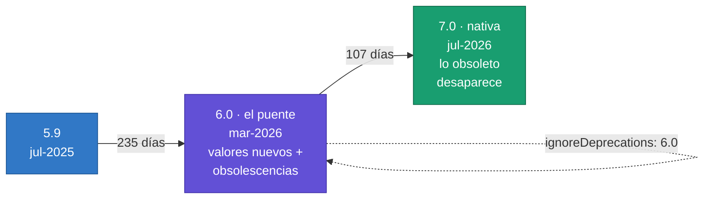
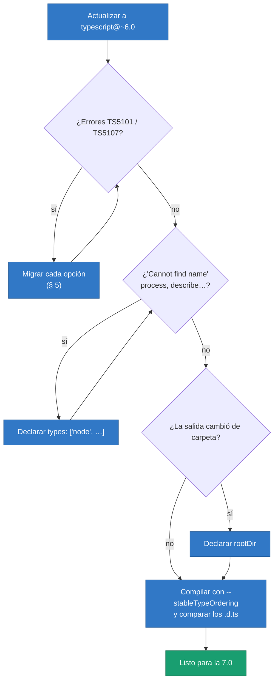

<div align="center">

# 11 · TypeScript 6.0: el puente

**La última versión del compilador escrito en TypeScript: valores por defecto nuevos, la mayor ronda de obsolescencias de la historia y las herramientas para saltar a la 7.0 (marzo de 2026)**

[⬅ 10 · TypeScript 5.5–5.9](10-typescript-5.5-5.9-inferencia-y-sintaxis-borrable.md) · [🏠 Índice](../README.md) · [12 · TypeScript 7 ➡](12-typescript-7-el-compilador-nativo.md)

</div>

<!-- ts=6.0 -->

| Ficha | TypeScript 6.0 |
|---|---|
| **Publicación** | 23 de marzo de 2026 (beta: 11 de febrero; candidata: 6 de marzo) |
| **Días desde la 5.9** | 235: la pausa más larga desde 2016 |
| **Motor** | Strada, el compilador en TypeScript, por **última vez** |
| **Compilador de este capítulo** | `6.0.3`, comparado con `5.9.3` y `7.0.2` |
| **Papel** | Puente: todo lo que compila sin avisos en la 6.0 debe compilar igual en la 7.0 |
| **Paquete de compatibilidad** | `@typescript/typescript6` (ejecutable `tsc6`), publicado junto a la 7.0 |

> [!IMPORTANT]
> La 6.0 no se diseñó para añadir cosas, sino para **quitar**: cambia los valores por defecto que llevaban una década anclados en 2012 y marca
> como obsoleto todo lo que el compilador nativo no iba a soportar. Lo obsoleto sigue funcionando con `"ignoreDeprecations": "6.0"`, y desaparece
> sin remedio en la 7.0. Quien migre a la 6.0 **sin** esa opción y sin avisos ha hecho ya casi todo el trabajo de la 7.0.

---

## Contenido

1. [Por qué una versión puente](#1-por-qué-una-versión-puente)
2. [Lo nuevo del lenguaje y de la biblioteca](#2-lo-nuevo-del-lenguaje-y-de-la-biblioteca)
3. [Los nuevos valores por defecto](#3-los-nuevos-valores-por-defecto)
4. [`types` y `rootDir`: los dos cambios que más rompen](#4-types-y-rootdir-los-dos-cambios-que-más-rompen)
5. [Lo que queda obsoleto](#5-lo-que-queda-obsoleto)
6. [`--stableTypeOrdering`: ensayar el orden de la 7.0](#6---stabletypeordering-ensayar-el-orden-de-la-70)
7. [`tsc archivo.ts` y `--ignoreConfig`](#7-tsc-archivots-y---ignoreconfig)
8. [Lista de comprobación: de la 5.9 a la 6.0](#8-lista-de-comprobación-de-la-59-a-la-60)
9. [Referencias](#9-referencias)

---

## 1. Por qué una versión puente

En marzo de 2025 el equipo anunció que portaba el compilador a Go ([12 · TypeScript 7](12-typescript-7-el-compilador-nativo.md)). Un *port* —no una
reescritura— tiene una condición: el comportamiento debe ser **idéntico**. Pero había partes del compilador que nadie quería portar: emitir
ES5, los formatos AMD, UMD y SystemJS, la resolución `classic`, `outFile`… Y había valores por defecto que ya nadie defendía: `strict` desactivado,
`target: es5`, todas las carpetas de `@types` cargadas a la vez.

La solución fue partir el cambio en dos versiones:



| | 5.9 | 6.0 | 7.0 |
|---|---|---|---|
| **Compilador** | Strada (TypeScript) | Strada (TypeScript) | Corsa (Go) |
| **Valores por defecto** | Los de siempre | **Nuevos** | Los de la 6.0 |
| **Opciones obsoletas** | Las de la 5.0, ya retiradas | **Avisan** (TS5101/TS5107); se silencian con `ignoreDeprecations` | **Error sin remedio** (TS5102/TS5108) |
| **Orden de los tipos** | Por orden de creación | Igual, o estable con `--stableTypeOrdering` | Siempre estable |
| **API para herramientas** | Sí | Sí, la última | No hasta la 7.1 |

> [!NOTE]
> No hubo 6.1. La 6.0 recibió parches (6.0.2 y 6.0.3), pero la siguiente versión menor fue directamente la 7.0. El paquete
> `@typescript/typescript6` mantiene vivo el compilador 6.0 para las herramientas que necesitan su API mientras la 7.x no la ofrece completa.

---

## 2. Lo nuevo del lenguaje y de la biblioteca

### Funciones sin `this`, menos sensibles al contexto

Una función con parámetros sin anotar es **sensible al contexto**: la inferencia la aparca hasta haber deducido los parámetros de tipo con el resto
de argumentos. Un método escrito con sintaxis de método (`consumir(y) {}`) tiene además un `this` implícito, y por eso se trataba como sensible
**aunque no usara `this`**. El resultado: el orden de las propiedades de un objeto cambiaba la inferencia.

```ts solo=5.9 err=TS18046/TS2339
declare function conectar<T>(extremos: { producir: (x: number) => T; consumir: (y: T) => void }): void;

conectar({
    consumir(y) { return y.toFixed(); },    // 5.9: error, `y` es unknown
    producir(x: number) { return x * 2; },
});
```

```ts debut
declare function conectar<T>(extremos: { producir: (x: number) => T; consumir: (y: T) => void }): void;

conectar({
    consumir(y) { return y.toFixed(); },    // 6.0: `y` es number, como si fuera una flecha
    producir(x: number) { return x * 2; },
});
```

### Importaciones de subruta `#/`

El campo `imports` de `package.json` define alias privados de un paquete (`#interno/*`). Node exigía algo después de la almohadilla; versiones
recientes de Node 20 admiten el prefijo desnudo `#/`, y la 6.0 lo entiende con `nodenext` y `bundler`:

```ts debut opts=rootDir:.
// @filename: package.json
{ "name": "tienda", "type": "module", "imports": { "#/*": "./*.ts" } }

// @filename: util/precio.ts
export const conIva = (n: number): number => n * 1.21;

// @filename: principal.ts
import { conIva } from "#/util/precio";
const total: number = conIva(100);
```

Es la alternativa estándar a los alias de `paths` que dependían de `baseUrl`, ahora obsoleto ([§ 5](#5-lo-que-queda-obsoleto)).

### `bundler` con `module: commonjs`

Hasta la 5.9, `moduleResolution: bundler` exigía `module: esnext` o `preserve`. La 6.0 permite combinarlo con `commonjs`. Es la salida natural para
los proyectos que usaban `moduleResolution: node` (ahora obsoleto) con salida CommonJS:

```ts debut opts=module:commonjs,moduleResolution:bundler
export const formato = "commonjs con resolución de empaquetador";
```

### Biblioteca: `es2025`, `Temporal`, `getOrInsert` y `RegExp.escape`

| Novedad | `lib` | Estado en TC39 |
|---|---|---|
| `target` y `lib` `es2025` | `es2025` | ES2025 publicado |
| `Promise.try`, métodos de `Set`, auxiliares de iteradores | Pasan de `esnext` a `es2025` | ES2025 |
| `RegExp.escape` | `es2025` | ES2025 |
| `Temporal` | `esnext` o `esnext.temporal` | Stage 4 desde marzo de 2026: ES2027 |
| `Map.prototype.getOrInsert` · `getOrInsertComputed` (y en `WeakMap`) | `esnext` | Stage 4: ES2026 |
| `dom` incluye `dom.iterable` y `dom.asynciterable` | `dom` | — |

```ts run debut
const ahora = Temporal.PlainDate.from("2026-03-23");
const lanzamiento7 = ahora.add({ days: 107 });

const contadores = new Map<string, number>();
contadores.set("visitas", contadores.getOrInsert("visitas", 0) + 1);
const largo = contadores.getOrInsertComputed("clics", (clave) => clave.length);

const patron = new RegExp(RegExp.escape("1+1=2?"));

console.log(lanzamiento7.toString(), contadores.get("visitas"), largo, patron.test("¿1+1=2?"));   // → 2026-07-08 1 5 true
```

> [!NOTE]
> El ejemplo calcula la fecha de la 7.0 a partir de la 6.0 sumando los 107 días que las separan. Se ejecuta en Node 26, que ya implementa
> `Temporal`, `getOrInsert` y `RegExp.escape`; con versiones anteriores, el código compila pero falla en ejecución. Es la regla de siempre:
> `lib` declara, no implementa ([01 § `lib` no es `target`](01-modelo-de-versiones.md#lib-no-es-target)).

---

## 3. Los nuevos valores por defecto

Esta es la tabla más importante del capítulo. Cualquier opción que **no** escribas en tu `tsconfig.json` toma ahora un valor distinto:

| Opción | Hasta la 5.9 | Desde la 6.0 | Qué rompe si no la escribes |
|---|---|---|---|
| `strict` | `false` | **`true`** | Todo el código que dependía de `any` implícito y de `null` permisivo |
| `module` | `commonjs` (con destinos antiguos) | **`esnext`** | Proyectos que ejecutaban la salida de `tsc` en Node CommonJS |
| `target` | `es5` | **`es2025`, flotante** | Nada en compilación; el JavaScript emitido deja de funcionar en runtimes antiguos |
| `types` | Todo `node_modules/@types` | **`[]`** | `process`, `describe`, `Buffer`… desaparecen ([§ 4](#4-types-y-rootdir-los-dos-cambios-que-más-rompen)) |
| `rootDir` | Carpeta común de los archivos de entrada | **La del `tsconfig.json`** | La salida aparece en `dist/src/` en vez de en `dist/` |
| `noUncheckedSideEffectImports` | `false` | **`true`** | `import "./algo.css"` sin declaración ([10 § 5.6](10-typescript-5.5-5.9-inferencia-y-sintaxis-borrable.md#5-typescript-56-importaciones-de-efecto-y---nocheck)) |
| `libReplacement` | `true` | **`false`** | Proyectos que sustituían `lib.dom` con `@typescript/lib-dom` |
| `esModuleInterop` · `allowSyntheticDefaultImports` | `false` | **`true`, y ya no se pueden desactivar** | `import * as express from "express"` deja de ser la forma correcta |
| `alwaysStrict` | `false` (salvo con `strict`) | **Siempre**: no se puede desactivar | Código *sloppy* que usa `static`, `await` o `public` como identificadores |

La prueba más directa: el mismo archivo, **sin ninguna opción**, en la 5.9 y en la 6.0.

```ts debut predeterminado err=TS7006
function identidad(valor) {   // 6.0: error TS7006, `valor` tiene un `any` implícito
    return valor;
}
```

```ts debut predeterminado
const visitas = new Map<string, number>();   // 5.9 sin opciones: destino ES5, `Map` no existe
visitas.set("inicio", 1);
```

> [!CAUTION]
> El `target` **flotante** es el cambio con más letra pequeña. «Lo último» era `es2025` en la 6.0 y la 7.0, y es `es2026` en la 7.1 beta: el mismo
> `tsconfig.json` sin `target` emite distinto JavaScript según la versión del compilador. Para código que corre en un runtime concreto, escribe
> el destino. La tabla de qué `target` necesita cada runtime está en [17 · `tsconfig` de referencia](17-tsconfig-de-referencia.md#2-recetas-para-2026).

---

## 4. `types` y `rootDir`: los dos cambios que más rompen

### `types: []`

Hasta la 5.9, el compilador incluía **todos** los paquetes de `node_modules/@types` como globales. En un proyecto con cien dependencias, eso
significaba cargar las declaraciones de Jest, Mocha, Node y jQuery a la vez, aunque el código no usara ninguna. La 6.0 no carga ninguno salvo que
se pida:

```jsonc
{
  "compilerOptions": {
    "types": ["node", "vitest/globals"]   // solo lo que el código usa como global
  }
}
```

| Síntoma tras actualizar | Causa | Solución |
|---|---|---|
| `Cannot find name 'process'` / `'Buffer'` / `'__dirname'` | Faltan los tipos de Node | `"types": ["node"]` |
| `Cannot find name 'describe'` / `'it'` / `'expect'` | Faltan los globales de pruebas | `"types": ["jest"]` o `"vitest/globals"` |
| `Cannot find module 'fs'` | Lo mismo, visto desde un `import` | `"types": ["node"]` |
| Funciona en el editor y no en `tsc` | El editor carga otro `tsconfig.json` | Revisar `include` y `types` de cada configuración |

`"types": ["*"]` recupera el comportamiento anterior, pero no se recomienda: las notas oficiales cuentan proyectos que ganaron entre un **20 % y
un 50 %** de tiempo de compilación solo por declarar `types`.

> [!TIP]
> `types` solo afecta a los paquetes **globales**. Un `import { readFile } from "node:fs"` carga los tipos de Node aunque `types` esté vacío,
> porque los importa explícitamente. Lo que deja de funcionar es usar `process` sin importarlo.

### `rootDir` en la carpeta del `tsconfig.json`

```text
proyecto/                       5.9 (rootDir inferido = src/)    6.0 (rootDir = proyecto/)
├── tsconfig.json               dist/
├── src/                        ├── index.js                     dist/
│   ├── index.ts                └── util/                        └── src/
│   └── util/                       └── fecha.js                     ├── index.js
│       └── fecha.ts                                                 └── util/fecha.js
└── dist/
```

Si un `package.json` apunta a `dist/index.js`, la 6.0 rompe el paquete sin dar un solo error de compilación. La corrección es una línea:
`"rootDir": "./src"`. La herramienta experimental `ts5to6` la añade automáticamente, junto con la migración de `baseUrl`.

---

## 5. Lo que queda obsoleto

Todo lo de esta tabla da un error en la 6.0 **salvo** que el `tsconfig.json` diga `"ignoreDeprecations": "6.0"`, y es un error sin remedio en la 7.0.
Los códigos se midieron con los compiladores `6.0.3` y `7.0.2`.

| Obsoleto | 6.0 sin `ignoreDeprecations` | 6.0 con `ignoreDeprecations` | 7.0 | Alternativa |
|---|---|---|---|---|
| `target: es5` | TS5107 | ✅ | TS5108 | `es2015` o superior; ES5 con Babel o swc |
| `downlevelIteration` | TS5101 | ✅ | TS5102 | Ninguna: solo afectaba a ES5 |
| `moduleResolution: node` / `node10` | TS5107 | ✅ | TS5108 | `nodenext` (Node) o `bundler` (empaquetadores, Bun) |
| `moduleResolution: classic` | TS5107 | ✅ | TS5108 | Ídem |
| `module: amd` / `umd` / `system` | TS5107 | ✅ | TS5108 | `esnext` o `preserve` y un empaquetador |
| `module: none` | TS5107 | ✅ | TS6046 (valor desconocido) | `esnext` |
| `outFile` | TS5101 | Solo con `amd`/`system` (TS6082) | TS5102 | Un empaquetador |
| `baseUrl` | TS5101 | ✅ | TS5102 | `paths` con rutas relativas (`"./src/*"`) o `imports` con `#/` |
| `esModuleInterop: false` | TS5107 | ✅ | TS5108 | `import express from "express"` |
| `allowSyntheticDefaultImports: false` | TS5107 | ✅ | TS5108 | Ídem |
| `alwaysStrict: false` | TS5107 | ✅ | TS5108 | Renombrar identificadores reservados |
| `module Nombre { }` (palabra clave) | TS1540 | TS1540 | TS1540 | `namespace Nombre { }` |
| `import … assert { }` | Error | Error | Error | `import … with { }` |
| `/// <reference no-default-lib="true"/>` | Error | Error | Error | `--noLib` o `--libReplacement` |

```ts hasta=6.0 luego=TS5102 opts=baseUrl:.,ignoreDeprecations:6.0
// 6.0: compila gracias a ignoreDeprecations; 7.0: error TS5102, la opción ya no existe
export const conBaseUrl = true;
```

```ts solo=6.0 opts=baseUrl:. err=TS5101
export const sinPermiso = true;   // 6.0 sin ignoreDeprecations: error TS5101
```

```ts err=TS1540
module Antiguo {            // error TS1540: usa `namespace`
    export const x = 1;
}
```

### `baseUrl`

`baseUrl` tenía dos efectos: servir de raíz para las rutas de `paths` y **convertir cualquier importación no relativa en una búsqueda en esa
carpeta**. El segundo efecto era una fuente de confusión —`import "utils"` podía encontrar `src/utils.ts` en lugar del paquete npm `utils`— y
ningún runtime lo reproducía. Desde la 4.1, `paths` funciona sin `baseUrl` ([07 § 4.1](07-typescript-4.0-4.4-tuplas-variadicas-y-plantillas.md#4-typescript-41-remapeo-de-claves-y-condicionales-recursivos)):

```jsonc
// Antes
{ "compilerOptions": { "baseUrl": "./src", "paths": { "@app/*": ["app/*"] } } }

// Después: las rutas de `paths` son relativas al tsconfig.json
{ "compilerOptions": { "paths": { "@app/*": ["./src/app/*"] } } }

// Si el código dependía de la búsqueda implícita, esta entrada la reproduce
{ "compilerOptions": { "paths": { "*": ["./src/*"] } } }
```

### `esModuleInterop` siempre activo

Con `esModuleInterop: false`, un módulo CommonJS se importaba con `import * as express from "express"` y se llamaba `express()`, algo que la
especificación de módulos ES no permite: un espacio de nombres no es invocable. Con la opción activa —ahora obligatoria— la forma correcta es
`import express from "express"` ([04 § `esModuleInterop`](04-typescript-2.3-2.9-estricto-y-condicionales.md#6-typescript-27-esmoduleinterop)).

---

## 6. `--stableTypeOrdering`: ensayar el orden de la 7.0

### El problema

El compilador asigna a cada tipo un identificador interno en el **orden en que lo encuentra**, y ordena las uniones por ese identificador. Por eso
una línea sin relación aparente puede cambiar cómo se escribe un tipo en los mensajes y en los `.d.ts`. El compilador nativo comprueba archivos
**en paralelo**: no hay un orden de encuentro único, así que la 7.0 ordena los tipos **por su contenido**.

Este es el `.d.ts` que emiten tres compiladores para el mismo archivo:

```ts omitir
const previo = { z: true };
const otro = "beta";                 // crea el tipo "beta" antes que "alfa"
export function a(c: boolean) { return c ? "alfa" : "beta"; }
export const lista = [{ y: 1 }, { z: true }];
```

| Compilador | `a(c: boolean)` | Elementos de `lista` |
|---|---|---|
| 6.0 | `"beta" \| "alfa"` | `{ y: number; z?: undefined }` · `{ z: boolean; y?: undefined }` |
| 6.0 con `--stableTypeOrdering` | `"alfa" \| "beta"` | `{ z?: undefined; y: number }` · `{ y?: undefined; z: boolean }` |
| 7.0 | `"alfa" \| "beta"` | `{ z?: undefined; y: number }` · `{ y?: undefined; z: boolean }` |

### La opción

`--stableTypeOrdering` hace que la 6.0 ordene como la 7.0. No cambia qué compila —salvo en casos de inferencia que dependían del orden—, pero
permite comparar los `.d.ts` y los mensajes de error de ambas versiones antes de migrar.

```ts debut opts=stableTypeOrdering
export const ordenEstable = true;
```

> [!WARNING]
> La opción puede hacer la comprobación **hasta un 25 % más lenta**. Es una herramienta de diagnóstico para la migración, no una configuración
> permanente. En la 7.0 el orden estable es obligatorio y no tiene coste, porque el diseño del compilador lo necesita
> ([12 § Orden determinista](12-typescript-7-el-compilador-nativo.md#5-orden-determinista-de-tipos)).

Si con la opción aparecen errores nuevos, suelen ser inferencias que dependían del orden. Se corrigen anotando un argumento de tipo o una variable.

---

## 7. `tsc archivo.ts` y `--ignoreConfig`

`tsc archivo.ts` en una carpeta con `tsconfig.json` **ignoraba la configuración en silencio** y compilaba el archivo con las opciones por
defecto. Era una trampa clásica: el mismo archivo daba errores distintos con `tsc` y con `tsc archivo.ts`. Desde la 6.0 es un error:

```text
$ tsc principal.ts
error TS5112: tsconfig.json is present but will not be loaded if files are specified on commandline.
Use '--ignoreConfig' to skip this error.

$ tsc --ignoreConfig principal.ts      # compila solo ese archivo, sin la configuración, a propósito
```

---

## 8. Lista de comprobación: de la 5.9 a la 6.0



1. **Escribe lo que antes era implícito.** Declara en el `tsconfig.json` los valores que tu proyecto necesita: `target`, `module`, `types`,
   `rootDir` y, si de verdad hace falta, `"strict": false`. Así el cambio de valores por defecto no te afecta.
2. **Elimina las opciones obsoletas**, una por una, con la tabla del § 5. Usa `ignoreDeprecations: "6.0"` solo como andamio temporal: en la 7.0 no
   sirve de nada.
3. **Comprueba la salida**, no solo los errores: carpeta de `dist`, extensiones y formato de módulos.
4. **Prueba `--stableTypeOrdering`** una vez y compara los `.d.ts` publicados.
5. **Prueba el compilador nativo** (`npx tsc` de la 7.0) en paralelo antes de cambiar el editor.

La receta completa, con los pasos de la 7.0, está en [23 · Migración y ciclo de vida](23-migracion-y-ciclo-de-vida.md#5-de-59-a-60).

---

## 9. Referencias

- [Anuncio de TypeScript 6.0](https://devblogs.microsoft.com/typescript/announcing-typescript-6-0/) (23 de marzo de 2026) · [Beta](https://devblogs.microsoft.com/typescript/announcing-typescript-6-0-beta/) · [Candidata](https://devblogs.microsoft.com/typescript/announcing-typescript-6-0-rc/)
- Opciones: [`ignoreDeprecations`](https://www.typescriptlang.org/tsconfig/#ignoreDeprecations) · [`types`](https://www.typescriptlang.org/tsconfig/#types) · [`rootDir`](https://www.typescriptlang.org/tsconfig/#rootDir) · [`paths`](https://www.typescriptlang.org/tsconfig/#paths)
- Node.js: [Subrutas de importación](https://nodejs.org/api/packages.html#subpath-imports)
- TC39: [Temporal](https://github.com/tc39/proposal-temporal) · [Upsert](https://github.com/tc39/proposal-upsert) · [`RegExp.escape`](https://github.com/tc39/proposal-regex-escaping)
- Pruebas de debut: [25 · TypeScript 6.0](25-pruebas-de-debut.md#typescript-60)
