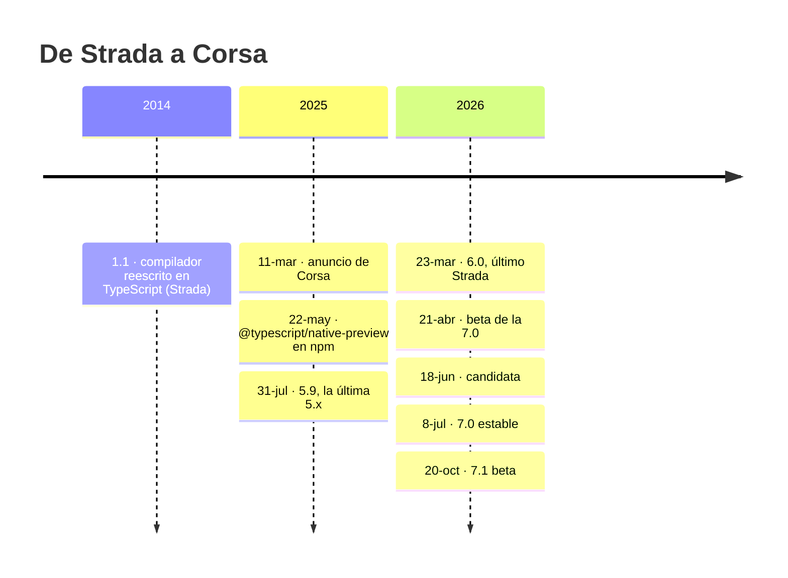

<div align="center">

# 12 · TypeScript 7: el compilador nativo

**Corsa: el compilador portado a Go, entre 8 y 12 veces más rápido, con comprobación en paralelo, orden determinista y servidor LSP; y la 7.1 beta, con la API estable y los *content mappers* (2025–2026)**

[⬅ 11 · TypeScript 6.0](11-typescript-6.0-el-puente.md) · [🏠 Índice](../README.md) · [13 · Hilos evolutivos ➡](13-hilos-evolutivos.md)

</div>

<!-- ts=7.0 -->

| Ficha | 7.0 🟢 | 7.1 🟡 |
|---|---|---|
| **Publicación** | 8 de julio de 2026 | Beta el 20 de octubre de 2026; candidata anunciada para «un mes después» |
| **Beta · candidata** | 21 de abril · 18 de junio de 2026 | — |
| **Compilador de este capítulo** | `7.0.2` | `7.1.0-beta` |
| **Motor** | Corsa (Go) | Corsa (Go) |
| **Velocidad** | Entre 8 y 12 veces más rápido que la 6.0 en compilaciones completas | Otro 13–47 % menos de tiempo que la 7.0 |
| **API para herramientas** | Inestable (`typescript/unstable/*`) | Estable: `typescript/sync`, `async`, `fs`, `ast` |
| **`target` por defecto** | `es2025` | `es2026` |

> [!IMPORTANT]
> TypeScript 7 **no es un lenguaje nuevo**: es el mismo comprobador de tipos, portado función a función a otro lenguaje de programación. Un proyecto
> que compila sin avisos en la 6.0 (sin `ignoreDeprecations` y con `--stableTypeOrdering`) debe compilar igual en la 7.0. Lo que cambia es todo lo
> demás: la velocidad, el paralelismo, el editor, el paquete npm y la API.

---

## Contenido

1. [Por qué Go: Strada, Corsa y un *port*](#1-por-qué-go-strada-corsa-y-un-port)
2. [Las cifras](#2-las-cifras)
3. [Paralelismo: `--checkers`, `--builders` y `--singleThreaded`](#3-paralelismo---checkers---builders-y---singlethreaded)
4. [Lo que cambia para el código](#4-lo-que-cambia-para-el-código)
5. [Orden determinista de tipos](#5-orden-determinista-de-tipos)
6. [El editor: de `tsserver` a LSP](#6-el-editor-de-tsserver-a-lsp)
7. [Convivir con la 6.0: la API que falta](#7-convivir-con-la-60-la-api-que-falta)
8. [TypeScript 7.1 (beta): la API y los *content mappers*](#8-typescript-71-beta-la-api-y-los-content-mappers)
9. [Notas de migración](#9-notas-de-migración)
10. [Referencias](#10-referencias)

---

## 1. Por qué Go: Strada, Corsa y un *port*

### El techo de Strada

El compilador de TypeScript estaba escrito en TypeScript desde la 1.1 (2014). Ese compilador —llamado internamente **Strada**— es un programa
JavaScript que corre en Node, en **un solo hilo**, con un recolector de basura pensado para páginas web. En proyectos de millones de líneas, el
techo era evidente: minutos para una compilación completa, decenas de segundos para que el editor mostrara el primer error.

El 11 de marzo de 2025 el equipo anunció el proyecto **Corsa**: llevar el compilador a código nativo. El nombre del repositorio lo dice todo:
`microsoft/typescript-go`.

### *Port*, no reescritura

La decisión clave fue **portar** y no reescribir. Reescribir permite mejorar el diseño, pero produce un compilador que se comporta distinto en
miles de casos límite que millones de proyectos dan por supuestos. Portar significa traducir cada función a su equivalente, conservando la
estructura, los nombres y la lógica. Por eso la 7.0 da los mismos errores que la 6.0.

| Criterio | Por qué Go encaja |
|---|---|
| **Parecido estructural** | El compilador usa funciones y estructuras de datos, no jerarquías de clases: se traduce casi línea a línea |
| **Memoria** | Control del diseño de las estructuras en memoria, con un recolector de basura (el compilador crea grafos cíclicos enormes) |
| **Concurrencia** | Hilos ligeros con memoria compartida: el análisis, la comprobación y la emisión se reparten entre núcleos |
| **Portabilidad** | Binarios nativos para 20 combinaciones de sistema y arquitectura, sin toolchain de C++ |

### Cronología



---

## 2. Las cifras

### Compilaciones completas

Cifras del anuncio oficial: TypeScript 6.0 frente a 7.0, con la configuración por defecto (cuatro comprobadores).

| Proyecto | 6.0 | 7.0 | Aceleración |
|---|---:|---:|---:|
| VS Code | 125,7 s | 10,6 s | **11,9×** |
| Sentry | 139,8 s | 15,7 s | **8,9×** |
| Bluesky | 24,3 s | 2,8 s | **8,7×** |
| Playwright | 12,8 s | 1,47 s | **8,7×** |
| tldraw | 11,2 s | 1,46 s | **7,7×** |

### Memoria

Contra lo que cabría esperar de un programa en paralelo, la 7.0 usa **menos** memoria total:

| Proyecto | 6.0 | 7.0 | Diferencia |
|---|---:|---:|---:|
| VS Code | 5,2 GB | 4,2 GB | −18 % |
| Sentry | 4,9 GB | 4,6 GB | −6 % |
| Bluesky | 1,8 GB | 1,3 GB | −26 % |
| Playwright | 1,0 GB | 0,9 GB | −11 % |
| tldraw | 0,6 GB | 0,5 GB | −15 % |

### El editor y los equipos

| Medida | Antes | Con la 7.0 |
|---|---|---|
| Abrir un archivo con un error en el repositorio de VS Code | ≈ 17,5 s | < 1,3 s (más de 13×) |
| Slack: comprobación de tipos en CI | ≈ 7,5 min | ≈ 1,25 min; 40 % menos de tiempo en la cola de integración |
| Canva: tiempo hasta el primer error en el editor | ≈ 58 s | ≈ 4,8 s |
| Órdenes del editor que fallan | — | Más de un 80 % menos |
| Caídas del servidor de lenguaje | — | Más de un 60 % menos |

> [!NOTE]
> «Diez veces más rápido» es la frase del anuncio y una buena aproximación, pero el factor depende del proyecto. Con un solo núcleo, el código
> nativo ya es varias veces más rápido; el resto llega del paralelismo, que gana más cuantos más archivos independientes tenga el proyecto.

---

## 3. Paralelismo: `--checkers`, `--builders` y `--singleThreaded`

La 7.0 analiza, comprueba y emite **en paralelo**. El análisis sintáctico y la emisión escalan casi linealmente con los archivos. La comprobación
de tipos es más difícil de repartir, porque un archivo necesita los tipos de otros; la 7.0 la reparte entre un número fijo de comprobadores.

| Opción | Valor por defecto | Qué controla |
|---|---|---|
| `--checkers N` | **4** | Comprobadores de tipos por proyecto. Más rápido con más núcleos, a cambio de memoria |
| `--builders N` | — | Referencias de proyecto que se construyen a la vez con `--build`. Se **multiplica** por `--checkers` |
| `--singleThreaded` | `false` | Todo en un hilo: depuración, comparación de rendimiento, entornos con pocos recursos |

Con `--checkers 8`, el anuncio da: VS Code 7,51 s (16,7×), Sentry 12,08 s (11,6×), Bluesky 2,01 s (12,1×). Con `--checkers 4 --builders 4`, un
monorrepo puede tener hasta 16 comprobadores trabajando a la vez.

```bash
tsc --checkers 8                 # máquina de CI con muchos núcleos
tsc -b --builders 4              # monorrepo con referencias de proyecto
tsc --singleThreaded --pprofDir ./perfiles   # perfilar en un solo hilo
```

> [!WARNING]
> El número de comprobadores puede, en casos raros, cambiar **qué** errores se encuentran primero en código cuya inferencia depende del orden.
> Por eso conviene fijar `--checkers` al mismo valor en todas las máquinas, y por eso la 7.0 hace obligatorio el orden determinista de tipos
> ([§ 5](#5-orden-determinista-de-tipos)).

### Opciones nuevas de la línea de órdenes

| Opción | Para qué |
|---|---|
| `--quiet` / `-q` | Suprime la salida que no son errores |
| `--pprofDir <carpeta>` | Escribe perfiles de CPU y memoria en formato pprof, la herramienta estándar de Go |
| `--deduplicatePackages` | Trata como uno solo los paquetes duplicados con el mismo nombre y versión en `node_modules` |

### `--watch` reescrito

El modo vigilancia de la 7.0 se apoya en una adaptación a Go del vigilante de archivos del empaquetador Parcel (`@parcel/watcher`), con unas
pocas rutinas en ensamblador en lugar de una dependencia de C++. Los intentos anteriores, basados en sondear los archivos periódicamente,
resultaron demasiado costosos con `node_modules` grandes.

---

## 4. Lo que cambia para el código

### Lo obsoleto en la 6.0 desaparece

Todo lo que la 6.0 marcó como obsoleto es un error sin remedio: `ignoreDeprecations: "6.0"` ya no tiene efecto. La tabla con los códigos está en
[11 § Lo que queda obsoleto](11-typescript-6.0-el-puente.md#5-lo-que-queda-obsoleto).

```ts ts=6.0 hasta=6.0 luego=TS5108 opts=target:es5,ignoreDeprecations:6.0
export const paraNavegadoresAntiguos = true;   // 6.0: compila; 7.0: error TS5108
```

### Inferencia de plantillas por punto de código

Las cadenas de JavaScript son secuencias de unidades UTF-16: un emoji ocupa **dos**. Strada infería las plantillas literales por unidades, y
partía los emojis por la mitad. Corsa infiere por **puntos de código**:

```ts debut
type Cabeza<S> = S extends `${infer C}${string}` ? C : never;

const emoji: Cabeza<"😀abc"> = "😀";   // 6.0: Cabeza<"😀abc"> era "\uD83D", medio emoji
```

> [!CAUTION]
> El cambio rompe las utilidades de tipo que calculaban la **longitud** de una cadena contando caracteres con plantillas: `Longitud<"😀">` era 2
> y ahora es 1, que es lo que cuenta `[..."😀"].length` en ejecución, pero no lo que devuelve `"😀".length`.

### JavaScript con JSDoc, simplificado

La 7.0 reimplementó el soporte de JavaScript para que analice los `.js` con las mismas reglas que los `.ts`. Varias rarezas heredadas de Closure
Compiler desaparecen:

| Antes (6.0) | 7.0 | Alternativa |
|---|---|---|
| Un valor usado como tipo en JSDoc | Error | `typeof valor` |
| `@enum` especial | Sin significado especial | `@typedef` sobre `(typeof X)[keyof typeof X]` |
| `?` suelto como tipo | Error | `any` |
| `@class` convierte una función en constructor | No | Una declaración `class` |
| `!` postfijo (`Tipo!`) | No se admite | `Tipo` |
| Sintaxis de funciones de Closure (`function(string): void`) | No se admite | `(s: string) => void` |
| Reasignar `prototype` o crear alias de `this` | Sin tratamiento especial | Clases |

La lista completa está en el archivo `CHANGES.md` del repositorio `typescript-go`. El modo JSDoc en general se trata en
[20 § JavaScript con tipos](20-ecosistema-y-runtimes.md#7-javascript-con-tipos-el-modo-jsdoc).

---

## 5. Orden determinista de tipos

En Strada, el orden de los miembros de una unión dependía del orden en que el comprobador **creaba** cada tipo, que a su vez dependía del orden
en que leía los archivos. Con varios comprobadores trabajando en paralelo no existe un orden único, y el resultado podría variar de una ejecución a
otra. Corsa ordena los tipos **por su contenido**.

| | 6.0 | 6.0 con `--stableTypeOrdering` | 7.0 |
|---|---|---|---|
| Orden de las uniones | Por creación | Por contenido | Por contenido |
| ¿Se puede desactivar? | — | Sí | **No** |
| Coste | — | Hasta un 25 % más lento | Ninguno apreciable |

El experimento del capítulo anterior lo muestra con un `.d.ts`: la misma función se declara como `"beta" | "alfa"` en la 6.0 y como
`"alfa" | "beta"` en la 7.0 ([11 § `--stableTypeOrdering`](11-typescript-6.0-el-puente.md#6---stabletypeordering-ensayar-el-orden-de-la-70)).

Consecuencias prácticas:

- Los **`.d.ts` publicados** pueden cambiar de texto al pasar a la 7.0, aunque sean equivalentes. Revisa los *diffs* de las bibliotecas.
- Las **pruebas que comparan mensajes de error** o tipos impresos (*snapshots*) pueden necesitar actualizarse.
- A cambio, la salida es **reproducible**: misma entrada, mismo resultado, en cualquier máquina y con cualquier número de comprobadores.

Este atlas vive con esa consecuencia. Las consultas de tipo `// ^?` de sus ejemplos se resuelven con el servicio de lenguaje de la 6.0 —el último
que se puede cargar como biblioteca— **con `stableTypeOrdering` activado**, para que muestren el mismo orden que verás en un editor con la 7.0. Por
eso una unión escrita como `"bajo" | "medio" | "alto"` aparece como `"alto" | "bajo" | "medio"`
([05 § `as const`](05-typescript-3.0-3.4-proyectos-y-tuplas.md#7-typescript-34-as-const-y-readonly-en-arreglos)).

---

## 6. El editor: de `tsserver` a LSP

Strada hablaba con los editores mediante **`tsserver`**, un protocolo propio que solo VS Code y un puñado de complementos implementaban del todo.
Corsa implementa el **Language Server Protocol** (LSP), el estándar que usan casi todos los editores, y atiende varias peticiones a la vez en hilos
distintos.

| | TypeScript 6 | TypeScript 7 |
|---|---|---|
| **Protocolo** | `tsserver` (propio) | LSP (estándar) |
| **Ejecutable** | `node tsserver.js` | El mismo binario nativo que `tsc` |
| **Paquete npm** | Incluye `tsserver` | **Ya no** incluye `tsserver` |
| **Concurrencia** | Una petición a la vez | Varias en paralelo |
| **Complementos de `tsserver`** | Sí (Vue, Svelte, Angular, MDX…) | **No**; en la 7.1, *content mappers* |

### VS Code

| Paso | Detalle |
|---|---|
| Instalar | Extensión **TypeScript 7** de `TypeScriptTeam`; se convierte en el servidor por defecto al instalarla |
| Activar o desactivar | Órdenes *TypeScript: Enable TypeScript 7 Language Server* y *Disable TypeScript 7 Language Server* |
| Usar el paquete del proyecto | `"js/ts.tsdk.path": "./node_modules/typescript"` |
| Visual Studio | Activa la 7 automáticamente según el área de trabajo |

```jsonc
// .vscode/settings.json
{
  "js/ts.experimental.useTsgo": true,
  "js/ts.tsdk.path": "./node_modules/typescript"
}
```

Desde la beta se fueron incorporando funciones del editor: importaciones automáticas, información expandible al pasar el cursor, sugerencias
incrustadas, *code lenses*, ir a la definición en el código fuente, edición enlazada de etiquetas JSX, resaltado semántico, ordenar importaciones y
quitar las que sobran.

> [!TIP]
> El editor y la línea de órdenes se pueden migrar **por separado**. Un equipo puede usar el `tsc` de la 7.0 en CI desde el primer día —es donde
> más se nota la velocidad— y mantener el editor en la 6.0 mientras sus complementos (Vue, Svelte, Angular) no funcionen con la 7.

---

## 7. Convivir con la 6.0: la API que falta

La 7.0 **no tiene API de programación estable**. Las herramientas que cargaban el compilador como biblioteca —typescript-eslint, los complementos
de Vue (Volar), Svelte y Astro, la comprobación de plantillas de Angular, `ts-node`, muchos cargadores de webpack— no pueden usar la 7.0. Lo que
incluye el paquete son puntos de entrada experimentales, `typescript/unstable/sync`, `unstable/async`, `unstable/ast`…, sin garantía de
compatibilidad.

Para convivir, Microsoft publicó el compilador 6.0 en un paquete aparte. La configuración que recomienda el anuncio usa **alias de npm**:

```jsonc
{
  "devDependencies": {
    // Lo que las herramientas importan como "typescript": la API de la 6.0
    "typescript": "npm:@typescript/typescript6@^6.0.2",
    // El compilador nativo, con su ejecutable tsc
    "@typescript/native": "npm:typescript@^7.0.2"
  }
}
```

| Paquete | Ejecutable | Uso |
|---|---|---|
| `typescript@7` | `tsc` | El compilador nativo |
| `@typescript/typescript6` | `tsc6` | El compilador 6.0, con su API completa, para typescript-eslint y similares |
| `@typescript/native-preview` | `tsgo` | Las vistas previas anteriores a la 7.0 (más de 8,5 millones de descargas semanales); las compilaciones nocturnas vuelven a `typescript@next` |

### Cómo se distribuye

El paquete `typescript@7` pesa unos **3,5 MB** y no contiene el compilador: es un lanzador en JavaScript que localiza el binario adecuado. El
binario viaja en una de **20** dependencias opcionales, `@typescript/typescript-<sistema>-<arquitectura>`, de las que npm instala solo la de la
máquina. En macOS con Apple Silicon, `@typescript/typescript-darwin-arm64` ocupa unos 26 MB. Para comparar, el paquete de la 6.0 pesa 24 MB y
lo contiene todo en JavaScript.

| Sistema | Arquitecturas |
|---|---|
| Windows | `x64`, `arm64` |
| Linux | `x64`, `arm`, `arm64`, `loong64`, `mips64el`, `ppc64`, `riscv64`, `s390x` |
| macOS | `x64`, `arm64` |
| FreeBSD · NetBSD · OpenBSD | `x64`, `arm64` |
| AIX · SunOS | `ppc64` · `x64` |

> [!NOTE]
> Las 20 plataformas se contaron en el campo `optionalDependencies` del `package.json` de `typescript@7.0.2`. Instalar con `--no-optional` o
> copiar `node_modules` entre sistemas operativos deja el paquete sin binario.

---

<!-- ts=7.1 -->

## 8. TypeScript 7.1 (beta): la API y los *content mappers*

> [!WARNING]
> TypeScript 7.1 está **en beta** desde el 20 de octubre de 2026 (`npm install -D typescript@beta`). Todo lo de esta sección puede cambiar antes
> de la versión estable. Los ejemplos se comprueban con `7.1.0-beta` cuando el verificador se ejecuta con `--beta`.

### La API estable

La pieza que faltaba en la 7.0. En lugar de un único módulo enorme, como el `typescript.js` de Strada, la API se divide en puntos de entrada:

| Punto de entrada | Contenido |
|---|---|
| `typescript/sync` | Cliente síncrono: opciones, programa y comprobador de tipos |
| `typescript/async` | El mismo cliente, basado en promesas |
| `typescript/fs` | Sistemas de archivos virtuales y por capas |
| `typescript/ast` | Tipos de nodos y enumeraciones (`SyntaxKind`, `ScriptTarget`) |
| `typescript/ast/is` · `ast/factory` | Guardas de tipo de los nodos; funciones `create*` y `update*` inmutables |
| `typescript/schemas/tsconfig.schema.json` | El esquema JSON de `tsconfig.json`, dentro del paquete |

El compilador sigue siendo un proceso en Go: la API habla con él. Por eso los objetos `API` y `Program` son **desechables** y deben liberarse, con
`using` ([09 § `using`](09-typescript-5.0-5.4-decoradores-y-using.md#6-typescript-52-using-y-la-gestión-explícita-de-recursos)) o con `dispose()`:

```ts omitir
import { API } from "typescript/sync";
import { createFileSystemWithLib } from "typescript/fs";

using api = new API({ fs: createFileSystemWithLib({ "/proyecto/a.ts": "export const x: number = 'uno';" }) });
using programa = api.createProgram({ rootNames: ["/proyecto/a.ts"], options: { strict: true } });

for (const d of programa.getSemanticDiagnostics()) {
    console.log(d.code, d.messageText);    // 2322 Type 'string' is not assignable to type 'number'.
}
```

> [!NOTE]
> El bloque anterior es ilustrativo y no se ejecuta en la verificación del atlas: la API de la beta todavía está cambiando. Las notas de la 7.1
> advierten que, si no se liberan los objetos, la memoria del lado de Go no se recupera.

### *Content mappers*

Los complementos de `tsserver` permitían a Vue o Svelte enseñar al editor a leer sus archivos. Corsa no los admite. Su sustituto son los
*content mappers*: programas externos, registrados por extensión, que dan al compilador una **vista TypeScript** de un archivo `.vue`, `.svelte`,
`.astro` o `.mdx`, con regiones que se corresponden con el original para que los errores apunten al sitio correcto.

```jsonc
{
  "compilerOptions": {
    "contentMappers": [
      { "package": "@vue/content-mapper", "extensions": [".vue"], "options": { "target": 3.5 } }
    ]
  }
}
```

```bash
tsc --runExternalCode       # sin esta opción, el compilador se niega a ejecutar los mappers
```

Como un *mapper* es un ejecutable arbitrario, `tsc` exige `--runExternalCode` y VS Code exige confiar en el área de trabajo. Hay prototipos para
Astro, CSS Modules, Ember, MDX, Svelte y Vue; el paquete `@vue/content-mapper` del ejemplo de las notas **todavía no existe** en npm.

### `es2026` y lo nuevo de la biblioteca

`es2026` pasa a ser un `target` y una `lib` estables y, por la regla del destino flotante de la 6.0, el **nuevo valor por defecto**:

```ts debut opts=target:es2026
const texto: string = new Uint8Array([72, 111, 108, 97]).toBase64();
const esError: boolean = Error.isError(new Error("x"));
const suma: number = Math.sumPrecise([0.1, 0.2, 0.3]);
const lista: Promise<number[]> = Array.fromAsync([1, 2, 3]);
```

| En `es2026` | En `esnext` (propuestas aún no publicadas) |
|---|---|
| `Array.fromAsync`, `Error.isError`, `Math.sumPrecise` | `Promise.allKeyed`, `Promise.allSettledKeyed` |
| `Iterator.concat`, `JSON.rawJSON` | `Iterator.zip`, `Iterator.zipKeyed` |
| `Uint8Array`: `toBase64`, `fromBase64`, `toHex`, `fromHex` y sus `setFrom*` | `Iterator.prototype.chunks`, `.join`, `.includes` |
| `Map` / `WeakMap`: `getOrInsert`, `getOrInsertComputed` | `AbstractModuleSource` (fase de origen) |

### Atributos de importación en módulos ambientales

`declare module "*.css"` no distinguía cómo se importaba un archivo. La 7.1 permite declarar módulos según sus **atributos**:

```ts debut
// @filename: ambiente.d.ts
declare module "*" with { type: "css" } {
    const hoja: CSSStyleSheet;
    export default hoja;
}
declare module "*" with { type: "text" } {
    const texto: string;
    export default texto;
}

// @filename: principal.ts
import estilos from "./tema.css" with { type: "css" };
import leeme from "./LEEME.md" with { type: "text" };

const reglas: number = estilos.cssRules.length;
const largo: number = leeme.length;
```

Estas importaciones no se comprueban contra el disco: si el archivo no existe, el error aparece al ejecutar o al empaquetar. Las notas recomiendan
que estas declaraciones las escriba la aplicación, no las bibliotecas.

### Importaciones en fase de origen

`import source` (stage 3) obtiene el **origen** de un módulo sin evaluarlo. Para WebAssembly, es un `WebAssembly.Module` listo para instanciar:

```ts debut
import source modulo from "./calculo.wasm";

const instancia = await WebAssembly.instantiate(modulo);
const dinamico = await import.source("./calculo.wasm");
```

Solo admite la importación por defecto y exige `module` igual a `esnext`, `nodenext` o `preserve`.

### Rendimiento de la 7.1

Medido por el equipo con cuatro comprobadores y `--noEmit`:

| Proyecto | 7.0 | 7.1 beta | Tiempo | Memoria |
|---|---:|---:|---:|---:|
| Bluesky | 4,48 s | 3,89 s | −13,2 % | −15,8 % |
| mui-docs | 22,2 s | 11,9 s | −46,6 % | −49,6 % |
| Sentry | 19,6 s | 15,1 s | −22,8 % | −20,8 % |
| t3code-server | 26,5 s | 19,1 s | −28,2 % | −24,6 % |
| VS Code | 21,6 s | 17,7 s | −17,7 % | −17,2 % |

### El cambio incompatible: parámetros distribuidos

En la rama de un tipo condicional distributivo, la 7.1 trata el parámetro distribuido como un parámetro **nuevo y más estrecho**, y deja de
aceptar que se use donde se exigía el original sin distribuir:

```ts ts=6.0 hasta=7.0 luego=TS2344
type Mostrar<A extends B, B> = { valor: A; tipo: B };
type Distinto<A, B extends A> = A extends B ? never : Mostrar<B, A>;
// 7.1: error TS2344: 'B' is only assignable to the non-distributed 'A', but 'A' has been distributed here.
```

La corrección suele ser eliminar la restricción innecesaria o añadir una comprobación condicional que la garantice en la rama.

---

## 9. Notas de migración

| De | A | Qué revisar |
|---|---|---|
| 6.0 sin avisos | 7.0 | Casi nada: ese es el objetivo de la 6.0 |
| 6.0 con `ignoreDeprecations` | 7.0 | Cada opción obsoleta es ahora un error: TS5102, TS5108 o TS6046 |
| Cualquiera | 7.0 | Los `.d.ts` cambian de orden; las *snapshots* de tipos y errores, también |
| Herramientas con la API (typescript-eslint, Volar, Angular) | 7.0 | Mantener `@typescript/typescript6` hasta que las herramientas adopten la API de la 7.1 |
| Complementos de `tsserver` | 7.0 | No funcionan: mantener el editor en la 6.0 o esperar a los *content mappers* |
| JavaScript con JSDoc al estilo Closure | 7.0 | La tabla del § 4 |
| Utilidades de longitud de cadenas con plantillas | 7.0 | Cuentan puntos de código |
| 7.0 | 7.1 beta | `target` por defecto `es2026`; parámetros distribuidos (TS2344); tipos del DOM regenerados |

La receta paso a paso de la migración está en [23 § De la 6.0 a la 7.0](23-migracion-y-ciclo-de-vida.md#6-de-60-a-70).

---

## 10. Referencias

- [Anuncio de TypeScript 7.0](https://devblogs.microsoft.com/typescript/announcing-typescript-7-0/) (8 de julio de 2026) · [Anuncio de TypeScript 7.1 beta](https://devblogs.microsoft.com/typescript/announcing-typescript-7-1-beta/) (20 de octubre de 2026)
- [Anuncio del proyecto Corsa: «A 10x Faster TypeScript»](https://devblogs.microsoft.com/typescript/typescript-native-port/) (11 de marzo de 2025)
- Repositorio [`microsoft/typescript-go`](https://github.com/microsoft/typescript-go) y su `CHANGES.md`
- Paquetes: [`typescript`](https://www.npmjs.com/package/typescript) · [`@typescript/typescript6`](https://www.npmjs.com/package/@typescript/typescript6) · [`@typescript/native-preview`](https://www.npmjs.com/package/@typescript/native-preview)
- [Language Server Protocol](https://microsoft.github.io/language-server-protocol/)
- Pruebas de debut: [25 · TypeScript 7.0](25-pruebas-de-debut.md#typescript-70) · [7.1](25-pruebas-de-debut.md#typescript-71)
