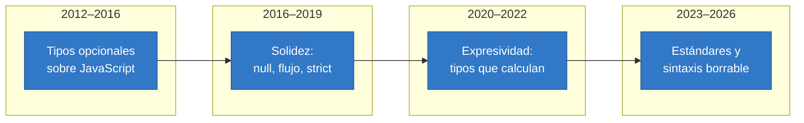
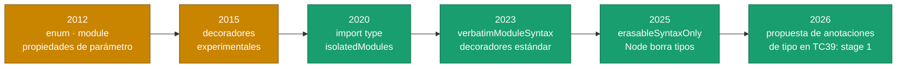

<div align="center">

# 13 · Hilos evolutivos

**Diez problemas que TypeScript tardó años en resolver, contados de principio a fin: nulos, estrechamiento, tuplas, cadenas, clases, módulos, estrictez, emisión, inferencia y valores por defecto**

[⬅ 12 · TypeScript 7](12-typescript-7-el-compilador-nativo.md) · [🏠 Índice](../README.md) · [14 · El sistema de tipos a fondo ➡](14-sistema-de-tipos-a-fondo.md)

</div>

<!-- ts=5.9 -->

> [!IMPORTANT]
> Los capítulos 02 a 12 cuentan TypeScript **por versiones**: qué trajo cada una. Este capítulo lo cuenta **por problemas**: cómo se resolvió cada
> uno a lo largo de los años, a menudo en cinco o seis pasos separados por versiones distintas. Es la mejor forma de entender por qué una
> característica tiene la forma que tiene, y de reconocer código escrito para una época concreta.

---

## Contenido

1. [Cómo leer este capítulo](#1-cómo-leer-este-capítulo)
2. [`null` y `undefined`](#2-null-y-undefined)
3. [Estrechamiento](#3-estrechamiento)
4. [Tuplas](#4-tuplas)
5. [Cadenas como tipos](#5-cadenas-como-tipos)
6. [Clases y privacidad](#6-clases-y-privacidad)
7. [Módulos e importaciones de tipos](#7-módulos-e-importaciones-de-tipos)
8. [La familia `strict`](#8-la-familia-strict)
9. [De lo que se emite a lo que se borra](#9-de-lo-que-se-emite-a-lo-que-se-borra)
10. [Inferencia](#10-inferencia)
11. [Los valores por defecto](#11-los-valores-por-defecto)
12. [Referencias](#12-referencias)

---

## 1. Cómo leer este capítulo

Cada hilo tiene la misma estructura: el problema, una tabla con los pasos y su versión, y un ejemplo que reúne lo que hoy se puede escribir. Las
versiones enlazan al capítulo que las explica; las características, al [catálogo A–Z](22-catalogo-a-z.md) y a sus
[pruebas de debut](25-pruebas-de-debut.md).



Tres patrones se repiten en casi todos los hilos:

1. **Primero una opción, después el valor por defecto.** `strictNullChecks` (2.0) tardó diez años en ser el comportamiento sin configurar (6.0).
2. **Primero lo propio, después lo estándar.** `private` (0.8) antes que `#privado` (3.8); decoradores de 2015 antes que los de TC39 (5.0).
3. **Primero la anotación, después la inferencia.** Las guardas de tipo había que declararlas (1.6); desde la 5.5, el compilador las deduce.

---

## 2. `null` y `undefined`

**El problema.** En TypeScript 1.x, `null` y `undefined` eran valores válidos de **cualquier** tipo. `const n: number = null` compilaba, y el error
de los mil millones de dólares de Tony Hoare seguía intacto ([03 § El error](03-typescript-2.0-2.2-nulos-y-flujo.md#1-el-error-de-los-mil-millones-de-dólares)).

| Versión | Paso | Capítulo |
|---|---|---|
| 0.8 | `null` y `undefined` pertenecen a todos los tipos | [02](02-origenes-y-typescript-1.md) |
| **2.0** | `strictNullChecks`: tipos `null` y `undefined` propios; operador `!` | [03](03-typescript-2.0-2.2-nulos-y-flujo.md) |
| 2.2 | Error al operar con valores posiblemente nulos (`x + 1`) | [03](03-typescript-2.0-2.2-nulos-y-flujo.md) |
| 2.3 | `strictNullChecks` entra en `--strict` | [04](04-typescript-2.3-2.9-estricto-y-condicionales.md) |
| **3.7** | `?.` y `??` | [06](06-typescript-3.5-3.9-encadenamiento-y-aserciones.md) |
| 4.0 | `??=` | [07](07-typescript-4.0-4.4-tuplas-variadicas-y-plantillas.md) |
| 4.1 | `noUncheckedIndexedAccess`: `arr[i]` puede ser `undefined` | [07](07-typescript-4.0-4.4-tuplas-variadicas-y-plantillas.md) |
| 4.4 | `exactOptionalPropertyTypes`: «ausente» no es «`undefined`» | [07](07-typescript-4.0-4.4-tuplas-variadicas-y-plantillas.md) |
| 4.8 | `unknown` es `{} \| null \| undefined`; `NonNullable<T>` es `T & {}` | [08](08-typescript-4.5-4.9-esm-y-satisfies.md) |
| 5.6 | Error si un `??` nunca puede usar su lado derecho | [10](10-typescript-5.5-5.9-inferencia-y-sintaxis-borrable.md) |
| **6.0** | `strict` por defecto: `strictNullChecks` sin configurar nada | [11](11-typescript-6.0-el-puente.md) |

```ts run opts=noUncheckedIndexedAccess,exactOptionalPropertyTypes
interface Perfil {
    nombre: string;
    apodo?: string;                    // puede faltar, pero no valer undefined (4.4)
    contactos: string[];
}

function saludo(perfil: Perfil | null): string {
    const nombre = perfil?.apodo ?? perfil?.nombre ?? "invitado";   // 3.7
    const primero = perfil?.contactos[0];                           // string | undefined (4.1)
    return primero === undefined ? `Hola, ${nombre}` : `Hola, ${nombre} (y ${primero})`;
}

console.log(saludo(null), "|", saludo({ nombre: "Ana", contactos: ["Luis"] }));   // → Hola, invitado | Hola, Ana (y Luis)
```

---

## 3. Estrechamiento

**El problema.** Un valor de tipo `string | number` solo es útil si el compilador sabe, en cada punto del código, cuál de los dos es. El
**estrechamiento** (*narrowing*) es el mecanismo que lo deduce de las comprobaciones que el programa ya hace. Es probablemente el hilo con más
pasos de toda la historia del lenguaje, y sigue abierto.

| Versión | El compilador aprende a estrechar con… | Ejemplo |
|---|---|---|
| 1.4 | `typeof` e `instanceof` dentro de un `if` | `if (typeof x === "string")` |
| 1.6 | Guardas definidas por el usuario | `function esPez(a): a is Pez` |
| 1.8 | Guardas basadas en `this` | `isFile(): this is Archivo` |
| **2.0** | **Análisis de flujo de control**: asignaciones, `return`, `throw`, ramas | `if (!x) return; x.foo` |
| 2.0 | Uniones discriminadas | `switch (forma.tipo)` |
| 2.7 | El operador `in` | `if ("nadar" in animal)` |
| 3.2 | Discriminantes no unitarios | `{ error: Error } \| { error: undefined }` |
| **3.7** | Funciones de aserción y funciones que devuelven `never` | `asserts x is string` |
| 4.3 | Genéricos según su restricción, en contexto | `C extends Set<T> \| T[]` |
| **4.4** | **Condiciones guardadas en constantes** | `const esTexto = typeof x === "string"` |
| 4.5 | Discriminantes con patrones de plantilla | `` tipo: `${string}Error` `` |
| 4.6 | Uniones **desestructuradas** y parámetros dependientes | `const { tipo, dato } = accion` |
| 4.7 | Accesos con corchetes de clave literal o símbolo | `obj[clave]` |
| 4.8 | `unknown` como `{} \| null \| undefined` | `if (x) { … }` estrecha a `{}` |
| 4.9 | `in` con propiedades que el tipo **no** declara | `"nombre" in valor` añade la propiedad |
| 5.3 | `switch (true)`, comparación con booleanos y `Symbol.hasInstance` | `case typeof x === "string":` |
| **5.4** | **Clausuras** creadas después de la última asignación | `url` dentro de un `map` |
| **5.5** | **Predicados inferidos** y accesos indexados constantes | `arr.filter(x => x !== undefined)` |

```ts run
type Evento =
    | { tipo: "clic"; x: number; y: number }
    | { tipo: "tecla"; codigo: string }
    | { tipo: "error"; causa: unknown };

function describir(eventos: (Evento | undefined)[]): string[] {
    return eventos
        .filter((e) => e !== undefined)                    // 5.5: Evento[], sin `as`
        .map((evento) => {
            const { tipo } = evento;
            const esPuntero = tipo === "clic";             // 4.4: condición en una constante
            if (esPuntero) {
                return `clic en ${evento.x},${evento.y}`;
            }
            switch (true) {                                // 5.3
                case evento.tipo === "tecla":
                    return `tecla ${evento.codigo}`;
                // cada `case` estrecha con su propia condición, no con las anteriores
                case evento.tipo === "error" && evento.causa instanceof Error:
                    return `error: ${evento.causa.message}`;
                default:
                    return "error desconocido";
            }
        });
}

console.log(describir([{ tipo: "clic", x: 1, y: 2 }, undefined, { tipo: "error", causa: new Error("red") }]).join(" · "));
// → clic en 1,2 · error: red
```

> [!NOTE]
> El estrechamiento tiene un límite deliberado: el compilador **no** sigue los efectos de las llamadas a funciones. Si llamas a `actualizar()` entre
> la comprobación y el uso, el compilador sigue creyendo lo que comprobó, aunque la función haya cambiado el objeto. Es uno de los agujeros de
> solidez que el equipo aceptó a sabiendas ([14 § Solidez](14-sistema-de-tipos-a-fondo.md#10-los-agujeros-deliberados-de-solidez)).

---

## 4. Tuplas

**El problema.** JavaScript usa arreglos de longitud y tipos fijos para devolver varios valores (`useState`), para los argumentos de una función y
para filas de datos. Un tipo `T[]` pierde esa estructura.

| Versión | Paso | Ejemplo |
|---|---|---|
| 1.3 | Tipos tupla | `[string, number]` |
| 2.7 | Longitud fija: `[string]` ya no acepta tres elementos | `length: 1` |
| **3.0** | Tuplas en parámetros rest; elementos opcionales y rest al final | `(...args: [string, number?])` |
| 3.1 | Tipos mapeados que respetan las tuplas | `Promisify<[A, B]>` es una tupla |
| 3.4 | `readonly` en tuplas y `as const` | `readonly ["a", "b"]` |
| **4.0** | **Tuplas variádicas** y elementos con nombre | `[...T, ...U]` · `[inicio: number]` |
| 4.2 | Rest al principio o en medio | `[...string[], number]` |
| 5.0 | Parámetros `const` | `<const T extends readonly unknown[]>` |
| 5.2 | Elementos con y sin nombre, mezclados | `[clave: string, number]` |

```ts
type Argumentos<F> = F extends (...args: infer A) => unknown ? A : never;
type SinPrimero<T extends unknown[]> = T extends [unknown, ...infer R] ? R : [];

function fijarPrimero<F extends (...args: any[]) => any>(f: F, primero: Argumentos<F>[0]) {
    return (...resto: SinPrimero<Argumentos<F>>): ReturnType<F> => f(primero, ...resto);
}

function mover(id: string, x: number, y: number): string { return `${id}→${x},${y}`; }

const moverA = fijarPrimero(mover, "a");
//    ^? const moverA: (x: number, y: number) => string
```

---

## 5. Cadenas como tipos

**El problema.** Las API de JavaScript están llenas de cadenas con significado: nombres de eventos, rutas, propiedades CSS, claves de objetos. Un
`string` no distingue `"click"` de `"clik"`.

| Versión | Paso | Ejemplo |
|---|---|---|
| 1.8 | Tipos literales de cadena | `"left" \| "right"` |
| 2.1 | `keyof` y tipos literales inferidos | `keyof Persona` |
| 2.4 | Enums de cadena | `enum Color { Rojo = "ROJO" }` |
| 3.4 | `as const` | `["a", "b"] as const` |
| **4.1** | **Tipos de plantilla literal**, `Uppercase` y compañía, remapeo de claves | `` `on${Capitalize<E>}` `` |
| 4.3 | Plantillas contextuales y comparables entre sí | `` `hola ${string}` `` |
| 4.4 | Firmas de índice con patrones | `` [k: `data-${string}`]: string `` |
| 4.5 | Patrones como discriminantes | `` `${string}Error` `` |
| 4.8 | `infer N extends number` da el literal | `"42"` → `42` |
| 7.0 | Inferencia por puntos de código | `"😀"` ya no se parte |

```ts
type Ruta = `/${string}`;
type Metodo = "GET" | "POST";
type Clave = `${Metodo} ${Ruta}`;

type Rutas = {
    "GET /usuarios": { respuesta: string[] };
    "POST /usuarios": { cuerpo: { nombre: string }; respuesta: { id: number } };
};

function definir<R extends Record<Clave, unknown>>(rutas: { [K in keyof R]: () => R[K] }) { return rutas; }

const api = definir<Rutas>({
    "GET /usuarios": () => ({ respuesta: ["Ana"] }),
    "POST /usuarios": () => ({ cuerpo: { nombre: "Luis" }, respuesta: { id: 1 } }),
});
```

---

## 6. Clases y privacidad

**El problema.** TypeScript nació con clases, tres años antes que ECMAScript, y tuvo que reconciliarse con las que ECMAScript definió después.

| Versión | Paso | Origen |
|---|---|---|
| 0.8 | Clases, herencia, `public` / `private`, propiedades de parámetro | TypeScript |
| 1.3 | `protected` | TypeScript |
| 1.6 | Clases abstractas y expresiones de clase | TypeScript · ES2015 |
| 2.0 | `readonly`, constructores privados | TypeScript |
| 2.2 | *Mixins* | Patrón de JavaScript |
| 2.7 | `strictPropertyInitialization` y `!` en campos | TypeScript |
| 3.7 | `useDefineForClassFields` y `declare` en campos | Semántica de ES2022 |
| **3.8** | **`#privado`** | ES2022 |
| 4.3 | `override`, métodos `#privados`, tipos de escritura | TypeScript · ES2022 |
| 4.4 | Bloques `static` | ES2022 |
| 4.5 | `#x in obj` | ES2022 |
| 4.9 | `accessor` | Propuesta de decoradores |
| **5.0** | **Decoradores estándar** | TC39 (stage 2.7 desde 2026) |
| 5.8 | `erasableSyntaxOnly` prohíbe las propiedades de parámetro | Node |

```ts run opts=noImplicitOverride
abstract class Recurso {
    static #creados = 0;
    readonly id: number;
    #abierto = false;

    constructor() { this.id = ++Recurso.#creados; }

    abrir(): this { this.#abierto = true; return this; }
    get estado(): string { return this.#abierto ? "abierto" : "cerrado"; }
    abstract describir(): string;
}

class Archivo extends Recurso {
    constructor(readonly ruta: string) { super(); }
    override describir(): string { return `#${this.id} ${this.ruta} (${this.estado})`; }
}

console.log(new Archivo("datos.csv").abrir().describir());   // → #1 datos.csv (abierto)
```

---

## 7. Módulos e importaciones de tipos

**El problema.** En 2012 JavaScript no tenía módulos. TypeScript inventó los suyos, después adoptó los de ES2015, después tuvo que entenderse con
Node, que tardó años en adoptarlos, y finalmente con herramientas que compilan archivo a archivo sin entender los tipos.

| Versión | Paso | Para quién |
|---|---|---|
| 0.8 | Módulos internos (`module X {}`) y externos (CommonJS, AMD) | Navegadores de 2012 y Node |
| 1.5 | Sintaxis de módulos ES; `namespace` | El estándar |
| 1.5 | `isolatedModules` | Transpiladores archivo a archivo |
| 2.4 | `import()` dinámico | Carga diferida |
| 2.7 | `esModuleInterop` | Importar CommonJS como ES |
| 2.9 | Tipos `import("…")` | Declaraciones |
| **3.8** | **`import type`** | Transpiladores |
| 4.5 | `import { type X }` | Ídem |
| **4.7** | **`node16`**: ESM en Node, `.mts`, `exports` | Node |
| **5.0** | **`bundler`** y `verbatimModuleSyntax` | Vite, esbuild, webpack |
| 5.3 | Atributos de importación (`with`) | JSON, CSS |
| 5.4 | `module: preserve` | Empaquetadores y Bun |
| 5.7 | `rewriteRelativeImportExtensions` | Node con `.ts` |
| 5.8 | `require(esm)` y `erasableSyntaxOnly` | Node 22+ |
| 5.9 | `import defer` | Arranque perezoso |
| 6.0 | AMD, UMD, System, `classic`, `node10` y `baseUrl`, obsoletos | — |
| 7.1 🟡 | `import source` y módulos ambientales con atributos | WebAssembly, CSS |

El detalle de cada modo está en [16 · Módulos y resolución](16-modulos-y-resolucion.md).

---

## 8. La familia `strict`

**El problema.** Cada comprobación nueva rompe código existente. La solución fue añadirlas como **opciones**, agruparlas bajo `--strict` en la 2.3 y
dejar que quien lo active reciba las nuevas automáticamente.

| Versión | Opción | ¿En `--strict`? |
|---|---|---|
| 0.9 | `noImplicitAny` | ✅ desde la 2.3 |
| 2.0 | `strictNullChecks` · `noImplicitThis` | ✅ |
| 2.1 | `alwaysStrict` | ✅ (obligatoria desde la 6.0) |
| **2.3** | **`--strict`** | — |
| 2.6 | `strictFunctionTypes` | ✅ |
| 2.7 | `strictPropertyInitialization` | ✅ |
| 3.2 | `strictBindCallApply` | ✅ |
| 4.1 | `noUncheckedIndexedAccess` | ❌ |
| 4.3 | `noImplicitOverride` | ❌ |
| 4.4 | `useUnknownInCatchVariables` | ✅ |
| 4.4 | `exactOptionalPropertyTypes` | ❌ |
| 5.6 | `strictBuiltinIteratorReturn` | ✅ |
| **6.0** | **`strict` es el valor por defecto** | — |

> [!TIP]
> Las tres opciones con ❌ son las que más valor dan **fuera** del paquete. Por eso el `tsc --init` de la 5.9 activa `noUncheckedIndexedAccess` y
> `exactOptionalPropertyTypes` explícitamente ([10 § `tsc --init`](10-typescript-5.5-5.9-inferencia-y-sintaxis-borrable.md#9-typescript-59-import-defer-y-tsc---init-mínimo)).

---

## 9. De lo que se emite a lo que se borra

**El problema.** El TypeScript de 2012 era un lenguaje con **emisión propia**: `enum`, `namespace`, propiedades de parámetro y, después,
decoradores generaban código que JavaScript no tenía. El TypeScript de 2026 aspira a ser **JavaScript más anotaciones que se borran**.



| Construcción | Desde | Hoy | Alternativa borrable |
|---|---|---|---|
| `enum` | 0.8 | Funciona; prohibido con `erasableSyntaxOnly` | Objeto `as const` + tipo unión |
| `module X {}` / `namespace X {}` | 0.8 / 1.5 | `module` es error desde la 6.0; `namespace` prohibido con `erasableSyntaxOnly` | Módulos ES |
| Propiedades de parámetro | 0.8 | Prohibidas con `erasableSyntaxOnly` | Campos y asignaciones explícitas |
| `import x = require()` | 0.8 | Prohibido con `erasableSyntaxOnly` | `import` o `createRequire` |
| Decoradores experimentales | 1.5 | Siguen; Angular y NestJS los usan | Decoradores estándar (también emiten código) |

La guía para elegir entre `enum` y sus alternativas está en [21 § `enum` o unión](21-guias-de-decision.md#2-enum-unión-de-literales-u-objeto-as-const).

---

## 10. Inferencia

**El problema.** Cuanto más infiere el compilador, menos anotaciones hacen falta; pero una inferencia demasiado lista es impredecible.

| Versión | Paso |
|---|---|
| 0.8 | Inferencia local de variables y retornos |
| 2.1 | Literales inferidos y ensanchamiento controlado |
| 2.4 | Inferencia desde el tipo de retorno esperado |
| 2.8 | `infer` en tipos condicionales |
| 3.4 | Inferencia de orden superior en funciones genéricas |
| 4.0 | Propiedades de clase inferidas desde el constructor |
| 4.7 | Inferencia propiedad a propiedad en objetos y métodos; `infer X extends Y` |
| 5.0 | Parámetros `const` |
| 5.4 | `NoInfer` para excluir posiciones |
| 5.5 | Predicados de tipo inferidos |
| 6.0 | Funciones sin `this` menos sensibles al contexto |
| 7.0 | Orden determinista: el resultado ya no depende del orden de lectura |

```ts
declare function crearTienda<Estado, Acciones extends Record<string, (estado: Estado, ...args: any[]) => Estado>>(
    config: { inicial: Estado; acciones: Acciones },
): { [K in keyof Acciones]: Acciones[K] extends (estado: Estado, ...args: infer A) => Estado ? (...args: A) => void : never };

const tienda = crearTienda({
    inicial: { cuenta: 0 },
    acciones: {
        sumar: (estado, n: number) => ({ cuenta: estado.cuenta + n }),
        reiniciar: () => ({ cuenta: 0 }),
    },
});

tienda.sumar(5);
//     ^? (property) sumar: (n: number) => void
```

---

## 11. Los valores por defecto

**El problema.** Un `tsconfig.json` vacío es el TypeScript que encuentra un principiante. Durante catorce años, ese TypeScript emitía ES3 o ES5,
no era estricto y cargaba todos los `@types`.

| Opción | 0.8 – 4.9 | 5.0 – 5.9 | 6.0 – 7.0 | 7.1 🟡 |
|---|---|---|---|---|
| `target` | `es3` | `es5` | `es2025` (flotante) | `es2026` (flotante) |
| `module` | `commonjs` | `commonjs` | `esnext` | `esnext` |
| `strict` | `false` | `false` | **`true`** | `true` |
| `types` | Todos los `@types` | Todos los `@types` | `[]` | `[]` |
| `rootDir` | Inferido | Inferido | Carpeta del `tsconfig.json` | Ídem |
| `noUncheckedSideEffectImports` | — | `false` (desde la 5.6) | `true` | `true` |
| `esModuleInterop` | `false` (desde la 2.7) | `false` | Siempre `true` | Siempre `true` |
| `tsc --init` | ~100 líneas comentadas | 44 líneas modernas (5.9) | Igual que la 5.9 | Igual |

---

## 12. Referencias

- [Catálogo A–Z](22-catalogo-a-z.md): las 386 características con su versión
- [Pruebas de debut](25-pruebas-de-debut.md): la evidencia de cada versión
- Manual: [Estrechamiento](https://www.typescriptlang.org/docs/handbook/2/narrowing.html) · [Clases](https://www.typescriptlang.org/docs/handbook/2/classes.html) · [Módulos](https://www.typescriptlang.org/docs/handbook/modules/introduction.html)
- [Notas de versión de TypeScript](https://www.typescriptlang.org/docs/handbook/release-notes/overview.html)
