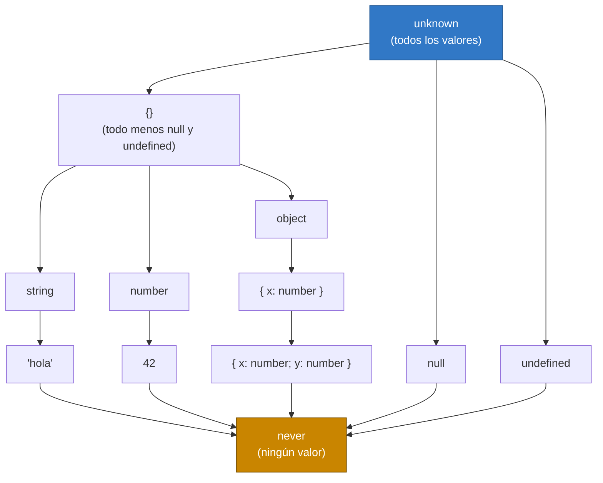

<div align="center">

# 14 · El sistema de tipos a fondo

**Conjuntos de valores, tipado estructural, `any`/`unknown`/`never`, ensanchamiento, asignabilidad, frescura, varianza, inferencia, los agujeros deliberados de solidez y las marcas nominales**

[⬅ 13 · Hilos evolutivos](13-hilos-evolutivos.md) · [🏠 Índice](../README.md) · [15 · Programación a nivel de tipos ➡](15-programacion-a-nivel-de-tipos.md)

</div>

<!-- ts=5.9 -->

> [!IMPORTANT]
> Los capítulos por versiones explican **qué** acepta el compilador. Este explica **por qué**. Con tres ideas —un tipo es un conjunto de valores,
> la compatibilidad se decide por la forma y el sistema renuncia a la solidez total a propósito— se puede predecir casi cualquier error de
> TypeScript, y casi cualquier ausencia de error.

---

## Contenido

1. [Un tipo es un conjunto de valores](#1-un-tipo-es-un-conjunto-de-valores)
2. [Tipado estructural](#2-tipado-estructural)
3. [`any`, `unknown` y `never`](#3-any-unknown-y-never)
4. [Literales y ensanchamiento](#4-literales-y-ensanchamiento)
5. [Uniones e intersecciones](#5-uniones-e-intersecciones)
6. [Asignabilidad y frescura](#6-asignabilidad-y-frescura)
7. [Varianza](#7-varianza)
8. [Genéricos y restricciones](#8-genéricos-y-restricciones)
9. [Inferencia](#9-inferencia)
10. [Los agujeros deliberados de solidez](#10-los-agujeros-deliberados-de-solidez)
11. [Tipado nominal simulado: las marcas](#11-tipado-nominal-simulado-las-marcas)
12. [Referencias](#12-referencias)

---

## 1. Un tipo es un conjunto de valores

La forma más útil de pensar en un tipo de TypeScript es como el **conjunto de valores** que puede contener una variable de ese tipo. Con esa idea,
las operaciones del sistema de tipos son operaciones de conjuntos:

| Concepto de TypeScript | Operación de conjuntos | Ejemplo |
|---|---|---|
| `A` es asignable a `B` | A ⊆ B | `"hola"` ⊆ `string` |
| `A \| B` | A ∪ B | `string \| number` |
| `A & B` | A ∩ B | `{ a: 1 } & { b: 2 }` |
| `never` | ∅, el conjunto vacío | `string & number` |
| `unknown` | El universo: todos los valores | — |
| `A extends B ? X : Y` | ¿A ⊆ B? | `"a" extends string ? 1 : 0` |
| `keyof T` | El conjunto de claves conocidas | `keyof { a: 1; b: 2 }` es `"a" \| "b"` |



La intuición de conjuntos explica resultados que de otro modo parecen raros:

```ts
type A = string & number;
//   ^? type A = never
type B = { x: number } | { x: number; y: number };    // el segundo ⊂ el primero, pero la unión conserva ambos
type C = keyof ({ a: 1 } | { a: 2; b: 3 });
//   ^? type C = "a"
type D = keyof ({ a: 1 } & { b: 2 });
//   ^? type D = "a" | "b"
```

`keyof` de una unión da **menos** claves —solo las que tienen todos sus miembros— y `keyof` de una intersección da **más**. Es contraintuitivo
hasta que se piensa en conjuntos: un valor de `A | B` puede ser de cualquiera de los dos, así que solo se pueden leer con seguridad las claves
comunes.

---

## 2. Tipado estructural

TypeScript no pregunta **cómo se llama** un tipo, sino **qué forma tiene**. Dos tipos con los mismos miembros son intercambiables, aunque se
declararan por separado y sin relación entre sí.

```ts run
interface Punto2D { x: number; y: number; }
class Vector { constructor(public x: number, public y: number) {} }

function longitud(p: Punto2D): number { return Math.hypot(p.x, p.y); }

console.log(longitud(new Vector(3, 4)));            // → 5
console.log(longitud({ x: 6, y: 8 }));              // → 10
const punto3d = { x: 1, y: 0, z: 9 };
console.log(longitud(punto3d));                     // → 1
```

`Vector` nunca dijo implementar `Punto2D`, y no hace falta. Es la decisión que permite tipar JavaScript existente: el código JavaScript se basa en
el *duck typing*, y un sistema nominal obligaría a reescribirlo.

| | Nominal (Java, C#) | Estructural (TypeScript) |
|---|---|---|
| **Compatibles si…** | Uno declara heredar del otro | Tienen la forma necesaria |
| **`class A` y `class B` con los mismos campos** | Distintos | Iguales |
| **Ventaja** | Distingue conceptos con la misma forma (`Euros` y `Dólares`) | Tipa JavaScript tal como se escribe |
| **En TypeScript, para lo nominal** | — | Marcas ([§ 11](#11-tipado-nominal-simulado-las-marcas)) o miembros `#privados` |

> [!NOTE]
> Hay excepciones nominales dentro del sistema: las clases con miembros `private`, `protected` o `#privados` solo son compatibles con su propia
> jerarquía; los `unique symbol` son únicos; y los enums son nominales entre sí. Las tres se pueden usar como marcas.

---

## 3. `any`, `unknown` y `never`

| | `any` | `unknown` | `never` |
|---|---|---|---|
| **Conjunto** | Desactiva la comprobación | Todos los valores | Ningún valor |
| **¿Se le puede asignar cualquier cosa?** | Sí | Sí | No (solo `never`) |
| **¿Se puede asignar a cualquier cosa?** | Sí | No (solo a `unknown` y `any`) | Sí |
| **¿Se pueden usar sus propiedades?** | Sí, sin comprobar | No, hay que estrechar antes | No se llega nunca |
| **Papel** | Escotilla de escape | Tipo superior seguro | Tipo inferior: imposible, inalcanzable |
| **Desde** | 0.8 | 3.0 | 2.0 |

```ts err=TS18046,TS2322
declare const desconocido: unknown;
declare const cualquiera: any;

const a: string = cualquiera;              // compila: `any` se asigna a todo
cualquiera.lo.que.sea();                   // compila, y probablemente falla en ejecución
desconocido.toString();                    // error TS18046: hay que estrechar
const b: string = desconocido;             // error TS2322
```

`any` es **contagioso**: el resultado de operar con un `any` es otro `any`, y un `any` dentro de una estructura se propaga a todo lo que la toca.
`unknown` es lo contrario: obliga a demostrar algo antes de usarlo.

### `never` como herramienta

`never` es el tipo de lo que no puede ocurrir. Sirve para tres cosas:

```ts err=TS2322
type Forma = { tipo: "circulo"; radio: number } | { tipo: "cuadrado"; lado: number } | { tipo: "triangulo"; base: number };

function area(f: Forma): number {
    switch (f.tipo) {
        case "circulo": return Math.PI * f.radio ** 2;
        case "cuadrado": return f.lado ** 2;
        default: {
            const exhaustivo: never = f;      // error TS2322: falta el caso "triangulo"
            return exhaustivo;
        }
    }
}
```

| Uso | Ejemplo |
|---|---|
| Comprobación exhaustiva | `const x: never = valor` en el `default` |
| Función que nunca vuelve | `function fallar(m: string): never { throw new Error(m) }` |
| Filtrar en tipos | `T extends string ? T : never` elimina miembros de una unión |

---

## 4. Literales y ensanchamiento

Un literal tiene su propio tipo: `"hola"` es del tipo `"hola"`, subconjunto de `string`. El compilador decide cuándo **conservar** el literal y
cuándo **ensancharlo** al tipo primitivo, según si la variable puede cambiar.

```ts
const fija = "hola";
//    ^? const fija: "hola"
let variable = "hola";
//  ^? let variable: string
const objeto = { modo: "oscuro" };
//    ^? const objeto: { modo: string; }
const congelado = { modo: "oscuro" } as const;
//    ^? const congelado: { readonly modo: "oscuro"; }
```

| Situación | ¿Se conserva el literal? | Por qué |
|---|---|---|
| `const x = "a"` | Sí | `x` no puede cambiar |
| `let x = "a"` | No: `string` | `x` puede reasignarse |
| Propiedad de un objeto | No | Las propiedades son mutables |
| `as const` (3.4) | Sí, y todo `readonly` | Lo pide el programador |
| Argumento de un `<const T>` (5.0) | Sí | Lo pide la función |
| Contexto que espera un literal | Sí | `const m: "a" \| "b" = "a"` |

El problema clásico del ensanchamiento:

```ts err=TS2345
declare function pedir(url: string, metodo: "GET" | "POST"): void;

const opciones = { url: "/api", metodo: "GET" };
pedir(opciones.url, opciones.metodo);      // error TS2345: `metodo` es string, no "GET" | "POST"
```

Las soluciones, de más a menos recomendable: `satisfies` (conserva el literal y comprueba), `as const` (conserva y congela) o una anotación
explícita del objeto.

---

## 5. Uniones e intersecciones

### Uniones

Una unión es «uno de estos». Solo se pueden usar los miembros comunes, hasta que el estrechamiento diga cuál es
([13 § Estrechamiento](13-hilos-evolutivos.md#3-estrechamiento)). El compilador **reduce** las uniones: elimina los miembros que son subtipos de
otro miembro cuando son literales o primitivos.

```ts
type R1 = "a" | string;
//   ^? type R1 = string
type R2 = number | never;
//   ^? type R2 = number
type R3 = unknown | string;
//   ^? type R3 = unknown
```

### Intersecciones

Una intersección es «todo esto a la vez». Con objetos, combina propiedades; con primitivos incompatibles, es `never`. Desde la 3.9, una
intersección de objetos con **discriminantes incompatibles** también se reduce a `never`:

```ts
type Gato = { especie: "gato"; maulla: true };
type Perro = { especie: "perro"; ladra: true };
type GatoPerro = Gato & Perro;
//   ^? type GatoPerro = never

type ConId = { id: number } & { nombre: string };   // un objeto con las dos propiedades
const usuario: ConId = { id: 1, nombre: "Ana" };
```

### Distributividad

Un tipo condicional sobre un parámetro de tipo **desnudo** se aplica a cada miembro de una unión por separado
([04 § Distributividad](04-typescript-2.3-2.9-estricto-y-condicionales.md#distributividad)):

```ts
type ALista<T> = T extends unknown ? T[] : never;
type SinDistribuir<T> = [T] extends [unknown] ? T[] : never;

type X = ALista<string | number>;
//   ^? type X = string[] | number[]
type Y = SinDistribuir<string | number>;
//   ^? type Y = (string | number)[]
```

---

## 6. Asignabilidad y frescura

### La regla

`S` es asignable a `T` si todo valor de `S` es un valor válido de `T`. Para objetos: `S` debe tener todas las propiedades **obligatorias** de `T`,
con tipos asignables. Puede tener **más**.

### La excepción: la comprobación de propiedades sobrantes

Si `S` puede tener propiedades de más, ¿por qué esto falla?

```ts err=TS2561/TS2353
interface Opciones { color?: string; tamano?: number; }

const o: Opciones = { color: "rojo", tamanio: 12 };   // error TS2561: `tamanio` no existe; ¿quisiste decir `tamano`?
```

Porque un **literal de objeto** recién escrito es «fresco»: el compilador sabe que nadie más lo usa, así que una propiedad que el tipo no conoce
solo puede ser una errata. La frescura se pierde en cuanto el objeto pasa por una variable:

```ts
interface Opciones { color?: string; tamano?: number; }

const literal = { color: "rojo", tamanio: 12 };
const o: Opciones = literal;     // compila: `literal` ya no es fresco
```

| Situación | ¿Comprobación de sobrantes? |
|---|---|
| Literal asignado directamente a una variable anotada | ✅ |
| Literal pasado directamente como argumento | ✅ |
| Literal con `satisfies` | ✅ |
| Objeto que viene de una variable | ❌ |
| Literal con `as T` | ❌ |
| Tipo con firma de índice `[k: string]: …` | ❌ (todo encaja) |

### Tipos débiles

Un tipo cuyas propiedades son **todas opcionales** acepta casi cualquier objeto. Desde la 2.4, asignarle un objeto que no comparta **ninguna**
propiedad es un error, aunque no sea fresco:

```ts err=TS2559
interface Opciones { color?: string; tamano?: number; }
const config = { velocidad: 3 };
const o: Opciones = config;      // error TS2559: no tiene ninguna propiedad en común
```

---

## 7. Varianza

La varianza responde a una pregunta: si `Gato` es asignable a `Animal`, ¿qué pasa con `Caja<Gato>` y `Caja<Animal>`? Depende de **cómo usa** `Caja`
su parámetro.

| Varianza | Relación | Cuándo | Ejemplo | Anotación (4.7) |
|---|---|---|---|---|
| **Covariante** | `F<Gato>` → `F<Animal>` | `T` solo **sale** | `() => T`, `readonly T[]`, `Promise<T>` | `out T` |
| **Contravariante** | `F<Animal>` → `F<Gato>` | `T` solo **entra** | `(x: T) => void` | `in T` |
| **Invariante** | Ninguna | `T` entra y sale | `{ leer(): T; escribir(x: T): void }` con propiedades función | `in out T` |
| **Bivariante** | Ambas | Métodos y, sin `strictFunctionTypes`, todas las funciones | `{ escribir(x: T): void }` | — |

```ts err=TS2322
interface Animal { nombre: string; }
interface Gato extends Animal { maulla(): void; }

type Productor<T> = () => T;
type Consumidor<T> = (x: T) => void;

declare let produceGatos: Productor<Gato>;
declare let produceAnimales: Productor<Animal>;
declare let consumeGatos: Consumidor<Gato>;
declare let consumeAnimales: Consumidor<Animal>;

produceAnimales = produceGatos;     // ✅ covariante: un gato es un animal
consumeGatos = consumeAnimales;     // ✅ contravariante: quien atiende a cualquier animal atiende a un gato
consumeAnimales = consumeGatos;     // ❌ error TS2322: recibiría un perro y llamaría a maulla()
```

### La excepción de los arreglos y los métodos

Los arreglos de TypeScript son **covariantes** aunque se puedan escribir, y eso no es sólido:

```ts run
interface Animal { nombre: string; }
interface Gato extends Animal { maulla(): string; }

const gatos: Gato[] = [{ nombre: "Michi", maulla: () => "miau" }];
const animales: Animal[] = gatos;          // permitido: covarianza de arreglos
animales.push({ nombre: "Firulais" });     // un perro en la lista de gatos

try {
    gatos[1].maulla();
} catch (e) {
    console.log((e as Error).constructor.name);   // → TypeError
}
```

Del mismo modo, los parámetros de los **métodos** siguen siendo bivariantes con `strictFunctionTypes`, porque hacerlos estrictos rompería
`Array<T>` y casi todo el DOM ([04 § La excepción](04-typescript-2.3-2.9-estricto-y-condicionales.md#la-excepción-deliberada-los-métodos)). Es la
razón por la que el ejemplo de anotaciones de varianza del capítulo 08 usa una propiedad función y no un método.

### Cómo calcula el compilador la varianza

Para no comparar estructuras enteras cada vez, el compilador **mide** la varianza de cada parámetro de tipo una vez, sustituyéndolo por dos tipos
de prueba relacionados, y la reutiliza. Con tipos muy recursivos la medida es cara o imprecisa: para eso existen `in` y `out`
([08 § Varianza explícita](08-typescript-4.5-4.9-esm-y-satisfies.md#5-typescript-47-expresiones-de-instanciación-y-varianza-explícita)).

---

## 8. Genéricos y restricciones

Un parámetro de tipo es una **variable de tipo**: se fija en cada uso. `extends` lo **restringe**: limita qué tipos se aceptan y, a cambio, permite
usar lo que la restricción garantiza.

```ts err=TS2339
function longitudSinRestriccion<T>(x: T): number {
    return x.length;                      // error TS2339: T puede ser cualquier cosa
}

function longitud<T extends { length: number }>(x: T): number {
    return x.length;                      // correcto: la restricción lo garantiza
}

function propiedad<T, K extends keyof T>(objeto: T, clave: K): T[K] {
    return objeto[clave];                 // T[K]: el tipo exacto de esa propiedad
}
```

| Patrón | Significa |
|---|---|
| `<T>` | Cualquier tipo; dentro de la función, como `unknown` |
| `<T extends U>` | Cualquier subtipo de `U` |
| `<K extends keyof T>` | Una clave de `T` |
| `<T = Defecto>` (2.3) | Valor por defecto si no se puede inferir |
| `<const T>` (5.0) | Inferir literales |
| `NoInfer<T>` (5.4) | Esta posición no participa en la inferencia |

> [!TIP]
> Una regla práctica: **un parámetro de tipo debe aparecer al menos dos veces** en la firma (por ejemplo, en un argumento y en el retorno). Si solo
> aparece una vez, no relaciona nada y es mejor usar el tipo directamente: `function f<T>(x: T): void` es lo mismo que `function f(x: unknown): void`.

---

## 9. Inferencia

### Candidatos y mejor tipo común

Para inferir `T`, el compilador recoge **candidatos** de cada posición donde aparece y elige uno:

```ts
declare function primero<T>(a: T, b: T): T;

const n = primero(1, 2);
//    ^? const n: 1 | 2
const m = primero(1, "dos" as string | number);
//    ^? const m: string | number
```

### Tipado contextual

La inferencia también va **hacia dentro**: el tipo esperado de una expresión tipa sus partes. Es lo que permite no anotar los parámetros de un
*callback*:

```ts
const nombres = ["Ana", "Luis"];
nombres.map((n) => n.toUpperCase());     // `n` es string por contexto
window.addEventListener("keydown", (e) => e.key);   // `e` es KeyboardEvent por contexto
```

### Funciones sensibles al contexto

Un argumento con parámetros sin anotar es **sensible al contexto**: no se puede tipar hasta conocer `T`, así que la inferencia lo aparca, infiere
`T` con los demás argumentos y vuelve a él. De ahí salen casi todas las sorpresas de la inferencia: el orden de los argumentos importa, y un método
con `this` implícito se trataba como sensible aunque no lo usara (corregido en la 6.0, [11 § Lo nuevo](11-typescript-6.0-el-puente.md#2-lo-nuevo-del-lenguaje-y-de-la-biblioteca)).

| Para mejorar la inferencia… | Herramienta |
|---|---|
| Que una posición no aporte candidatos | `NoInfer<T>` (5.4) |
| Inferir literales | `<const T>` (5.0) |
| Que el orden de las propiedades no importe | Anotar el parámetro de la primera función |
| Que `filter` estreche | Escribir la condición exacta (5.5 infiere el predicado) |

---

## 10. Los agujeros deliberados de solidez

Un sistema de tipos es **sólido** si nunca acepta un programa que vaya a tener un error de tipos en ejecución. TypeScript **no lo es, a propósito**.
Su objetivo declarado es ser útil con JavaScript real, y algunos agujeros son el precio de no rechazar código correcto ni obligar a anotar en
exceso. Conocerlos es saber dónde no confiar.

| Agujero | Ejemplo | Por qué existe | Mitigación |
|---|---|---|---|
| `any` | `const x: any = 1; x.foo()` | Escotilla para migrar JavaScript | `noImplicitAny`, `unknown`, typescript-eslint |
| Aserciones `as` | `({}) as Usuario` | El programador sabe más | `satisfies`, guardas, validación en el borde |
| `!` no nulo | `mapa.get(k)!.valor` | Ídem | Comprobar o usar `??` |
| Covarianza de arreglos | El perro en la lista de gatos (§ 7) | Usabilidad de `Array<T>` | `readonly T[]` en parámetros |
| Bivarianza de métodos | Un método que acepta un subtipo | Compatibilidad con el DOM y `Array` | Propiedades función en lugar de métodos |
| Índices sin comprobar | `arr[99].x` | Ruido de `undefined` por todas partes | `noUncheckedIndexedAccess` |
| Estrechamiento sin efectos | La llamada intermedia que cambia el objeto | Analizar efectos es demasiado caro | Releer después de llamar |
| Parámetros opcionales | `(a?: number) => void` asignable a `(a: number) => void` y viceversa | *Callbacks* de JavaScript | — |
| Propiedades opcionales y `undefined` | `{ x?: number }` acepta `{ x: undefined }` | Ídem | `exactOptionalPropertyTypes` |
| `this` en *callbacks* | Pasar `obj.metodo` sin enlazar | No se puede saber cómo se llamará | Funciones flecha, `noImplicitThis` |

```ts run
// El estrechamiento no sigue los efectos de las llamadas
interface Estado { valor: string | null; }
const estado: Estado = { valor: "listo" };

function reiniciar(): void { estado.valor = null; }

if (estado.valor !== null) {
    reiniciar();
    try {
        console.log(estado.valor.toUpperCase());   // el compilador cree que es string
    } catch {
        console.log("TypeError en ejecución");     // → TypeError en ejecución
    }
}
```

> [!IMPORTANT]
> La consecuencia práctica es una disciplina: **valida en los bordes**. Lo que entra al programa (JSON, formularios, variables de entorno, respuestas
> de API) se comprueba en ejecución con guardas o con una biblioteca de esquemas, y a partir de ahí los tipos son fiables. Donde el código usa
> `as`, `!` o `any`, los tipos son una opinión.

---

## 11. Tipado nominal simulado: las marcas

El tipado estructural tiene un caso débil: dos conceptos con **la misma forma** y significados distintos. Un identificador de usuario y uno de
pedido son ambos `string`; unos euros y unos dólares son ambos `number`. El compilador los mezcla sin decir nada.

```ts
type IdUsuario = string;
type IdPedido = string;

declare function cancelar(pedido: IdPedido): void;
declare const usuario: IdUsuario;
cancelar(usuario);      // compila: un alias no crea un tipo nuevo
```

Una **marca** (*brand*) añade al tipo una propiedad que ningún valor real tiene, y que solo se puede obtener a través de una función de
construcción:

```ts run
declare const marca: unique symbol;
type Marca<T, M extends string> = T & { readonly [marca]: M };

type IdUsuario = Marca<string, "IdUsuario">;
type IdPedido = Marca<string, "IdPedido">;
type Euros = Marca<number, "Euros">;

function idPedido(texto: string): IdPedido {
    if (!/^P-\d+$/.test(texto)) throw new Error(`id de pedido inválido: ${texto}`);
    return texto as IdPedido;          // el único `as`, dentro del constructor que valida
}
const euros = (n: number) => n as Euros;

function cancelar(pedido: IdPedido): string { return `cancelado ${pedido}`; }

const pedido = idPedido("P-42");
console.log(cancelar(pedido));                     // → cancelado P-42
console.log(pedido.startsWith("P"), euros(3) + 2); // → true 5
```

En ejecución, una marca no existe: `pedido` sigue siendo un `string` y los euros, un `number`. Pero el compilador ya no los confunde:

```ts err=TS2345
declare const marca: unique symbol;
type IdPedido = string & { readonly [marca]: "IdPedido" };

declare function cancelar(pedido: IdPedido): void;
cancelar("P-43");      // error TS2345: un string cualquiera no es un IdPedido
```

| Técnica | Cómo | Coste en ejecución | Notas |
|---|---|---|---|
| Intersección con `unique symbol` | `T & { readonly [marca]: "X" }` | Ninguno | La más común; el símbolo no existe de verdad |
| Propiedad de texto | `T & { __marca: "X" }` | Ninguno | Más simple; aparece en el autocompletado |
| Clase con miembro `#privado` | `class Euros { #m!: void; … }` | Un objeto | Nominal de verdad, pero ya no es un `number` |
| `enum` | `enum IdUsuario {}` | Ninguno | Truco antiguo; no se recomienda |

> [!TIP]
> Las bibliotecas de validación ofrecen marcas integradas (`z.string().brand<"IdPedido">()` en Zod, `v.brand` en Valibot): la marca solo se obtiene
> pasando la validación. Es la combinación ideal con la regla del § 10: validar en el borde y marcar lo validado.

Existe una propuesta para tipos nominales nativos en el repositorio de TypeScript desde 2014. No ha prosperado, porque las marcas cubren casi
todos los casos sin cambiar el lenguaje.

---

## 12. Referencias

- Manual: [Compatibilidad de tipos](https://www.typescriptlang.org/docs/handbook/type-compatibility.html) · [Inferencia de tipos](https://www.typescriptlang.org/docs/handbook/type-inference.html) · [Estrechamiento](https://www.typescriptlang.org/docs/handbook/2/narrowing.html)
- [Objetivos de diseño de TypeScript](https://github.com/microsoft/TypeScript/wiki/TypeScript-Design-Goals): el no-objetivo 3 es «un sistema de tipos sólido o demostrablemente correcto»
- [Especificación histórica del lenguaje (1.8)](https://github.com/microsoft/TypeScript/blob/v1.8.10/doc/spec.md): la última que se mantuvo; desde entonces, el comportamiento lo define el compilador
- Opciones: [`strictFunctionTypes`](https://www.typescriptlang.org/tsconfig/#strictFunctionTypes) · [`noUncheckedIndexedAccess`](https://www.typescriptlang.org/tsconfig/#noUncheckedIndexedAccess) · [`exactOptionalPropertyTypes`](https://www.typescriptlang.org/tsconfig/#exactOptionalPropertyTypes)
