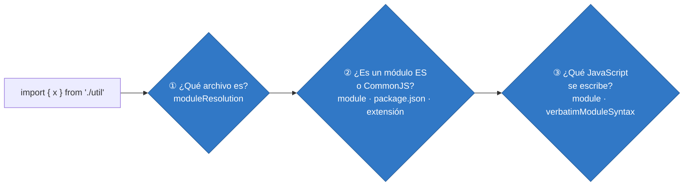
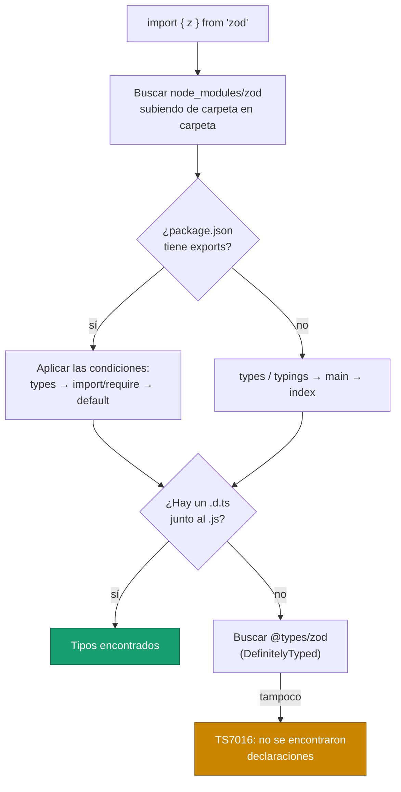
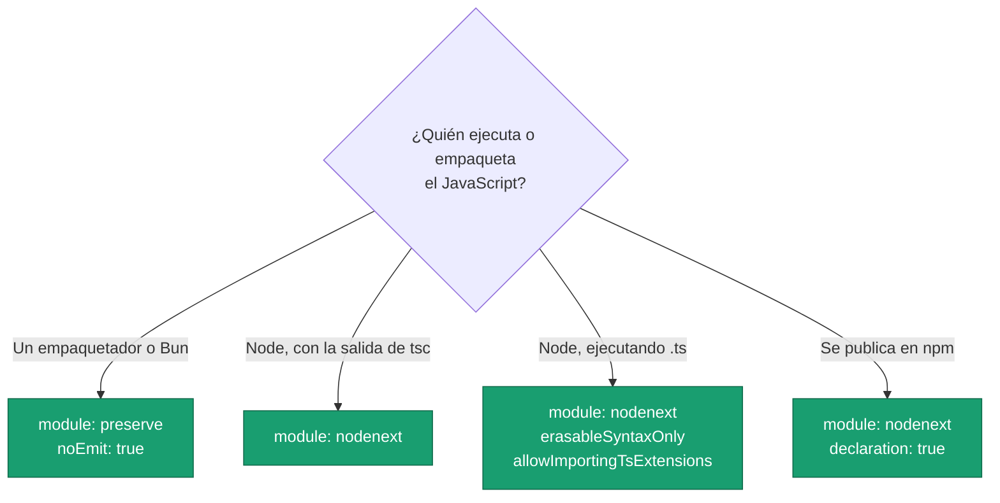

<div align="center">

# 16 · Módulos y resolución

**`module`, `moduleResolution`, ESM y CommonJS en Node, `package.json` (`type`, `exports`, `imports`), importaciones de tipos, interoperabilidad, `paths` y declaraciones ambientales**

[⬅ 15 · Programación a nivel de tipos](15-programacion-a-nivel-de-tipos.md) · [🏠 Índice](../README.md) · [17 · `tsconfig` de referencia ➡](17-tsconfig-de-referencia.md)

</div>

<!-- ts=5.9 -->

> [!IMPORTANT]
> Los módulos son la parte de TypeScript con **más configuraciones posibles y más configuraciones incorrectas**. La causa no es TypeScript, sino
> JavaScript: hay dos sistemas de módulos (CommonJS y ES), varios runtimes con reglas distintas (Node, navegadores, Bun, Deno) y empaquetadores con
> las suyas. La regla de oro de este capítulo es una sola: **configura TypeScript para que imite exactamente lo que hará el programa que ejecute o
> empaquete tu código**.

---

## Contenido

1. [Tres preguntas distintas](#1-tres-preguntas-distintas)
2. [`module`: el formato que se emite](#2-module-el-formato-que-se-emite)
3. [`moduleResolution`: cómo se encuentra un archivo](#3-moduleresolution-cómo-se-encuentra-un-archivo)
4. [ESM y CommonJS en Node](#4-esm-y-commonjs-en-node)
5. [`package.json`: `type`, `exports` e `imports`](#5-packagejson-type-exports-e-imports)
6. [Importaciones de tipos y `verbatimModuleSyntax`](#6-importaciones-de-tipos-y-verbatimmodulesyntax)
7. [Interoperabilidad y la exportación por defecto](#7-interoperabilidad-y-la-exportación-por-defecto)
8. [`paths` y alias](#8-paths-y-alias)
9. [Declaraciones ambientales](#9-declaraciones-ambientales)
10. [Recetas por escenario](#10-recetas-por-escenario)
11. [Referencias](#11-referencias)

---

## 1. Tres preguntas distintas

Cada `import` plantea tres preguntas que el compilador responde con opciones distintas:



| Pregunta | Opción principal | Opciones auxiliares |
|---|---|---|
| ① ¿Qué archivo corresponde a `"./util"` o a `"paquete"`? | `moduleResolution` | `paths`, `customConditions`, `allowImportingTsExtensions`, `moduleSuffixes` |
| ② ¿El archivo es un módulo ES o CommonJS? | `module` (con `node16`/`nodenext`) | `type` de `package.json`, extensiones `.mts`/`.cts`, `moduleDetection` |
| ③ ¿Qué se emite para cada `import`? | `module` | `verbatimModuleSyntax`, `esModuleInterop`, `rewriteRelativeImportExtensions` |

Desde la 5.0, `module` determina casi siempre el `moduleResolution` adecuado, y el compilador rechaza combinaciones incoherentes
(`module: nodenext` con `moduleResolution: bundler`, por ejemplo). Lo más sencillo es **escribir solo `module`**.

---

## 2. `module`: el formato que se emite

Cada valor llegó con una versión del compilador, y algunos ya se fueron. Esta tabla la genera `tools/generar-atlas.ts` a partir de lo que
responden los propios compiladores:

<!-- atlas:inicio tabla-module -->
| `module` | Disponible desde | Estado | Para qué |
|---|---|---|---|
| `amd` | **0.8** | ⛔ Obsoleto en 6.0, retirado en 7.0 | RequireJS |
| `commonjs` | **0.8** | 🟢 | `require` y `module.exports`: Node clásico |
| `system` | **1.5** | ⛔ Obsoleto en 6.0, retirado en 7.0 | SystemJS |
| `umd` | **1.5** | ⛔ Obsoleto en 6.0, retirado en 7.0 | CommonJS, AMD o global, según el entorno |
| `es2015` | **1.7** | 🟢 | Módulos ES |
| `es6` | **1.7** | 🟢 | Módulos ES; alias de `es2015` |
| `none` | **1.8** | ⛔ Obsoleto en 6.0, retirado en 7.0 | Sin módulos |
| `esnext` | **2.4** | 🟢 | Módulos ES con lo último |
| `es2020` | **3.8** | 🟢 | Añade `import()` e `import.meta` |
| `es2022` | **4.5** | 🟢 | Añade `await` de nivel superior |
| `node12` | **4.5** | ⛔ Retirado en 4.7 | Nombre provisional de `node16`; solo en compilaciones nocturnas |
| `nodenext` | **4.5** | 🟢 | El Node más reciente que el compilador conoce |
| `node16` | **4.7** | 🟢 | Node 16: el formato lo decide `package.json` |
| `preserve` | **5.4** | 🟢 | No transforma `import` ni `require`: empaquetadores y Bun |
| `node18` | **5.8** | 🟢 | Node 18: sin `require(esm)` |
| `node20` | **5.9** | 🟢 | Node 20: con `require(esm)` |
<!-- atlas:fin tabla-module -->

| Familia | Valores | Cuándo |
|---|---|---|
| **Node** | `node16`, `node18`, `node20`, `nodenext` | El código se ejecuta en Node tal como sale de `tsc`. `nodenext` sigue a la versión más reciente que conozca el compilador; los otros tres son puntos fijos |
| **Empaquetador** | `preserve` (5.4), `esnext` | Vite, esbuild, webpack, Rollup, Bun. `preserve` no toca ni `import` ni `require` |
| **ES puro** | `es2015`, `es2020`, `es2022`, `esnext` | Navegadores con `<script type="module">` sin empaquetar |
| **CommonJS** | `commonjs` | Paquetes CommonJS antiguos; para Node moderno, mejor `node16`+ |
| **Retirados en 7.0** | `amd`, `umd`, `system`, `none` | — |

---

## 3. `moduleResolution`: cómo se encuentra un archivo

<!-- atlas:inicio tabla-resolucion -->
| `moduleResolution` | Disponible desde | Estado | Para qué |
|---|---|---|---|
| `classic` | **1.6** | ⛔ Obsoleto en 6.0, retirado en 7.0 | El algoritmo original de TypeScript, anterior a Node |
| `node` | **1.6** | ⛔ Obsoleto en 6.0, retirado en 7.0 | Alias histórico de `node10` |
| `node12` | **4.5** | ⛔ Retirado en 4.7 | Nombre provisional de `node16` |
| `nodenext` | **4.5** | 🟢 | El Node más reciente |
| `node16` | **4.7** | 🟢 | Node 16+: `exports`, `imports` y extensiones obligatorias en ESM |
| `bundler` | **5.0** | 🟢 | Como Vite, esbuild o webpack: `exports` sin exigir extensiones |
| `node10` | **5.0** | ⛔ Obsoleto en 6.0, retirado en 7.0 | Node 10: sin `exports` de `package.json` |
<!-- atlas:fin tabla-resolucion -->

Las diferencias que importan entre los tres modos vigentes:

| Comportamiento | `node16` / `nodenext` | `bundler` |
|---|---|---|
| Extensión en importaciones relativas | **Obligatoria** en módulos ES (`./util.js`); opcional en CommonJS | Opcional |
| Importar un directorio (`./componentes` → `index.ts`) | Solo en CommonJS | Sí |
| `exports` de `package.json` | Sí, con condiciones `import`/`require`/`node`/`types`/`default` | Sí, con `import`/`types`/`default` y `customConditions` |
| `imports` (`#interno`) | Sí | Sí |
| `typesVersions` | Sí | Sí |
| Elegir condición según quien importa (ESM o CJS) | Sí | No: siempre `import` |

### Cómo se busca un paquete



> [!TIP]
> Cuando una importación no se resuelve como esperas, `tsc --traceResolution` imprime cada paso de la búsqueda, y `tsc --explainFiles` dice por qué
> cada archivo forma parte del programa. Son las dos herramientas más útiles para depurar módulos.

---

## 4. ESM y CommonJS en Node

### Cómo decide Node el formato de un archivo

| Archivo | Formato en Node | Lo que TypeScript emite con `node16`+ |
|---|---|---|
| `.mjs` / `.mts` | Módulo ES siempre | `.mjs` con `import`/`export` |
| `.cjs` / `.cts` | CommonJS siempre | `.cjs` con `require`/`module.exports` |
| `.js` / `.ts` con `"type": "module"` en el `package.json` más cercano | Módulo ES | `.js` con `import`/`export` |
| `.js` / `.ts` sin `type`, o con `"type": "commonjs"` | CommonJS | `.js` con `require` |

### Las reglas de un módulo ES en Node

```ts opts=module:nodenext,moduleResolution:nodenext err=TS2835
// @filename: package.json
{ "name": "servicio", "type": "module" }

// @filename: util.ts
export const version = 1;

// @filename: principal.ts
import { version } from "./util";        // error TS2835: falta la extensión (.js)
```

```ts opts=module:nodenext,moduleResolution:nodenext
// @filename: package.json
{ "name": "servicio", "type": "module" }

// @filename: util.ts
export const version = 1;

// @filename: principal.ts
import { version } from "./util.js";
const url: string = import.meta.url;            // en ESM no hay __filename: se usa import.meta
const datos = await Promise.resolve(version);   // `await` de nivel superior
```

En un módulo ES tampoco existen `require`, `module.exports`, `__filename` ni `__dirname`. Sus equivalentes son `import`, `export`,
`import.meta.filename` e `import.meta.dirname` (Node 20.11+, declarados en `@types/node`).

### Importar CommonJS desde ESM, y al revés

| Desde | Hacia | ¿Funciona? | Cómo |
|---|---|---|---|
| ESM | ESM | ✅ | `import` |
| ESM | CommonJS | ✅ | `import x from "./cjs.cjs"`: `module.exports` llega como exportación por defecto |
| CommonJS | CommonJS | ✅ | `require` (o `import x = require()` en TypeScript) |
| CommonJS | ESM | ✅ con `import()` asíncrono | `const m = await import("./esm.mjs")` |
| CommonJS | ESM, síncrono | ✅ desde Node 22.12 (sin `await` de nivel superior en el módulo ES) | `require("./esm.mjs")`; TypeScript lo admite con `nodenext` desde la 5.8 |

```ts opts=module:nodenext,moduleResolution:nodenext
// @filename: moderno.mts
export const saludo = "hola";

// @filename: clasico.cts
import moderno = require("./moderno.mjs");       // require(esm), 5.8+
const texto: string = moderno.saludo;
```

---

## 5. `package.json`: `type`, `exports` e `imports`

```jsonc
{
  "name": "@empresa/fechas",
  "type": "module",
  "exports": {
    ".": {
      "types": "./dist/index.d.ts",       // siempre la primera: TypeScript la busca antes que las demás
      "import": "./dist/index.js",
      "require": "./dist/index.cjs"
    },
    "./formato": {
      "types": "./dist/formato.d.ts",
      "default": "./dist/formato.js"
    },
    "./package.json": "./package.json"
  },
  "imports": {
    "#interno/*": "./src/interno/*.ts",
    "#/*": "./src/*.ts"                    // prefijo desnudo: Node 20+ y TypeScript 6.0+
  }
}
```

| Campo | Para qué | Notas |
|---|---|---|
| `type` | Formato por defecto de los `.js` del paquete | `"module"` o `"commonjs"` (por defecto) |
| `exports` | Los **únicos** puntos de entrada públicos | Cualquier ruta no listada es inaccesible: `import "pkg/dist/interno.js"` falla |
| Condición `types` | Dónde están las declaraciones de esa entrada | Debe ir **antes** que `import`/`require`/`default` |
| `imports` | Alias privados del paquete, que empiezan por `#` | La alternativa estándar a `paths` |
| `typesVersions` | Declaraciones distintas según la versión de TypeScript | Desde la 3.1; [05 § `typesVersions`](05-typescript-3.0-3.4-proyectos-y-tuplas.md#typesversions) |

> [!WARNING]
> El error más común al publicar una biblioteca con salida doble (ESM y CommonJS) es servir **un solo `.d.ts`** para ambos formatos. El `.d.ts` de
> un archivo `.cjs` debe ser `.d.cts`, y el de un `.mjs`, `.d.mts`: si no, TypeScript aplicará las reglas de un formato al otro. La herramienta
> [`@arethetypeswrong/cli`](https://github.com/arethetypeswrong/arethetypeswrong.github.io) detecta estos problemas antes de publicar.

---

## 6. Importaciones de tipos y `verbatimModuleSyntax`

Una importación que solo trae tipos no debería existir en el JavaScript. Pero solo el comprobador completo sabe si `Usuario` es una interfaz o una
clase. Las herramientas que procesan archivos sueltos (esbuild, swc, Babel, Node) no pueden saberlo.

| Versión | Herramienta |
|---|---|
| 1.5 | `isolatedModules`: avisa del código que un transpilador de archivos sueltos no puede compilar |
| 3.8 | `import type` · `export type` |
| 4.5 | `import { type X, y }` |
| **5.0** | **`verbatimModuleSyntax`**: lo que lleva `type` se borra; lo demás, se emite tal cual |
| 5.0 | `export type * from` |

```ts opts=verbatimModuleSyntax err=TS1484
// @filename: modelos.ts
export interface Usuario { nombre: string; }
export function crear(nombre: string): Usuario { return { nombre }; }

// @filename: principal.ts
import { Usuario, crear } from "./modelos";     // error TS1484: `Usuario` es un tipo; usa `type`
const u: Usuario = crear("Ana");
```

```ts opts=verbatimModuleSyntax
// @filename: modelos.ts
export interface Usuario { nombre: string; }
export function crear(nombre: string): Usuario { return { nombre }; }

// @filename: principal.ts
import { type Usuario, crear } from "./modelos";
const u: Usuario = crear("Ana");
```

Con `verbatimModuleSyntax` y `module: nodenext`, un archivo **CommonJS** no puede usar `import`/`export` (porque se emitirían tal cual y Node no
los entiende en CommonJS): hay que escribir `import x = require()` y `export =`. Es la regla que más sorprende al activar la opción.

---

## 7. Interoperabilidad y la exportación por defecto

CommonJS no tiene «exportación por defecto»: tiene un único `module.exports`. Al importarlo con sintaxis ES hay que decidir qué es el
`default`. Durante años TypeScript y los empaquetadores decidieron distinto:

| Código | `esModuleInterop: false` (antes de la 2.7) | `esModuleInterop: true` (obligatorio desde la 6.0) |
|---|---|---|
| `import * as express from "express"` | El espacio de nombres es `module.exports`: se podía llamar `express()` | Un espacio de nombres no es invocable: error al llamarlo |
| `import express from "express"` | Busca `module.exports.default`: `undefined` | `module.exports` entero, como Node y los empaquetadores |

La 6.0 hizo obligatorio el comportamiento correcto ([11 § Lo obsoleto](11-typescript-6.0-el-puente.md#5-lo-que-queda-obsoleto)). Si un proyecto
antiguo usa `import * as x` para llamar a `x()`, la corrección es pasar a `import x from`.

---

## 8. `paths` y alias

`paths` redirige importaciones **solo para el compilador**: no cambia el JavaScript emitido. Si el runtime o el empaquetador no conocen el mismo
alias, el programa compila y falla al ejecutarse.

```jsonc
{
  "compilerOptions": {
    "paths": {
      "@app/*": ["./src/app/*"],      // desde la 4.1, relativas al tsconfig.json: sin baseUrl
      "@pruebas/*": ["./test/*"]
    }
  }
}
```

| Alternativa | ¿Lo entiende el runtime? | Notas |
|---|---|---|
| `paths` | ❌ Solo TypeScript | Hay que replicarlo en Vite (`resolve.alias`), Jest, etc. |
| `imports` de `package.json` (`#app/*`) | ✅ Node, Bun, Deno y empaquetadores | La opción estándar; TypeScript lo lee con `nodenext` y `bundler` |
| Espacios de trabajo (`workspaces`) | ✅ | Para paquetes de un monorrepo |

> [!TIP]
> En proyectos nuevos, prefiere `imports` con `#`: una sola configuración que entienden el compilador y el runtime. `paths` sigue siendo útil para
> alias que un empaquetador también configura.

---

## 9. Declaraciones ambientales

Cuando un módulo no tiene tipos —un archivo CSS, una imagen, un paquete JavaScript sin declaraciones—, se declara:

```ts
// @filename: recursos.d.ts
declare module "*.svg" {
    const url: string;
    export default url;
}
declare module "*.module.css" {
    const clases: Readonly<Record<string, string>>;
    export default clases;
}
declare module "paquete-sin-tipos";        // abreviado (2.0): todo es any

// @filename: principal.ts
import logo from "./logo.svg";
import estilos from "./boton.module.css";
const src: string = logo;
const clase: string | undefined = estilos["primario"];
```

| Forma | Desde | Para |
|---|---|---|
| `declare module "nombre" { … }` | 0.8 | Tipos de un paquete concreto |
| `declare module "nombre";` (abreviada) | 2.0 | Silenciar un paquete sin tipos (todo `any`) |
| `declare module "*.ext" { … }` (comodín) | 2.0 | Archivos no JavaScript |
| `declare global { … }` dentro de un módulo | 1.8 | Ampliar el ámbito global (`Window`, `ImportMeta`) |
| Aumento de módulos: `declare module "vue" { interface … }` | 1.8 | Añadir miembros a los tipos de otro paquete |
| `declare module "*" with { type: "css" }` | 7.1 🟡 | Declarar por atributos de importación ([12 § 7.1](12-typescript-7-el-compilador-nativo.md#8-typescript-71-beta-la-api-y-los-content-mappers)) |

---

## 10. Recetas por escenario

| Escenario | `module` | Notas |
|---|---|---|
| Aplicación con Vite, Next, Astro u otro empaquetador | `preserve` (o `esnext`) | `moduleResolution` pasa a `bundler`; añade `noEmit: true` |
| Servicio o CLI que corre en Node con la salida de `tsc` | `nodenext` | `"type": "module"` en `package.json`; extensiones `.js` en las importaciones |
| Node ejecutando `.ts` directamente (22.18+) | `nodenext` | Más `erasableSyntaxOnly`, `allowImportingTsExtensions` y `noEmit` ([10 § 8](10-typescript-5.5-5.9-inferencia-y-sintaxis-borrable.md#8-typescript-58-erasablesyntaxonly-y-la-sintaxis-borrable)) |
| Bun | `preserve` | Bun entiende `import` y `require` mezclados |
| Deno | `nodenext` o `preserve` | Deno trae su propio comprobador; `tsc` solo para herramientas |
| Biblioteca publicada en npm | `nodenext` | Es la opción **más estricta**: lo que compila con ella funciona en Node y en empaquetadores |
| Paquete CommonJS que se mantiene | `nodenext` con `"type": "commonjs"` | Antes, `module: commonjs` + `moduleResolution: node10`, retirado en la 7.0 |



Las configuraciones completas están en [17 · `tsconfig` de referencia](17-tsconfig-de-referencia.md#2-recetas-para-2026).

---

## 11. Referencias

- Manual: [Módulos: teoría](https://www.typescriptlang.org/docs/handbook/modules/theory.html) · [Referencia](https://www.typescriptlang.org/docs/handbook/modules/reference.html) · [Elegir opciones](https://www.typescriptlang.org/docs/handbook/modules/guides/choosing-compiler-options.html)
- Node.js: [Módulos ECMAScript](https://nodejs.org/api/esm.html) · [Paquetes](https://nodejs.org/api/packages.html) · [`require(esm)`](https://nodejs.org/api/modules.html#loading-ecmascript-modules-using-require)
- [Are the types wrong?](https://arethetypeswrong.github.io/): comprobador de las declaraciones de un paquete
- Opciones: [`module`](https://www.typescriptlang.org/tsconfig/#module) · [`moduleResolution`](https://www.typescriptlang.org/tsconfig/#moduleResolution) · [`verbatimModuleSyntax`](https://www.typescriptlang.org/tsconfig/#verbatimModuleSyntax) · [`paths`](https://www.typescriptlang.org/tsconfig/#paths)
