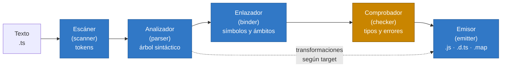
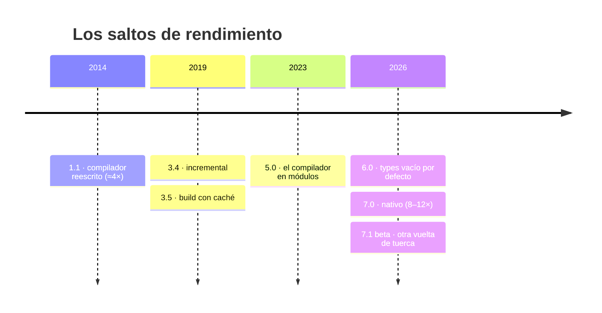

<div align="center">

# 18 · Bajo el capó y rendimiento

**Las fases del compilador, el programa y el servicio de lenguaje, cómo diagnosticar una compilación lenta, cómo escribir tipos baratos, la compilación incremental y doce años persiguiendo la velocidad**

[⬅ 17 · `tsconfig` de referencia](17-tsconfig-de-referencia.md) · [🏠 Índice](../README.md) · [19 · TypeScript y ECMAScript ➡](19-typescript-y-ecmascript.md)

</div>

<!-- ts=5.9 -->

> [!IMPORTANT]
> Un compilador lento no es solo una espera en CI: es un editor que tarda en subrayar el error, un autocompletado que llega tarde y un equipo que
> desactiva comprobaciones para ir más rápido. Este capítulo explica dónde se va el tiempo, cómo medirlo y qué hizo TypeScript durante doce años
> para recuperarlo, hasta el salto de la 7.0.

---

## Contenido

1. [Las fases del compilador](#1-las-fases-del-compilador)
2. [Programa, comprobador y servicio de lenguaje](#2-programa-comprobador-y-servicio-de-lenguaje)
3. [Diagnosticar una compilación lenta](#3-diagnosticar-una-compilación-lenta)
4. [Escribir tipos que compilan rápido](#4-escribir-tipos-que-compilan-rápido)
5. [Compilación incremental y referencias de proyecto](#5-compilación-incremental-y-referencias-de-proyecto)
6. [Doce años persiguiendo la velocidad](#6-doce-años-persiguiendo-la-velocidad)
7. [Medición propia: 6.0 frente a 7.0](#7-medición-propia-60-frente-a-70)
8. [Referencias](#8-referencias)

---

## 1. Las fases del compilador



| Fase | Qué produce | Coste típico | Escala en paralelo (7.0) |
|---|---|---|---|
| **Escáner y analizador** | Un árbol sintáctico por archivo | Proporcional al tamaño del código | ✅ Perfectamente: cada archivo es independiente |
| **Enlazador** | Símbolos, ámbitos, banderas de flujo | Bajo | ✅ Por archivo |
| **Comprobador** | Tipos, relaciones, errores | **El grueso del tiempo**: depende de la complejidad de los tipos, no del tamaño | ⚠️ Parcial: un archivo necesita tipos de otros |
| **Emisor** | JavaScript, declaraciones, mapas de fuente | Proporcional al tamaño | ✅ Por archivo |

El comprobador es **perezoso**: solo calcula el tipo de algo cuando alguien lo pregunta, y lo guarda en caché. Por eso una sola firma compleja en
un archivo muy importado puede dominar el tiempo de todo el proyecto.

---

## 2. Programa, comprobador y servicio de lenguaje

| Pieza | Qué es | Quién la usa |
|---|---|---|
| **Programa** (`Program`) | El conjunto de archivos, con sus opciones y las relaciones entre ellos | `tsc`, herramientas |
| **Comprobador** (`TypeChecker`) | Responde preguntas sobre tipos de ese programa | `tsc`, typescript-eslint |
| **Servicio de lenguaje** | Mantiene el programa vivo y lo actualiza con cada pulsación; responde a completado, errores, renombrar… | El editor |
| **Servidor** | Proceso que expone el servicio a los editores: `tsserver` (≤ 6.0) o LSP (7.0) | VS Code, Vim, Zed… |

El editor no recompila el proyecto a cada tecla: reutiliza los árboles de los archivos que no cambiaron y recalcula lo necesario. Aun así, en un
proyecto grande, la primera carga y los cambios en archivos muy importados son caros. Es la razón del «modo semántico parcial» de la 4.0, de los
diagnósticos por región de la 5.6 y, sobre todo, del servidor multihilo de la 7.0.

---

## 3. Diagnosticar una compilación lenta

### Paso 1: ¿cuánto y dónde?

`--extendedDiagnostics` imprime las cifras de una compilación. Esta es la salida real de la 6.0.3 y la 7.0.2 para el mismo proyecto pequeño (la
receta A del capítulo 17):

```text
TypeScript 6.0.3                                TypeScript 7.0.2
Files:                         82               Files:              82
Lines of Library:           57052               Lines:           84847
Lines of Definitions:       27775               Identifiers:     63951
Identifiers:                64911               Symbols:         41743
Symbols:                    41069               Types:            1152
Types:                       1117               Instantiations:    808
Instantiations:               980               Memory used:    35121K
Memory used:               82326K               Memory allocs:   59966
Parse time:                 0.11s               Parse time:     0.018s
Bind time:                  0.07s               Bind time:      0.005s
Check time:                 0.03s               Check time:     0.002s
Total time:                 0.24s               Total time:     0.026s
```

| Cifra | Qué indica si es alta |
|---|---|
| `Files` | Se cargan archivos de más: revisa `include`, `types` y `--explainFiles` |
| `Lines of Library` / `Definitions` | Muchos `.d.ts`: `skipLibCheck` y `types` explícitos ayudan |
| `Instantiations` | Tipos genéricos que se instancian sin parar: el sospechoso habitual |
| `Check time` frente a `Parse time` | Si domina la comprobación, el problema son los tipos; si domina el análisis, el volumen |
| `Memory used` | Cerca del límite de Node (≈ 4 GB por defecto en Strada), la recolección de basura se come el tiempo |

### Paso 2: ¿por qué está este archivo?

```bash
tsc --explainFiles > archivos.txt        # por qué entra cada archivo (4.2)
tsc --traceResolution > resolucion.txt   # cómo se resolvió cada importación
tsc --listFilesOnly                      # solo la lista
```

Un hallazgo típico: medio `node_modules/@types` cargado porque `types` no estaba declarado. La 6.0 lo resolvió cambiando el valor por defecto a
`[]` ([11 § 4](11-typescript-6.0-el-puente.md#4-types-y-rootdir-los-dos-cambios-que-más-rompen)).

### Paso 3: ¿qué tipo es el culpable?

```bash
tsc --generateTrace traza                 # 4.1: escribe trace.json y types.json
npx @typescript/analyze-trace traza       # 4.6: resume los puntos calientes
```

`analyze-trace` señala los archivos y las expresiones donde el comprobador pasó más tiempo. La traza también se puede abrir en el perfilador de
Chrome o en Perfetto. En la 7.0, `--pprofDir` escribe perfiles en el formato estándar de Go.

### Paso 4: el editor

Si `tsc` es rápido y el editor no, el problema suele ser el proyecto que el editor carga. *TypeScript: Open TS Server log* (≤ 6.0) o el registro
del servidor LSP (7.0) muestran qué `tsconfig.json` se usó y cuánto tardó cada petición.

---

## 4. Escribir tipos que compilan rápido

| Preferir | Antes que | Por qué |
|---|---|---|
| `interface A extends B, C {}` | `type A = B & C & {…}` | Las interfaces se comprueban una vez y se cachean por nombre; las intersecciones se recalculan |
| Anotar el tipo de retorno de funciones exportadas | Dejar que se infiera | El `.d.ts` se escribe sin inferir, y los cambios internos no invalidan a quien importa |
| Alias con nombre para tipos intermedios | Tipos anónimos anidados | El compilador reutiliza un alias en lugar de expandirlo cada vez |
| Uniones de decenas de miembros | Uniones de miles | Comparar uniones es cuadrático en el peor caso |
| Recursión de cola con acumuladores | Recursión que envuelve el resultado | Límite de 1000 en lugar de ~50 ([15 § 6](15-programacion-a-nivel-de-tipos.md#6-recursión-límites-y-acumuladores)) |
| Restricciones simples en genéricos | Condicionales encadenados en la restricción | Cada uso evalúa la restricción |
| `isolatedDeclarations` en bibliotecas | Inferencia en lo exportado | Otras herramientas generan los `.d.ts` en paralelo |

```ts
// Caro: cada uso de `Usuario` recalcula la intersección
type UsuarioCaro = { id: number } & { nombre: string } & { roles: string[] };

// Barato: una interfaz se comprueba una vez y se compara por nombre
interface ConId { id: number; }
interface ConNombre { nombre: string; }
interface Usuario extends ConId, ConNombre { roles: string[]; }

// Anotar el retorno de lo exportado evita inferir en cada archivo que lo importe
export function crear(nombre: string): Usuario {
    return { id: Date.now(), nombre, roles: [] };
}
```

---

## 5. Compilación incremental y referencias de proyecto

| Mecanismo | Desde | Qué guarda | Cuándo |
|---|---|---|---|
| `--watch` | 1.x | Todo en memoria | Desarrollo |
| `--incremental` | 3.4 | Un archivo `.tsbuildinfo` con firmas y diagnósticos | Compilaciones repetidas en CI o en local |
| `--incremental` con `--noEmit` | 4.0 | Ídem, sin emitir | Proyectos con empaquetador |
| Referencias de proyecto + `tsc -b` | 3.0 | Un `.tsbuildinfo` por proyecto y sus `.d.ts` | Monorrepos |
| `--build` con errores intermedios | 5.6 | Sigue construyendo los proyectos dependientes | Monorrepos grandes |
| `--builders` | 7.0 | Construye varias referencias en paralelo | Monorrepos con muchos núcleos |

Cómo decide `--incremental` qué recomprobar: para cada archivo guarda la **firma** de su `.d.ts`. Si un archivo cambia pero su firma no —un cambio
dentro del cuerpo de una función—, los archivos que lo importan no se recomprueban. Es otra razón para anotar los tipos de retorno exportados: con
la inferencia, cualquier cambio interno puede cambiar la firma.

La guía para decidir cuándo dividir en referencias está en [21 § Un proyecto o varios](21-guias-de-decision.md#7-un-proyecto-o-varios).

---

## 6. Doce años persiguiendo la velocidad

El rendimiento ha sido una constante, no un episodio. Cada pocas versiones, una se dedicó a recuperar el terreno que habían costado las
características nuevas:

| Año | Versión | Hito | Cifra publicada |
|---|---|---|---|
| 2014 | **1.1** | Compilador reescrito desde cero (el que sería Strada) | Unas 4 veces más rápido que el original |
| 2016 | 2.0 | Análisis de flujo de control con caché | — |
| 2018 | 3.0 | Referencias de proyecto | Monorrepos que se construyen por partes |
| 2019 | 3.4 | `--incremental` | Reconstrucciones mucho más rápidas |
| 2019 | 3.5 | Caché en `--build` y en la comprobación | Hasta un 68 % menos en reconstrucciones con cientos de proyectos |
| 2020 | 3.9 | Trabajo con material-ui y styled-components | ≈ 40 % menos en material-ui |
| 2020 | 4.0 | Modo semántico parcial en el editor | Respuesta antes de cargar el proyecto |
| 2021 | 4.5 | Recursión de cola en tipos | Tipos recursivos sin agotar el límite |
| 2022 | 4.6 | `@typescript/analyze-trace` | Herramienta oficial para encontrar culpables |
| 2022 | 4.8 | `--build`, `--watch` e `--incremental` | Entre un 10 % y un 25 % menos |
| 2022 | 4.9 | Vigilancia por eventos del sistema | Fin del sondeo de archivos |
| 2023 | **5.0** | Migración de *namespaces* a módulos y esbuild | 10–20 % más rápido; paquete de 63,8 a 37,4 MB |
| 2023 | 5.3 | Sin analizar JSDoc en `.ts` | Menos tiempo y memoria |
| 2024 | 5.5 | Objetos monomórficos | 5–8 % con la API pública |
| 2024 | 5.6 | Diagnósticos por región en el editor | Errores visibles antes en archivos grandes |
| 2024 | 5.7 | Caché de compilación de V8 | `tsc --version` unas 2,5 veces más rápido |
| 2025 | 5.9 | Caché de instanciaciones | Menos trabajo en bibliotecas muy genéricas |
| 2026 | 6.0 | `types: []` por defecto | 20–50 % menos en proyectos que cargaban todos los `@types` |
| 2026 | **7.0** | **Compilador nativo en Go (Corsa)** | **8–12 veces** más rápido en compilaciones completas |
| 2026 | 7.1 🟡 | Optimizaciones de Corsa | 13–47 % menos tiempo y 16–50 % menos memoria que la 7.0 |



---

## 7. Medición propia: 6.0 frente a 7.0

Las cifras oficiales se obtuvieron con proyectos grandes (VS Code, Sentry…) en máquinas de muchos núcleos ([12 § 2](12-typescript-7-el-compilador-nativo.md#2-las-cifras)).
Para tener una referencia reproducible, este atlas midió un proyecto **sintético** de 1500 módulos encadenados, cada uno con una interfaz, un tipo
mapeado con remapeo de claves, un tipo recursivo `Profundo<T>`, una función genérica y llamadas entre módulos. Se comprobó con `--noEmit`, y se
tomó la **mediana de cinco ejecuciones** en un Apple M2 con 8 núcleos y 8 GB de memoria, con Node 26.13.

| Compilador | Mediana | Frente a la 6.0 |
|---|---:|---:|
| 5.9.3 | 1,29 s | 0,95× |
| 6.0.3 | 1,23 s | 1× |
| 7.0.2 `--singleThreaded` | 0,47 s | **2,6×** |
| 7.0.2 (4 comprobadores, por defecto) | 0,23 s | **5,3×** |
| 7.0.2 `--checkers 8` | 0,22 s | 5,6× |
| 7.1.0-beta | 0,20 s | **6,2×** |

| `--extendedDiagnostics` | 6.0.3 | 7.0.2 |
|---|---:|---:|
| Archivos | 1561 | 1561 |
| Memoria usada | 263 MB | 202 MB |

Tres lecturas:

1. **El código nativo, solo, ya multiplica por 2,6.** El resto de la ganancia viene del paralelismo.
2. **El factor es menor que el oficial** (5× frente a 8–12×) porque el proyecto es pequeño: el arranque y la carga de las bibliotecas pesan más en
   proporción, y ocho núcleos limitan el reparto. En proyectos más grandes el factor crece.
3. **Más comprobadores no siempre ayudan**: con 1500 módulos encadenados en serie, pasar de 4 a 8 apenas cambia nada. La estructura del proyecto
   limita el paralelismo.

> [!NOTE]
> El generador del proyecto sintético y el script de medición son un experimento puntual de esta edición y no forman parte de `tools/`. Las cifras
> sirven para comparar compiladores entre sí en la misma máquina, no como referencia absoluta.

---

## 8. Referencias

- [Wiki de rendimiento de TypeScript](https://github.com/microsoft/TypeScript/wiki/Performance) · [Trazas de rendimiento](https://github.com/microsoft/TypeScript/wiki/Performance-Tracing)
- [`@typescript/analyze-trace`](https://www.npmjs.com/package/@typescript/analyze-trace)
- [Arquitectura del compilador (TypeScript Deep Dive)](https://basarat.gitbook.io/typescript/overview) · [`microsoft/typescript-go`](https://github.com/microsoft/typescript-go)
- Anuncios: [5.0](https://devblogs.microsoft.com/typescript/announcing-typescript-5-0/) · [7.0](https://devblogs.microsoft.com/typescript/announcing-typescript-7-0/) · [7.1 beta](https://devblogs.microsoft.com/typescript/announcing-typescript-7-1-beta/)
