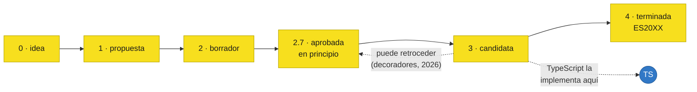
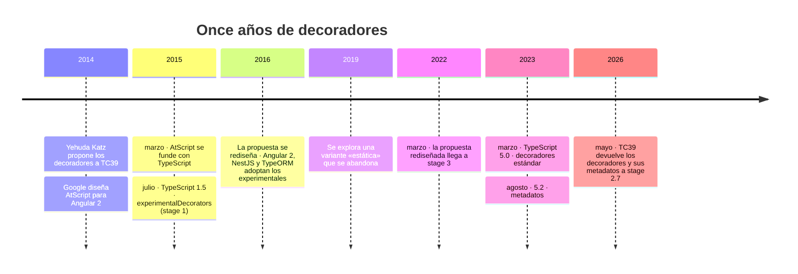

<div align="center">

# 19 · TypeScript y ECMAScript

**Un superconjunto que persigue un estándar: el proceso de TC39, lo que TypeScript adelantó, las bibliotecas `lib` de cada versión, la saga de los decoradores y la propuesta de anotaciones de tipo**

[⬅ 18 · Bajo el capó](18-bajo-el-capo-y-rendimiento.md) · [🏠 Índice](../README.md) · [20 · Ecosistema y runtimes ➡](20-ecosistema-y-runtimes.md)

</div>

<!-- ts=5.9 -->

> [!IMPORTANT]
> TypeScript se define como **JavaScript con sintaxis de tipos**. Eso le impone una regla que ha seguido —con dos excepciones históricas— desde 2015:
> no inventar sintaxis de **ejecución**. Lo que se ejecuta es JavaScript, y JavaScript lo decide TC39, el comité técnico 39 de Ecma International.
> TypeScript adelanta propuestas cuando alcanzan stage 3, a veces años antes de que lleguen a los navegadores, y paga el precio cuando una
> propuesta cambia después.

---

## Contenido

1. [Un superconjunto que persigue un estándar](#1-un-superconjunto-que-persigue-un-estándar)
2. [El proceso de TC39](#2-el-proceso-de-tc39)
3. [Lo que TypeScript adelantó](#3-lo-que-typescript-adelantó)
4. [Las bibliotecas `lib` de cada versión](#4-las-bibliotecas-lib-de-cada-versión)
5. [La saga de los decoradores](#5-la-saga-de-los-decoradores)
6. [Anotaciones de tipo en JavaScript](#6-anotaciones-de-tipo-en-javascript)
7. [Lo que TypeScript no hará](#7-lo-que-typescript-no-hará)
8. [Referencias](#8-referencias)

---

## 1. Un superconjunto que persigue un estándar

En 2012, TypeScript **se adelantó** a ES2015: clases, módulos y funciones flecha llegaron a TypeScript tres años antes que al estándar. Era una
apuesta: si TC39 los definía de otra forma, TypeScript tendría que cambiar. Salió bien con las clases y las flechas; con los módulos internos y los
decoradores, no tanto.

| Época | Relación con ECMAScript | Ejemplos |
|---|---|---|
| 2012–2015 | **Por delante** del estándar, con diseños propios | Clases (0.8), módulos internos (0.8), `enum` (0.8), decoradores (1.5) |
| 2015–2019 | **Alcanzar** ES2015 y transformar hacia ES3/ES5 | `let`/`const`, `for…of`, generadores, `async` para ES5 (2.1) |
| 2019–hoy | **Seguir** a TC39 desde stage 3 | `?.` (3.7), `#privado` (3.8), `using` (5.2), `import defer` (5.9) |

Las dos grandes excepciones a «solo sintaxis de tipos» —`enum` y `namespace`, más las propiedades de parámetro— son anteriores a esa regla. Hoy
`erasableSyntaxOnly` permite prohibirlas ([10 § 8](10-typescript-5.5-5.9-inferencia-y-sintaxis-borrable.md#8-typescript-58-erasablesyntaxonly-y-la-sintaxis-borrable)).

---

## 2. El proceso de TC39

| Stage | Nombre | Significa | ¿TypeScript la implementa? |
|---|---|---|---|
| 0 | Idea | Alguien la propone | No |
| 1 | Propuesta | El comité acepta estudiar el problema | No (excepción: los decoradores de 2015) |
| 2 | Borrador | Hay una sintaxis y una semántica preliminares | No |
| **2.7** | Aprobada en principio | Especificación completa; faltan pruebas e implementaciones (etapa creada entre finales de 2023 y principios de 2024) | No |
| **3** | Candidata | Lista para implementar; solo cambia por problemas graves | **Sí**: la política de TypeScript |
| 4 | Terminada | Dos implementaciones y pruebas de test262; entra en la siguiente edición anual | Sí |



Cada junio, Ecma publica una edición nueva (ES2015, ES2016…) con lo que llegó a stage 4 en los doce meses anteriores. TypeScript añade un `target` y
una `lib` con el nombre de cada edición ([01 § 7](01-modelo-de-versiones.md#7-target-y-lib-el-javascript-que-sale-y-el-que-se-supone)).

---

## 3. Lo que TypeScript adelantó

| Característica | TypeScript | Edición ES | Adelanto |
|---|---|---|---|
| Clases | 0.8 (2012) | ES2015 | 3 años |
| Funciones flecha | 0.8 (2012) | ES2015 | 3 años |
| Módulos (`import`/`export`) | 1.5 (2015) | ES2015 | Simultáneo |
| `async`/`await` | 1.7 (2015, con destino ES6) | ES2017 | 2 años |
| Propagación de objetos | 2.1 (2016) | ES2018 | 2 años |
| `import()` dinámico | 2.4 (2017) | ES2020 | 3 años |
| `?.` y `??` | 3.7 (2019) | ES2020 | Meses |
| Campos `#privados` y `await` de nivel superior | 3.8 (2020) | ES2022 | 2 años |
| `&&=`, `\|\|=`, `??=` | 4.0 (2020) | ES2021 | 1 año |
| Bloques `static` | 4.4 (2021) | ES2022 | 1 año |
| `#x in obj` | 4.5 (2021) | ES2022 | Meses |
| Atributos de importación (`with`) | 5.3 (2023) | ES2025 | 2 años |
| `using` y `await using` | 5.2 (2023) | ES2027 (stage 4 en mayo de 2026) | ≈ 4 años |
| Tipos de `Temporal` | 6.0 (2026) | ES2027 (stage 4 en marzo de 2026) | — |
| `import defer` | 5.9 (2025) | Stage 3 | — |
| `import source` | 7.1 🟡 (2026) | Stage 3 | — |
| Decoradores estándar | 5.0 (2023) | **Stage 2.7** desde mayo de 2026 | Quizá nunca en esa forma |

```ts run
// Todo esto es JavaScript estándar que TypeScript compiló antes que los motores
class Contador {
    static #instancias = 0;                  // ES2022
    #valor = 0;
    static { Contador.#instancias = 0; }     // ES2022

    incrementar(paso?: number): number {
        this.#valor += paso ?? 1;            // ES2020
        return this.#valor;
    }
    static esContador(x: object): boolean { return #valor in x; }   // ES2022
}

const c = new Contador();
let ultimo: number | undefined;
ultimo ??= c.incrementar();                  // ES2021
console.log(ultimo, c.incrementar(5), Contador.esContador(c));   // → 1 6 true
```

---

## 4. Las bibliotecas `lib` de cada versión

Cada API nueva del estándar llega a TypeScript como un archivo de declaraciones. Esta tabla, generada preguntando a cada compilador qué valores
de `lib` acepta, dice en qué versión debutó cada uno:

<!-- atlas:inicio tabla-lib -->
| TypeScript | Bibliotecas `lib` que debutan |
|---|---|
| **2.0** | `dom` · `es2015` · `es2015.collection` · `es2015.core` · `es2015.generator` · `es2015.iterable` · `es2015.promise` · `es2015.proxy` · `es2015.reflect` · `es2015.symbol` · `es2015.symbol.wellknown` · `es2016` · `es2016.array.include` · `es2017` · `es2017.object` · `es2017.sharedmemory` · `es5` · `es6` · `es7` · `scripthost` · `webworker` |
| **2.1** | `dom.iterable` · `es2017.string` |
| **2.3** | `esnext` · `esnext.asynciterable` |
| **2.4** | `es2017.intl` |
| **2.7** | `es2017.typedarrays` · `es2018` · `esnext.array` · `esnext.promise` |
| **2.8** | `es2018.promise` · `es2018.regexp` |
| **2.9** | `es2018.intl` |
| **3.0** | `esnext.intl` · `esnext.symbol` · `webworker.importscripts` |
| **3.2** | `esnext.bigint` |
| **3.4** | `es2018.asynciterable` · `es2019` · `es2019.array` · `es2019.string` · `es2019.symbol` |
| **3.5** | `es2019.object` · `es2020` · `es2020.string` · `es2020.symbol.wellknown` |
| **3.6** | `es2018.asyncgenerator` |
| **3.8** | `es2020.bigint` · `es2020.promise` |
| **3.9** | `esnext.string` |
| **4.0** | `es2020.intl` |
| **4.1** | `es2020.sharedmemory` · `esnext.weakref` · `webworker.iterable` |
| **4.3** | `es2021` · `es2021.promise` · `es2021.string` · `es2021.weakref` |
| **4.5** | `es2021.intl` |
| **4.6** | `es2022` · `es2022.array` · `es2022.error` · `es2022.object` · `es2022.string` |
| **4.7** | `es2020.date` · `es2020.number` · `es2022.intl` |
| **4.8** | `es2022.sharedmemory` |
| **4.9** | `es2019.intl` |
| **5.0** | `decorators` · `decorators.legacy` · `es2022.regexp` · `es2023` · `es2023.array` |
| **5.2** | `es2017.date` · `es2023.collection` · `esnext.collection` · `esnext.decorators` · `esnext.disposable` |
| **5.4** | `dom.asynciterable` · `es2016.intl` · `esnext.object` · `webworker.asynciterable` |
| **5.5** | `es2023.intl` · `esnext.regexp` |
| **5.6** | `esnext.iterator` |
| **5.7** | `es2017.arraybuffer` · `es2024` · `es2024.arraybuffer` · `es2024.collection` · `es2024.object` · `es2024.promise` · `es2024.regexp` · `es2024.sharedmemory` · `es2024.string` |
| **5.8** | `esnext.float16` |
| **5.9** | `esnext.error` · `esnext.sharedmemory` |
| **6.0** | `es2025` · `es2025.collection` · `es2025.float16` · `es2025.intl` · `es2025.iterator` · `es2025.promise` · `es2025.regexp` · `esnext.date` · `esnext.temporal` · `esnext.typedarrays` |
| **7.1** 🟡 | `es2026` · `es2026.array` · `es2026.collection` · `es2026.error` · `es2026.iterator` · `es2026.json` · `es2026.math` · `es2026.typedarrays` · `esnext.modulesource` |
<!-- atlas:fin tabla-lib -->

Dos detalles que la tabla deja ver:

- Las bibliotecas `esnext.*` son **provisionales**. Cuando una propuesta llega a stage 4, sus declaraciones se mueven a la edición correspondiente
  (`esnext.iterator` pasó a `es2025` en la 6.0) y la entrada `esnext.*` puede desaparecer: `es2022.sharedmemory` existió de la 4.8 a la 5.6.
- `decorators` y `decorators.legacy` (5.0) son las declaraciones de los dos sistemas de decoradores, que conviven
  ([09 § 2](09-typescript-5.0-5.4-decoradores-y-using.md#2-decoradores-estándar)).

---

## 5. La saga de los decoradores

Ninguna característica ilustra mejor el riesgo de adelantarse al estándar.



| Fecha | Hecho |
|---|---|
| 2014–2015 | Yehuda Katz presenta la propuesta en TC39. El equipo de Angular necesita anotaciones para su inyección de dependencias y diseña AtScript, un superconjunto de TypeScript |
| Marzo de 2015 | En ng-conf, Google y Microsoft anuncian que AtScript se funde con TypeScript: Angular 2 se escribirá en TypeScript |
| Julio de 2015 | TypeScript 1.5 implementa los decoradores tras `experimentalDecorators`, con la propuesta en stage 1, y añade `emitDecoratorMetadata` |
| 2016–2021 | La propuesta se rediseña varias veces. Mientras, el ecosistema construye sobre la versión de 2015: Angular, NestJS, TypeORM, MobX, class-validator |
| Marzo de 2022 | Una propuesta **completamente nueva** —distinta firma, sin decoradores de parámetro, con `accessor`— llega a stage 3 |
| Noviembre de 2022 | TypeScript 4.9 implementa `accessor` |
| Marzo de 2023 | TypeScript 5.0 implementa los decoradores estándar y los activa cuando no hay `experimentalDecorators` |
| Agosto de 2023 | TypeScript 5.2 implementa los metadatos de decoradores (`Symbol.metadata`) |
| 2023–2026 | Babel y TypeScript los transforman, pero **ningún motor de JavaScript los implementa** de forma nativa |
| Mayo de 2026 | TC39 devuelve los decoradores y sus metadatos a **stage 2.7**: pruebas de test262 insuficientes, ningún motor que los distribuya y la propuesta sin un responsable activo |

> [!WARNING]
> En noviembre de 2026, TypeScript mantiene **dos** sistemas de decoradores, y ninguno es estándar. Los experimentales siguen siendo los que usan
> Angular (en sus decoradores de clase y de parámetro) y NestJS; los estándar los usan Lit y bibliotecas nuevas. Antes de elegir, comprueba qué
> sistema espera el marco que usas. La regla del stage 3 se creó precisamente para no repetir 2015, y esta vez ni siquiera el stage 3 bastó.

```ts run
// Decorador estándar: compila sin experimentalDecorators
function contarLlamadas<This, Args extends unknown[], R>(
    metodo: (this: This, ...args: Args) => R,
    contexto: ClassMethodDecoratorContext<This, (this: This, ...args: Args) => R>,
) {
    let llamadas = 0;
    contexto.addInitializer(function () { llamadas = 0; });
    return function (this: This, ...args: Args): R {
        llamadas++;
        if (llamadas === 3) console.log(`${String(contexto.name)} llamado 3 veces`);
        return metodo.apply(this, args);
    };
}

class Servicio {
    @contarLlamadas
    ping(): string { return "pong"; }
}

const s = new Servicio();
s.ping(); s.ping();
console.log(s.ping());
// → ping llamado 3 veces
// → pong
```

---

## 6. Anotaciones de tipo en JavaScript

En marzo de 2022, Daniel Rosenwasser (Microsoft), Rob Palmer (Bloomberg) y Romulo Cintra (Igalia) presentaron a TC39 una propuesta para que
**JavaScript acepte sintaxis de tipos y la ignore**: los motores tratarían `x: number` como un comentario. Llegó a **stage 1** ese mismo mes, y
en noviembre de 2026 sigue ahí.

| Idea | Detalle |
|---|---|
| Qué propone | Reservar en la gramática de JavaScript un espacio para anotaciones que el motor ignora |
| Qué **no** propone | Comprobar tipos en el navegador, ni elegir TypeScript como sistema de tipos oficial |
| Qué cubriría | Anotaciones, `interface`, `type`, genéricos, `as`, `!`, `import type`: la sintaxis borrable |
| Qué no cubriría | `enum`, `namespace`, propiedades de parámetro: lo que genera código |
| Estado | Stage 1 desde marzo de 2022 |

Mientras tanto, los runtimes han llegado por otro camino al mismo sitio: Node (22.18+), Deno y Bun **borran** los tipos antes de ejecutar
([20 · Ecosistema y runtimes](20-ecosistema-y-runtimes.md#2-node-ejecutar-ts-borrando-los-tipos)). `erasableSyntaxOnly` (5.8) es, en la práctica, la
definición operativa de la sintaxis que esa propuesta abarcaría.

---

## 7. Lo que TypeScript no hará

Los [objetivos de diseño](https://github.com/microsoft/TypeScript/wiki/TypeScript-Design-Goals) de TypeScript, escritos en sus primeros años y
todavía vigentes, explican muchas peticiones rechazadas. Algunos **no-objetivos**:

| No-objetivo | Consecuencia práctica |
|---|---|
| Imitar el diseño de otros lenguajes | No hay sobrecarga de operadores, ni `final`, ni clases selladas |
| Optimizar el rendimiento del JavaScript emitido | El compilador no reescribe tu código para que vaya más rápido |
| Un sistema de tipos sólido o demostrablemente correcto | Los agujeros del [14 § 10](14-sistema-de-tipos-a-fondo.md#10-los-agujeros-deliberados-de-solidez) son deliberados |
| Herramientas de compilación de extremo a extremo | `tsc` no empaqueta ni minimiza; para eso hay otras herramientas |
| Añadir o depender de información de tipos en ejecución | No hay reflexión de tipos: `emitDecoratorMetadata` es una excepción heredada |
| Emitir un programa distinto según los tipos | El JavaScript emitido no depende de los tipos inferidos (la base de `isolatedModules`) |

Y algunos objetivos: alinearse con las propuestas actuales y futuras de ECMAScript, conservar el comportamiento en ejecución de todo el código
JavaScript, usar un sistema de tipos **estructural** y emitir JavaScript limpio e idiomático.

---

## 8. Referencias

- [TC39](https://tc39.es) · [Proceso de TC39](https://tc39.es/process-document/) · [Propuestas](https://github.com/tc39/proposals) · [Propuestas terminadas](https://github.com/tc39/proposals/blob/main/finished-proposals.md) · [Notas de las reuniones](https://github.com/tc39/notes)
- Propuestas: [Decoradores](https://github.com/tc39/proposal-decorators) · [Anotaciones de tipo](https://github.com/tc39/proposal-type-annotations) · [Gestión explícita de recursos](https://github.com/tc39/proposal-explicit-resource-management) · [Temporal](https://github.com/tc39/proposal-temporal)
- [Objetivos de diseño de TypeScript](https://github.com/microsoft/TypeScript/wiki/TypeScript-Design-Goals)
- [Compatibilidad de ECMAScript por motor](https://compat-table.github.io/compat-table/es2016plus/)
