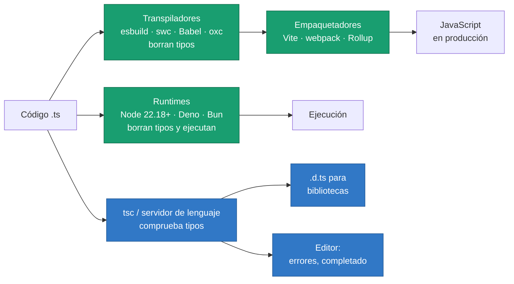
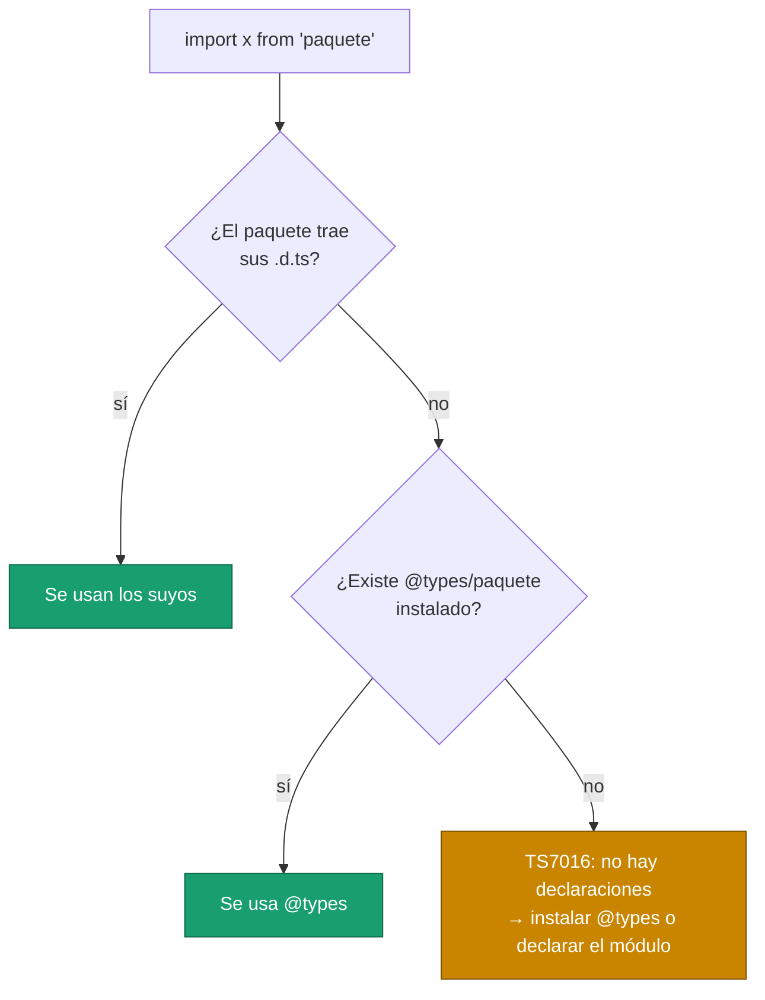

<div align="center">

# 20 · Ecosistema y runtimes

**Quién lee TypeScript en 2026: Node, Deno y Bun; DefinitelyTyped; los transpiladores que borran tipos; typescript-eslint; el modo JSDoc y la validación en ejecución**

[⬅ 19 · TypeScript y ECMAScript](19-typescript-y-ecmascript.md) · [🏠 Índice](../README.md) · [21 · Guías de decisión ➡](21-guias-de-decision.md)

</div>

<!-- ts=5.9 -->

> [!IMPORTANT]
> En 2012, TypeScript era un compilador: entraba `.ts` y salía `.js`. En 2026 es, sobre todo, un **comprobador de tipos** y un **servicio de
> editor**. Casi ningún proyecto ejecuta la salida de `tsc`: el código lo transforman esbuild, swc o Vite, o lo ejecutan directamente Node, Deno o
> Bun borrando los tipos. Entender quién hace qué evita la mitad de las configuraciones incorrectas.

---

## Contenido

1. [El mapa: quién hace qué](#1-el-mapa-quién-hace-qué)
2. [Node: ejecutar `.ts` borrando los tipos](#2-node-ejecutar-ts-borrando-los-tipos)
3. [Deno y Bun](#3-deno-y-bun)
4. [DefinitelyTyped y los paquetes `@types`](#4-definitelytyped-y-los-paquetes-types)
5. [Transpiladores: esbuild, swc, Babel y oxc](#5-transpiladores-esbuild-swc-babel-y-oxc)
6. [*Linters*: typescript-eslint y compañía](#6-linters-typescript-eslint-y-compañía)
7. [JavaScript con tipos: el modo JSDoc](#7-javascript-con-tipos-el-modo-jsdoc)
8. [Validación en ejecución](#8-validación-en-ejecución)
9. [Referencias](#9-referencias)

---

## 1. El mapa: quién hace qué



| Herramienta | ¿Comprueba tipos? | ¿Emite JavaScript? | ¿Genera `.d.ts`? | Requisito |
|---|---|---|---|---|
| `tsc` | ✅ | ✅ | ✅ | — |
| esbuild · swc · Babel · oxc | ❌ | ✅ | oxc y swc, con `isolatedDeclarations` | `isolatedModules` / `verbatimModuleSyntax` |
| Node 22.18+ | ❌ | (ejecuta) | ❌ | Sintaxis borrable |
| Deno | ✅ con `deno check` | (ejecuta) | — | — |
| Bun | ❌ | (ejecuta) | ❌ | — |
| Vite · webpack | ❌ (delegan en esbuild, swc o Babel) | ✅ | Con complementos | `isolatedModules` |

La consecuencia es que **la comprobación de tipos es un paso aparte**: `tsc --noEmit` en CI y el servidor de lenguaje en el editor. Ningún
transpilador detendrá un error de tipos.

---

## 2. Node: ejecutar `.ts` borrando los tipos

### Cronología

| Versión de Node | Fecha | Estado |
|---|---|---|
| 22.6 | Agosto de 2024 | `--experimental-strip-types`: borrar tipos detrás de una opción |
| 22.7 | Agosto de 2024 | `--experimental-transform-types`: además, transformar `enum` y `namespace` |
| **23.6** | Enero de 2025 | Eliminación de tipos **activada por defecto** |
| **22.18** | 2025 | Activada por defecto también en la rama LTS 22 |
| Versiones actuales | 2026 | Marcada como **estable** (*Stability 2*) en la documentación de Node |

### Cómo funciona

Node usa un analizador de TypeScript (Amaro, basado en swc) que **sustituye las anotaciones por espacios en blanco**. No genera mapas de fuente
porque no los necesita: las posiciones de los errores coinciden con las del archivo original.

```ts omitir
// entrada.ts                                     // lo que Node ejecuta (mismas columnas)
function sumar(a: number, b: number): number {    function sumar(a        , b        )         {
    return a + b;                                     return a + b;
}                                                 }
```

### Lo que Node exige

| Regla | Por qué | Cómo cumplirla en `tsconfig.json` |
|---|---|---|
| Solo sintaxis borrable | No genera código | `erasableSyntaxOnly: true` |
| `import type` para los tipos | No sabe qué es un tipo sin comprobar | `verbatimModuleSyntax: true` |
| Extensión en las importaciones relativas (`./util.ts`) | Resolución de ESM | `allowImportingTsExtensions` y `rewriteRelativeImportExtensions` |
| No lee `tsconfig.json` | `paths`, `target`, `jsx` no le afectan | Usar `imports` de `package.json` en lugar de `paths` |
| No borra tipos en `node_modules` | Los paquetes deben publicar JavaScript | Compilar las bibliotecas antes de publicarlas |
| No comprueba tipos | Solo ejecuta | `tsc --noEmit` aparte |

La configuración completa está en [17 § Receta C](17-tsconfig-de-referencia.md#c--node-ejecutando-ts-directamente-2218--236).

---

## 3. Deno y Bun

| | Deno | Bun |
|---|---|---|
| **TypeScript desde** | Su primera versión (2018; 1.0 en 2020) | Su primera versión (1.0 en 2023) |
| **Cómo lo ejecuta** | Transpila con swc | Transpila con su propio transpilador (en Zig) |
| **¿Comprueba tipos?** | Sí, con `deno check` (y antes de `deno test` o `deno publish`) | No: hay que ejecutar `tsc` |
| **Configuración** | `deno.json` (lee `compilerOptions`) | `tsconfig.json` (lee `paths` y `jsx`) |
| **Sintaxis no borrable** (`enum`, decoradores) | Sí | Sí |
| **Módulos** | ESM; `npm:` y `jsr:` como especificadores | ESM y CommonJS mezclados (`module: preserve`) |
| **Registro propio** | JSR, que publica TypeScript sin compilar | — |

> [!NOTE]
> JSR (2024) es un registro de paquetes que acepta **código TypeScript** y genera por su cuenta el JavaScript y los `.d.ts` para cada consumidor.
> Exige que los tipos exportados sean explícitos —la misma idea que `isolatedDeclarations` ([10 § 3](10-typescript-5.5-5.9-inferencia-y-sintaxis-borrable.md#3-typescript-55-isolateddeclarations-y-configdir))—
> para poder generar las declaraciones sin un comprobador completo.

---

## 4. DefinitelyTyped y los paquetes `@types`

Muchos paquetes de npm están escritos en JavaScript y no publican tipos. **DefinitelyTyped** es el repositorio comunitario donde se escriben y
publican sus declaraciones, bajo el ámbito `@types` de npm.

| Concepto | Detalle |
|---|---|
| Origen | Repositorio comunitario desde 2012; publicación automática en `@types/*` desde TypeScript 2.0 (2016) |
| Nombre | `@types/<paquete>`; los paquetes con ámbito, como `@types/babel__core` para `@babel/core` |
| Versión | El *major.minor* del paquete `@types` sigue al de la biblioteca; el parche es propio |
| Soporte de TypeScript | Cada `@types` se prueba con las versiones de TypeScript publicadas en los **dos últimos años**; las más antiguas dejan de estar garantizadas |
| Cuándo **no** hace falta | Si el paquete publica sus propios `.d.ts` (campo `types` o condición `types` en `exports`) |
| Globales | Desde la 6.0, un `@types` con globales (`node`, `jest`) hay que listarlo en `types` ([11 § 4](11-typescript-6.0-el-puente.md#4-types-y-rootdir-los-dos-cambios-que-más-rompen)) |



La ventana de dos años tiene una consecuencia: una biblioteca que fije TypeScript 4.x puede encontrarse con `@types` que usan sintaxis más nueva
(por ejemplo, parámetros `const` o `NoInfer`) y no compilan. `typesVersions` permite a un paquete ofrecer declaraciones distintas según la versión
del compilador ([05 § `typesVersions`](05-typescript-3.0-3.4-proyectos-y-tuplas.md#typesversions)).

---

## 5. Transpiladores: esbuild, swc, Babel y oxc

| Herramienta | Lenguaje | Desde | Dónde se usa |
|---|---|---|---|
| Babel (`@babel/preset-typescript`) | JavaScript | 2018 (Babel 7) | Proyectos con complementos de Babel; React Native |
| esbuild | Go | 2020 | Vite (desarrollo), tsx, muchos empaquetadores |
| swc | Rust | 2019 | Next.js, Deno, Jest (`@swc/jest`), Node (Amaro) |
| oxc | Rust | 2023 | Rolldown (el empaquetador de Vite), generación de `.d.ts` aislados |

Todos comparten una limitación: procesan **un archivo cada vez**, sin el comprobador. De ahí salen las reglas de `isolatedModules` (1.5):

| Construcción | Problema para un transpilador de archivos sueltos | Opción que lo detecta |
|---|---|---|
| `export { Usuario } from "./tipos"` donde `Usuario` es un tipo | No sabe si borrar la reexportación | `isolatedModules` / `verbatimModuleSyntax` |
| `const enum` de otro archivo | No conoce sus valores para insertarlos | `isolatedModules` |
| Un archivo sin `import` ni `export` | No sabe si es un script o un módulo | `moduleDetection: force` |
| Exportaciones inferidas en una biblioteca | No puede escribir el `.d.ts` | `isolatedDeclarations` |

```ts opts=isolatedModules err=TS1205
// @filename: tipos.ts
export interface Usuario { nombre: string; }

// @filename: indice.ts
export { Usuario } from "./tipos";     // error TS1205: con isolatedModules hay que escribir `export type`
```

---

## 6. *Linters*: typescript-eslint y compañía

| Herramienta | Qué aporta | Relación con el compilador |
|---|---|---|
| **typescript-eslint** | Reglas de ESLint para TypeScript; las «con tipos» (`no-floating-promises`, `no-unsafe-*`) usan el comprobador | Carga la API del compilador: con la 7.0 necesita `@typescript/typescript6` hasta adoptar la API de la 7.1 |
| **Biome** | *Linter* y formateador en Rust, muy rápido | Analiza la sintaxis; desde la versión 2, algunas reglas con inferencia propia |
| **oxlint** | *Linter* en Rust del proyecto oxc | Igual: rápido, con un subconjunto de reglas |
| **Prettier** | Formateador | Solo sintaxis |

> [!TIP]
> Las reglas de typescript-eslint que **usan tipos** son las que más errores reales encuentran (promesas sin `await`, `any` que se cuela,
> comparaciones imposibles) y también las más lentas, porque construyen el programa completo. Es habitual ejecutar las rápidas en el editor y las
> que usan tipos solo en CI.

---

## 7. JavaScript con tipos: el modo JSDoc

TypeScript comprueba también archivos **JavaScript**, leyendo los tipos de comentarios JSDoc. Es la forma de tener tipos sin paso de compilación:
el archivo que se ejecuta es el mismo que se escribe. Proyectos como Svelte y webpack lo usan en su propio código.

| Activación | Alcance |
|---|---|
| `// @ts-check` al principio de un `.js` | Ese archivo |
| `checkJs: true` (con `allowJs`) | Todos los `.js` del proyecto |
| `// @ts-nocheck` | Excluye un archivo |

```js verificar
// @ts-check

/** @typedef {{ nombre: string, edad?: number }} Persona */

/**
 * @template T
 * @param {T[]} lista
 * @param {(x: T) => boolean} condicion
 * @returns {T | undefined}
 */
export function buscar(lista, condicion) {
    return lista.find(condicion);
}

/** @type {Persona[]} */
const personas = [{ nombre: "Ana", edad: 34 }];

const ana = buscar(personas, (p) => p.nombre === "Ana");
const edad = ana?.edad ?? 0;

/** @satisfies {Record<string, Persona>} */
export const porId = { a1: { nombre: "Luis" } };
```

| Etiqueta | Equivale a | Desde |
|---|---|---|
| `@type {T}` | Anotación de una variable | 2.3 |
| `@param` · `@returns` | Firma de función | 2.3 |
| `@typedef` | `type` | 2.3 |
| `@callback` | Tipo función con nombre | 2.9 |
| `@template T` | Parámetro genérico | 2.3 |
| `@public` · `@private` · `@readonly` | Modificadores | 3.8 |
| `@satisfies` · `@overload` | `satisfies` y sobrecargas | 5.0 |
| `@import` | `import type` | 5.5 |

> [!WARNING]
> La 7.0 simplificó el modo JSDoc: desaparecen las rarezas heredadas de Closure Compiler (`@enum` especial, `?` como tipo, funciones como
> constructores con `@class`, la sintaxis `function(string): void`). Un proyecto JSDoc antiguo debe revisar la tabla del
> [12 § 4](12-typescript-7-el-compilador-nativo.md#4-lo-que-cambia-para-el-código) antes de migrar.

---

## 8. Validación en ejecución

Los tipos desaparecen al ejecutar: lo que llega por la red, de un formulario o de un archivo no está comprobado por nadie
([14 § 10](14-sistema-de-tipos-a-fondo.md#10-los-agujeros-deliberados-de-solidez)). Las bibliotecas de **esquemas** resuelven las dos mitades a la vez:
validan en ejecución y deducen el tipo estático del esquema.

| Biblioteca | Estilo | Nota |
|---|---|---|
| Zod | Encadenado: `z.object({ … })` | La más extendida |
| Valibot | Funciones componibles | Muy pequeña tras el *tree-shaking* |
| ArkType | Sintaxis de cadenas parecida a TypeScript: `type({ nombre: "string" })` | Rápida en ejecución |
| TypeBox | Genera JSON Schema | Integración con OpenAPI |

Varias de ellas implementan **Standard Schema**, una interfaz común que permite a los marcos (formularios, enrutadores, tRPC) aceptar esquemas de
cualquier biblioteca.

```ts run
// Lo mismo, sin biblioteca: una guarda que valida y estrecha
interface Usuario { id: number; nombre: string; }

function esUsuario(x: unknown): x is Usuario {
    return typeof x === "object" && x !== null
        && "id" in x && typeof x.id === "number"
        && "nombre" in x && typeof x.nombre === "string";
}

const datos: unknown = JSON.parse('{"id": 7, "nombre": "Ana"}');
console.log(esUsuario(datos) ? datos.nombre.toUpperCase() : "inválido");   // → ANA
```

---

## 9. Referencias

- Node.js: [Módulos: TypeScript](https://nodejs.org/api/typescript.html) · [Ejecutar TypeScript de forma nativa](https://nodejs.org/en/learn/typescript/run-natively)
- [Deno: TypeScript](https://docs.deno.com/runtime/fundamentals/typescript/) · [Bun: TypeScript](https://bun.sh/docs/runtime/typescript) · [JSR](https://jsr.io)
- [DefinitelyTyped](https://github.com/DefinitelyTyped/DefinitelyTyped) · [Política de soporte de versiones de TypeScript en DefinitelyTyped](https://github.com/DefinitelyTyped/DefinitelyTyped#support-window)
- [typescript-eslint](https://typescript-eslint.io) · [Biome](https://biomejs.dev) · [oxc](https://oxc.rs)
- Manual: [JSDoc de referencia](https://www.typescriptlang.org/docs/handbook/jsdoc-supported-types.html) · [Comprobar JavaScript](https://www.typescriptlang.org/docs/handbook/intro-to-js-ts.html)
- [Standard Schema](https://standardschema.dev) · [Zod](https://zod.dev) · [Valibot](https://valibot.dev) · [ArkType](https://arktype.io)
