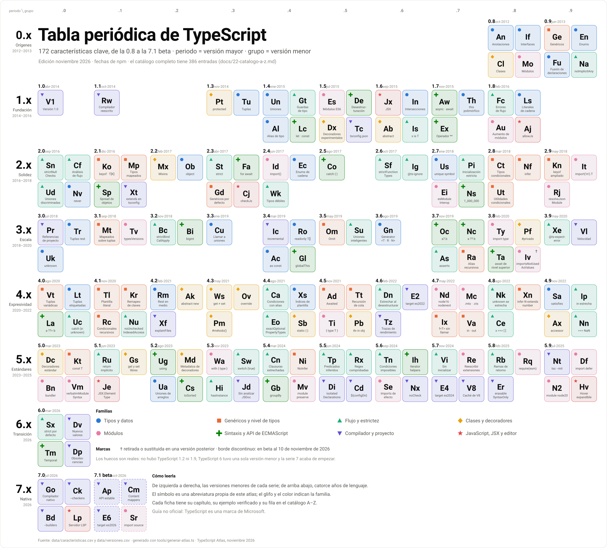

# 22 · Catálogo A–Z de características de TypeScript

**386 características con su versión, familia, lo que exigen en ejecución, su relación con ECMAScript y su prueba de debut · edición noviembre 2026**

[⬅ 21 · Guías de decisión](21-guias-de-decision.md) · [🏠 Índice](../README.md) · [23 · Migración ➡](23-migracion-y-ciclo-de-vida.md)

> [!NOTE]
> Este archivo se **genera automáticamente** desde [`data/caracteristicas.csv`](../data/caracteristicas.csv) con
> `node tools/generar-atlas.ts`. Para corregir o añadir una característica, edita el CSV y vuelve a ejecutar el script.

<picture>
  <source media="(prefers-color-scheme: dark)" srcset="../assets/ts-atlas-tabla-periodica-oscuro.svg">
  
</picture>

## Contenido

1. [Cómo leer el catálogo](#cómo-leer-el-catálogo)
2. [Resumen por versión](#resumen-por-versión)
3. [Resumen por familia](#resumen-por-familia)
4. [Lo que ya no existe](#lo-que-ya-no-existe)
5. [Catálogo](#catálogo)

---

## Cómo leer el catálogo

| Columna | Significado |
|---|---|
| **TS** | Versión en la que debutó, con enlace a su capítulo |
| **Familia** | Una de las ocho familias del atlas (las mismas del póster) |
| **Exige** | Qué necesita la característica más allá del compilador (tabla siguiente) |
| **ECMAScript** | Edición del estándar o etapa de TC39 a la que corresponde, si refleja una propuesta de JavaScript |
| **Estado** | 🟢 vigente · 🟡 en beta · ⛔ retirada (se indica la versión en que dejó de aceptarse) |
| **🧪** | Enlace a su [prueba de debut](25-pruebas-de-debut.md): un fragmento mínimo que compila con esa versión y **falla con la anterior** |

| Exige | Qué significa | Consecuencia práctica |
|---|---|---|
| **Solo tipos** | Se borra al compilar: no deja rastro en el JavaScript | Funciona con cualquier `target` y con la eliminación de tipos de Node |
| **Sintaxis ES** | Sintaxis de ECMAScript: pasa tal cual si el destino la soporta, o se transforma | Revisa `target` y el runtime; TypeScript la transforma si hace falta |
| **Emisión propia** | Sintaxis de TypeScript que genera código en ejecución (no es «borrable») | Incompatible con `erasableSyntaxOnly` y con la eliminación de tipos |
| **Biblioteca** | Declaraciones de tipos de una API: el runtime debe tenerla | Revisa `lib` y que el runtime la implemente; TypeScript no añade *polyfills* |
| **Opción** | Opción del compilador o de tsconfig.json | Se activa en `tsconfig.json` |
| **Herramienta** | Capacidad del compilador, del editor o del servicio de lenguaje | No cambia el lenguaje |

---

## Resumen por versión

| Versión | Publicación | Características | Solo tipos | Sintaxis ES | Emisión propia | Biblioteca | Opción | Herramienta |
|---|---|---:|---:|---:|---:|---:|---:|---:|
| [TypeScript 0.8](02-origenes-y-typescript-1.md) | oct-2012 | 15 | 8 | 3 | 3 | · | 1 | · |
| [TypeScript 0.9](02-origenes-y-typescript-1.md) | jun-2013 | 6 | 4 | · | 1 | · | 1 | · |
| [TypeScript 1.0](02-origenes-y-typescript-1.md) | abr-2014 | 1 | · | · | · | · | · | 1 |
| [TypeScript 1.1](02-origenes-y-typescript-1.md) | oct-2014 | 1 | · | · | · | · | · | 1 |
| [TypeScript 1.3](02-origenes-y-typescript-1.md) | nov-2014 | 2 | 2 | · | · | · | · | · |
| [TypeScript 1.4](02-origenes-y-typescript-1.md) | ene-2015 | 7 | 3 | 2 | 1 | · | 1 | · |
| [TypeScript 1.5](02-origenes-y-typescript-1.md) | jul-2015 | 12 | · | 6 | 3 | · | 3 | · |
| [TypeScript 1.6](02-origenes-y-typescript-1.md) | sep-2015 | 13 | 7 | 2 | 1 | · | 2 | 1 |
| [TypeScript 1.7](02-origenes-y-typescript-1.md) | nov-2015 | 3 | 1 | 2 | · | · | · | · |
| [TypeScript 1.8](02-origenes-y-typescript-1.md) | feb-2016 | 9 | 5 | 1 | · | · | 3 | · |
| [TypeScript 2.0](03-typescript-2.0-2.2-nulos-y-flujo.md) | sep-2016 | 21 | 12 | 1 | · | · | 8 | · |
| [TypeScript 2.1](03-typescript-2.0-2.2-nulos-y-flujo.md) | dic-2016 | 12 | 6 | 2 | · | · | 4 | · |
| [TypeScript 2.2](03-typescript-2.0-2.2-nulos-y-flujo.md) | feb-2017 | 5 | 4 | 1 | · | · | · | · |
| [TypeScript 2.3](04-typescript-2.3-2.9-estricto-y-condicionales.md) | abr-2017 | 6 | 1 | 1 | · | · | 3 | 1 |
| [TypeScript 2.4](04-typescript-2.3-2.9-estricto-y-condicionales.md) | jun-2017 | 5 | 3 | 1 | 1 | · | · | · |
| [TypeScript 2.5](04-typescript-2.3-2.9-estricto-y-condicionales.md) | ago-2017 | 4 | 1 | 1 | · | · | 1 | 1 |
| [TypeScript 2.6](04-typescript-2.3-2.9-estricto-y-condicionales.md) | oct-2017 | 4 | 1 | · | · | · | 2 | 1 |
| [TypeScript 2.7](04-typescript-2.3-2.9-estricto-y-condicionales.md) | ene-2018 | 7 | 4 | 1 | · | · | 2 | · |
| [TypeScript 2.8](04-typescript-2.3-2.9-estricto-y-condicionales.md) | mar-2018 | 8 | 6 | · | · | · | 1 | 1 |
| [TypeScript 2.9](04-typescript-2.3-2.9-estricto-y-condicionales.md) | may-2018 | 6 | 3 | 1 | · | · | 2 | · |
| [TypeScript 3.0](05-typescript-3.0-3.4-proyectos-y-tuplas.md) | jul-2018 | 5 | 4 | · | · | · | 1 | · |
| [TypeScript 3.1](05-typescript-3.0-3.4-proyectos-y-tuplas.md) | sep-2018 | 3 | 2 | · | · | · | 1 | · |
| [TypeScript 3.2](05-typescript-3.0-3.4-proyectos-y-tuplas.md) | nov-2018 | 6 | 2 | 1 | · | · | 3 | · |
| [TypeScript 3.3](05-typescript-3.0-3.4-proyectos-y-tuplas.md) | ene-2019 | 2 | 1 | · | · | · | · | 1 |
| [TypeScript 3.4](05-typescript-3.0-3.4-proyectos-y-tuplas.md) | mar-2019 | 5 | 3 | 1 | · | · | 1 | · |
| [TypeScript 3.5](06-typescript-3.5-3.9-encadenamiento-y-aserciones.md) | may-2019 | 6 | 4 | · | · | · | 1 | 1 |
| [TypeScript 3.6](06-typescript-3.5-3.9-encadenamiento-y-aserciones.md) | ago-2019 | 5 | 3 | 1 | · | · | · | 1 |
| [TypeScript 3.7](06-typescript-3.5-3.9-encadenamiento-y-aserciones.md) | nov-2019 | 9 | 5 | 2 | · | · | 2 | · |
| [TypeScript 3.8](06-typescript-3.5-3.9-encadenamiento-y-aserciones.md) | feb-2020 | 8 | 2 | 3 | · | · | 3 | · |
| [TypeScript 3.9](06-typescript-3.5-3.9-encadenamiento-y-aserciones.md) | may-2020 | 6 | 4 | · | · | · | · | 2 |
| [TypeScript 4.0](07-typescript-4.0-4.4-tuplas-variadicas-y-plantillas.md) | ago-2020 | 9 | 4 | 1 | · | · | 2 | 2 |
| [TypeScript 4.1](07-typescript-4.0-4.4-tuplas-variadicas-y-plantillas.md) | nov-2020 | 7 | 4 | · | · | · | 3 | · |
| [TypeScript 4.2](07-typescript-4.0-4.4-tuplas-variadicas-y-plantillas.md) | feb-2021 | 6 | 3 | · | · | · | 2 | 1 |
| [TypeScript 4.3](07-typescript-4.0-4.4-tuplas-variadicas-y-plantillas.md) | may-2021 | 8 | 6 | 1 | · | · | · | 1 |
| [TypeScript 4.4](07-typescript-4.0-4.4-tuplas-variadicas-y-plantillas.md) | ago-2021 | 6 | 2 | 1 | · | · | 2 | 1 |
| [TypeScript 4.5](08-typescript-4.5-4.9-esm-y-satisfies.md) | nov-2021 | 9 | 4 | 2 | · | · | 3 | · |
| [TypeScript 4.6](08-typescript-4.5-4.9-esm-y-satisfies.md) | feb-2022 | 8 | 5 | · | · | · | 1 | 2 |
| [TypeScript 4.7](08-typescript-4.5-4.9-esm-y-satisfies.md) | may-2022 | 11 | 6 | · | · | · | 4 | 1 |
| [TypeScript 4.8](08-typescript-4.5-4.9-esm-y-satisfies.md) | ago-2022 | 5 | 3 | · | · | · | · | 2 |
| [TypeScript 4.9](08-typescript-4.5-4.9-esm-y-satisfies.md) | nov-2022 | 6 | 3 | 1 | · | · | · | 2 |
| [TypeScript 5.0](09-typescript-5.0-5.4-decoradores-y-using.md) | mar-2023 | 12 | 4 | 1 | · | · | 5 | 2 |
| [TypeScript 5.1](09-typescript-5.0-5.4-decoradores-y-using.md) | jun-2023 | 6 | 4 | · | · | · | · | 2 |
| [TypeScript 5.2](09-typescript-5.0-5.4-decoradores-y-using.md) | ago-2023 | 7 | 3 | 2 | · | 1 | · | 1 |
| [TypeScript 5.3](09-typescript-5.0-5.4-decoradores-y-using.md) | nov-2023 | 8 | 5 | 1 | · | · | · | 2 |
| [TypeScript 5.4](09-typescript-5.0-5.4-decoradores-y-using.md) | mar-2024 | 6 | 3 | · | · | 1 | 1 | 1 |
| [TypeScript 5.5](10-typescript-5.5-5.9-inferencia-y-sintaxis-borrable.md) | jun-2024 | 9 | 4 | · | · | 1 | 2 | 2 |
| [TypeScript 5.6](10-typescript-5.5-5.9-inferencia-y-sintaxis-borrable.md) | sep-2024 | 9 | 1 | 1 | · | 1 | 4 | 2 |
| [TypeScript 5.7](10-typescript-5.5-5.9-inferencia-y-sintaxis-borrable.md) | nov-2024 | 7 | 2 | · | · | 1 | 2 | 2 |
| [TypeScript 5.8](10-typescript-5.5-5.9-inferencia-y-sintaxis-borrable.md) | feb-2025 | 6 | 1 | · | · | · | 4 | 1 |
| [TypeScript 5.9](10-typescript-5.5-5.9-inferencia-y-sintaxis-borrable.md) | jul-2025 | 6 | · | 1 | · | 1 | 2 | 2 |
| [TypeScript 6.0](11-typescript-6.0-el-puente.md) | mar-2026 | 13 | 1 | · | · | 4 | 8 | · |
| [TypeScript 7.0](12-typescript-7-el-compilador-nativo.md) | jul-2026 | 14 | 1 | · | · | · | 5 | 8 |
| [TypeScript 7.1](12-typescript-7-el-compilador-nativo.md) | beta, oct-2026 | 6 | 1 | 1 | · | · | 2 | 2 |
| **Total** | | **386** | **171** | **46** | **10** | **10** | **98** | **51** |

## Resumen por familia

| Familia | Características | Con prueba de debut |
|---|---:|---:|
| Tipos y datos | 46 | 45 |
| Genéricos y nivel de tipos | 42 | 39 |
| Flujo y estrictez | 62 | 60 |
| Clases y decoradores | 27 | 27 |
| Módulos | 57 | 47 |
| Sintaxis y API de ECMAScript | 37 | 36 |
| Compilador y proyecto | 76 | 23 |
| JavaScript, JSX y editor | 39 | 5 |
| **Total** | **386** | **282** |

## Lo que ya no existe

TypeScript casi nunca retira nada, y por eso esta lista es corta. Casi todo lo que contiene salió del compilador entre la 6.0 y la 7.0; el detalle está en
[11 · TypeScript 6.0](11-typescript-6.0-el-puente.md) y en [23 · Migración](23-migracion-y-ciclo-de-vida.md).

| Característica | Debutó en | Dejó de aceptarse en | Descripción |
|---|---|---|---|
| `importsNotUsedAsValues` | [3.8](06-typescript-3.5-3.9-encadenamiento-y-aserciones.md) | **5.6** | Controlaba la elisión de importaciones; obsoleta en la 5.0, la sustituyó `verbatimModuleSyntax` |
| `--preserveValueImports` | [4.5](08-typescript-4.5-4.9-esm-y-satisfies.md) | **5.6** | Conservaba importaciones sin uso aparente; obsoleta en la 5.0, la sustituyó `verbatimModuleSyntax` |
| Salida `umd` y `system` | [1.5](02-origenes-y-typescript-1.md) | **7.0** | Formatos de módulo anteriores a ESM; obsoletos en la 6.0 junto con `amd` y `none` |
| Resolución de módulos `node` | [1.6](02-origenes-y-typescript-1.md) | **7.0** | Imita a Node 10 (hoy `node10`); obsoleta en la 6.0 en favor de `nodenext` y `bundler` |
| `baseUrl` | [2.0](03-typescript-2.0-2.2-nulos-y-flujo.md) | **7.0** | Raíz de búsqueda de módulos no relativos; obsoleta en la 6.0, porque `paths` ya no la necesita |
| `--downlevelIteration` | [2.3](04-typescript-2.3-2.9-estricto-y-condicionales.md) | **7.0** | Iteradores y generadores exactos para ES5 y ES3; obsoleta en la 6.0 junto con `target es5` |
| Aserciones de importación | [4.5](08-typescript-4.5-4.9-esm-y-satisfies.md) | **7.0** | `assert { type: 'json' }`: la propuesta cambió a `with`; obsoleta en la 6.0 |

---

## Catálogo

### A

| Característica | TS | Familia | Exige | ECMAScript | Estado | Descripción | 🧪 |
|---|---|---|---|---|---|---|:-:|
| Acceso con punto en firmas de índice | [2.2](03-typescript-2.0-2.2-nulos-y-flujo.md) | Tipos y datos | Solo tipos | — | 🟢 | `mapa.clave` además de `mapa['clave']` | [🧪](25-pruebas-de-debut.md#punto-en-indices) |
| Accesores automáticos | [4.9](08-typescript-4.5-4.9-esm-y-satisfies.md) | Clases y decoradores | Sintaxis ES | Stage 2.7 | 🟢 | `accessor nombre = ''` crea `get` y `set` sobre un campo privado | [🧪](25-pruebas-de-debut.md#accessor) |
| Accesores en contextos ambientales | [3.6](06-typescript-3.5-3.9-encadenamiento-y-aserciones.md) | Clases y decoradores | Solo tipos | — | 🟢 | `get` y `set` en archivos `.d.ts` | [🧪](25-pruebas-de-debut.md#accesores-ambientales) |
| Alias de tipo | [1.4](02-origenes-y-typescript-1.md) | Tipos y datos | Solo tipos | — | 🟢 | `type Nombre = ...` da nombre a cualquier tipo | [🧪](25-pruebas-de-debut.md#alias-de-tipo) |
| Alias de tipo genéricos | [1.6](02-origenes-y-typescript-1.md) | Genéricos y nivel de tipos | Solo tipos | — | 🟢 | `type Caja<T> = { valor: T }` | [🧪](25-pruebas-de-debut.md#alias-genericos) |
| Alias de tipo recursivos | [3.7](06-typescript-3.5-3.9-encadenamiento-y-aserciones.md) | Genéricos y nivel de tipos | Solo tipos | — | 🟢 | `type Json = string \| number \| Json[] \| { [k: string]: Json }` | [🧪](25-pruebas-de-debut.md#alias-recursivos) |
| `--allowJs` | [1.8](02-origenes-y-typescript-1.md) | JavaScript, JSX y editor | Opción | — | 🟢 | Archivos `.js` dentro de un proyecto TypeScript | [🧪](25-pruebas-de-debut.md#allow-js) |
| `--allowUmdGlobalAccess` | [3.5](06-typescript-3.5-3.9-encadenamiento-y-aserciones.md) | Módulos | Opción | — | 🟢 | Permite usar un global UMD desde un módulo | [🧪](25-pruebas-de-debut.md#allow-umd-global-access) |
| `--alwaysStrict` | [2.1](03-typescript-2.0-2.2-nulos-y-flujo.md) | Compilador y proyecto | Opción | — | 🟢 | Analiza en modo estricto y emite `'use strict'`; siempre activo desde la 6.0 | [🧪](25-pruebas-de-debut.md#always-strict) |
| Análisis de flujo con condiciones en alias | [4.4](07-typescript-4.0-4.4-tuplas-variadicas-y-plantillas.md) | Flujo y estrictez | Solo tipos | — | 🟢 | `const esTexto = typeof x === 'string'` estrecha después en el `if` | [🧪](25-pruebas-de-debut.md#flujo-con-alias) |
| Análisis de flujo en accesos con corchetes | [4.7](08-typescript-4.5-4.9-esm-y-satisfies.md) | Flujo y estrictez | Solo tipos | — | 🟢 | `obj[clave]` se estrecha cuando `clave` es un literal o un símbolo único | [🧪](25-pruebas-de-debut.md#flujo-en-corchetes) |
| Análisis de flujo en parámetros dependientes | [4.6](08-typescript-4.5-4.9-esm-y-satisfies.md) | Flujo y estrictez | Solo tipos | — | 🟢 | Con `...args` de tipo unión de tuplas, estrechar uno estrecha los demás | [🧪](25-pruebas-de-debut.md#parametros-dependientes) |
| Análisis de flujo en uniones desestructuradas | [4.6](08-typescript-4.5-4.9-esm-y-satisfies.md) | Flujo y estrictez | Solo tipos | — | 🟢 | `const { tipo, dato } = accion`: estrechar `tipo` estrecha `dato` | [🧪](25-pruebas-de-debut.md#flujo-en-desestructuracion) |
| Análisis de tipos por flujo de control | [2.0](03-typescript-2.0-2.2-nulos-y-flujo.md) | Flujo y estrictez | Solo tipos | — | 🟢 | El tipo de una variable depende del punto del programa | [🧪](25-pruebas-de-debut.md#analisis-de-flujo) |
| Analizador de trazas | [4.6](08-typescript-4.5-4.9-esm-y-satisfies.md) | Compilador y proyecto | Herramienta | — | 🟢 | `@typescript/analyze-trace` interpreta la salida de `--generateTrace` | — |
| Anotaciones de tipo | [0.8](02-origenes-y-typescript-1.md) | Tipos y datos | Solo tipos | — | 🟢 | Tipos estáticos opcionales sobre JavaScript: `x: number` | [🧪](25-pruebas-de-debut.md#anotaciones-de-tipo) |
| Anotaciones de varianza | [4.7](08-typescript-4.5-4.9-esm-y-satisfies.md) | Genéricos y nivel de tipos | Solo tipos | — | 🟢 | `in` y `out` en parámetros de tipo declaran contravarianza y covarianza | [🧪](25-pruebas-de-debut.md#anotaciones-de-varianza) |
| API `transpileDeclaration` | [5.5](10-typescript-5.5-5.9-inferencia-y-sintaxis-borrable.md) | Compilador y proyecto | Herramienta | — | 🟢 | Genera el `.d.ts` de un solo archivo | — |
| API estable del compilador | [7.1](12-typescript-7-el-compilador-nativo.md) | Compilador y proyecto | Herramienta | — | 🟡 beta | `typescript/sync`, `typescript/async`, `typescript/ast` y `typescript/fs` | — |
| API inestable | [7.0](12-typescript-7-el-compilador-nativo.md) | Compilador y proyecto | Herramienta | — | 🟢 | `typescript/unstable/*`: la API definitiva llega con la 7.1 | — |
| Archivos `tsconfig.json` de solución | [3.9](06-typescript-3.5-3.9-encadenamiento-y-aserciones.md) | JavaScript, JSX y editor | Herramienta | — | 🟢 | El editor entiende un `tsconfig.json` que solo contiene `references` | — |
| Archivos de declaración `.d.ts` | [0.8](02-origenes-y-typescript-1.md) | Módulos | Solo tipos | — | 🟢 | Describen los tipos de código JavaScript que ya existe | [🧪](25-pruebas-de-debut.md#archivos-de-declaracion) |
| Argumentos de tipo en JSX y plantillas etiquetadas | [2.9](04-typescript-2.3-2.9-estricto-y-condicionales.md) | Genéricos y nivel de tipos | Solo tipos | — | 🟢 | `<Lista<Usuario> />` y plantillas etiquetadas genéricas | [🧪](25-pruebas-de-debut.md#argumentos-de-tipo-en-jsx) |
| Arreglos tipados genéricos | [5.7](10-typescript-5.5-5.9-inferencia-y-sintaxis-borrable.md) | Tipos y datos | Biblioteca | — | 🟢 | `Uint8Array<TArrayBuffer>` distingue `ArrayBuffer` de `SharedArrayBuffer` | [🧪](25-pruebas-de-debut.md#typed-arrays-genericos) |
| Aserción de asignación definida | [2.7](04-typescript-2.3-2.9-estricto-y-condicionales.md) | Flujo y estrictez | Solo tipos | — | 🟢 | `nombre!: string` promete que algo externo la inicializa | [🧪](25-pruebas-de-debut.md#asignacion-definida) |
| Aserciones `const` | [3.4](05-typescript-3.0-3.4-proyectos-y-tuplas.md) | Tipos y datos | Solo tipos | — | 🟢 | `as const`: literales exactos, propiedades `readonly` y tuplas | [🧪](25-pruebas-de-debut.md#as-const) |
| Aserciones de importación | [4.5](08-typescript-4.5-4.9-esm-y-satisfies.md) | Módulos | Sintaxis ES | Sustituida | ⛔ 7.0 | `assert { type: 'json' }`: la propuesta cambió a `with`; obsoleta en la 6.0 | [🧪](25-pruebas-de-debut.md#aserciones-de-importacion) |
| Aserciones de tipo `<T>x` | [0.8](02-origenes-y-typescript-1.md) | Tipos y datos | Solo tipos | — | 🟢 | El programador afirma un tipo; no hay comprobación en ejecución | [🧪](25-pruebas-de-debut.md#aserciones-de-tipo) |
| Aserciones de tipo en JSDoc | [2.5](04-typescript-2.3-2.9-estricto-y-condicionales.md) | JavaScript, JSX y editor | Solo tipos | — | 🟢 | `/** @type {T} */ (valor)` en archivos JavaScript | — |
| `async` y `await` | [1.7](02-origenes-y-typescript-1.md) | Sintaxis y API de ECMAScript | Sintaxis ES | ES2017 | 🟢 | Con destino ES6 en la 1.7; para ES5 y ES3, desde la 2.1 | [🧪](25-pruebas-de-debut.md#async-await) |
| `async` y `await` para ES5 y ES3 | [2.1](03-typescript-2.0-2.2-nulos-y-flujo.md) | Sintaxis y API de ECMAScript | Sintaxis ES | ES2017 | 🟢 | Máquina de estados con los auxiliares `__awaiter` y `__generator` | [🧪](25-pruebas-de-debut.md#async-para-es5) |
| Atributos de importación | [5.3](09-typescript-5.0-5.4-decoradores-y-using.md) | Módulos | Sintaxis ES | ES2025 | 🟢 | `import datos from './d.json' with { type: 'json' }` | [🧪](25-pruebas-de-debut.md#atributos-de-importacion) |
| Atributos de importación comprobados | [5.4](09-typescript-5.0-5.4-decoradores-y-using.md) | Módulos | Solo tipos | — | 🟢 | Se validan contra el tipo global `ImportAttributes` | — |
| Atributos de importación en módulos ambientales | [7.1](12-typescript-7-el-compilador-nativo.md) | Módulos | Solo tipos | — | 🟡 beta | Una declaración de módulo puede depender de `with { type: 'css' }` | [🧪](25-pruebas-de-debut.md#atributos-en-modulos-ambientales) |
| Atributos JSX con espacio de nombres | [5.1](09-typescript-5.0-5.4-decoradores-y-using.md) | JavaScript, JSX y editor | Solo tipos | — | 🟢 | `<a:b />` y `xlink:href` | — |
| Aumento de módulos y del ámbito global | [1.8](02-origenes-y-typescript-1.md) | Módulos | Solo tipos | — | 🟢 | `declare module 'x'` y `declare global` amplían tipos ajenos | [🧪](25-pruebas-de-debut.md#aumento-de-modulos) |
| `await` de nivel superior | [3.8](06-typescript-3.5-3.9-encadenamiento-y-aserciones.md) | Sintaxis y API de ECMAScript | Sintaxis ES | ES2022 | 🟢 | `await` fuera de una función `async`, en módulos | [🧪](25-pruebas-de-debut.md#await-de-nivel-superior) |

### B

| Característica | TS | Familia | Exige | ECMAScript | Estado | Descripción | 🧪 |
|---|---|---|---|---|---|---|:-:|
| `baseUrl` | [2.0](03-typescript-2.0-2.2-nulos-y-flujo.md) | Módulos | Opción | — | ⛔ 7.0 | Raíz de búsqueda de módulos no relativos; obsoleta en la 6.0, porque `paths` ya no la necesita | [🧪](25-pruebas-de-debut.md#base-url) |
| `bigint` | [3.2](05-typescript-3.0-3.4-proyectos-y-tuplas.md) | Sintaxis y API de ECMAScript | Sintaxis ES | ES2020 | 🟢 | Enteros de precisión arbitraria: `100n` | [🧪](25-pruebas-de-debut.md#bigint) |
| Binarios por plataforma | [7.0](12-typescript-7-el-compilador-nativo.md) | Compilador y proyecto | Herramienta | — | 🟢 | Un paquete `@typescript/typescript-<so>-<arquitectura>` para cada una de las 20 plataformas | — |
| Bloques `static` | [4.4](07-typescript-4.0-4.4-tuplas-variadicas-y-plantillas.md) | Clases y decoradores | Sintaxis ES | ES2022 | 🟢 | Inicialización estática con acceso a los campos privados | [🧪](25-pruebas-de-debut.md#bloques-static) |
| `--build --watch` incremental | [3.3](05-typescript-3.0-3.4-proyectos-y-tuplas.md) | Compilador y proyecto | Herramienta | — | 🟢 | Los proyectos compuestos solo recompilan lo afectado | — |
| `--build` con errores intermedios | [5.6](10-typescript-5.5-5.9-inferencia-y-sintaxis-borrable.md) | Compilador y proyecto | Herramienta | — | 🟢 | Un proyecto con errores ya no detiene a los que dependen de él | — |
| `bundler` con `--module commonjs` | [6.0](11-typescript-6.0-el-puente.md) | Módulos | Opción | — | 🟢 | La salida natural para quien usaba `moduleResolution node` | [🧪](25-pruebas-de-debut.md#bundler-con-commonjs) |
| Búsqueda de configuración en directorios ancestros | [5.7](10-typescript-5.5-5.9-inferencia-y-sintaxis-borrable.md) | JavaScript, JSX y editor | Herramienta | — | 🟢 | El editor sigue subiendo hasta encontrar el proyecto que contiene el archivo | — |

### C

| Característica | TS | Familia | Exige | ECMAScript | Estado | Descripción | 🧪 |
|---|---|---|---|---|---|---|:-:|
| Caché de compilación de V8 | [5.7](10-typescript-5.5-5.9-inferencia-y-sintaxis-borrable.md) | Compilador y proyecto | Herramienta | — | 🟢 | `module.enableCompileCache()` hace que `tsc --version` arranque unas 2,5 veces más rápido | — |
| Caché de instanciaciones | [5.9](10-typescript-5.5-5.9-inferencia-y-sintaxis-borrable.md) | Compilador y proyecto | Herramienta | — | 🟢 | Menos trabajo repetido en bibliotecas con tipos muy genéricos | — |
| Campos privados `#` | [3.8](06-typescript-3.5-3.9-encadenamiento-y-aserciones.md) | Clases y decoradores | Sintaxis ES | ES2022 | 🟢 | `#saldo`: privacidad real, garantizada en ejecución | [🧪](25-pruebas-de-debut.md#campos-privados) |
| `catch` sin variable | [2.5](04-typescript-2.3-2.9-estricto-y-condicionales.md) | Sintaxis y API de ECMAScript | Sintaxis ES | ES2019 | 🟢 | `try { } catch { }` | [🧪](25-pruebas-de-debut.md#catch-opcional) |
| `--checkJs` y `// @ts-check` | [2.3](04-typescript-2.3-2.9-estricto-y-condicionales.md) | JavaScript, JSX y editor | Opción | — | 🟢 | Errores de tipos en archivos JavaScript, con JSDoc como anotación | [🧪](25-pruebas-de-debut.md#check-js) |
| Clases | [0.8](02-origenes-y-typescript-1.md) | Clases y decoradores | Sintaxis ES | ES2015 | 🟢 | Clases con herencia, tres años antes de que existieran en ECMAScript | [🧪](25-pruebas-de-debut.md#clases) |
| Clases mixin | [2.2](03-typescript-2.0-2.2-nulos-y-flujo.md) | Clases y decoradores | Solo tipos | — | 🟢 | Funciones que reciben un constructor y devuelven una clase extendida | [🧪](25-pruebas-de-debut.md#mixins) |
| Clases y métodos `abstract` | [1.6](02-origenes-y-typescript-1.md) | Clases y decoradores | Solo tipos | — | 🟢 | Clases que no se instancian y miembros que la derivada debe implementar | [🧪](25-pruebas-de-debut.md#clases-abstractas) |
| Código antes de `super()` | [4.6](08-typescript-4.5-4.9-esm-y-satisfies.md) | Clases y decoradores | Solo tipos | — | 🟢 | Permitido si no usa `this`, aunque la clase tenga campos inicializados y el destino obligue a transformarlos | [🧪](25-pruebas-de-debut.md#codigo-antes-de-super) |
| Comandos de importaciones del editor | [4.9](08-typescript-4.5-4.9-esm-y-satisfies.md) | JavaScript, JSX y editor | Herramienta | — | 🟢 | «Quitar importaciones sin usar» y «Ordenar importaciones» | — |
| Comas finales en parámetros | [2.0](03-typescript-2.0-2.2-nulos-y-flujo.md) | Sintaxis y API de ECMAScript | Sintaxis ES | ES2017 | 🟢 | `f(a, b,)` | [🧪](25-pruebas-de-debut.md#comas-finales) |
| Comentarios en `tsconfig.json` | [1.8](02-origenes-y-typescript-1.md) | Compilador y proyecto | Opción | — | 🟢 | El archivo de configuración admite `//` y `/* */` | — |
| Comparación con literales de objeto y arreglo | [4.8](08-typescript-4.5-4.9-esm-y-satisfies.md) | Flujo y estrictez | Solo tipos | — | 🟢 | `x === []` es siempre falso, y ahora es un error | [🧪](25-pruebas-de-debut.md#comparar-literales-de-objeto) |
| Comparaciones con `NaN` | [4.9](08-typescript-4.5-4.9-esm-y-satisfies.md) | Flujo y estrictez | Solo tipos | — | 🟢 | `x === NaN` es un error: usa `Number.isNaN` | [🧪](25-pruebas-de-debut.md#igualdad-con-nan) |
| Compilación de proyectos en paralelo | [7.0](12-typescript-7-el-compilador-nativo.md) | Compilador y proyecto | Opción | — | 🟢 | `--builders` fija cuántas referencias de proyecto se compilan a la vez | — |
| Compilaciones nocturnas | [1.6](02-origenes-y-typescript-1.md) | Compilador y proyecto | Herramienta | — | 🟢 | `npm install typescript@next` | — |
| Compilador nativo en Go | [7.0](12-typescript-7-el-compilador-nativo.md) | Compilador y proyecto | Herramienta | — | 🟢 | Corsa: el mismo comprobador, portado a Go; entre 8 y 12 veces más rápido en compilaciones completas | — |
| Compilador reescrito | [1.1](02-origenes-y-typescript-1.md) | Compilador y proyecto | Herramienta | — | 🟢 | Nueva base de código unas cuatro veces más rápida; el proyecto se muda a GitHub | — |
| Completado de sentencias de importación | [4.3](07-typescript-4.0-4.4-tuplas-variadicas-y-plantillas.md) | JavaScript, JSX y editor | Herramienta | — | 🟢 | El editor propone la línea `import` entera | — |
| Completado exhaustivo de `switch` | [5.0](09-typescript-5.0-5.4-decoradores-y-using.md) | JavaScript, JSX y editor | Herramienta | — | 🟢 | El editor escribe todos los `case` de una unión | — |
| Componentes de función en JSX | [1.8](02-origenes-y-typescript-1.md) | JavaScript, JSX y editor | Solo tipos | — | 🟢 | Una función puede usarse como elemento JSX con sus propiedades comprobadas | — |
| Comprobación de expresiones regulares | [5.5](10-typescript-5.5-5.9-inferencia-y-sintaxis-borrable.md) | Flujo y estrictez | Solo tipos | — | 🟢 | Errores de sintaxis y referencias a grupos inexistentes en los literales | [🧪](25-pruebas-de-debut.md#sintaxis-de-regex) |
| Comprobación de funciones no llamadas | [3.7](06-typescript-3.5-3.9-encadenamiento-y-aserciones.md) | Flujo y estrictez | Solo tipos | — | 🟢 | `if (usuario.esAdmin)` es un error si `esAdmin` es un método | [🧪](25-pruebas-de-debut.md#funciones-no-llamadas) |
| Comprobación de marca privada | [4.5](08-typescript-4.5-4.9-esm-y-satisfies.md) | Clases y decoradores | Sintaxis ES | ES2022 | 🟢 | `#x in obj` pregunta si un objeto tiene el campo privado | [🧪](25-pruebas-de-debut.md#presencia-de-campo-privado) |
| Comprobación de propiedades sobrantes | [1.6](02-origenes-y-typescript-1.md) | Flujo y estrictez | Solo tipos | — | 🟢 | Un literal de objeto no puede traer propiedades que el tipo de destino no declara | [🧪](25-pruebas-de-debut.md#propiedades-sobrantes) |
| Comprobación de tipos en paralelo | [7.0](12-typescript-7-el-compilador-nativo.md) | Compilador y proyecto | Opción | — | 🟢 | `--checkers` fija cuántos comprobadores trabajan por proyecto | — |
| Comprobación de uniones más inteligente | [3.5](06-typescript-3.5-3.9-encadenamiento-y-aserciones.md) | Flujo y estrictez | Solo tipos | — | 🟢 | Un objeto se compara con la unión descomponiendo sus discriminantes | [🧪](25-pruebas-de-debut.md#uniones-mas-inteligentes) |
| Comprobación desacoplada de JSX | [5.1](09-typescript-5.0-5.4-decoradores-y-using.md) | JavaScript, JSX y editor | Solo tipos | — | 🟢 | `JSX.ElementType` permite componentes que devuelven promesas o cadenas | — |
| Comprobación estricta del operador `in` | [4.2](07-typescript-4.0-4.4-tuplas-variadicas-y-plantillas.md) | Flujo y estrictez | Solo tipos | — | 🟢 | El lado derecho de `in` no puede ser un primitivo | — |
| Comprobación granular de ramas de retorno | [5.8](10-typescript-5.5-5.9-inferencia-y-sintaxis-borrable.md) | Flujo y estrictez | Solo tipos | — | 🟢 | Cada rama de un `? :` en un `return` se comprueba contra el tipo declarado | [🧪](25-pruebas-de-debut.md#ramas-de-retorno) |
| Comprobaciones de verdad y nulidad imposibles | [5.6](10-typescript-5.5-5.9-inferencia-y-sintaxis-borrable.md) | Flujo y estrictez | Solo tipos | — | 🟢 | Error si una condición es siempre verdadera o si un `??` nunca se usa | [🧪](25-pruebas-de-debut.md#comprobaciones-de-verdad) |
| Configuración heredada de paquetes | [3.2](05-typescript-3.0-3.4-proyectos-y-tuplas.md) | Compilador y proyecto | Opción | — | 🟢 | `extends` puede apuntar a un paquete de `node_modules` | — |
| Conservación de alias de tipo | [4.2](07-typescript-4.0-4.4-tuplas-variadicas-y-plantillas.md) | Tipos y datos | Herramienta | — | 🟢 | Los mensajes y los `.d.ts` muestran el alias que escribiste | — |
| `const enum` | [1.4](02-origenes-y-typescript-1.md) | Tipos y datos | Emisión propia | — | 🟢 | Enum que se sustituye por sus valores y no deja objeto en ejecución | [🧪](25-pruebas-de-debut.md#const-enum) |
| Constructores privados y protegidos | [2.0](03-typescript-2.0-2.2-nulos-y-flujo.md) | Clases y decoradores | Solo tipos | — | 🟢 | Para *singletons* y para clases que solo se derivan | [🧪](25-pruebas-de-debut.md#constructores-privados) |
| *Content mappers* | [7.1](12-typescript-7-el-compilador-nativo.md) | Compilador y proyecto | Opción | — | 🟡 beta | Complementos que dan al compilador una vista TypeScript de archivos `.vue`, `.svelte` o `.mdx`; exigen `--runExternalCode` | — |
| Corrección rápida para parámetros | [5.4](09-typescript-5.0-5.4-decoradores-y-using.md) | JavaScript, JSX y editor | Herramienta | — | 🟢 | Añade a la función los parámetros que faltan en una llamada | — |
| Cursores enlazados en JSX | [5.1](09-typescript-5.0-5.4-decoradores-y-using.md) | JavaScript, JSX y editor | Herramienta | — | 🟢 | Al renombrar la etiqueta de apertura cambia la de cierre | — |

### D

| Característica | TS | Familia | Exige | ECMAScript | Estado | Descripción | 🧪 |
|---|---|---|---|---|---|---|:-:|
| Declaraciones de tipo locales | [1.6](02-origenes-y-typescript-1.md) | Tipos y datos | Solo tipos | — | 🟢 | Clases, interfaces, enums y alias dentro de funciones y bloques | [🧪](25-pruebas-de-debut.md#tipos-locales) |
| Declaraciones desde JavaScript | [3.7](06-typescript-3.5-3.9-encadenamiento-y-aserciones.md) | JavaScript, JSX y editor | Opción | — | 🟢 | `--declaration` con `--allowJs` genera `.d.ts` a partir de JSDoc | — |
| `--declarationMap` | [2.9](04-typescript-2.3-2.9-estricto-y-condicionales.md) | Compilador y proyecto | Opción | — | 🟢 | «Ir a la definición» lleva al `.ts` original y no al `.d.ts` | [🧪](25-pruebas-de-debut.md#declaration-map) |
| Decoradores estándar | [5.0](09-typescript-5.0-5.4-decoradores-y-using.md) | Clases y decoradores | Sintaxis ES | Stage 2.7 | 🟢 | Los de la propuesta de TC39, sin `--experimentalDecorators`; en stage 3 de 2022 a mayo de 2026 | [🧪](25-pruebas-de-debut.md#decoradores-estandar) |
| Decoradores experimentales | [1.5](02-origenes-y-typescript-1.md) | Clases y decoradores | Emisión propia | Propuesta de 2015 | 🟢 | `--experimentalDecorators`: la versión que adoptaron Angular y NestJS; sigue disponible | [🧪](25-pruebas-de-debut.md#decoradores-experimentales) |
| `defaultProps` en JSX | [3.0](05-typescript-3.0-3.4-proyectos-y-tuplas.md) | JavaScript, JSX y editor | Solo tipos | — | 🟢 | `LibraryManagedAttributes` describe las propiedades con valor por defecto | — |
| Definiciones UMD | [2.0](03-typescript-2.0-2.2-nulos-y-flujo.md) | Módulos | Solo tipos | — | 🟢 | `export as namespace miLib` en un archivo de declaración | [🧪](25-pruebas-de-debut.md#export-as-namespace) |
| `@deprecated` en el editor | [4.0](07-typescript-4.0-4.4-tuplas-variadicas-y-plantillas.md) | JavaScript, JSX y editor | Herramienta | — | 🟢 | Las declaraciones marcadas aparecen tachadas | — |
| Descripciones en las API del DOM | [5.9](10-typescript-5.5-5.9-inferencia-y-sintaxis-borrable.md) | JavaScript, JSX y editor | Biblioteca | — | 🟢 | Resúmenes de MDN al pasar el cursor | — |
| Desestructuración | [1.5](02-origenes-y-typescript-1.md) | Sintaxis y API de ECMAScript | Sintaxis ES | ES2015 | 🟢 | `const { a, b } = obj` y `[x, y] = par`, en declaraciones, asignaciones y parámetros | [🧪](25-pruebas-de-debut.md#desestructuracion) |
| Destinos `ES2016`, `ES2017` y `ESNext` | [2.1](03-typescript-2.0-2.2-nulos-y-flujo.md) | Compilador y proyecto | Opción | — | 🟢 | El destino deja de ser solo ES3, ES5 o ES6 | [🧪](25-pruebas-de-debut.md#destinos-es2016-es2017) |
| Detección de tipos débiles | [2.4](04-typescript-2.3-2.9-estricto-y-condicionales.md) | Flujo y estrictez | Solo tipos | — | 🟢 | Error si un objeto no comparte ninguna propiedad con un tipo de propiedades todas opcionales | [🧪](25-pruebas-de-debut.md#tipos-debiles) |
| Diagnósticos localizados | [2.6](04-typescript-2.3-2.9-estricto-y-condicionales.md) | Compilador y proyecto | Opción | — | 🟢 | `--locale es` muestra los mensajes en español | — |
| Diagnósticos por región | [5.6](10-typescript-5.5-5.9-inferencia-y-sintaxis-borrable.md) | JavaScript, JSX y editor | Herramienta | — | 🟢 | El editor comprueba primero lo visible en pantalla | — |
| Directiva `/// <reference lib>` | [3.0](05-typescript-3.0-3.4-proyectos-y-tuplas.md) | Compilador y proyecto | Solo tipos | — | 🟢 | Un archivo pide una biblioteca concreta | — |
| Discriminantes no unitarios | [3.2](05-typescript-3.0-3.4-proyectos-y-tuplas.md) | Flujo y estrictez | Solo tipos | — | 🟢 | Una unión se distingue también por propiedades `null`, `undefined` o no literales | [🧪](25-pruebas-de-debut.md#discriminantes-no-unitarios) |
| `dom` incluye `dom.iterable` | [6.0](11-typescript-6.0-el-puente.md) | Compilador y proyecto | Biblioteca | — | 🟢 | Ya no hace falta añadir `dom.iterable` ni `dom.asynciterable` | [🧪](25-pruebas-de-debut.md#dom-iterable-integrado) |
| `--downlevelIteration` | [2.3](04-typescript-2.3-2.9-estricto-y-condicionales.md) | Sintaxis y API de ECMAScript | Opción | — | ⛔ 7.0 | Iteradores y generadores exactos para ES5 y ES3; obsoleta en la 6.0 junto con `target es5` | [🧪](25-pruebas-de-debut.md#downlevel-iteration) |

### E

| Característica | TS | Familia | Exige | ECMAScript | Estado | Descripción | 🧪 |
|---|---|---|---|---|---|---|:-:|
| El compilador migra a módulos | [5.0](09-typescript-5.0-5.4-decoradores-y-using.md) | Compilador y proyecto | Herramienta | — | 🟢 | Entre un 10 % y un 20 % más rápido, y un paquete npm que baja de 63,8 MB a 37,4 MB | — |
| Elementos de tupla etiquetados | [4.0](07-typescript-4.0-4.4-tuplas-variadicas-y-plantillas.md) | Tipos y datos | Solo tipos | — | 🟢 | `[inicio: number, fin: number]` | [🧪](25-pruebas-de-debut.md#elementos-etiquetados) |
| Elementos rest al inicio o en medio de una tupla | [4.2](07-typescript-4.0-4.4-tuplas-variadicas-y-plantillas.md) | Tipos y datos | Solo tipos | — | 🟢 | `[...string[], number]` | [🧪](25-pruebas-de-debut.md#rest-en-cualquier-posicion) |
| Eliminación de recursión de cola en tipos | [4.5](08-typescript-4.5-4.9-esm-y-satisfies.md) | Genéricos y nivel de tipos | Solo tipos | — | 🟢 | Los tipos condicionales recursivos en posición de cola no agotan el límite de profundidad | [🧪](25-pruebas-de-debut.md#recursion-de-cola) |
| `--emitDeclarationOnly` | [2.8](04-typescript-2.3-2.9-estricto-y-condicionales.md) | Compilador y proyecto | Opción | — | 🟢 | Emite solo los `.d.ts`. Anunciada con la 2.8; el parche 2.7.2 ya la incluía | [🧪](25-pruebas-de-debut.md#emit-declaration-only) |
| `emitDecoratorMetadata` | [1.5](02-origenes-y-typescript-1.md) | Clases y decoradores | Emisión propia | — | 🟢 | Emite los tipos de diseño para `reflect-metadata` | [🧪](25-pruebas-de-debut.md#emit-decorator-metadata) |
| Encadenamiento opcional | [3.7](06-typescript-3.5-3.9-encadenamiento-y-aserciones.md) | Sintaxis y API de ECMAScript | Sintaxis ES | ES2020 | 🟢 | `a?.b`, `a?.[i]` y `f?.()` se detienen si hay `null` o `undefined` | [🧪](25-pruebas-de-debut.md#encadenamiento-opcional) |
| Enums | [0.8](02-origenes-y-typescript-1.md) | Tipos y datos | Emisión propia | — | 🟢 | Constantes con nombre; los numéricos tienen mapeo inverso. Anunciados con la 0.9, el compilador 0.8.3 ya los acepta | [🧪](25-pruebas-de-debut.md#enums) |
| Enums de cadena | [2.4](04-typescript-2.3-2.9-estricto-y-condicionales.md) | Tipos y datos | Emisión propia | — | 🟢 | `enum Color { Rojo = 'ROJO' }` | [🧪](25-pruebas-de-debut.md#enums-de-cadena) |
| `--erasableSyntaxOnly` | [5.8](10-typescript-5.5-5.9-inferencia-y-sintaxis-borrable.md) | Compilador y proyecto | Opción | — | 🟢 | Prohíbe enums, namespaces y propiedades de parámetro: lo que Node no puede borrar | [🧪](25-pruebas-de-debut.md#erasable-syntax-only) |
| Errores de flujo de control | [1.8](02-origenes-y-typescript-1.md) | Flujo y estrictez | Opción | — | 🟢 | Código inalcanzable, etiquetas sin uso, `--noImplicitReturns` y `--noFallthroughCasesInSwitch` | [🧪](25-pruebas-de-debut.md#errores-de-flujo) |
| Errores de sintaxis en JavaScript | [4.6](08-typescript-4.5-4.9-esm-y-satisfies.md) | JavaScript, JSX y editor | Herramienta | — | 🟢 | El editor avisa de redeclaraciones y modificadores inválidos también en `.js` | — |
| `es2020` como `target` y `module` | [3.8](06-typescript-3.5-3.9-encadenamiento-y-aserciones.md) | Compilador y proyecto | Opción | — | 🟢 | Conserva `?.`, `??`, `bigint` e `import()` sin transformar | [🧪](25-pruebas-de-debut.md#destino-es2020) |
| `es2025` en `target` y `lib` | [6.0](11-typescript-6.0-el-puente.md) | Compilador y proyecto | Opción | ES2025 | 🟢 | `Promise.try`, métodos de `Set`, auxiliares de iteradores y `RegExp.escape` | [🧪](25-pruebas-de-debut.md#destino-es2025) |
| `es2026` en `target` y `lib` | [7.1](12-typescript-7-el-compilador-nativo.md) | Compilador y proyecto | Opción | ES2026 | 🟡 beta | `Array.fromAsync`, `Error.isError`, `Math.sumPrecise` y `Uint8Array` en Base64; pasa a ser el destino por defecto | [🧪](25-pruebas-de-debut.md#destino-es2026) |
| `--esModuleInterop` | [2.7](04-typescript-2.3-2.9-estricto-y-condicionales.md) | Módulos | Opción | — | 🟢 | `import d from 'cjs'` como lo hacen Node y los empaquetadores; siempre activo desde la 6.0 | [🧪](25-pruebas-de-debut.md#es-module-interop) |
| Esquemas JSON incluidos | [7.1](12-typescript-7-el-compilador-nativo.md) | Compilador y proyecto | Herramienta | — | 🟡 beta | `typescript/schemas/tsconfig.schema.json` viaja en el paquete | — |
| Estrechamiento con `in` de propiedades no listadas | [4.9](08-typescript-4.5-4.9-esm-y-satisfies.md) | Flujo y estrictez | Solo tipos | — | 🟢 | `'x' in obj` añade `Record<'x', unknown>` al tipo | [🧪](25-pruebas-de-debut.md#in-con-propiedades-no-listadas) |
| Estrechamiento con `switch (true)` | [5.3](09-typescript-5.0-5.4-decoradores-y-using.md) | Flujo y estrictez | Solo tipos | — | 🟢 | Cada `case` condicional estrecha como un `if` | [🧪](25-pruebas-de-debut.md#switch-true) |
| Estrechamiento contextual de genéricos | [4.3](07-typescript-4.0-4.4-tuplas-variadicas-y-plantillas.md) | Flujo y estrictez | Solo tipos | — | 🟢 | Un valor de tipo `T` se estrecha según su restricción cuando el contexto lo pide | [🧪](25-pruebas-de-debut.md#estrechamiento-contextual-de-genericos) |
| Estrechamiento de `unknown` y `{}` | [4.8](08-typescript-4.5-4.9-esm-y-satisfies.md) | Flujo y estrictez | Solo tipos | — | 🟢 | `unknown` se comporta como `{} \| null \| undefined` y `NonNullable<T>` es `T & {}` | [🧪](25-pruebas-de-debut.md#estrechamiento-de-unknown) |
| Estrechamiento de accesos indexados constantes | [5.5](10-typescript-5.5-5.9-inferencia-y-sintaxis-borrable.md) | Flujo y estrictez | Solo tipos | — | 🟢 | `obj[clave]` se estrecha si ni `obj` ni `clave` cambian | [🧪](25-pruebas-de-debut.md#accesos-indexados-constantes) |
| Estrechamiento por comparación con booleanos | [5.3](09-typescript-5.0-5.4-decoradores-y-using.md) | Flujo y estrictez | Solo tipos | — | 🟢 | `if (esTexto(x) === true)` también estrecha | [🧪](25-pruebas-de-debut.md#comparacion-con-booleanos) |
| Estrechamiento preservado en clausuras | [5.4](09-typescript-5.0-5.4-decoradores-y-using.md) | Flujo y estrictez | Solo tipos | — | 🟢 | Se conserva dentro de una función creada después de la última asignación | [🧪](25-pruebas-de-debut.md#estrechamiento-en-clausuras) |
| Etiqueta JSDoc `@import` | [5.5](10-typescript-5.5-5.9-inferencia-y-sintaxis-borrable.md) | JavaScript, JSX y editor | Solo tipos | — | 🟢 | `/** @import { T } from './tipos' */` | — |
| `--exactOptionalPropertyTypes` | [4.4](07-typescript-4.0-4.4-tuplas-variadicas-y-plantillas.md) | Flujo y estrictez | Opción | — | 🟢 | `x?: T` deja de aceptar un `undefined` explícito | [🧪](25-pruebas-de-debut.md#exact-optional-property-types) |
| `Exclude`, `Extract`, `NonNullable`, `ReturnType` e `InstanceType` | [2.8](04-typescript-2.3-2.9-estricto-y-condicionales.md) | Genéricos y nivel de tipos | Solo tipos | — | 🟢 | Tipos utilitarios construidos con condicionales | [🧪](25-pruebas-de-debut.md#utilidades-2-8) |
| Excluir archivos de la importación automática | [4.8](08-typescript-4.5-4.9-esm-y-satisfies.md) | JavaScript, JSX y editor | Herramienta | — | 🟢 | Preferencia `autoImportFileExcludePatterns` | — |
| `--explainFiles` | [4.2](07-typescript-4.0-4.4-tuplas-variadicas-y-plantillas.md) | Compilador y proyecto | Opción | — | 🟢 | Explica por qué cada archivo forma parte del programa | [🧪](25-pruebas-de-debut.md#explain-files) |
| `export * as ns` | [3.8](06-typescript-3.5-3.9-encadenamiento-y-aserciones.md) | Módulos | Sintaxis ES | ES2020 | 🟢 | Reexporta un módulo entero bajo un nombre | [🧪](25-pruebas-de-debut.md#export-estrella-como) |
| `export =` | [0.9](02-origenes-y-typescript-1.md) | Módulos | Emisión propia | — | 🟢 | Exportación única compatible con CommonJS y AMD | [🧪](25-pruebas-de-debut.md#export-asignacion) |
| `export type *` | [5.0](09-typescript-5.0-5.4-decoradores-y-using.md) | Módulos | Solo tipos | — | 🟢 | Reexporta solo los tipos de un módulo | [🧪](25-pruebas-de-debut.md#export-type-estrella) |
| Expresiones de clase | [1.6](02-origenes-y-typescript-1.md) | Sintaxis y API de ECMAScript | Sintaxis ES | ES2015 | 🟢 | `const C = class { }` | [🧪](25-pruebas-de-debut.md#expresiones-de-clase) |
| Expresiones de instanciación | [4.7](08-typescript-4.5-4.9-esm-y-satisfies.md) | Genéricos y nivel de tipos | Solo tipos | — | 🟢 | `const MapaDeErrores = Map<string, Error>` fija los argumentos de tipo sin llamar | [🧪](25-pruebas-de-debut.md#expresiones-de-instanciacion) |
| Extensiones `.mts` y `.cts` | [4.7](08-typescript-4.5-4.9-esm-y-satisfies.md) | Módulos | Opción | — | 🟢 | El formato del módulo se declara en la extensión, como `.mjs` y `.cjs`; el compilador 4.6.4 ya las leía | [🧪](25-pruebas-de-debut.md#extensiones-mts-cts) |
| Extensiones `.ts` en importaciones de tipo | [5.2](09-typescript-5.0-5.4-decoradores-y-using.md) | Módulos | Solo tipos | — | 🟢 | `import type` admite rutas con extensión de implementación | [🧪](25-pruebas-de-debut.md#rutas-ts-en-import-type) |

### F

| Característica | TS | Familia | Exige | ECMAScript | Estado | Descripción | 🧪 |
|---|---|---|---|---|---|---|:-:|
| Fábricas JSX de React 17 | [4.1](07-typescript-4.0-4.4-tuplas-variadicas-y-plantillas.md) | JavaScript, JSX y editor | Opción | — | 🟢 | `jsx: react-jsx` y `react-jsxdev`, con `jsxImportSource` | [🧪](25-pruebas-de-debut.md#react-jsx) |
| Fábricas JSX por archivo | [2.8](04-typescript-2.3-2.9-estricto-y-condicionales.md) | JavaScript, JSX y editor | Solo tipos | — | 🟢 | El pragma `/** @jsx h */` elige la función que construye los elementos | — |
| Firmas de construcción `abstract` | [4.2](07-typescript-4.0-4.4-tuplas-variadicas-y-plantillas.md) | Clases y decoradores | Solo tipos | — | 🟢 | `abstract new () => T` describe clases abstractas como valores | [🧪](25-pruebas-de-debut.md#construccion-abstracta) |
| Firmas de índice `static` | [4.3](07-typescript-4.0-4.4-tuplas-variadicas-y-plantillas.md) | Clases y decoradores | Solo tipos | — | 🟢 | `static [clave: string]: number` | [🧪](25-pruebas-de-debut.md#indices-estaticos) |
| Firmas de índice de símbolo y de plantilla | [4.4](07-typescript-4.0-4.4-tuplas-variadicas-y-plantillas.md) | Tipos y datos | Solo tipos | — | 🟢 | `[k: symbol]` y patrones de plantilla literal como claves de índice | [🧪](25-pruebas-de-debut.md#indices-de-simbolo-y-plantilla) |
| `for...of` | [1.5](02-origenes-y-typescript-1.md) | Sintaxis y API de ECMAScript | Sintaxis ES | ES2015 | 🟢 | Recorrido de arreglos e iterables | [🧪](25-pruebas-de-debut.md#for-of) |
| Funciones de aserción | [3.7](06-typescript-3.5-3.9-encadenamiento-y-aserciones.md) | Flujo y estrictez | Solo tipos | — | 🟢 | `asserts cond` y `asserts x is T`: si retornan, el tipo queda estrechado | [🧪](25-pruebas-de-debut.md#funciones-de-asercion) |
| Funciones flecha | [0.8](02-origenes-y-typescript-1.md) | Sintaxis y API de ECMAScript | Sintaxis ES | ES2015 | 🟢 | `(x) => x + 1`, con `this` léxico | [🧪](25-pruebas-de-debut.md#funciones-flecha) |
| Funciones no llamadas en ternarios | [3.9](06-typescript-3.5-3.9-encadenamiento-y-aserciones.md) | Flujo y estrictez | Solo tipos | — | 🟢 | La comprobación de la 3.7 se extiende al operador condicional | [🧪](25-pruebas-de-debut.md#funciones-no-llamadas-en-ternarios) |
| Funciones que devuelven `never` | [3.7](06-typescript-3.5-3.9-encadenamiento-y-aserciones.md) | Flujo y estrictez | Solo tipos | — | 🟢 | El análisis de flujo sabe que el código posterior es inalcanzable | [🧪](25-pruebas-de-debut.md#funciones-never) |
| Funciones sin `this` menos sensibles al contexto | [6.0](11-typescript-6.0-el-puente.md) | Genéricos y nivel de tipos | Solo tipos | — | 🟢 | Los métodos que no usan `this` participan antes en la inferencia | [🧪](25-pruebas-de-debut.md#menos-sensibilidad-contextual) |
| Fusión de declaraciones | [0.9](02-origenes-y-typescript-1.md) | Tipos y datos | Solo tipos | — | 🟢 | Interfaces, módulos y clases con el mismo nombre se combinan | [🧪](25-pruebas-de-debut.md#fusion-de-declaraciones) |

### G

| Característica | TS | Familia | Exige | ECMAScript | Estado | Descripción | 🧪 |
|---|---|---|---|---|---|---|:-:|
| Generadores | [1.6](02-origenes-y-typescript-1.md) | Sintaxis y API de ECMAScript | Sintaxis ES | ES2015 | 🟢 | `function*` y `yield`, con destino ES6 | [🧪](25-pruebas-de-debut.md#generadores) |
| Generadores más estrictos | [3.6](06-typescript-3.5-3.9-encadenamiento-y-aserciones.md) | Tipos y datos | Solo tipos | — | 🟢 | `Generator<T, TReturn, TNext>` distingue lo producido, lo devuelto y lo recibido | [🧪](25-pruebas-de-debut.md#generadores-estrictos) |
| Genéricos | [0.9](02-origenes-y-typescript-1.md) | Genéricos y nivel de tipos | Solo tipos | — | 🟢 | Tipos, funciones y clases parametrizados, con restricciones `extends` | [🧪](25-pruebas-de-debut.md#genericos) |
| `globalThis` | [3.4](05-typescript-3.0-3.4-proyectos-y-tuplas.md) | Sintaxis y API de ECMAScript | Sintaxis ES | ES2020 | 🟢 | Acceso tipado al objeto global | [🧪](25-pruebas-de-debut.md#global-this) |
| Guardas de tipo `typeof` e `instanceof` | [1.4](02-origenes-y-typescript-1.md) | Flujo y estrictez | Solo tipos | — | 🟢 | El tipo se estrecha dentro de la rama comprobada | [🧪](25-pruebas-de-debut.md#guardas-typeof-instanceof) |
| Guardas de tipo basadas en `this` | [1.8](02-origenes-y-typescript-1.md) | Flujo y estrictez | Solo tipos | — | 🟢 | `esArchivo(): this is Archivo` | [🧪](25-pruebas-de-debut.md#guardas-this) |
| Guardas de tipo con `in` | [2.7](04-typescript-2.3-2.9-estricto-y-condicionales.md) | Flujo y estrictez | Solo tipos | — | 🟢 | `'nadar' in animal` estrecha una unión | [🧪](25-pruebas-de-debut.md#guardas-in) |
| Guardas de tipo definidas por el usuario | [1.6](02-origenes-y-typescript-1.md) | Flujo y estrictez | Solo tipos | — | 🟢 | `function esPez(x): x is Pez` | [🧪](25-pruebas-de-debut.md#guardas-definidas-por-el-usuario) |

### H

| Característica | TS | Familia | Exige | ECMAScript | Estado | Descripción | 🧪 |
|---|---|---|---|---|---|---|:-:|
| Herencia de configuración | [2.1](03-typescript-2.0-2.2-nulos-y-flujo.md) | Compilador y proyecto | Opción | — | 🟢 | `extends` en `tsconfig.json` | — |

### I

| Característica | TS | Familia | Exige | ECMAScript | Estado | Descripción | 🧪 |
|---|---|---|---|---|---|---|:-:|
| Identificadores de módulo arbitrarios | [5.6](10-typescript-5.5-5.9-inferencia-y-sintaxis-borrable.md) | Módulos | Sintaxis ES | ES2022 | 🟢 | `export { x as 'nombre con espacios' }` | [🧪](25-pruebas-de-debut.md#identificadores-de-modulo-arbitrarios) |
| `--ignoreConfig` | [6.0](11-typescript-6.0-el-puente.md) | Compilador y proyecto | Opción | — | 🟢 | `tsc archivo.ts` con un `tsconfig.json` presente es el error TS5112, salvo con esta opción | — |
| `import defer` | [5.9](10-typescript-5.5-5.9-inferencia-y-sintaxis-borrable.md) | Módulos | Sintaxis ES | Stage 3 | 🟢 | `import defer * as ns` retrasa la evaluación del módulo hasta su primer uso | [🧪](25-pruebas-de-debut.md#import-defer) |
| `import.meta` | [2.9](04-typescript-2.3-2.9-estricto-y-condicionales.md) | Módulos | Sintaxis ES | ES2020 | 🟢 | Metadatos del módulo actual | [🧪](25-pruebas-de-debut.md#import-meta) |
| `import()` dinámico | [2.4](04-typescript-2.3-2.9-estricto-y-condicionales.md) | Módulos | Sintaxis ES | ES2020 | 🟢 | Carga diferida de módulos; devuelve una promesa tipada | [🧪](25-pruebas-de-debut.md#import-dinamico) |
| Importaciones de subruta `#/` | [6.0](11-typescript-6.0-el-puente.md) | Módulos | Opción | — | 🟢 | `imports` de `package.json` admite el prefijo `#/`, como Node | [🧪](25-pruebas-de-debut.md#subrutas-almohadilla) |
| Importaciones en fase de origen | [7.1](12-typescript-7-el-compilador-nativo.md) | Módulos | Sintaxis ES | Stage 3 | 🟡 beta | `import source x from './m.wasm'` | [🧪](25-pruebas-de-debut.md#import-source) |
| Importaciones JSON validadas en `nodenext` | [5.7](10-typescript-5.5-5.9-inferencia-y-sintaxis-borrable.md) | Módulos | Solo tipos | — | 🟢 | Exigen `with { type: 'json' }` y solo ofrecen la exportación por defecto | — |
| Importaciones sin tipos | [2.1](03-typescript-2.0-2.2-nulos-y-flujo.md) | Módulos | Solo tipos | — | 🟢 | Un módulo sin declaraciones se importa como `any`, salvo con `noImplicitAny` | — |
| Importaciones y exportaciones solo de tipo | [3.8](06-typescript-3.5-3.9-encadenamiento-y-aserciones.md) | Módulos | Solo tipos | — | 🟢 | `import type { T }` y `export type { T }` se borran siempre | [🧪](25-pruebas-de-debut.md#import-type) |
| `importsNotUsedAsValues` | [3.8](06-typescript-3.5-3.9-encadenamiento-y-aserciones.md) | Módulos | Opción | — | ⛔ 5.6 | Controlaba la elisión de importaciones; obsoleta en la 5.0, la sustituyó `verbatimModuleSyntax` | [🧪](25-pruebas-de-debut.md#imports-not-used-as-values) |
| `--incremental` | [3.4](05-typescript-3.0-3.4-proyectos-y-tuplas.md) | Compilador y proyecto | Opción | — | 🟢 | Guarda el grafo del proyecto en `.tsbuildinfo` para compilar más rápido | [🧪](25-pruebas-de-debut.md#incremental) |
| `--incremental` con `--noEmit` | [4.0](07-typescript-4.0-4.4-tuplas-variadicas-y-plantillas.md) | Compilador y proyecto | Opción | — | 🟢 | Caché incremental para quien solo comprueba tipos | — |
| `infer` | [2.8](04-typescript-2.3-2.9-estricto-y-condicionales.md) | Genéricos y nivel de tipos | Solo tipos | — | 🟢 | Captura una parte de un tipo dentro de una condición | [🧪](25-pruebas-de-debut.md#infer) |
| Inferencia de `any` por flujo de control | [2.1](03-typescript-2.0-2.2-nulos-y-flujo.md) | Flujo y estrictez | Solo tipos | — | 🟢 | `let x;` toma el tipo de lo que se le asigna en cada punto | [🧪](25-pruebas-de-debut.md#any-por-flujo) |
| Inferencia de funciones en objetos y métodos | [4.7](08-typescript-4.5-4.9-esm-y-satisfies.md) | Genéricos y nivel de tipos | Solo tipos | — | 🟢 | La inferencia avanza propiedad a propiedad, de izquierda a derecha | [🧪](25-pruebas-de-debut.md#inferencia-en-objetos-y-metodos) |
| Inferencia de orden superior | [3.4](05-typescript-3.0-3.4-proyectos-y-tuplas.md) | Genéricos y nivel de tipos | Solo tipos | — | 🟢 | Componer funciones genéricas conserva sus parámetros de tipo | [🧪](25-pruebas-de-debut.md#inferencia-de-orden-superior) |
| Inferencia de plantillas por punto de código | [7.0](12-typescript-7-el-compilador-nativo.md) | Genéricos y nivel de tipos | Solo tipos | — | 🟢 | Un emoji ya no se parte en dos mitades al inferir con plantillas literales | [🧪](25-pruebas-de-debut.md#plantillas-por-punto-de-codigo) |
| Inferencia de propiedades desde el constructor | [4.0](07-typescript-4.0-4.4-tuplas-variadicas-y-plantillas.md) | Clases y decoradores | Solo tipos | — | 🟢 | Con `noImplicitAny`, el tipo de un campo se deduce de sus asignaciones | [🧪](25-pruebas-de-debut.md#propiedades-desde-constructor) |
| Inferencia de tipos | [0.8](02-origenes-y-typescript-1.md) | Tipos y datos | Solo tipos | — | 🟢 | El tipo se deduce del inicializador y del contexto | [🧪](25-pruebas-de-debut.md#inferencia-de-tipos) |
| Inferencia desde constructores genéricos | [3.5](06-typescript-3.5-3.9-encadenamiento-y-aserciones.md) | Genéricos y nivel de tipos | Solo tipos | — | 🟢 | La inferencia de orden superior alcanza a las clases | — |
| Inferencia desde el tipo de retorno | [2.4](04-typescript-2.3-2.9-estricto-y-condicionales.md) | Genéricos y nivel de tipos | Solo tipos | — | 🟢 | Los genéricos se infieren también del tipo esperado del resultado | [🧪](25-pruebas-de-debut.md#inferencia-desde-retorno) |
| Inferencia en accesos indexados | [4.6](08-typescript-4.5-4.9-esm-y-satisfies.md) | Genéricos y nivel de tipos | Solo tipos | — | 🟢 | Se infiere `T[K]` al mapear sobre claves genéricas | — |
| Información expandible al pasar el cursor | [5.9](10-typescript-5.5-5.9-inferencia-y-sintaxis-borrable.md) | JavaScript, JSX y editor | Herramienta | — | 🟢 | Botones `+` y `-` para desplegar tipos (vista previa) | — |
| `instanceof` con `Symbol.hasInstance` | [5.3](09-typescript-5.0-5.4-decoradores-y-using.md) | Flujo y estrictez | Solo tipos | — | 🟢 | Un método `[Symbol.hasInstance]` con predicado de tipo dirige el estrechamiento | [🧪](25-pruebas-de-debut.md#has-instance) |
| Interfaces | [0.8](02-origenes-y-typescript-1.md) | Tipos y datos | Solo tipos | — | 🟢 | Contratos estructurales que desaparecen al compilar | [🧪](25-pruebas-de-debut.md#interfaces) |
| Intersecciones reducidas a `never` | [3.9](06-typescript-3.5-3.9-encadenamiento-y-aserciones.md) | Tipos y datos | Solo tipos | — | 🟢 | Una intersección con discriminantes incompatibles es `never` | [🧪](25-pruebas-de-debut.md#interseccion-a-never) |
| Ir a la definición en el código fuente | [4.7](08-typescript-4.5-4.9-esm-y-satisfies.md) | JavaScript, JSX y editor | Herramienta | — | 🟢 | Salta al `.js` o al `.ts` real en lugar del `.d.ts` | — |
| `--isolatedDeclarations` | [5.5](10-typescript-5.5-5.9-inferencia-y-sintaxis-borrable.md) | Compilador y proyecto | Opción | — | 🟢 | Exige anotar lo exportado para que otras herramientas generen los `.d.ts` archivo a archivo | [🧪](25-pruebas-de-debut.md#isolated-declarations) |
| `--isolatedModules` | [1.5](02-origenes-y-typescript-1.md) | Compilador y proyecto | Opción | — | 🟢 | Garantiza que cada archivo se puede transpilar por separado | [🧪](25-pruebas-de-debut.md#isolated-modules) |
| Iteración asíncrona | [2.3](04-typescript-2.3-2.9-estricto-y-condicionales.md) | Sintaxis y API de ECMAScript | Sintaxis ES | ES2018 | 🟢 | `for await...of` y generadores `async function*` | [🧪](25-pruebas-de-debut.md#iteracion-asincrona) |

### J

| Característica | TS | Familia | Exige | ECMAScript | Estado | Descripción | 🧪 |
|---|---|---|---|---|---|---|:-:|
| JSX y archivos `.tsx` | [1.6](02-origenes-y-typescript-1.md) | JavaScript, JSX y editor | Emisión propia | — | 🟢 | `--jsx preserve` o `react`, con comprobación de elementos y atributos | [🧪](25-pruebas-de-debut.md#jsx) |
| `jsxFragmentFactory` | [4.0](07-typescript-4.0-4.4-tuplas-variadicas-y-plantillas.md) | JavaScript, JSX y editor | Opción | — | 🟢 | Fábrica propia para los fragmentos JSX | [🧪](25-pruebas-de-debut.md#jsx-fragment-factory) |

### K

| Característica | TS | Familia | Exige | ECMAScript | Estado | Descripción | 🧪 |
|---|---|---|---|---|---|---|:-:|
| `keyof` con claves numéricas y símbolos | [2.9](04-typescript-2.3-2.9-estricto-y-condicionales.md) | Genéricos y nivel de tipos | Solo tipos | — | 🟢 | `keyof T` es `string \| number \| symbol` | [🧪](25-pruebas-de-debut.md#keyof-number-symbol) |
| `keyof` y tipos de acceso indexado | [2.1](03-typescript-2.0-2.2-nulos-y-flujo.md) | Genéricos y nivel de tipos | Solo tipos | — | 🟢 | `keyof T` son las claves de `T`; `T[K]`, el tipo de esa propiedad | [🧪](25-pruebas-de-debut.md#keyof) |

### L

| Característica | TS | Familia | Exige | ECMAScript | Estado | Descripción | 🧪 |
|---|---|---|---|---|---|---|:-:|
| `let` y `const` | [1.4](02-origenes-y-typescript-1.md) | Sintaxis y API de ECMAScript | Sintaxis ES | ES2015 | 🟢 | Ámbito de bloque; en la 1.4 solo con destino ES6 | [🧪](25-pruebas-de-debut.md#let-y-const) |
| `let` y `const` capturados en bucles | [1.8](02-origenes-y-typescript-1.md) | Sintaxis y API de ECMAScript | Sintaxis ES | ES2015 | 🟢 | Cada iteración tiene su propio enlace, también en ES5 | [🧪](25-pruebas-de-debut.md#let-const-en-bucles) |
| `--lib` | [2.0](03-typescript-2.0-2.2-nulos-y-flujo.md) | Compilador y proyecto | Opción | — | 🟢 | Las declaraciones del runtime se eligen aparte del destino | [🧪](25-pruebas-de-debut.md#opcion-lib) |
| `lib` desde `node_modules` | [4.5](08-typescript-4.5-4.9-esm-y-satisfies.md) | Compilador y proyecto | Opción | — | 🟢 | Un paquete `@typescript/lib-dom` sustituye a la biblioteca integrada | — |
| `--libReplacement` | [5.8](10-typescript-5.5-5.9-inferencia-y-sintaxis-borrable.md) | Compilador y proyecto | Opción | — | 🟢 | Activa o desactiva la búsqueda de `@typescript/lib-*`; desactivada por defecto en la 6.0 | [🧪](25-pruebas-de-debut.md#lib-replacement) |
| Llamadas sobre uniones de funciones | [3.3](05-typescript-3.0-3.4-proyectos-y-tuplas.md) | Tipos y datos | Solo tipos | — | 🟢 | Se puede invocar una unión de firmas: los parámetros se intersecan | [🧪](25-pruebas-de-debut.md#llamadas-sobre-uniones) |

### M

| Característica | TS | Familia | Exige | ECMAScript | Estado | Descripción | 🧪 |
|---|---|---|---|---|---|---|:-:|
| Mapas de código fuente | [0.8](02-origenes-y-typescript-1.md) | Compilador y proyecto | Opción | — | 🟢 | `--sourcemap` permite depurar el TypeScript original | — |
| Mapeo de rutas `paths` | [2.0](03-typescript-2.0-2.2-nulos-y-flujo.md) | Módulos | Opción | — | 🟢 | Alias de importación para el compilador; no cambian el JavaScript emitido | — |
| Mejor `infer` en tipos de plantilla | [4.8](08-typescript-4.5-4.9-esm-y-satisfies.md) | Genéricos y nivel de tipos | Solo tipos | — | 🟢 | `infer N extends number` convierte un fragmento de cadena en un número literal (en la 4.7 daba `number` a secas) | [🧪](25-pruebas-de-debut.md#infer-en-plantillas) |
| Mejor inferencia de tipos literales | [2.1](03-typescript-2.0-2.2-nulos-y-flujo.md) | Tipos y datos | Solo tipos | — | 🟢 | `const c = 'hola'` tiene el tipo `'hola'` | [🧪](25-pruebas-de-debut.md#literales-inferidos) |
| Mejor inferencia en `Promise.all` | [3.9](06-typescript-3.5-3.9-encadenamiento-y-aserciones.md) | Genéricos y nivel de tipos | Solo tipos | — | 🟢 | Corrige la mezcla de `null` y `undefined` entre los resultados | [🧪](25-pruebas-de-debut.md#promise-all) |
| Mejoras de tipos de plantilla | [4.3](07-typescript-4.0-4.4-tuplas-variadicas-y-plantillas.md) | Genéricos y nivel de tipos | Solo tipos | — | 🟢 | Las expresiones de plantilla se tipan por contexto y los patrones se comparan entre sí | [🧪](25-pruebas-de-debut.md#plantillas-contextuales) |
| Mejoras de velocidad de la 3.5 | [3.5](06-typescript-3.5-3.9-encadenamiento-y-aserciones.md) | Compilador y proyecto | Herramienta | — | 🟢 | Hasta un 68 % menos de tiempo al reconstruir con `--build` frente a la 3.4 | — |
| Mejoras de velocidad de la 3.9 | [3.9](06-typescript-3.5-3.9-encadenamiento-y-aserciones.md) | Compilador y proyecto | Herramienta | — | 🟢 | Alrededor de un 40 % menos de tiempo de compilación en material-ui | — |
| Mejores comprobaciones de profundidad | [4.6](08-typescript-4.5-4.9-esm-y-satisfies.md) | Genéricos y nivel de tipos | Solo tipos | — | 🟢 | Detecta mejor las expansiones de tipos infinitas | — |
| Mejores errores con promesas | [3.6](06-typescript-3.5-3.9-encadenamiento-y-aserciones.md) | Flujo y estrictez | Solo tipos | — | 🟢 | Sugiere `await` cuando se usa una promesa como si fuera su valor | — |
| Metadatos de decoradores | [5.2](09-typescript-5.0-5.4-decoradores-y-using.md) | Clases y decoradores | Sintaxis ES | Stage 2.7 | 🟢 | `context.metadata` y `Symbol.metadata` | [🧪](25-pruebas-de-debut.md#metadatos-de-decoradores) |
| Métodos `getOrInsert` | [6.0](11-typescript-6.0-el-puente.md) | Sintaxis y API de ECMAScript | Biblioteca | ES2026 | 🟢 | `Map.prototype.getOrInsert` y `getOrInsertComputed` | [🧪](25-pruebas-de-debut.md#upsert) |
| Métodos auxiliares de iteradores | [5.6](10-typescript-5.5-5.9-inferencia-y-sintaxis-borrable.md) | Sintaxis y API de ECMAScript | Biblioteca | ES2025 | 🟢 | `map`, `filter` y `take` sobre cualquier iterador; tipo `IteratorObject` | [🧪](25-pruebas-de-debut.md#helpers-de-iteradores) |
| Métodos de copia de arreglos | [5.2](09-typescript-5.0-5.4-decoradores-y-using.md) | Sintaxis y API de ECMAScript | Biblioteca | ES2023 | 🟢 | `toSorted`, `toReversed`, `toSpliced` y `with` | [🧪](25-pruebas-de-debut.md#copia-de-arreglos) |
| Métodos nuevos de `Set` | [5.5](10-typescript-5.5-5.9-inferencia-y-sintaxis-borrable.md) | Sintaxis y API de ECMAScript | Biblioteca | ES2025 | 🟢 | `union`, `intersection`, `difference` e `isSubsetOf` | [🧪](25-pruebas-de-debut.md#metodos-de-set) |
| Métodos sobre uniones de arreglos | [5.2](09-typescript-5.0-5.4-decoradores-y-using.md) | Tipos y datos | Solo tipos | — | 🟢 | `filter`, `find` y `reduce` sobre `string[] \| number[]` | [🧪](25-pruebas-de-debut.md#metodos-en-uniones-de-arreglos) |
| Métodos y accesores `#privados` | [4.3](07-typescript-4.0-4.4-tuplas-variadicas-y-plantillas.md) | Clases y decoradores | Sintaxis ES | ES2022 | 🟢 | `#metodo()`, `get #x()` y miembros estáticos privados | [🧪](25-pruebas-de-debut.md#metodos-privados) |
| Modificador `readonly` en arreglos y tuplas | [3.4](05-typescript-3.0-3.4-proyectos-y-tuplas.md) | Tipos y datos | Solo tipos | — | 🟢 | `readonly string[]` y `readonly [number, number]` | [🧪](25-pruebas-de-debut.md#readonly-en-arreglos) |
| Modificador `type` en nombres importados | [4.5](08-typescript-4.5-4.9-esm-y-satisfies.md) | Módulos | Solo tipos | — | 🟢 | `import { type Tipo, valor } from './m'` | [🧪](25-pruebas-de-debut.md#modificador-type-en-imports) |
| Modificadores `+` y `-` en tipos mapeados | [2.8](04-typescript-2.3-2.9-estricto-y-condicionales.md) | Genéricos y nivel de tipos | Solo tipos | — | 🟢 | `-readonly` y `-?` quitan modificadores; de ahí nace `Required<T>` | [🧪](25-pruebas-de-debut.md#modificadores-mapeados) |
| Modificadores de acceso en JSDoc | [3.8](06-typescript-3.5-3.9-encadenamiento-y-aserciones.md) | JavaScript, JSX y editor | Solo tipos | — | 🟢 | `@public`, `@private`, `@protected` y `@readonly` | — |
| Modo `--watch` reescrito | [7.0](12-typescript-7-el-compilador-nativo.md) | Compilador y proyecto | Herramienta | — | 🟢 | Vigilancia de archivos basada en una adaptación a Go del vigilante de Parcel | — |
| Modo semántico parcial | [4.0](07-typescript-4.0-4.4-tuplas-variadicas-y-plantillas.md) | JavaScript, JSX y editor | Herramienta | — | 🟢 | El editor responde antes de terminar de cargar el proyecto | — |
| `--module es2022` | [4.5](08-typescript-4.5-4.9-esm-y-satisfies.md) | Módulos | Opción | — | 🟢 | Módulos con `await` de nivel superior | [🧪](25-pruebas-de-debut.md#module-es2022) |
| `--module node18` | [5.8](10-typescript-5.5-5.9-inferencia-y-sintaxis-borrable.md) | Módulos | Opción | — | 🟢 | Punto fijo para Node 18: sin `require(esm)` y con aserciones de importación | [🧪](25-pruebas-de-debut.md#module-node18) |
| `--module node20` | [5.9](10-typescript-5.5-5.9-inferencia-y-sintaxis-borrable.md) | Módulos | Opción | — | 🟢 | Punto fijo para Node 20, con `target es2023` | [🧪](25-pruebas-de-debut.md#module-node20) |
| `--module preserve` | [5.4](09-typescript-5.0-5.4-decoradores-y-using.md) | Módulos | Opción | — | 🟢 | Conserva `import` y `require` como se escribieron, para empaquetadores y Bun | [🧪](25-pruebas-de-debut.md#module-preserve) |
| `--moduleDetection` | [4.7](08-typescript-4.5-4.9-esm-y-satisfies.md) | Módulos | Opción | — | 🟢 | `force` trata todo archivo como módulo | [🧪](25-pruebas-de-debut.md#module-detection) |
| `--moduleResolution bundler` | [5.0](09-typescript-5.0-5.4-decoradores-y-using.md) | Módulos | Opción | — | 🟢 | Resuelve como Vite, esbuild o webpack: `exports` sin exigir extensiones | [🧪](25-pruebas-de-debut.md#resolucion-bundler) |
| `moduleSuffixes` | [4.7](08-typescript-4.5-4.9-esm-y-satisfies.md) | Módulos | Opción | — | 🟢 | Busca `archivo.ios.ts` antes que `archivo.ts` | [🧪](25-pruebas-de-debut.md#module-suffixes) |
| Módulos ambientales abreviados y con comodín | [2.0](03-typescript-2.0-2.2-nulos-y-flujo.md) | Módulos | Solo tipos | — | 🟢 | `declare module 'modulo-sin-tipos';` y `declare module '*.css'` | [🧪](25-pruebas-de-debut.md#modulos-ambientales-abreviados) |
| Módulos ECMAScript en Node | [4.7](08-typescript-4.5-4.9-esm-y-satisfies.md) | Módulos | Opción | — | 🟢 | `node16` y `nodenext` entienden `exports`, `imports` y `type` de `package.json` | [🧪](25-pruebas-de-debut.md#esm-en-node) |
| Módulos ES6 | [1.5](02-origenes-y-typescript-1.md) | Módulos | Sintaxis ES | ES2015 | 🟢 | `import` y `export` estándar | [🧪](25-pruebas-de-debut.md#modulos-es6) |
| Módulos internos y externos | [0.8](02-origenes-y-typescript-1.md) | Módulos | Emisión propia | — | 🟢 | `module` interno (hoy `namespace`) y módulos externos CommonJS y AMD | [🧪](25-pruebas-de-debut.md#modulos-internos-y-externos) |
| Mover a un archivo existente | [5.1](09-typescript-5.0-5.4-decoradores-y-using.md) | JavaScript, JSX y editor | Herramienta | — | 🟢 | Refactorización que traslada declaraciones y corrige los `import` | — |

### N

| Característica | TS | Familia | Exige | ECMAScript | Estado | Descripción | 🧪 |
|---|---|---|---|---|---|---|:-:|
| `namespace` | [1.5](02-origenes-y-typescript-1.md) | Módulos | Emisión propia | — | 🟢 | Nuevo nombre de los módulos internos; `module X {}` siguió como sinónimo hasta la 6.0 | [🧪](25-pruebas-de-debut.md#namespace) |
| `new.target` | [2.2](03-typescript-2.0-2.2-nulos-y-flujo.md) | Sintaxis y API de ECMAScript | Sintaxis ES | ES2015 | 🟢 | Saber con qué constructor se invocó `new` | [🧪](25-pruebas-de-debut.md#new-target) |
| `--noCheck` | [5.6](10-typescript-5.5-5.9-inferencia-y-sintaxis-borrable.md) | Compilador y proyecto | Opción | — | 🟢 | Emite sin comprobar tipos | [🧪](25-pruebas-de-debut.md#no-check) |
| `--noEmitOnError` | [1.4](02-origenes-y-typescript-1.md) | Compilador y proyecto | Opción | — | 🟢 | No se escribe JavaScript si hay errores | [🧪](25-pruebas-de-debut.md#no-emit-on-error) |
| `--noImplicitAny` | [0.9](02-origenes-y-typescript-1.md) | Flujo y estrictez | Opción | — | 🟢 | Error cuando un tipo se infiere como `any` sin haberlo escrito (desde la 0.9.1) | [🧪](25-pruebas-de-debut.md#no-implicit-any) |
| `--noPropertyAccessFromIndexSignature` | [4.2](07-typescript-4.0-4.4-tuplas-variadicas-y-plantillas.md) | Flujo y estrictez | Opción | — | 🟢 | Obliga a usar corchetes con las firmas de índice | [🧪](25-pruebas-de-debut.md#no-property-access-from-index-signature) |
| `--noUncheckedIndexedAccess` | [4.1](07-typescript-4.0-4.4-tuplas-variadicas-y-plantillas.md) | Flujo y estrictez | Opción | — | 🟢 | `arr[i]` y `mapa[k]` incluyen `undefined` | [🧪](25-pruebas-de-debut.md#no-unchecked-indexed-access) |
| `--noUncheckedSideEffectImports` | [5.6](10-typescript-5.5-5.9-inferencia-y-sintaxis-borrable.md) | Módulos | Opción | — | 🟢 | `import './estilos.css'` debe resolverse; por defecto desde la 6.0 | [🧪](25-pruebas-de-debut.md#no-unchecked-side-effect-imports) |
| `--noUnusedLocals` y `--noUnusedParameters` | [2.0](03-typescript-2.0-2.2-nulos-y-flujo.md) | Flujo y estrictez | Opción | — | 🟢 | Error por declaraciones sin uso | [🧪](25-pruebas-de-debut.md#no-unused) |
| Nuevo *playground* | [3.6](06-typescript-3.5-3.9-encadenamiento-y-aserciones.md) | JavaScript, JSX y editor | Herramienta | — | 🟢 | Editor en línea con todas las opciones y versiones | — |
| Nuevos valores por defecto | [6.0](11-typescript-6.0-el-puente.md) | Compilador y proyecto | Opción | — | 🟢 | `module: esnext`, `target` flotante (hoy `es2025`), `types: []` y `rootDir` en la carpeta del `tsconfig.json` | [🧪](25-pruebas-de-debut.md#valores-por-defecto-6-0) |

### O

| Característica | TS | Familia | Exige | ECMAScript | Estado | Descripción | 🧪 |
|---|---|---|---|---|---|---|:-:|
| `Object.groupBy` y `Map.groupBy` | [5.4](09-typescript-5.0-5.4-decoradores-y-using.md) | Sintaxis y API de ECMAScript | Biblioteca | ES2024 | 🟢 | Agrupan un iterable por clave | [🧪](25-pruebas-de-debut.md#group-by) |
| Obsolescencias de la 5.0 | [5.0](09-typescript-5.0-5.4-decoradores-y-using.md) | Compilador y proyecto | Opción | — | 🟢 | `target ES3`, `out`, `charset`, `keyofStringsOnly` y otras: error salvo con `ignoreDeprecations: '5.0'` | — |
| Obsolescencias de la 6.0 | [6.0](11-typescript-6.0-el-puente.md) | Compilador y proyecto | Opción | — | 🟢 | `target es5`, `baseUrl`, `outFile`, `node10`, AMD, UMD y System: error salvo con `ignoreDeprecations: '6.0'` | — |
| Omisión del análisis de JSDoc | [5.3](09-typescript-5.0-5.4-decoradores-y-using.md) | Compilador y proyecto | Herramienta | — | 🟢 | `tsc` no analiza JSDoc en archivos TypeScript: menos tiempo y menos memoria | — |
| `Omit` | [3.5](06-typescript-3.5-3.9-encadenamiento-y-aserciones.md) | Genéricos y nivel de tipos | Solo tipos | — | 🟢 | `Omit<T, K>` quita propiedades de un tipo | [🧪](25-pruebas-de-debut.md#omit) |
| Opciones de personalización de resolución | [5.0](09-typescript-5.0-5.4-decoradores-y-using.md) | Módulos | Opción | — | 🟢 | `allowImportingTsExtensions`, `customConditions`, `allowArbitraryExtensions` y otras | [🧪](25-pruebas-de-debut.md#opciones-de-resolucion) |
| Opciones nuevas de la 7.0 | [7.0](12-typescript-7-el-compilador-nativo.md) | Compilador y proyecto | Opción | — | 🟢 | `--quiet`, `--pprofDir` y `--deduplicatePackages` | — |
| Operador `as` | [1.6](02-origenes-y-typescript-1.md) | Tipos y datos | Solo tipos | — | 🟢 | Aserción de tipo sin ambigüedad con JSX: `x as T` | [🧪](25-pruebas-de-debut.md#operador-as) |
| Operador `satisfies` | [4.9](08-typescript-4.5-4.9-esm-y-satisfies.md) | Tipos y datos | Solo tipos | — | 🟢 | Comprueba que una expresión cumple un tipo sin cambiar el tipo inferido | [🧪](25-pruebas-de-debut.md#satisfies) |
| Operador de aserción no nula | [2.0](03-typescript-2.0-2.2-nulos-y-flujo.md) | Flujo y estrictez | Solo tipos | — | 🟢 | `x!` descarta `null` y `undefined` sin comprobación en ejecución | [🧪](25-pruebas-de-debut.md#asercion-no-nula) |
| Operador de exponenciación | [1.7](02-origenes-y-typescript-1.md) | Sintaxis y API de ECMAScript | Sintaxis ES | ES2016 | 🟢 | `2 ** 10` y `x **= 2` | [🧪](25-pruebas-de-debut.md#exponenciacion) |
| Operador de fusión nula | [3.7](06-typescript-3.5-3.9-encadenamiento-y-aserciones.md) | Sintaxis y API de ECMAScript | Sintaxis ES | ES2020 | 🟢 | `a ?? b` usa `b` solo si `a` es `null` o `undefined` | [🧪](25-pruebas-de-debut.md#fusion-nula) |
| Operador de propagación | [1.5](02-origenes-y-typescript-1.md) | Sintaxis y API de ECMAScript | Sintaxis ES | ES2015 | 🟢 | `f(...args)` y `[...a, ...b]` | [🧪](25-pruebas-de-debut.md#spread-de-arreglos) |
| Operadores de asignación lógica | [4.0](07-typescript-4.0-4.4-tuplas-variadicas-y-plantillas.md) | Sintaxis y API de ECMAScript | Sintaxis ES | ES2021 | 🟢 | `a &&= b`, `a \|\|= b` y `a ??= b` | [🧪](25-pruebas-de-debut.md#asignacion-logica) |
| Operandos posiblemente nulos | [2.2](03-typescript-2.0-2.2-nulos-y-flujo.md) | Flujo y estrictez | Solo tipos | — | 🟢 | Error al operar con `null` o `undefined` en expresiones aritméticas | [🧪](25-pruebas-de-debut.md#operandos-nulos) |
| Optimizaciones de carga de programas | [5.8](10-typescript-5.5-5.9-inferencia-y-sintaxis-borrable.md) | Compilador y proyecto | Herramienta | — | 🟢 | Menos normalización de rutas y menos validación repetida de opciones | — |
| Optimizaciones de rendimiento de la 5.5 | [5.5](10-typescript-5.5-5.9-inferencia-y-sintaxis-borrable.md) | Compilador y proyecto | Herramienta | — | 🟢 | Objetos monomórficos: compilaciones entre un 5 % y un 8 % más rápidas con la API pública | — |
| Orden determinista de tipos | [7.0](12-typescript-7-el-compilador-nativo.md) | Compilador y proyecto | Herramienta | — | 🟢 | Uniones y propiedades se ordenan por contenido: la salida ya no depende del orden de análisis | — |
| Organizar importaciones | [2.8](04-typescript-2.3-2.9-estricto-y-condicionales.md) | JavaScript, JSX y editor | Herramienta | — | 🟢 | Ordena y limpia los `import` desde el editor | — |
| `override` y `--noImplicitOverride` | [4.3](07-typescript-4.0-4.4-tuplas-variadicas-y-plantillas.md) | Clases y decoradores | Solo tipos | — | 🟢 | Declara, y permite exigir, que un miembro sustituye al de la clase base | [🧪](25-pruebas-de-debut.md#override) |

### P

| Característica | TS | Familia | Exige | ECMAScript | Estado | Descripción | 🧪 |
|---|---|---|---|---|---|---|:-:|
| Paquete `@typescript/typescript6` | [7.0](12-typescript-7-el-compilador-nativo.md) | Compilador y proyecto | Herramienta | — | 🟢 | El compilador 6.0 como `tsc6`, para convivir con la 7.0 y conservar su API | — |
| Paquetes `@types` | [2.0](03-typescript-2.0-2.2-nulos-y-flujo.md) | Módulos | Opción | — | 🟢 | Las declaraciones se instalan con npm desde DefinitelyTyped; opciones `types` y `typeRoots` | — |
| Paquetes deduplicados | [2.5](04-typescript-2.3-2.9-estricto-y-condicionales.md) | Módulos | Herramienta | — | 🟢 | Dos copias del mismo paquete y versión se tratan como una | — |
| Parámetros de *callback* contravariantes | [2.4](04-typescript-2.3-2.9-estricto-y-condicionales.md) | Flujo y estrictez | Solo tipos | — | 🟢 | Comparación más estricta de funciones que reciben funciones | [🧪](25-pruebas-de-debut.md#callbacks-contravariantes) |
| Parámetros de tipo `const` | [5.0](09-typescript-5.0-5.4-decoradores-y-using.md) | Genéricos y nivel de tipos | Solo tipos | — | 🟢 | `<const T>` infiere literales como si el argumento llevara `as const` | [🧪](25-pruebas-de-debut.md#parametros-const) |
| Parámetros de tipo como restricciones | [1.8](02-origenes-y-typescript-1.md) | Genéricos y nivel de tipos | Solo tipos | — | 🟢 | `<T extends U, U>`: un parámetro puede acotar a otro | [🧪](25-pruebas-de-debut.md#parametros-de-tipo-como-restriccion) |
| Parámetros opcionales, por defecto y rest | [0.8](02-origenes-y-typescript-1.md) | Sintaxis y API de ECMAScript | Sintaxis ES | ES2015 | 🟢 | `f(a?: T, b = 1, ...resto: T[])` | [🧪](25-pruebas-de-debut.md#parametros-opcionales-y-rest) |
| `Partial`, `Readonly`, `Record` y `Pick` | [2.1](03-typescript-2.0-2.2-nulos-y-flujo.md) | Genéricos y nivel de tipos | Solo tipos | — | 🟢 | Los primeros tipos utilitarios de la biblioteca estándar | [🧪](25-pruebas-de-debut.md#utilidades-2-1) |
| `paths` sin `baseUrl` | [4.1](07-typescript-4.0-4.4-tuplas-variadicas-y-plantillas.md) | Módulos | Opción | — | 🟢 | Las rutas se resuelven respecto al `tsconfig.json` | — |
| Patrones en `tsconfig.json` | [2.0](03-typescript-2.0-2.2-nulos-y-flujo.md) | Compilador y proyecto | Opción | — | 🟢 | `include` y `exclude` con comodines | — |
| Plantillas de cadena | [1.4](02-origenes-y-typescript-1.md) | Sintaxis y API de ECMAScript | Sintaxis ES | ES2015 | 🟢 | Cadenas con interpolación `${expr}` y varias líneas | [🧪](25-pruebas-de-debut.md#plantillas-de-cadena) |
| Plantillas etiquetadas para ES3 y ES5 | [1.5](02-origenes-y-typescript-1.md) | Sintaxis y API de ECMAScript | Sintaxis ES | ES2015 | 🟢 | Las plantillas etiquetadas también se compilan para destinos antiguos | [🧪](25-pruebas-de-debut.md#plantillas-etiquetadas) |
| Plugins del servicio de lenguaje | [2.3](04-typescript-2.3-2.9-estricto-y-condicionales.md) | JavaScript, JSX y editor | Herramienta | — | 🟢 | Extensiones del editor que amplían el servicio de lenguaje | — |
| Predicados de tipo inferidos | [5.5](10-typescript-5.5-5.9-inferencia-y-sintaxis-borrable.md) | Flujo y estrictez | Solo tipos | — | 🟢 | `x => x !== undefined` se infiere como `x is T`: `filter` por fin estrecha | [🧪](25-pruebas-de-debut.md#predicados-inferidos) |
| `--preserveSymlinks` | [2.5](04-typescript-2.3-2.9-estricto-y-condicionales.md) | Módulos | Opción | — | 🟢 | No resuelve los enlaces simbólicos a su ruta real | [🧪](25-pruebas-de-debut.md#preserve-symlinks) |
| `--preserveValueImports` | [4.5](08-typescript-4.5-4.9-esm-y-satisfies.md) | Módulos | Opción | — | ⛔ 5.6 | Conservaba importaciones sin uso aparente; obsoleta en la 5.0, la sustituyó `verbatimModuleSyntax` | [🧪](25-pruebas-de-debut.md#preserve-value-imports) |
| Promesas siempre verdaderas | [4.3](07-typescript-4.0-4.4-tuplas-variadicas-y-plantillas.md) | Flujo y estrictez | Solo tipos | — | 🟢 | Error al usar una promesa sin `await` como condición; con una llamada directa, `if (f())`, desde la 4.4 | [🧪](25-pruebas-de-debut.md#promesas-siempre-verdaderas) |
| Propagación de arreglos más precisa | [3.6](06-typescript-3.5-3.9-encadenamiento-y-aserciones.md) | Sintaxis y API de ECMAScript | Sintaxis ES | — | 🟢 | El auxiliar `__spreadArrays` respeta los huecos al compilar para ES5 | — |
| Propagación y resto de objetos | [2.1](03-typescript-2.0-2.2-nulos-y-flujo.md) | Sintaxis y API de ECMAScript | Sintaxis ES | ES2018 | 🟢 | `{ ...a, b: 1 }` y `const { x, ...resto } = obj` | [🧪](25-pruebas-de-debut.md#spread-de-objetos) |
| Propagación y resto de objetos genéricos | [3.2](05-typescript-3.0-3.4-proyectos-y-tuplas.md) | Genéricos y nivel de tipos | Solo tipos | — | 🟢 | `{ ...t, extra }` con `t: T` produce `T & { extra }` | [🧪](25-pruebas-de-debut.md#spread-generico) |
| Propiedades calculadas | [1.5](02-origenes-y-typescript-1.md) | Sintaxis y API de ECMAScript | Sintaxis ES | ES2015 | 🟢 | `{ [clave]: valor }` | [🧪](25-pruebas-de-debut.md#propiedades-calculadas) |
| Propiedades de clase opcionales | [2.0](03-typescript-2.0-2.2-nulos-y-flujo.md) | Clases y decoradores | Solo tipos | — | 🟢 | `nombre?: string` también en clases | [🧪](25-pruebas-de-debut.md#propiedades-opcionales-de-clase) |
| Propiedades de parámetro | [0.8](02-origenes-y-typescript-1.md) | Clases y decoradores | Emisión propia | — | 🟢 | `constructor(public x: number)` declara y asigna el campo | [🧪](25-pruebas-de-debut.md#propiedades-de-parametro) |
| Propiedades e índices `readonly` | [2.0](03-typescript-2.0-2.2-nulos-y-flujo.md) | Tipos y datos | Solo tipos | — | 🟢 | Solo asignables en la declaración o en el constructor | [🧪](25-pruebas-de-debut.md#readonly) |
| Propiedades en declaraciones de función | [3.1](05-typescript-3.0-3.4-proyectos-y-tuplas.md) | Tipos y datos | Solo tipos | — | 🟢 | `f.valorPorDefecto = 1` declara la propiedad | [🧪](25-pruebas-de-debut.md#propiedades-en-funciones) |
| Propiedades sobrantes en uniones | [3.5](06-typescript-3.5-3.9-encadenamiento-y-aserciones.md) | Flujo y estrictez | Solo tipos | — | 🟢 | La comprobación mira cada miembro de la unión | [🧪](25-pruebas-de-debut.md#propiedades-sobrantes-en-uniones) |
| Propiedades y accesores abstractos | [2.0](03-typescript-2.0-2.2-nulos-y-flujo.md) | Clases y decoradores | Solo tipos | — | 🟢 | `abstract` también en propiedades | [🧪](25-pruebas-de-debut.md#propiedades-abstractas) |
| `protected` | [1.3](02-origenes-y-typescript-1.md) | Clases y decoradores | Solo tipos | — | 🟢 | Miembros visibles solo en la clase y en sus derivadas | [🧪](25-pruebas-de-debut.md#protected) |

### R

| Característica | TS | Familia | Exige | ECMAScript | Estado | Descripción | 🧪 |
|---|---|---|---|---|---|---|:-:|
| Refactorización «Insertar variable» | [5.2](09-typescript-5.0-5.4-decoradores-y-using.md) | JavaScript, JSX y editor | Herramienta | — | 🟢 | Sustituye una variable por su valor en todos sus usos | — |
| Referencias de proyecto | [3.0](05-typescript-3.0-3.4-proyectos-y-tuplas.md) | Compilador y proyecto | Opción | — | 🟢 | `references`, `composite` y `tsc --build` dividen un repositorio en proyectos | — |
| `RegExp.escape` | [6.0](11-typescript-6.0-el-puente.md) | Sintaxis y API de ECMAScript | Biblioteca | ES2025 | 🟢 | Escapa texto para usarlo dentro de una expresión regular | [🧪](25-pruebas-de-debut.md#regexp-escape) |
| Remapeo de claves | [4.1](07-typescript-4.0-4.4-tuplas-variadicas-y-plantillas.md) | Genéricos y nivel de tipos | Solo tipos | — | 🟢 | `{ [K in keyof T as NuevaClave]: T[K] }` renombra o filtra propiedades | [🧪](25-pruebas-de-debut.md#remapeo-de-claves) |
| Rendimiento de las compilaciones incrementales | [4.8](08-typescript-4.5-4.9-esm-y-satisfies.md) | Compilador y proyecto | Herramienta | — | 🟢 | Entre un 10 % y un 25 % menos de tiempo en `--build`, `--watch` e `--incremental` | — |
| `require()` de módulos ES | [5.8](10-typescript-5.5-5.9-inferencia-y-sintaxis-borrable.md) | Módulos | Opción | — | 🟢 | `--module nodenext` permite `require` de un módulo ES, como Node 22 | [🧪](25-pruebas-de-debut.md#require-esm) |
| Resolución de módulos `node` | [1.6](02-origenes-y-typescript-1.md) | Módulos | Opción | — | ⛔ 7.0 | Imita a Node 10 (hoy `node10`); obsoleta en la 6.0 en favor de `nodenext` y `bundler` | [🧪](25-pruebas-de-debut.md#resolucion-node) |
| `resolution-mode` | [4.7](08-typescript-4.5-4.9-esm-y-satisfies.md) | Módulos | Solo tipos | — | 🟢 | Elige resolver como `import` o como `require` en una directiva o en un tipo | — |
| `resolution-mode` estable | [5.3](09-typescript-5.0-5.4-decoradores-y-using.md) | Módulos | Solo tipos | — | 🟢 | En tipos de importación y en todos los modos de módulo | — |
| `--resolveJsonModule` | [2.9](04-typescript-2.3-2.9-estricto-y-condicionales.md) | Módulos | Opción | — | 🟢 | Importar archivos `.json` con su tipo inferido | [🧪](25-pruebas-de-debut.md#resolve-json-module) |
| Restricciones en `infer` | [4.7](08-typescript-4.5-4.9-esm-y-satisfies.md) | Genéricos y nivel de tipos | Solo tipos | — | 🟢 | `infer U extends string` acota lo que se captura | [🧪](25-pruebas-de-debut.md#infer-extends) |
| Retirada de lo obsoleto en la 5.0 | [5.6](10-typescript-5.5-5.9-inferencia-y-sintaxis-borrable.md) | Compilador y proyecto | Opción | — | 🟢 | Anunciada para la 5.5, pero el compilador 5.5.4 aún las admite con `ignoreDeprecations`; la 5.6 las rechaza sin remedio | — |
| Retirada de lo obsoleto en la 6.0 | [7.0](12-typescript-7-el-compilador-nativo.md) | Compilador y proyecto | Opción | — | 🟢 | Lo que la 6.0 marcó como obsoleto pasa a ser un error sin remedio | — |
| Retornos implícitos en funciones `undefined` | [5.1](09-typescript-5.0-5.4-decoradores-y-using.md) | Flujo y estrictez | Solo tipos | — | 🟢 | Una función que devuelve `undefined` ya no necesita `return` | [🧪](25-pruebas-de-debut.md#retorno-undefined-implicito) |
| `--rewriteRelativeImportExtensions` | [5.7](10-typescript-5.5-5.9-inferencia-y-sintaxis-borrable.md) | Módulos | Opción | — | 🟢 | Convierte `./a.ts` en `./a.js` al emitir | [🧪](25-pruebas-de-debut.md#rewrite-relative-import-extensions) |

### S

| Característica | TS | Familia | Exige | ECMAScript | Estado | Descripción | 🧪 |
|---|---|---|---|---|---|---|:-:|
| Salida `umd` y `system` | [1.5](02-origenes-y-typescript-1.md) | Módulos | Opción | — | ⛔ 7.0 | Formatos de módulo anteriores a ESM; obsoletos en la 6.0 junto con `amd` y `none` | [🧪](25-pruebas-de-debut.md#salida-umd-y-system) |
| `@satisfies` y `@overload` en JSDoc | [5.0](09-typescript-5.0-5.4-decoradores-y-using.md) | JavaScript, JSX y editor | Solo tipos | — | 🟢 | `satisfies` y las sobrecargas llegan a los archivos JavaScript | — |
| Separadores numéricos | [2.7](04-typescript-2.3-2.9-estricto-y-condicionales.md) | Sintaxis y API de ECMAScript | Sintaxis ES | ES2021 | 🟢 | `1_000_000` | [🧪](25-pruebas-de-debut.md#separadores-numericos) |
| Servidor de lenguaje LSP | [7.0](12-typescript-7-el-compilador-nativo.md) | JavaScript, JSX y editor | Herramienta | — | 🟢 | El editor habla el protocolo estándar con el binario nativo; el paquete ya no trae `tsserver` | — |
| `--showConfig` | [3.2](05-typescript-3.0-3.4-proyectos-y-tuplas.md) | Compilador y proyecto | Opción | — | 🟢 | Muestra la configuración final calculada | — |
| `--singleThreaded` | [7.0](12-typescript-7-el-compilador-nativo.md) | Compilador y proyecto | Opción | — | 🟢 | Desactiva el paralelismo | — |
| `--skipLibCheck` | [2.0](03-typescript-2.0-2.2-nulos-y-flujo.md) | Compilador y proyecto | Opción | — | 🟢 | No comprueba los archivos de declaración | [🧪](25-pruebas-de-debut.md#skip-lib-check) |
| Sobrecarga de funciones | [0.8](02-origenes-y-typescript-1.md) | Tipos y datos | Solo tipos | — | 🟢 | Varias firmas y una sola implementación | [🧪](25-pruebas-de-debut.md#sobrecarga-de-funciones) |
| Sobrecarga por constantes | [0.9](02-origenes-y-typescript-1.md) | Tipos y datos | Solo tipos | — | 🟢 | Firmas especializadas por cadena literal: el antecedente de los tipos literales | [🧪](25-pruebas-de-debut.md#sobrecarga-por-constantes) |
| Soporte de JavaScript simplificado | [7.0](12-typescript-7-el-compilador-nativo.md) | JavaScript, JSX y editor | Herramienta | — | 🟢 | JSDoc se interpreta como TypeScript; adiós a las funciones constructoras y a las etiquetas de Closure | — |
| `--stableTypeOrdering` | [6.0](11-typescript-6.0-el-puente.md) | Compilador y proyecto | Opción | — | 🟢 | Ordena los tipos como la 7.0 para comparar resultados; hasta un 25 % más lento | [🧪](25-pruebas-de-debut.md#stable-type-ordering) |
| `--strict` | [2.3](04-typescript-2.3-2.9-estricto-y-condicionales.md) | Flujo y estrictez | Opción | — | 🟢 | Activa toda la familia de comprobaciones estrictas; por defecto desde la 6.0 | [🧪](25-pruebas-de-debut.md#strict) |
| `strict` por defecto | [6.0](11-typescript-6.0-el-puente.md) | Flujo y estrictez | Opción | — | 🟢 | Sin configuración, el proyecto es estricto | [🧪](25-pruebas-de-debut.md#strict-por-defecto) |
| `--strictBindCallApply` | [3.2](05-typescript-3.0-3.4-proyectos-y-tuplas.md) | Flujo y estrictez | Opción | — | 🟢 | `bind`, `call` y `apply` comprueban sus argumentos | [🧪](25-pruebas-de-debut.md#strict-bind-call-apply) |
| `--strictBuiltinIteratorReturn` | [5.6](10-typescript-5.5-5.9-inferencia-y-sintaxis-borrable.md) | Flujo y estrictez | Opción | — | 🟢 | `next()` de los iteradores nativos ya no devuelve `any` al terminar | [🧪](25-pruebas-de-debut.md#strict-builtin-iterator-return) |
| `--strictFunctionTypes` | [2.6](04-typescript-2.3-2.9-estricto-y-condicionales.md) | Flujo y estrictez | Opción | — | 🟢 | Los parámetros de los tipos función se comparan de forma contravariante | [🧪](25-pruebas-de-debut.md#strict-function-types) |
| `--strictNullChecks` | [2.0](03-typescript-2.0-2.2-nulos-y-flujo.md) | Flujo y estrictez | Opción | — | 🟢 | `null` y `undefined` dejan de pertenecer a todos los tipos | [🧪](25-pruebas-de-debut.md#strict-null-checks) |
| `--strictPropertyInitialization` | [2.7](04-typescript-2.3-2.9-estricto-y-condicionales.md) | Flujo y estrictez | Opción | — | 🟢 | Toda propiedad de clase debe inicializarse en su declaración o en el constructor | [🧪](25-pruebas-de-debut.md#strict-property-initialization) |
| Sugerencias incrustadas | [4.4](07-typescript-4.0-4.4-tuplas-variadicas-y-plantillas.md) | JavaScript, JSX y editor | Herramienta | — | 🟢 | Nombres de parámetros y tipos inferidos junto al código | — |
| Sugerencias incrustadas interactivas | [5.3](09-typescript-5.0-5.4-decoradores-y-using.md) | JavaScript, JSX y editor | Herramienta | — | 🟢 | Un clic en el tipo sugerido lleva a su definición | — |
| `super` sobre campos de instancia | [5.3](09-typescript-5.0-5.4-decoradores-y-using.md) | Clases y decoradores | Solo tipos | — | 🟢 | Error al leer con `super.x` un campo que no está en el prototipo | [🧪](25-pruebas-de-debut.md#super-en-campos) |

### T

| Característica | TS | Familia | Exige | ECMAScript | Estado | Descripción | 🧪 |
|---|---|---|---|---|---|---|:-:|
| `--target es2022` | [4.6](08-typescript-4.5-4.9-esm-y-satisfies.md) | Compilador y proyecto | Opción | ES2022 | 🟢 | Campos de clase, `at()`, `Object.hasOwn` y `cause` en los errores | [🧪](25-pruebas-de-debut.md#destino-es2022) |
| `--target es2024` y `--lib es2024` | [5.7](10-typescript-5.5-5.9-inferencia-y-sintaxis-borrable.md) | Compilador y proyecto | Opción | ES2024 | 🟢 | `Promise.withResolvers`, `Atomics.waitAsync` y búferes redimensionables | [🧪](25-pruebas-de-debut.md#destino-es2024) |
| Tipado estructural | [0.8](02-origenes-y-typescript-1.md) | Tipos y datos | Solo tipos | — | 🟢 | La compatibilidad se decide por la forma, no por el nombre | [🧪](25-pruebas-de-debut.md#tipado-estructural) |
| Tipo `any` | [0.8](02-origenes-y-typescript-1.md) | Tipos y datos | Solo tipos | — | 🟢 | La salida de emergencia del sistema de tipos: desactiva la comprobación | [🧪](25-pruebas-de-debut.md#tipo-any) |
| Tipo `Awaited` | [4.5](08-typescript-4.5-4.9-esm-y-satisfies.md) | Genéricos y nivel de tipos | Solo tipos | — | 🟢 | Desenvuelve promesas de forma recursiva, como hace `await` | [🧪](25-pruebas-de-debut.md#awaited) |
| Tipo `never` | [2.0](03-typescript-2.0-2.2-nulos-y-flujo.md) | Tipos y datos | Solo tipos | — | 🟢 | El tipo sin valores: funciones que no retornan y ramas imposibles | [🧪](25-pruebas-de-debut.md#never) |
| Tipo `NoInfer` | [5.4](09-typescript-5.0-5.4-decoradores-y-using.md) | Genéricos y nivel de tipos | Solo tipos | — | 🟢 | `NoInfer<T>` impide que una posición aporte candidatos a la inferencia | [🧪](25-pruebas-de-debut.md#no-infer) |
| Tipo `object` | [2.2](03-typescript-2.0-2.2-nulos-y-flujo.md) | Tipos y datos | Solo tipos | — | 🟢 | Cualquier valor que no sea primitivo | [🧪](25-pruebas-de-debut.md#tipo-object) |
| Tipo `this` polimórfico | [1.7](02-origenes-y-typescript-1.md) | Tipos y datos | Solo tipos | — | 🟢 | `this` como tipo de retorno: API fluidas que sobreviven a la herencia | [🧪](25-pruebas-de-debut.md#this-polimorfico) |
| Tipo `unknown` | [3.0](05-typescript-3.0-3.4-proyectos-y-tuplas.md) | Tipos y datos | Solo tipos | — | 🟢 | El tipo superior seguro: admite cualquier valor y obliga a estrechar antes de usarlo | [🧪](25-pruebas-de-debut.md#unknown) |
| Tipo de `this` en funciones | [2.0](03-typescript-2.0-2.2-nulos-y-flujo.md) | Tipos y datos | Solo tipos | — | 🟢 | `function f(this: Ventana)` y la opción `--noImplicitThis` | [🧪](25-pruebas-de-debut.md#parametro-this) |
| Tipos `import()` | [2.9](04-typescript-2.3-2.9-estricto-y-condicionales.md) | Módulos | Solo tipos | — | 🟢 | `import('./mod').Tipo` nombra un tipo sin importar el módulo | [🧪](25-pruebas-de-debut.md#tipos-import) |
| Tipos `null` y `undefined` | [2.0](03-typescript-2.0-2.2-nulos-y-flujo.md) | Tipos y datos | Solo tipos | — | 🟢 | Tipos con nombre propio que pueden formar parte de una unión | [🧪](25-pruebas-de-debut.md#tipos-null-y-undefined) |
| Tipos condicionales | [2.8](04-typescript-2.3-2.9-estricto-y-condicionales.md) | Genéricos y nivel de tipos | Solo tipos | — | 🟢 | `T extends U ? X : Y`: tipos que dependen de una condición | [🧪](25-pruebas-de-debut.md#tipos-condicionales) |
| Tipos condicionales distributivos | [2.8](04-typescript-2.3-2.9-estricto-y-condicionales.md) | Genéricos y nivel de tipos | Solo tipos | — | 🟢 | Sobre una unión, la condición se aplica a cada miembro | [🧪](25-pruebas-de-debut.md#condicionales-distributivos) |
| Tipos condicionales recursivos | [4.1](07-typescript-4.0-4.4-tuplas-variadicas-y-plantillas.md) | Genéricos y nivel de tipos | Solo tipos | — | 🟢 | Un tipo condicional puede referirse a sí mismo en sus ramas | [🧪](25-pruebas-de-debut.md#condicionales-recursivos) |
| Tipos de `Temporal` | [6.0](11-typescript-6.0-el-puente.md) | Sintaxis y API de ECMAScript | Biblioteca | ES2027 | 🟢 | Fechas y horas modernas en `esnext.temporal` | [🧪](25-pruebas-de-debut.md#tipos-temporal) |
| Tipos de escritura separados | [4.3](07-typescript-4.0-4.4-tuplas-variadicas-y-plantillas.md) | Clases y decoradores | Solo tipos | — | 🟢 | El `set` de una propiedad puede aceptar un tipo más amplio que el que devuelve el `get` | [🧪](25-pruebas-de-debut.md#tipos-de-escritura) |
| Tipos de plantilla como discriminantes | [4.5](08-typescript-4.5-4.9-esm-y-satisfies.md) | Flujo y estrictez | Solo tipos | — | 🟢 | Una unión se estrecha por una propiedad con patrón de plantilla | [🧪](25-pruebas-de-debut.md#plantillas-como-discriminantes) |
| Tipos de plantilla literal | [4.1](07-typescript-4.0-4.4-tuplas-variadicas-y-plantillas.md) | Genéricos y nivel de tipos | Solo tipos | — | 🟢 | Tipos de cadena construidos por interpolación de otros tipos | [🧪](25-pruebas-de-debut.md#plantilla-literal) |
| Tipos de tupla variádicos | [4.0](07-typescript-4.0-4.4-tuplas-variadicas-y-plantillas.md) | Genéricos y nivel de tipos | Solo tipos | — | 🟢 | `[...T, ...U]`: tuplas genéricas que se concatenan | [🧪](25-pruebas-de-debut.md#tuplas-variadicas) |
| Tipos intersección | [1.6](02-origenes-y-typescript-1.md) | Tipos y datos | Solo tipos | — | 🟢 | `A & B`: un valor que cumple ambos tipos a la vez | [🧪](25-pruebas-de-debut.md#intersecciones) |
| Tipos literales de cadena | [1.8](02-origenes-y-typescript-1.md) | Tipos y datos | Solo tipos | — | 🟢 | `'izquierda' \| 'derecha'` como tipo | [🧪](25-pruebas-de-debut.md#literales-de-cadena) |
| Tipos mapeados | [2.1](03-typescript-2.0-2.2-nulos-y-flujo.md) | Genéricos y nivel de tipos | Solo tipos | — | 🟢 | `{ [K in keyof T]: ... }` transforma cada propiedad | [🧪](25-pruebas-de-debut.md#tipos-mapeados) |
| Tipos mapeados sobre tuplas y arreglos | [3.1](05-typescript-3.0-3.4-proyectos-y-tuplas.md) | Genéricos y nivel de tipos | Solo tipos | — | 🟢 | Un tipo mapeado homomórfico conserva la forma de tupla | [🧪](25-pruebas-de-debut.md#mapeados-sobre-tuplas) |
| Tipos sin relación en `get` y `set` | [5.1](09-typescript-5.0-5.4-decoradores-y-using.md) | Clases y decoradores | Solo tipos | — | 🟢 | Con anotaciones explícitas, el `get` y el `set` pueden tener tipos independientes | [🧪](25-pruebas-de-debut.md#accesores-sin-relacion) |
| Tipos tupla | [1.3](02-origenes-y-typescript-1.md) | Tipos y datos | Solo tipos | — | 🟢 | `[string, number]`: posiciones con tipos distintos | [🧪](25-pruebas-de-debut.md#tuplas) |
| Tipos unión | [1.4](02-origenes-y-typescript-1.md) | Tipos y datos | Solo tipos | — | 🟢 | `string \| number`: un valor de uno de varios tipos | [🧪](25-pruebas-de-debut.md#uniones) |
| Todos los enums son enums de unión | [5.0](09-typescript-5.0-5.4-decoradores-y-using.md) | Tipos y datos | Solo tipos | — | 🟢 | Cada miembro tiene su tipo, también con valores calculados | [🧪](25-pruebas-de-debut.md#enums-de-union) |
| `// @ts-expect-error` | [3.9](06-typescript-3.5-3.9-encadenamiento-y-aserciones.md) | Flujo y estrictez | Solo tipos | — | 🟢 | Silencia un error y avisa si el error desaparece | [🧪](25-pruebas-de-debut.md#ts-expect-error) |
| `// @ts-ignore` | [2.6](04-typescript-2.3-2.9-estricto-y-condicionales.md) | Flujo y estrictez | Solo tipos | — | 🟢 | Silencia los errores de la línea siguiente | [🧪](25-pruebas-de-debut.md#ts-ignore) |
| `// @ts-nocheck` en TypeScript | [3.7](06-typescript-3.5-3.9-encadenamiento-y-aserciones.md) | Flujo y estrictez | Solo tipos | — | 🟢 | Desactiva la comprobación de un archivo `.ts` entero | [🧪](25-pruebas-de-debut.md#ts-nocheck) |
| `tsc --init` mínimo | [5.9](10-typescript-5.5-5.9-inferencia-y-sintaxis-borrable.md) | Compilador y proyecto | Opción | — | 🟢 | Un `tsconfig.json` corto y moderno: `nodenext`, `strict` y `verbatimModuleSyntax` | — |
| `tsc --init` y `exclude` | [1.6](02-origenes-y-typescript-1.md) | Compilador y proyecto | Opción | — | 🟢 | Genera un `tsconfig.json` inicial; `exclude` descarta carpetas | — |
| `tsconfig.json` | [1.5](02-origenes-y-typescript-1.md) | Compilador y proyecto | Opción | — | 🟢 | El proyecto y sus opciones en un archivo | — |
| `tslib` e `--importHelpers` | [2.1](03-typescript-2.0-2.2-nulos-y-flujo.md) | Compilador y proyecto | Opción | — | 🟢 | Los auxiliares se importan de un paquete en vez de repetirse en cada archivo | [🧪](25-pruebas-de-debut.md#tslib) |
| Tuplas con elementos con y sin nombre | [5.2](09-typescript-5.0-5.4-decoradores-y-using.md) | Tipos y datos | Solo tipos | — | 🟢 | `[primero: string, number]` | [🧪](25-pruebas-de-debut.md#tuplas-mixtas) |
| Tuplas de longitud fija | [2.7](04-typescript-2.3-2.9-estricto-y-condicionales.md) | Tipos y datos | Solo tipos | — | 🟢 | `[number, string]` ya no acepta una tupla más larga | [🧪](25-pruebas-de-debut.md#tuplas-de-longitud-fija) |
| Tuplas en parámetros rest y propagación | [3.0](05-typescript-3.0-3.4-proyectos-y-tuplas.md) | Tipos y datos | Solo tipos | — | 🟢 | `(...args: [number, string])`, con elementos opcionales y rest en las tuplas | [🧪](25-pruebas-de-debut.md#tuplas-en-rest) |
| `typeof` en posición de tipo | [0.9](02-origenes-y-typescript-1.md) | Genéricos y nivel de tipos | Solo tipos | — | 🟢 | `let y: typeof x` copia el tipo de un valor | [🧪](25-pruebas-de-debut.md#consultas-typeof) |
| TypeScript 1.0 | [1.0](02-origenes-y-typescript-1.md) | Compilador y proyecto | Herramienta | — | 🟢 | Primera versión estable, con especificación del lenguaje y contribuciones externas | — |
| `typesVersions` | [3.1](05-typescript-3.0-3.4-proyectos-y-tuplas.md) | Módulos | Opción | — | 🟢 | Un paquete ofrece declaraciones distintas según la versión de TypeScript | — |

### U

| Característica | TS | Familia | Exige | ECMAScript | Estado | Descripción | 🧪 |
|---|---|---|---|---|---|---|:-:|
| Uniones discriminadas | [2.0](03-typescript-2.0-2.2-nulos-y-flujo.md) | Flujo y estrictez | Solo tipos | — | 🟢 | Una propiedad literal común distingue los casos de una unión | [🧪](25-pruebas-de-debut.md#uniones-discriminadas) |
| `unique symbol` | [2.7](04-typescript-2.3-2.9-estricto-y-condicionales.md) | Tipos y datos | Solo tipos | — | 🟢 | Cada símbolo `const` tiene un tipo propio y sirve como clave de propiedad | [🧪](25-pruebas-de-debut.md#unique-symbol) |
| `unknown` en la variable de `catch` | [4.0](07-typescript-4.0-4.4-tuplas-variadicas-y-plantillas.md) | Flujo y estrictez | Solo tipos | — | 🟢 | `catch (e: unknown)` obliga a comprobar el error | [🧪](25-pruebas-de-debut.md#unknown-en-catch) |
| `Uppercase`, `Lowercase`, `Capitalize` y `Uncapitalize` | [4.1](07-typescript-4.0-4.4-tuplas-variadicas-y-plantillas.md) | Genéricos y nivel de tipos | Solo tipos | — | 🟢 | Tipos intrínsecos que transforman cadenas literales | [🧪](25-pruebas-de-debut.md#tipos-intrinsecos-de-cadena) |
| `useDefineForClassFields` y `declare` en propiedades | [3.7](06-typescript-3.5-3.9-encadenamiento-y-aserciones.md) | Clases y decoradores | Opción | ES2022 | 🟢 | Los campos de clase se definen como manda el estándar | [🧪](25-pruebas-de-debut.md#use-define-for-class-fields) |
| `--useUnknownInCatchVariables` | [4.4](07-typescript-4.0-4.4-tuplas-variadicas-y-plantillas.md) | Flujo y estrictez | Opción | — | 🟢 | La variable de `catch` es `unknown`; forma parte de `strict` | [🧪](25-pruebas-de-debut.md#use-unknown-in-catch-variables) |
| `using` y gestión explícita de recursos | [5.2](09-typescript-5.0-5.4-decoradores-y-using.md) | Sintaxis y API de ECMAScript | Sintaxis ES | ES2027 | 🟢 | `using` y `await using` liberan el recurso al salir del bloque, con `Symbol.dispose` | [🧪](25-pruebas-de-debut.md#using) |

### V

| Característica | TS | Familia | Exige | ECMAScript | Estado | Descripción | 🧪 |
|---|---|---|---|---|---|---|:-:|
| Valores por defecto de parámetros de tipo | [2.3](04-typescript-2.3-2.9-estricto-y-condicionales.md) | Genéricos y nivel de tipos | Solo tipos | — | 🟢 | `<T = string>` | [🧪](25-pruebas-de-debut.md#genericos-por-defecto) |
| Variable `${configDir}` | [5.5](10-typescript-5.5-5.9-inferencia-y-sintaxis-borrable.md) | Compilador y proyecto | Opción | — | 🟢 | Rutas relativas al proyecto que hereda una configuración compartida | — |
| Variables nunca inicializadas | [5.7](10-typescript-5.5-5.9-inferencia-y-sintaxis-borrable.md) | Flujo y estrictez | Solo tipos | — | 🟢 | Error si una variable no recibe valor en ninguna ruta, también dentro de funciones | [🧪](25-pruebas-de-debut.md#variables-nunca-inicializadas) |
| Varios archivos en `extends` | [5.0](09-typescript-5.0-5.4-decoradores-y-using.md) | Compilador y proyecto | Opción | — | 🟢 | `extends` acepta una lista de configuraciones | — |
| `--verbatimModuleSyntax` | [5.0](09-typescript-5.0-5.4-decoradores-y-using.md) | Módulos | Opción | — | 🟢 | Lo que no lleva `type` se emite tal cual; lo que lo lleva, se borra | [🧪](25-pruebas-de-debut.md#verbatim-module-syntax) |
| Vigilancia por eventos del sistema | [4.9](08-typescript-4.5-4.9-esm-y-satisfies.md) | Compilador y proyecto | Herramienta | — | 🟢 | `--watch` deja de sondear los archivos | — |

### W

| Característica | TS | Familia | Exige | ECMAScript | Estado | Descripción | 🧪 |
|---|---|---|---|---|---|---|:-:|
| `--watch` más rápido | [2.6](04-typescript-2.3-2.9-estricto-y-condicionales.md) | Compilador y proyecto | Herramienta | — | 🟢 | Reutiliza el programa anterior entre cambios | — |
| `watchOptions` | [3.8](06-typescript-3.5-3.9-encadenamiento-y-aserciones.md) | Compilador y proyecto | Opción | — | 🟢 | Estrategias de vigilancia de archivos y directorios | — |
