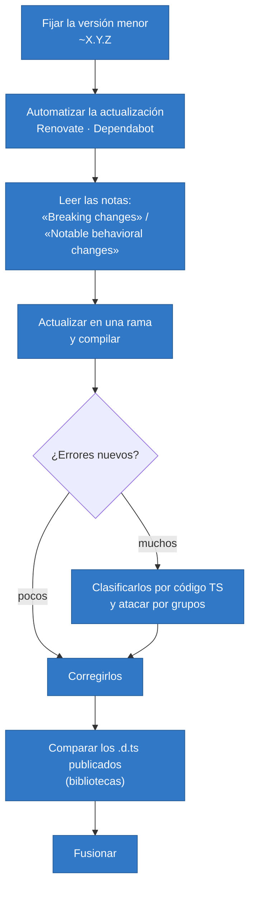

<div align="center">

# 23 · Migración y ciclo de vida

**Cuánto dura una versión, cómo actualizar sin sorpresas, los cambios incompatibles de cada versión y las recetas para saltar a la 5.x, a la 6.0 y a la 7.0**

[⬅ 22 · Catálogo A–Z](22-catalogo-a-z.md) · [🏠 Índice](../README.md) · [24 · Referencia rápida ➡](24-referencia-rapida-y-glosario.md)

</div>

<!-- ts=5.9 -->

> [!IMPORTANT]
> TypeScript no sigue SemVer y no tiene versiones con soporte extendido: **solo la última versión menor recibe parches**, y cualquier versión menor
> puede romper código. La estrategia que funciona es actualizar **a menudo y de una en una**, con la versión fijada y la actualización
> automatizada, en lugar de saltar cinco versiones cada dos años.

---

## Contenido

1. [El ciclo de vida de una versión](#1-el-ciclo-de-vida-de-una-versión)
2. [Estrategia general](#2-estrategia-general)
3. [Cambios incompatibles por versión](#3-cambios-incompatibles-por-versión)
4. [De la 4.x a la 5.x](#4-de-la-4x-a-la-5x)
5. [De 5.9 a 6.0](#5-de-59-a-60)
6. [De 6.0 a 7.0](#6-de-60-a-70)
7. [Herramientas de migración](#7-herramientas-de-migración)
8. [Referencias](#8-referencias)

---

## 1. El ciclo de vida de una versión

| Aspecto | Política |
|---|---|
| **Cadencia** | Una versión menor cada tres meses aproximadamente (mediana de 82 días entre la 2.0 y la 5.9) |
| **Parches** | Solo la versión menor más reciente; rara vez se publica un parche de la anterior |
| **Versiones con soporte extendido** | No existen |
| **Compatibilidad** | Ninguna garantía entre versiones menores ([01 § 3](01-modelo-de-versiones.md#3-typescript-no-sigue-semver)) |
| **`@types` de DefinitelyTyped** | Probados con las versiones de los últimos **dos años** ([20 § 4](20-ecosistema-y-runtimes.md#4-definitelytyped-y-los-paquetes-types)) |
| **Opciones obsoletas** | Avisan durante una o dos versiones con `ignoreDeprecations`, y luego se retiran |

### Qué versión de Node necesita el compilador

Según el campo `engines` del `package.json` de cada compilador:

| TypeScript | Node mínimo |
|---|---|
| 0.8 – 2.0 | 0.8 |
| 2.1 – 4.9 | 4.2 |
| 5.0 | 12.20 |
| 5.1 – 6.0 | 14.17 |
| 7.0 – 7.1 | 16.20 (solo para el lanzador: el compilador es un binario nativo) |

### Calendario de obsolescencias

| Mecanismo | Obsoleto en | Retirado en | Valor de `ignoreDeprecations` |
|---|---|---|---|
| Primera ronda (`target: es3`, `out`, `charset`…) | 5.0 | 5.6 | `"5.0"` |
| Segunda ronda (`target: es5`, `baseUrl`, `outFile`, AMD/UMD/System, `node10`…) | 6.0 | 7.0 | `"6.0"` |

---

## 2. Estrategia general



Reglas prácticas:

1. **Fija la versión menor** con `~` y el parche en el archivo de bloqueo. `^` aceptaría una versión menor nueva con sus cambios incompatibles.
2. **Actualiza el editor a la vez** que el proyecto: si VS Code usa otra versión, verás errores distintos ([01 § 6.3](01-modelo-de-versiones.md#63-el-editor)).
3. **Agrupa los errores por código.** `tsc --noEmit | grep -o "TS[0-9]*" | sort | uniq -c | sort -rn` da la lista de problemas por frecuencia.
4. **Un cambio de comportamiento por *commit*.** Si una actualización obliga a cambiar opciones, hazlo en un *commit* aparte del de la versión.
5. **Para bibliotecas**, compara los `.d.ts` generados antes y después: un cambio de inferencia puede alterar la API pública sin que nada falle.

---

## 3. Cambios incompatibles por versión

Resumen de lo que más rompe en cada versión. El detalle está en la sección «Notas de migración» del capítulo de cada era.

| Versión | Cambio que más afecta | Capítulo |
|---|---|---|
| 2.0 | `strictNullChecks` (si se activa); `never` en funciones que lanzan | [03](03-typescript-2.0-2.2-nulos-y-flujo.md#10-notas-de-migración) |
| 2.4 | Tipos débiles: TS2559 | [04](04-typescript-2.3-2.9-estricto-y-condicionales.md#10-notas-de-migración) |
| 2.6 | `strictFunctionTypes` en `--strict` | [04](04-typescript-2.3-2.9-estricto-y-condicionales.md#10-notas-de-migración) |
| 2.7 | `strictPropertyInitialization` en `--strict` | [04](04-typescript-2.3-2.9-estricto-y-condicionales.md#10-notas-de-migración) |
| 3.5 | Parámetros de tipo sin restricción = `unknown` | [06](06-typescript-3.5-3.9-encadenamiento-y-aserciones.md#9-notas-de-migración) |
| 3.7 | `.d.ts` con accesores que la 3.5 no lee | [06](06-typescript-3.5-3.9-encadenamiento-y-aserciones.md#9-notas-de-migración) |
| 4.4 | `useUnknownInCatchVariables` en `--strict` | [07](07-typescript-4.0-4.4-tuplas-variadicas-y-plantillas.md#9-notas-de-migración) |
| 4.7 | Parámetros de tipo sin restricción ya no asignables a `{}` | [08](08-typescript-4.5-4.9-esm-y-satisfies.md#9-notas-de-migración) |
| 4.8 | `unknown` y `{}`: `NonNullable<T>` = `T & {}` | [08](08-typescript-4.5-4.9-esm-y-satisfies.md#9-notas-de-migración) |
| **5.0** | Primera ronda de obsolescencias; decoradores estándar por defecto | [09](09-typescript-5.0-5.4-decoradores-y-using.md#10-notas-de-migración) |
| 5.6 | Se retira lo obsoleto en la 5.0; condiciones imposibles (TS2872) | [10](10-typescript-5.5-5.9-inferencia-y-sintaxis-borrable.md#10-notas-de-migración) |
| 5.7 | Arreglos tipados genéricos (`Uint8Array<T>`) | [10](10-typescript-5.5-5.9-inferencia-y-sintaxis-borrable.md#10-notas-de-migración) |
| **6.0** | Valores por defecto nuevos (`strict`, `types: []`, `rootDir`, `target`); segunda ronda de obsolescencias | [11](11-typescript-6.0-el-puente.md#8-lista-de-comprobación-de-la-59-a-la-60) |
| **7.0** | Lo obsoleto en la 6.0 es error; orden de tipos estable; sin API; JSDoc simplificado | [12](12-typescript-7-el-compilador-nativo.md#9-notas-de-migración) |
| 7.1 🟡 | `target` por defecto `es2026`; parámetros distribuidos más estrictos (TS2344) | [12](12-typescript-7-el-compilador-nativo.md#8-typescript-71-beta-la-api-y-los-content-mappers) |

---

## 4. De la 4.x a la 5.x

| Paso | Qué hacer |
|---|---|
| 1 | Actualizar Node a 14.17 o superior (lo exige el compilador desde la 5.1) |
| 2 | Si se usan decoradores experimentales, declarar `experimentalDecorators: true` **explícitamente** |
| 3 | Sustituir `importsNotUsedAsValues` y `preserveValueImports` por `verbatimModuleSyntax` |
| 4 | Sustituir `target: es3` por `es5` o superior; `out` por `outFile` |
| 5 | Revisar los enums numéricos: asignar un número fuera de rango es un error |
| 6 | Si se usa un empaquetador, pasar a `moduleResolution: bundler` |
| 7 | Antes de la 5.6, eliminar todo lo que dependa de `ignoreDeprecations: "5.0"` |

```ts err=TS1484 opts=verbatimModuleSyntax
// Lo que verbatimModuleSyntax exige: los tipos se importan con `type`
// @filename: tipos.ts
export interface Config { url: string; }

// @filename: principal.ts
import { Config } from "./tipos";      // error TS1484: escribe `import { type Config }`
const c: Config = { url: "/" };
```

---

## 5. De 5.9 a 6.0

La 6.0 es la versión puente: el objetivo es terminar **sin ningún aviso y sin `ignoreDeprecations`**. El detalle está en
[11 · TypeScript 6.0](11-typescript-6.0-el-puente.md).

| # | Paso | Síntoma si se omite |
|---|---|---|
| 1 | Escribir `types` con los paquetes de tipos globales que se usan: `["node"]`, `["vitest/globals"]`… | `Cannot find name 'process'` / `'describe'` |
| 2 | Escribir `rootDir` si el código está en una subcarpeta (`"./src"`) | La salida aparece en `dist/src/` |
| 3 | Escribir `target` y `module` explícitos | El JavaScript emitido cambia sin aviso |
| 4 | Si el proyecto no era estricto, escribir `"strict": false` (y planificar activarlo) | Cientos de errores TS7006, TS18048… |
| 5 | Sustituir `baseUrl` por rutas relativas en `paths` o por `imports` de `package.json` | TS5101 |
| 6 | Sustituir `moduleResolution: node`/`node10`/`classic` por `nodenext` o `bundler` | TS5107 |
| 7 | Sustituir `module: amd`/`umd`/`system`/`none` y `outFile` por un empaquetador | TS5107 / TS5101 |
| 8 | Sustituir `target: es5` y `downlevelIteration` por `es2015`+ (y Babel o swc si se necesita ES5) | TS5107 / TS5101 |
| 9 | Cambiar `import * as x from "cjs"` + `x()` por `import x from "cjs"` | Errores al llamar al espacio de nombres |
| 10 | Cambiar `module X {}` por `namespace X {}` y `assert {}` por `with {}` | TS1540 y error de sintaxis |
| 11 | Declarar los archivos no TypeScript importados por efecto (`*.css`) | TS2882 |
| 12 | Compilar una vez con `--stableTypeOrdering` y revisar los `.d.ts` | Diferencias de orden al pasar a la 7.0 |

La herramienta experimental **`ts5to6`** automatiza los pasos de `baseUrl` y `rootDir`.

```jsonc
// Antes (5.9): muchos valores implícitos
{ "compilerOptions": { "baseUrl": "./src", "outDir": "dist", "paths": { "@/*": ["*"] } } }

// Después (6.0): todo explícito, nada obsoleto
{
  "compilerOptions": {
    "target": "es2022",
    "module": "nodenext",
    "rootDir": "./src",
    "outDir": "./dist",
    "types": ["node"],
    "strict": true,
    "paths": { "@/*": ["./src/*"] }
  },
  "include": ["src"]
}
```

---

## 6. De 6.0 a 7.0

Si el paso anterior terminó sin avisos, este es sobre todo de **herramientas**. El detalle está en [12 · TypeScript 7](12-typescript-7-el-compilador-nativo.md).

| # | Paso | Notas |
|---|---|---|
| 1 | Comprobar que la 6.0 compila sin `ignoreDeprecations` | Lo obsoleto es error sin remedio en la 7.0 |
| 2 | Instalar `typescript@~7.0` y compilar con `tsc` en CI | Lo normal es que pase igual, y entre 8 y 12 veces más rápido |
| 3 | Si hay herramientas que usan la API (typescript-eslint con tipos, Volar, Angular, `ts-node`, cargadores de webpack), mantener `@typescript/typescript6` | Alias de npm: `"typescript": "npm:@typescript/typescript6@^6.0.2"` |
| 4 | Actualizar *snapshots* de tipos y mensajes de error | Orden de tipos estable |
| 5 | Comparar los `.d.ts` de las bibliotecas | Pueden cambiar de orden, no de significado |
| 6 | Revisar el JavaScript con JSDoc al estilo Closure | `@enum`, `?`, `@class`… ([12 § 4](12-typescript-7-el-compilador-nativo.md#4-lo-que-cambia-para-el-código)) |
| 7 | Revisar utilidades de longitud de cadenas con plantillas | Ahora cuentan puntos de código |
| 8 | Cambiar el editor: extensión **TypeScript 7** en VS Code | Si usas Vue, Svelte o Astro, espera a los *content mappers* de la 7.1 |
| 9 | Ajustar `--checkers` en CI según los núcleos de la máquina, y fijarlo | Por defecto, 4 |

> [!TIP]
> El orden recomendado por el propio equipo de TypeScript es **CLI primero, editor después**: el `tsc` nativo da la mayor ganancia (CI) y el
> menor riesgo, y el editor se puede seguir sirviendo con la 6.0 mientras los complementos se ponen al día.

---

## 7. Herramientas de migración

| Herramienta | Para qué |
|---|---|
| `ignoreDeprecations: "5.0"` / `"6.0"` | Andamio temporal: silencia lo obsoleto durante una versión |
| `ts5to6` (experimental) | Reescribe `baseUrl` y `rootDir` para la 6.0 |
| `--stableTypeOrdering` (6.0) | Ordena los tipos como la 7.0 para comparar resultados |
| `@typescript/typescript6` (`tsc6`) | Mantiene la API y el compilador de la 6.0 junto a la 7.0 |
| `tsc --showConfig` | La configuración efectiva tras la herencia y los valores por defecto |
| `tsc --explainFiles` · `--traceResolution` | Por qué entra cada archivo y cómo se resuelve cada importación |
| `@arethetypeswrong/cli` | Comprueba los `.d.ts` y `exports` de una biblioteca antes de publicar |
| Renovate · Dependabot | Abren una *pull request* con cada versión nueva (el repositorio de este atlas tiene cuatro abiertas de Dependabot) |
| [Pruebas de debut](25-pruebas-de-debut.md) de este atlas | Qué compila en cada versión, demostrado |

---

## 8. Referencias

- [Notas de versión](https://www.typescriptlang.org/docs/handbook/release-notes/overview.html): sección «Breaking Changes» de cada una
- [Wiki: cambios incompatibles en la API](https://github.com/microsoft/TypeScript/wiki/API-Breaking-Changes) · [Planes de iteración](https://github.com/microsoft/TypeScript/issues?q=label%3APlanning)
- Anuncios: [6.0](https://devblogs.microsoft.com/typescript/announcing-typescript-6-0/) · [7.0](https://devblogs.microsoft.com/typescript/announcing-typescript-7-0/)
- [DefinitelyTyped: ventana de soporte](https://github.com/DefinitelyTyped/DefinitelyTyped#support-window)
