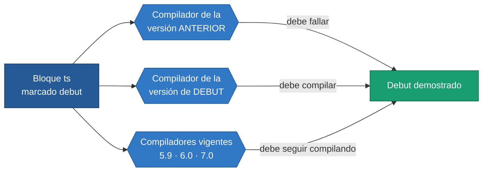

<div align="center">

# 25 · Pruebas de debut

**Un fragmento mínimo por característica: compila con la versión que la introdujo y falla con la anterior**

[⬅ 24 · Referencia rápida](24-referencia-rapida-y-glosario.md) · [🏠 Índice](../README.md) · [26 · El laboratorio ➡](26-laboratorio-del-repositorio.md)

</div>

> [!IMPORTANT]
> Este capítulo es el **cuaderno de laboratorio** del atlas. Afirmar que «los tipos de plantilla literal llegaron en TypeScript 4.1» es fácil;
> aquí se **demuestra**: cada bloque marcado `debut` se compila con el compilador real de su versión (descargado de npm), con el de la versión
> menor anterior —donde **debe fallar**— y con los compiladores vigentes (5.9, 6.0 y 7.0), donde debe seguir compilando.

---

## Contenido

- [El método](#el-método)
- [TypeScript 0.8](#typescript-08) · [0.9](#typescript-09) · [1.3](#typescript-13) · [1.4](#typescript-14) · [1.5](#typescript-15) · [1.6](#typescript-16) · [1.7](#typescript-17) · [1.8](#typescript-18)
- [TypeScript 2.0](#typescript-20) · [2.1](#typescript-21) · [2.2](#typescript-22) · [2.3](#typescript-23) · [2.4](#typescript-24) · [2.5](#typescript-25) · [2.6](#typescript-26) · [2.7](#typescript-27) · [2.8](#typescript-28) · [2.9](#typescript-29)
- [TypeScript 3.0](#typescript-30) · [3.1](#typescript-31) · [3.2](#typescript-32) · [3.3](#typescript-33) · [3.4](#typescript-34) · [3.5](#typescript-35) · [3.6](#typescript-36) · [3.7](#typescript-37) · [3.8](#typescript-38) · [3.9](#typescript-39)
- [TypeScript 4.0](#typescript-40) · [4.1](#typescript-41) · [4.2](#typescript-42) · [4.3](#typescript-43) · [4.4](#typescript-44) · [4.5](#typescript-45) · [4.6](#typescript-46) · [4.7](#typescript-47) · [4.8](#typescript-48) · [4.9](#typescript-49)
- [TypeScript 5.0](#typescript-50) · [5.1](#typescript-51) · [5.2](#typescript-52) · [5.3](#typescript-53) · [5.4](#typescript-54) · [5.5](#typescript-55) · [5.6](#typescript-56) · [5.7](#typescript-57) · [5.8](#typescript-58) · [5.9](#typescript-59)
- [TypeScript 6.0](#typescript-60) · [7.0](#typescript-70) · [7.1 (beta)](#typescript-71)

---

## El método



| Marca | Qué se comprueba |
|---|---|
| `debut` | El fragmento compila en su versión y **no** compila en la versión menor anterior |
| `err=TS…` con `debut` | El compilador **empieza** a dar ese error en esta versión: la anterior no lo daba |
| `hasta=X.Y` | El fragmento compila hasta esa versión y **falla** a partir de la siguiente (lo retirado) |
| `opts=…` | Opciones de compilador que el fragmento necesita |
| `script` | El archivo es un script global, sin `import` ni `export` |
| `predeterminado` | Sin las opciones del atlas: solo los valores por defecto del compilador |

Las opciones con que se comprueba cada versión son «lo más estricto que esa versión conozca»: `--strict` desde la 2.3, y antes `--noImplicitAny` y
`--strictNullChecks` cuando existen. Los compiladores de la 0.8 a la 1.4 se invocan por línea de comandos; de la 1.5 a la 6.0 se cargan en proceso;
los de la serie 7 son binarios nativos. Detalles en [`tools/verificar-ejemplos.ts`](../tools/verificar-ejemplos.ts).

> [!NOTE]
> Las características de **herramienta** (velocidad del compilador, funciones del editor, `tsconfig.json`) no cambian lo que compila, así que no
> tienen prueba aquí. En el [catálogo A–Z](22-catalogo-a-z.md), la columna 🧪 enlaza cada característica con su prueba cuando existe.

---

<!-- ts=0.8 -->

## TypeScript 0.8

Primera versión pública (1 de octubre de 2012). No hay versión anterior con la que comparar: estas pruebas demuestran lo que el compilador
**0.8.3 original** ya aceptaba, y que el mismo código sigue compilando catorce años después.

<a id="anotaciones-de-tipo"></a>**Anotaciones de tipo**

```ts script
var edad: number = 30;
var titulo: string = "Atlas";
```

Un fósil: en la 0.8 el tipo booleano se llamaba `bool`. La 0.9 lo renombró a `boolean`, como en la propuesta de ECMAScript, y `bool` dejó de existir.

```ts script hasta=0.8
var activo: bool = true;
```

<a id="interfaces"></a>**Interfaces**

```ts script
interface Punto {
    x: number;
    y: number;
}
var origen: Punto = { x: 0, y: 0 };
```

<a id="clases"></a>**Clases**

```ts script
class Animal {
    nombre: string;
    constructor(nombre: string) { this.nombre = nombre; }
    saludar(): string { return "Soy " + this.nombre; }
}
class Perro extends Animal {
    ladrar(): string { return "guau"; }
}
var rex = new Perro("Rex");
```

<a id="modulos-internos-y-externos"></a>**Módulos internos y externos.** La palabra clave `module` para módulos internos dejó de aceptarse en la 6.0: hoy se escribe `namespace`.

```ts script hasta=5.9 luego=TS1540
module Geometria {
    export function area(radio: number): number { return 3.14 * radio * radio; }
}
var superficie = Geometria.area(2);
```

<a id="funciones-flecha"></a>**Funciones flecha**

```ts script
var doble = (n: number) => n * 2;
var cuatro: number = doble(2);
```

<a id="propiedades-de-parametro"></a>**Propiedades de parámetro**

```ts script
class Coordenada {
    constructor(public latitud: number, private longitud: number) { }
    describir(): string { return this.latitud + ", " + this.longitud; }
}
var norte = new Coordenada(19.4, -99.1).latitud;
```

<a id="tipado-estructural"></a>**Tipado estructural**

```ts script
interface ConNombre { nombre: string; }
function presentar(alguien: ConNombre): string { return alguien.nombre; }
var mascota = { nombre: "Rex", patas: 4 };
presentar(mascota);
```

<a id="archivos-de-declaracion"></a>**Archivos de declaración**

```ts script
declare var motorDeTerceros: { version: string; iniciar(puerto: number): void; };
motorDeTerceros.iniciar(8080);
```

<a id="inferencia-de-tipos"></a>**Inferencia de tipos**

```ts script
var contador = 10;
var siguiente: number = contador + 1;
```

<a id="sobrecarga-de-funciones"></a>**Sobrecarga de funciones**

```ts script
function medir(valor: string): number;
function medir(valor: number[]): number;
function medir(valor: any): number { return valor.length; }
var largoDeTexto = medir("hola");
```

<a id="parametros-opcionales-y-rest"></a>**Parámetros opcionales, por defecto y rest**

```ts script
function sumarTodo(base: number, extra?: number, factor = 1, ...resto: number[]): number {
    return base * factor + resto.length;
}
sumarTodo(1);
sumarTodo(1, 2, 3, 4, 5);
```

<a id="tipo-any"></a>**Tipo `any`**

```ts script
var cualquiera: any = 4;
cualquiera = "ahora soy texto";
cualquiera.metodoQueNadieComprueba();
```

<a id="aserciones-de-tipo"></a>**Aserciones de tipo**

```ts script
var entrada: any = "hola";
var largo: number = (<string>entrada).length;
```

<a id="enums"></a>**Enums.** Se anunciaron con la 0.9, pero el compilador 0.8.3 ya los acepta, con mapeo inverso incluido: la prueba de debut contra la 0.8 falló, y por eso están aquí.

```ts script
enum Semaforo { Rojo, Ambar, Verde }
var luz: Semaforo = Semaforo.Verde;
var nombreDeLuz: string = Semaforo[Semaforo.Verde];
```

---

<!-- ts=0.9 -->

## TypeScript 0.9

<a id="genericos"></a>**Genéricos**

```ts script debut
function identidad<T>(valor: T): T { return valor; }
var texto: string = identidad<string>("genéricos");
```

<a id="fusion-de-declaraciones"></a>**Fusión de declaraciones.** Una función y un módulo interno del mismo nombre se combinan (aquí con la sintaxis `module` de la época).

```ts script debut hasta=5.9 luego=TS1540
function contadorDePasos(): number { return contadorDePasos.pasos; }
module contadorDePasos {
    export var pasos = 1;
}
```

<a id="export-asignacion"></a>**`export =`**

```ts script debut
declare module "legado" {
    var valorPorDefecto: number;
    export = valorPorDefecto;
}
```

<a id="consultas-typeof"></a>**`typeof` en posición de tipo**

```ts script debut
var plantilla = { ancho: 100, alto: 50 };
var copia: typeof plantilla = { ancho: 1, alto: 2 };
```

<a id="sobrecarga-por-constantes"></a>**Sobrecarga por constantes**

```ts script debut
interface Figura { lados: number; }
interface Cuadrado extends Figura { lado: number; }
function crearFigura(tipo: "cuadrado"): Cuadrado;
function crearFigura(tipo: string): Figura;
function crearFigura(tipo: string): any { return { lados: 4, lado: 1 }; }
var ladoDelCuadrado: number = crearFigura("cuadrado").lado;
```

<a id="no-implicit-any"></a>**`--noImplicitAny`.** Llegó con la 0.9.1: un parámetro sin anotar pasa a ser un error.

```ts script debut err=TS7006 opts=noImplicitAny
function duplicar(n) { return n * 2; }
```

---

<!-- ts=1.3 -->

## TypeScript 1.3

La versión anterior verificable es la 1.0.1: la 1.1 (el compilador reescrito) no tuvo paquete estable en npm.

<a id="protected"></a>**`protected`**

```ts script debut
class Boveda {
    protected combinacion = 1234;
}
class BovedaAuditada extends Boveda {
    revisar(): number { return this.combinacion; }
}
```

<a id="tuplas"></a>**Tipos tupla**

```ts script debut
var registro: [string, number] = ["edad", 30];
var etiqueta: string = registro[0];
var valor: number = registro[1];
```

---

<!-- ts=1.4 -->

## TypeScript 1.4

<a id="uniones"></a>**Tipos unión**

```ts script debut
var identificador: string | number = 5;
identificador = "cinco";
```

<a id="guardas-typeof-instanceof"></a>**Guardas de tipo `typeof` e `instanceof`**

```ts script debut
function longitudDe(x: string | number): number {
    if (typeof x === "string") {
        return x.length;
    } else {
        return x;
    }
}
```

<a id="alias-de-tipo"></a>**Alias de tipo**

```ts script debut
type Identificador = number;
type Manejador = (codigo: Identificador) => void;
var primero: Identificador = 1;
```

<a id="let-y-const"></a>**`let` y `const`**

```ts script debut
let intentos = 0;
const LIMITE = 3;
intentos = LIMITE;
```

<a id="plantillas-de-cadena"></a>**Plantillas de cadena**

```ts script debut
var quien = "mundo";
var saludo: string = `Hola, ${quien}`;
```

<a id="const-enum"></a>**`const enum`**

```ts script debut
const enum Direccion { Arriba, Abajo }
var rumbo = Direccion.Arriba;
```

<a id="no-emit-on-error"></a>**`--noEmitOnError`**

```ts script debut opts=noEmitOnError
var compila = true;
```

---

<!-- ts=1.5 -->

## TypeScript 1.5

<a id="modulos-es6"></a>**Módulos ES6**

```ts debut
// @filename: matematicas.ts
export function doble(n: number): number { return n * 2; }
export default 21;

// @filename: principal.ts
import base, { doble } from "./matematicas";
var respuesta: number = doble(base);
```

<a id="namespace"></a>**`namespace`**

```ts debut
namespace Geometria {
    export function area(radio: number): number { return 3.14 * radio * radio; }
}
var superficie: number = Geometria.area(1);
```

<a id="desestructuracion"></a>**Desestructuración**

```ts debut
var punto = { x: 1, y: 2 };
var { x, y } = punto;
var [primero, segundo] = [10, 20];
function norma({ x, y }: { x: number; y: number }): number { return x + y; }
```

<a id="spread-de-arreglos"></a>**Operador de propagación**

```ts debut
var numeros = [3, 1, 2];
var mayor: number = Math.max(...numeros);
var ampliado: number[] = [0, ...numeros];
```

<a id="for-of"></a>**`for...of`**

```ts debut
var letras = ["a", "b"];
for (var letra of letras) {
    letra.toUpperCase();
}
```

<a id="decoradores-experimentales"></a>**Decoradores experimentales.** Siguen compilando hoy, también con el compilador nativo, siempre con `experimentalDecorators`.

```ts debut opts=experimentalDecorators
function sellada(constructor: Function): void {
    Object.seal(constructor);
}

@sellada
class Reporte { }
```

<a id="emit-decorator-metadata"></a>**`emitDecoratorMetadata`**

```ts debut opts=experimentalDecorators,emitDecoratorMetadata
function inyectable(constructor: Function): void { }

@inyectable
class Servicio { }
```

<a id="propiedades-calculadas"></a>**Propiedades calculadas**

```ts debut
var clave = "dinamica";
var objeto = { [clave]: 1 };
```

<a id="salida-umd-y-system"></a>**Salida `umd` y `system`.** Obsoleta en la 6.0 y retirada en la 7.0.

```ts debut hasta=5.9 opts=module:umd,target:ES5
export var formato = "umd";
```

<a id="isolated-modules"></a>**`--isolatedModules`**

```ts debut opts=isolatedModules
export var aislado = true;
```

<a id="plantillas-etiquetadas"></a>**Plantillas etiquetadas para ES3 y ES5.** Depende de `target es5`, obsoleto en la 6.0.

```ts debut hasta=5.9 opts=target:ES5
function etiqueta(partes: TemplateStringsArray, valor: number): string { return partes[0] + valor; }
var mensaje: string = etiqueta`total: ${1}`;
```

---

<!-- ts=1.6 -->

## TypeScript 1.6

<a id="jsx"></a>**JSX y archivos `.tsx`**

```tsx script debut
declare namespace JSX {
    interface Element { }
    interface IntrinsicElements { div: { id?: string }; }
}
var elemento = <div id="app" />;
```

<a id="operador-as"></a>**Operador `as`**

```ts debut
var entrada: any = "hola";
var largo: number = (entrada as string).length;
```

<a id="intersecciones"></a>**Tipos intersección**

```ts debut
interface ConId { id: number; }
interface ConNombre { nombre: string; }
var usuario: ConId & ConNombre = { id: 1, nombre: "Ana" };
```

<a id="tipos-locales"></a>**Declaraciones de tipo locales**

```ts debut
function calcular(): number {
    interface Parcial { subtotal: number; }
    var p: Parcial = { subtotal: 10 };
    return p.subtotal;
}
```

<a id="expresiones-de-clase"></a>**Expresiones de clase**

```ts debut
var Punto = class {
    x = 0;
};
var p = new Punto();
```

<a id="clases-abstractas"></a>**Clases y métodos `abstract`**

```ts debut
abstract class Figura {
    abstract area(): number;
    describir(): string { return "área " + this.area(); }
}
class Cuadrado extends Figura {
    area(): number { return 4; }
}
```

<a id="alias-genericos"></a>**Alias de tipo genéricos**

```ts debut
type Caja<T> = { valor: T };
var caja: Caja<number> = { valor: 1 };
```

<a id="propiedades-sobrantes"></a>**Comprobación de propiedades sobrantes.** Desde la 1.6, este literal es un error.

```ts debut err=TS2322/TS2353
interface Opciones { ancho: number; }
var opciones: Opciones = { ancho: 1, alto: 2 };
```

<a id="generadores"></a>**Generadores**

```ts debut
function* contar() {
    yield 1;
    yield 2;
}
```

<a id="guardas-definidas-por-el-usuario"></a>**Guardas de tipo definidas por el usuario**

```ts debut
interface Pez { nadar(): void; }
interface Ave { volar(): void; }
function esPez(animal: Pez | Ave): animal is Pez {
    return (animal as Pez).nadar !== undefined;
}
```

<a id="resolucion-node"></a>**Resolución de módulos `node`.** Obsoleta en la 6.0 (hoy se llama `node10`).

```ts debut hasta=5.9 opts=moduleResolution:node
export var resuelto = true;
```

---

<!-- ts=1.7 -->

## TypeScript 1.7

<a id="async-await"></a>**`async` y `await`**

```ts debut
async function esperar(): Promise<number> {
    var valor = await Promise.resolve(1);
    return valor + 1;
}
```

<a id="this-polimorfico"></a>**Tipo `this` polimórfico**

```ts debut
class Calculadora {
    valor = 0;
    sumar(n: number): this { this.valor += n; return this; }
}
class Cientifica extends Calculadora {
    cuadrado(): this { this.valor = this.valor * this.valor; return this; }
}
var resultado = new Cientifica().sumar(2).cuadrado().valor;
```

<a id="exponenciacion"></a>**Operador de exponenciación**

```ts debut
var kilobyte = 2 ** 10;
```

---

<!-- ts=1.8 -->

## TypeScript 1.8

<a id="parametros-de-tipo-como-restriccion"></a>**Parámetros de tipo como restricciones**

```ts debut
function asignar<T extends U, U>(destino: T, origen: U): T {
    return destino;
}
```

<a id="errores-de-flujo"></a>**Errores de flujo de control**

```ts debut err=TS7030 opts=noImplicitReturns
function signo(n: number) {
    if (n > 0) { return 1; }
}
```

<a id="literales-de-cadena"></a>**Tipos literales de cadena**

```ts debut
type Lado = "izquierda" | "derecha";
var lado: Lado = "izquierda";
```

<a id="aumento-de-modulos"></a>**Aumento de módulos y del ámbito global**

```ts debut
// @filename: mascota.ts
export class Mascota {
    nombre = "Rex";
}

// @filename: principal.ts
import { Mascota } from "./mascota";

declare module "./mascota" {
    interface Mascota { sonido(): string; }
}
Mascota.prototype.sonido = function () { return "guau"; };

declare global {
    interface Array<T> { ultimo(): T; }
}
```

<a id="allow-js"></a>**`--allowJs`**

```ts debut opts=allowJs
export var mezclaConJavaScript = true;
```

<a id="guardas-this"></a>**Guardas de tipo basadas en `this`**

```ts debut
class Nodo {
    esHoja(): this is Hoja { return this instanceof Hoja; }
}
class Hoja extends Nodo {
    valor = 1;
}
```

<a id="let-const-en-bucles"></a>**`let` y `const` capturados en bucles.** Depende de `target es5`, obsoleto en la 6.0.

```ts debut hasta=5.9 opts=target:ES5
var acciones: Array<() => number> = [];
for (let i = 0; i < 3; i++) {
    acciones.push(() => i);
}
```

---

<!-- ts=2.0 -->

## TypeScript 2.0

<a id="strict-null-checks"></a>**`--strictNullChecks`**

```ts debut opts=strictNullChecks
var apodo: string | null = null;
```

<a id="tipos-null-y-undefined"></a>**Tipos `null` y `undefined`**

```ts debut
var nada: null = null;
var indefinido: undefined = undefined;
```

<a id="analisis-de-flujo"></a>**Análisis de tipos por flujo de control.** Tras el `return`, `x` solo puede ser `string`; hasta la 1.8 una guarda solo valía dentro de su bloque.

```ts debut
function longitudDe(x: string | number): number {
    if (typeof x === "number") { return x; }
    return x.length;
}
```

<a id="uniones-discriminadas"></a>**Uniones discriminadas**

```ts debut
interface Cuadrado { tipo: "cuadrado"; lado: number; }
interface Circulo { tipo: "circulo"; radio: number; }

function area(figura: Cuadrado | Circulo): number {
    switch (figura.tipo) {
        case "cuadrado": return figura.lado * figura.lado;
        case "circulo": return 3.14 * figura.radio * figura.radio;
    }
}
```

<a id="never"></a>**Tipo `never`**

```ts debut
function fallar(mensaje: string): never {
    throw new Error(mensaje);
}
```

<a id="asercion-no-nula"></a>**Operador de aserción no nula**

```ts debut
function largoDe(texto: string | null): number {
    return texto!.length;
}
```

<a id="readonly"></a>**Propiedades e índices `readonly`**

```ts debut
interface Punto {
    readonly x: number;
    readonly y: number;
}
var origen: Punto = { x: 0, y: 0 };
```

<a id="parametro-this"></a>**Tipo de `this` en funciones**

```ts debut
function alHacerClic(this: { contador: number }): void {
    this.contador++;
}
```

<a id="base-url"></a>**`baseUrl`.** Obsoleta en la 6.0 y retirada en la 7.0.

```ts debut hasta=5.9 opts=baseUrl:.
export var raiz = true;
```

<a id="modulos-ambientales-abreviados"></a>**Módulos ambientales abreviados y con comodín**

```ts script debut
declare module "modulo-sin-tipos";
declare module "*.css";
```

<a id="export-as-namespace"></a>**Definiciones UMD**

```ts script debut
// @filename: mi-lib.d.ts
export function saludar(): string;
export as namespace miLib;

// @filename: principal.ts
var saludo: string = miLib.saludar();
```

<a id="propiedades-opcionales-de-clase"></a>**Propiedades de clase opcionales**

```ts debut
class Configuracion {
    titulo?: string;
}
```

<a id="constructores-privados"></a>**Constructores privados y protegidos**

```ts debut
class Unico {
    private static instancia: Unico;
    private constructor() { }
    static obtener(): Unico {
        return Unico.instancia || (Unico.instancia = new Unico());
    }
}
```

<a id="propiedades-abstractas"></a>**Propiedades y accesores abstractos**

```ts debut
abstract class Figura {
    abstract nombre: string;
}
class Punto extends Figura {
    nombre = "punto";
}
```

<a id="opcion-lib"></a>**`--lib`**

```ts debut opts=lib:es5
var sinDom: number = 1;
```

<a id="no-unused"></a>**`--noUnusedLocals` y `--noUnusedParameters`**

```ts debut opts=noUnusedLocals,noUnusedParameters
export function doble(n: number): number { return n * 2; }
```

<a id="comas-finales"></a>**Comas finales en parámetros**

```ts debut
function sumar(a: number, b: number,): number { return a + b; }
sumar(1, 2,);
```

<a id="skip-lib-check"></a>**`--skipLibCheck`**

```ts debut opts=skipLibCheck
export var rapido = true;
```

---

<!-- ts=2.1 -->

## TypeScript 2.1

<a id="keyof"></a>**`keyof` y tipos de acceso indexado**

```ts debut
interface Persona { nombre: string; edad: number; }
type Clave = keyof Persona;

function leer<T, K extends keyof T>(objeto: T, clave: K): T[K] {
    return objeto[clave];
}
var edad: number = leer({ nombre: "Ana", edad: 30 }, "edad");
```

<a id="tipos-mapeados"></a>**Tipos mapeados**

```ts debut
type SoloLectura<T> = { readonly [K in keyof T]: T[K] };
type Opcional<T> = { [K in keyof T]?: T[K] };
var parcial: Opcional<{ a: number; b: string }> = { a: 1 };
```

<a id="utilidades-2-1"></a>**`Partial`, `Readonly`, `Record` y `Pick`**

```ts debut
interface Tarea { titulo: string; hecha: boolean; }
var cambios: Partial<Tarea> = { hecha: true };
var puntos: Record<"x" | "y", number> = { x: 1, y: 2 };
var resumen: Pick<Tarea, "titulo"> = { titulo: "Escribir" };
var fija: Readonly<Tarea> = { titulo: "Leer", hecha: false };
```

<a id="spread-de-objetos"></a>**Propagación y resto de objetos**

```ts debut
var base = { a: 1, b: 2 };
var ampliado = { ...base, c: 3 };
var { a, ...resto } = ampliado;
var suma: number = a + resto.b + resto.c;
```

<a id="async-para-es5"></a>**`async` y `await` para ES5 y ES3.** Depende de `target es5`, obsoleto en la 6.0.

```ts debut hasta=5.9 opts=target:ES5,lib:es5+es2015.promise+dom
async function esperar(): Promise<number> {
    return await Promise.resolve(1);
}
```

<a id="tslib"></a>**`tslib` e `--importHelpers`**

```ts debut opts=importHelpers
export var conAuxiliaresImportados = true;
```

<a id="destinos-es2016-es2017"></a>**Destinos `ES2016`, `ES2017` y `ESNext`**

```ts debut opts=target:ES2017
export var destino = "ES2017";
```

<a id="any-por-flujo"></a>**Inferencia de `any` por flujo de control**

```ts debut
function elegir(condicion: boolean): number | string {
    let x;
    if (condicion) { x = 1; } else { x = "uno"; }
    return x;
}
```

<a id="literales-inferidos"></a>**Mejor inferencia de tipos literales**

```ts debut
const saludo = "hola";
var exacto: "hola" = saludo;
```

<a id="always-strict"></a>**`--alwaysStrict`**

```ts debut opts=alwaysStrict
export var estricto = true;
```

---

<!-- ts=2.2 -->

## TypeScript 2.2

<a id="mixins"></a>**Clases mixin**

```ts debut
type Constructor<T> = new (...args: any[]) => T;

function ConFecha<TBase extends Constructor<{}>>(Base: TBase) {
    return class extends Base {
        creado = new Date();
    };
}

class Usuario {
    nombre = "Ana";
}
const UsuarioConFecha = ConFecha(Usuario);
const u = new UsuarioConFecha();
const datos: [string, Date] = [u.nombre, u.creado];
```

<a id="tipo-object"></a>**Tipo `object`**

```ts debut
var noPrimitivo: object = { a: 1 };
```

<a id="new-target"></a>**`new.target`**

```ts debut
class Base {
    constructor() {
        var invocado = new.target;
    }
}
```

<a id="operandos-nulos"></a>**Operandos posiblemente nulos**

```ts debut err=TS2532/TS18048
function doble(x: number | undefined): number {
    return x * 2;
}
```

<a id="punto-en-indices"></a>**Acceso con punto en firmas de índice**

```ts debut
interface Mapa { [clave: string]: number; }
var mapa: Mapa = {};
mapa.cualquiera = 1;
```

---

<!-- ts=2.3 -->

## TypeScript 2.3

<a id="strict"></a>**`--strict`**

```ts debut opts=strict
export var todoEstricto = true;
```

<a id="downlevel-iteration"></a>**`--downlevelIteration`.** Obsoleta en la 6.0 y retirada en la 7.0.

```ts debut hasta=5.9 opts=downlevelIteration
export var iteracionExacta = true;
```

<a id="iteracion-asincrona"></a>**Iteración asíncrona**

```ts debut
async function* numeros() {
    yield 1;
    yield 2;
}

async function sumar(): Promise<number> {
    let total = 0;
    for await (const n of numeros()) { total += n; }
    return total;
}
```

<a id="genericos-por-defecto"></a>**Valores por defecto de parámetros de tipo**

```ts debut
interface Respuesta<T = string> { dato: T; }
var r: Respuesta = { dato: "ok" };
```

<a id="check-js"></a>**`--checkJs` y `// @ts-check`**

```ts debut opts=allowJs,checkJs
export var javascriptComprobado = true;
```

---

<!-- ts=2.4 -->

## TypeScript 2.4

<a id="import-dinamico"></a>**`import()` dinámico**

```ts debut
// @filename: pesado.ts
export function calcular(): number { return 42; }

// @filename: principal.ts
async function cargar(): Promise<number> {
    const modulo = await import("./pesado");
    return modulo.calcular();
}
```

<a id="enums-de-cadena"></a>**Enums de cadena**

```ts debut
enum Color { Rojo = "ROJO", Verde = "VERDE" }
var c: Color = Color.Rojo;
```

<a id="inferencia-desde-retorno"></a>**Inferencia desde el tipo de retorno**

```ts debut
function mapear<T, U>(f: (x: T) => U): (a: T[]) => U[] {
    return a => a.map(f);
}
const longitudes: (a: string[]) => number[] = mapear(s => s.length);
```

<a id="callbacks-contravariantes"></a>**Parámetros de *callback* contravariantes**

```ts debut err=TS2322
interface Mapeable<T> {
    map<U>(f: (x: T) => U): Mapeable<U>;
}
declare let a: Mapeable<number>;
declare let b: Mapeable<string | number>;
a = b;
```

<a id="tipos-debiles"></a>**Detección de tipos débiles**

```ts debut err=TS2559
interface Opciones { datos?: string; tiempo?: number; }
function enviar(o: Opciones): void { }
const mal = { carga: "x", espera: 300 };
enviar(mal);
```

---

<!-- ts=2.5 -->

## TypeScript 2.5

<a id="catch-opcional"></a>**`catch` sin variable**

```ts debut
function esJson(texto: string): boolean {
    try { JSON.parse(texto); return true; } catch { return false; }
}
```

<a id="preserve-symlinks"></a>**`--preserveSymlinks`**

```ts debut opts=preserveSymlinks
export var enlaces = true;
```

---

<!-- ts=2.6 -->

## TypeScript 2.6

<a id="strict-function-types"></a>**`--strictFunctionTypes`**

```ts debut err=TS2322 opts=strictFunctionTypes
interface Animal { nombre: string; }
interface Perro extends Animal { ladrar(): void; }

declare let cuidarAnimal: (a: Animal) => void;
declare let cuidarPerro: (p: Perro) => void;
cuidarPerro = cuidarAnimal;   // correcto: quien acepta cualquier animal acepta un perro
cuidarAnimal = cuidarPerro;   // error: no todo animal es un perro
```

<a id="ts-ignore"></a>**`// @ts-ignore`**

```ts debut
// @ts-ignore
const numero: number = "esto no es un número";
```

---

<!-- ts=2.7 -->

## TypeScript 2.7

<a id="unique-symbol"></a>**`unique symbol`**

```ts debut
declare const marca: unique symbol;
interface Marcado {
    [marca]: true;
}
```

<a id="strict-property-initialization"></a>**`--strictPropertyInitialization`**

```ts debut err=TS2564
class Usuario {
    nombre: string;
}
```

<a id="asignacion-definida"></a>**Aserción de asignación definida**

```ts debut
class Servicio {
    conexion!: string;
}
```

<a id="tuplas-de-longitud-fija"></a>**Tuplas de longitud fija**

```ts debut err=TS2322
var par: [number, string] = [1, "a", 2];
```

<a id="guardas-in"></a>**Guardas de tipo con `in`**

```ts debut
interface Pez { nadar(): void; }
interface Ave { volar(): void; }

function mover(animal: Pez | Ave): void {
    if ("nadar" in animal) { animal.nadar(); } else { animal.volar(); }
}
```

<a id="es-module-interop"></a>**`--esModuleInterop`**

```ts debut opts=esModuleInterop
export var interoperable = true;
```

<a id="separadores-numericos"></a>**Separadores numéricos**

```ts debut
const millon = 1_000_000;
```

---

<!-- ts=2.8 -->

## TypeScript 2.8

<a id="tipos-condicionales"></a>**Tipos condicionales**

```ts debut
type EsCadena<T> = T extends string ? "sí" : "no";
const a: EsCadena<"hola"> = "sí";
const b: EsCadena<42> = "no";
```

<a id="condicionales-distributivos"></a>**Tipos condicionales distributivos**

```ts debut
type SinNulos<T> = T extends null | undefined ? never : T;
const limpio: SinNulos<string | null | undefined> = "texto";
```

<a id="infer"></a>**`infer`**

```ts debut
type Retorno<T> = T extends (...args: any[]) => infer R ? R : never;
const n: Retorno<() => number> = 1;
```

<a id="utilidades-2-8"></a>**`Exclude`, `Extract`, `NonNullable`, `ReturnType` e `InstanceType`**

```ts debut
type SinA = Exclude<"a" | "b" | "c", "a">;
type SoloA = Extract<"a" | "b" | "c", "a" | "z">;
const x: SinA = "b";
const y: SoloA = "a";
const z: NonNullable<string | null> = "z";
const r: ReturnType<() => boolean> = true;
const d: InstanceType<typeof Date> = new Date();
```

<a id="modificadores-mapeados"></a>**Modificadores `+` y `-` en tipos mapeados**

```ts debut
type Mutable<T> = { -readonly [K in keyof T]: T[K] };
type Completo<T> = { [K in keyof T]-?: T[K] };
const c: Completo<{ a?: number }> = { a: 1 };
const req: Required<{ b?: string }> = { b: "x" };
```

<a id="emit-declaration-only"></a>**`--emitDeclarationOnly`.** Las notas la presentan con la 2.8, pero la prueba de debut falló: el parche **2.7.2** ya la acepta
(el 2.7.1 responde `TS5023: Unknown compiler option`). Se queda en la 2.8, que es donde se anunció, y aquí solo se comprueba que compila.

```ts opts=declaration,emitDeclarationOnly
export var soloDeclaraciones = true;
```

---

<!-- ts=2.9 -->

## TypeScript 2.9

<a id="keyof-number-symbol"></a>**`keyof` con claves numéricas y símbolos**

```ts debut
const simbolo = Symbol("s");
interface Mixto {
    a: string;
    5: number;
    [simbolo]: boolean;
}
const numerica: keyof Mixto = 5;
const simbolica: keyof Mixto = simbolo;
```

<a id="argumentos-de-tipo-en-jsx"></a>**Argumentos de tipo en plantillas etiquetadas**

```ts debut
declare function etiqueta<T>(partes: TemplateStringsArray, ...valores: T[]): T;
const r: number = etiqueta<number>`${1} y ${2}`;
```

<a id="tipos-import"></a>**Tipos `import()`**

```ts debut
// @filename: modelos.ts
export interface Mascota { nombre: string; }

// @filename: principal.ts
function adoptar(m: import("./modelos").Mascota): string {
    return m.nombre;
}
```

<a id="import-meta"></a>**`import.meta`**

```ts debut
const meta = import.meta;
```

<a id="resolve-json-module"></a>**`--resolveJsonModule`**

```ts debut opts=resolveJsonModule,module:commonjs
// @filename: config.json
{ "puerto": 8080 }

// @filename: principal.ts
import config = require("./config.json");
const puerto: number = config.puerto;
```

<a id="declaration-map"></a>**`--declarationMap`**

```ts debut opts=declaration,declarationMap
export var conMapa = true;
```

---

<!-- ts=3.0 -->

## TypeScript 3.0

<a id="tuplas-en-rest"></a>**Tuplas en parámetros rest y propagación**

```ts debut
function registrar(...args: [number, string, boolean?]): number {
    return args.length;
}
registrar(1, "a");
registrar(1, "a", true);
```

<a id="unknown"></a>**Tipo `unknown`**

```ts debut
function longitudSegura(valor: unknown): number {
    if (typeof valor === "string") { return valor.length; }
    return 0;
}
```

---

<!-- ts=3.1 -->

## TypeScript 3.1

<a id="mapeados-sobre-tuplas"></a>**Tipos mapeados sobre tuplas y arreglos**

```ts debut
type Promesas<T> = { [K in keyof T]: Promise<T[K]> };
const pendientes: Promesas<[number, string]> = [Promise.resolve(1), Promise.resolve("a")];
```

<a id="propiedades-en-funciones"></a>**Propiedades en declaraciones de función**

```ts debut
function leerCuenta(): number {
    return leerCuenta.cuenta;
}
leerCuenta.cuenta = 0;
```

---

<!-- ts=3.2 -->

## TypeScript 3.2

<a id="strict-bind-call-apply"></a>**`--strictBindCallApply`**

```ts debut err=TS2345
function sumar(a: number, b: number): number { return a + b; }
sumar.call(undefined, 1, "2");
```

<a id="spread-generico"></a>**Propagación y resto de objetos genéricos**

```ts debut
function conId<T>(objeto: T) {
    return { ...objeto, id: 1 };
}
const etiquetado = conId({ nombre: "Ana" });
const par: [string, number] = [etiquetado.nombre, etiquetado.id];
```

<a id="bigint"></a>**`bigint`**

```ts debut
const grande: bigint = 100n;
const mayor = grande * 2n;
```

<a id="discriminantes-no-unitarios"></a>**Discriminantes no unitarios**

```ts debut
type Resultado<T> = { error: Error; dato: null } | { error: null; dato: T };

function desenvolver<T>(r: Resultado<T>): T {
    if (r.error) { throw r.error; }
    return r.dato;
}
```

---

<!-- ts=3.3 -->

## TypeScript 3.3

<a id="llamadas-sobre-uniones"></a>**Llamadas sobre uniones de funciones**

```ts debut
type Fruta = "manzana" | "naranja";
type Color = "rojo" | "naranja";
declare const consumir: ((f: Fruta) => number) | ((c: Color) => string);
const r: number | string = consumir("naranja");
```

---

<!-- ts=3.4 -->

## TypeScript 3.4

<a id="incremental"></a>**`--incremental`**

```ts debut opts=incremental,tsBuildInfoFile:cache.tsbuildinfo
export var conCache = true;
```

<a id="inferencia-de-orden-superior"></a>**Inferencia de orden superior**

```ts debut
function componer<A, B, C>(f: (a: A) => B, g: (b: B) => C): (a: A) => C {
    return x => g(f(x));
}
interface Caja<T> { valor: T; }
function enArreglo<T>(x: T): T[] { return [x]; }
function enCaja<U>(valor: U): Caja<U> { return { valor }; }

const combinada = componer(enArreglo, enCaja);
const r: Caja<string[]> = combinada("hola");
```

<a id="readonly-en-arreglos"></a>**Modificador `readonly` en arreglos y tuplas**

```ts debut
function total(numeros: readonly number[]): number {
    return numeros.length;
}
const par: readonly [number, number] = [1, 2];
```

<a id="as-const"></a>**Aserciones `const`**

```ts debut
const config = { modo: "oscuro", tamanos: [1, 2] } as const;
const modo: "oscuro" = config.modo;
const tamanos: readonly [1, 2] = config.tamanos;
```

<a id="global-this"></a>**`globalThis`**

```ts debut
const global = globalThis;
const temporizador = globalThis.setTimeout;
```

---

<!-- ts=3.5 -->

## TypeScript 3.5

<a id="omit"></a>**`Omit`**

```ts debut
interface Persona { nombre: string; clave: string; }
type Publica = Omit<Persona, "clave">;
const p: Publica = { nombre: "Ana" };
```

<a id="propiedades-sobrantes-en-uniones"></a>**Propiedades sobrantes en uniones**

```ts debut err=TS2322/TS2353/TS2326
type Punto = { x: number; y: number };
type Etiqueta = { nombre: string };
const cosa: Punto | Etiqueta = { x: 0, y: 0, nombre: true };
```

<a id="allow-umd-global-access"></a>**`--allowUmdGlobalAccess`**

```ts debut opts=allowUmdGlobalAccess
export var globalesUmd = true;
```

<a id="uniones-mas-inteligentes"></a>**Comprobación de uniones más inteligente**

```ts debut
type S = { hecho: boolean; valor: number };
type T = { hecho: false; valor: number } | { hecho: true; valor: number };
declare let origen: S;
const destino: T = origen;
```

---

<!-- ts=3.6 -->

## TypeScript 3.6

<a id="generadores-estrictos"></a>**Generadores más estrictos**

```ts debut
function* contador(): Generator<number, string, boolean> {
    const reiniciar: boolean = yield 1;
    return reiniciar ? "reiniciado" : "fin";
}
```

<a id="accesores-ambientales"></a>**Accesores en contextos ambientales**

```ts debut
declare class Caja {
    get valor(): number;
    set valor(v: number);
}
```

---

<!-- ts=3.7 -->

## TypeScript 3.7

<a id="encadenamiento-opcional"></a>**Encadenamiento opcional**

```ts debut
interface Pasajero { hijos?: string[]; contacto?: { llamar(): void }; }

function resumen(p: Pasajero): number | undefined {
    p.contacto?.llamar();
    return p.hijos?.length;
}
```

<a id="fusion-nula"></a>**Operador de fusión nula**

```ts debut
function puerto(configurado: number | undefined): number {
    return configurado ?? 8080;
}
```

<a id="funciones-de-asercion"></a>**Funciones de aserción**

```ts debut
function afirmar(condicion: unknown, mensaje: string): asserts condicion {
    if (!condicion) { throw new Error(mensaje); }
}

function largo(texto: string | undefined): number {
    afirmar(texto !== undefined, "falta el texto");
    return texto.length;
}
```

<a id="funciones-never"></a>**Funciones que devuelven `never`**

```ts debut
function fallar(mensaje: string): never {
    throw new Error(mensaje);
}

function exigir(texto: string | undefined): string {
    if (texto === undefined) { fallar("vacío"); }
    return texto;
}
```

<a id="alias-recursivos"></a>**Alias de tipo recursivos**

```ts debut
type Json = string | number | boolean | null | Json[] | { [clave: string]: Json };
const documento: Json = { lista: [1, "dos", null], anidado: { ok: true } };
```

<a id="use-define-for-class-fields"></a>**`useDefineForClassFields` y `declare` en propiedades**

```ts debut opts=useDefineForClassFields
class Base {
    recurso: object = {};
}
class Derivada extends Base {
    declare recurso: Date;
}
```

<a id="funciones-no-llamadas"></a>**Comprobación de funciones no llamadas**

```ts debut err=TS2774
interface Usuario { esAdmin(): boolean; }

function nivel(u: Usuario): number {
    if (u.esAdmin) { return 1; }
    return 0;
}
```

<a id="ts-nocheck"></a>**`// @ts-nocheck` en TypeScript**

```ts debut
// @ts-nocheck
const numero: number = "esto no se comprueba";
```

---

<!-- ts=3.8 -->

## TypeScript 3.8

<a id="import-type"></a>**Importaciones y exportaciones solo de tipo**

```ts debut
// @filename: tipos.ts
export interface Usuario { nombre: string; }

// @filename: principal.ts
import type { Usuario } from "./tipos";
const u: Usuario = { nombre: "Ana" };
export type { Usuario };
```

<a id="campos-privados"></a>**Campos privados `#`**

```ts debut
class Cuenta {
    #saldo = 0;
    depositar(cantidad: number): number {
        this.#saldo += cantidad;
        return this.#saldo;
    }
}
```

<a id="export-estrella-como"></a>**`export * as ns`**

```ts debut
// @filename: util.ts
export const version = 1;

// @filename: principal.ts
export * as util from "./util";
```

<a id="await-de-nivel-superior"></a>**`await` de nivel superior**

```ts debut
const dato: number = await Promise.resolve(42);
```

<a id="destino-es2020"></a>**`es2020` como `target` y `module`**

```ts debut opts=target:es2020,module:es2020
export var destino = "es2020";
```

<a id="imports-not-used-as-values"></a>**`importsNotUsedAsValues`.** Obsoleta en la 5.0 y retirada en la 5.5.

```ts debut hasta=4.9 opts=importsNotUsedAsValues:error
export var importaciones = true;
```

---

<!-- ts=3.9 -->

## TypeScript 3.9

<a id="ts-expect-error"></a>**`// @ts-expect-error`**

```ts debut
// @ts-expect-error
const numero: number = "error esperado";
```

<a id="promise-all"></a>**Mejor inferencia en `Promise.all`**

```ts debut
interface Leon { rugir(): void; }
interface Foca { cantar(): void; }

async function visitar(leones: Promise<Leon>, focas: Promise<Foca | undefined>): Promise<void> {
    const [leon, foca] = await Promise.all([leones, focas]);
    leon.rugir();
}
```

<a id="interseccion-a-never"></a>**Intersecciones reducidas a `never`**

```ts debut err=TS2339
interface Circulo { tipo: "circulo"; radio: number; }
interface Cuadrado { tipo: "cuadrado"; lado: number; }
declare let imposible: Circulo & Cuadrado;
imposible.tipo;
```

<a id="funciones-no-llamadas-en-ternarios"></a>**Funciones no llamadas en ternarios**

```ts debut err=TS2774
declare function listo(): boolean;
const estado = listo ? "sí" : "no";
```

---

<!-- ts=4.0 -->

## TypeScript 4.0

<a id="tuplas-variadicas"></a>**Tipos de tupla variádicos**

```ts debut
function concatenar<T extends unknown[], U extends unknown[]>(a: [...T], b: [...U]): [...T, ...U] {
    return [...a, ...b];
}
const unida: [number, string, boolean] = concatenar([1, "a"], [true]);
```

<a id="elementos-etiquetados"></a>**Elementos de tupla etiquetados**

```ts debut
type Rango = [inicio: number, fin: number];
const semana: Rango = [1, 7];
```

<a id="propiedades-desde-constructor"></a>**Inferencia de propiedades desde el constructor**

```ts debut
class Cuadrado {
    area;
    constructor(lado: number) {
        this.area = lado ** 2;
    }
}
const superficie: number = new Cuadrado(2).area;
```

<a id="asignacion-logica"></a>**Operadores de asignación lógica**

```ts debut
let cache: string[] | undefined;
(cache ??= []).push("valor");

let intentos = 0;
intentos ||= 3;
```

<a id="unknown-en-catch"></a>**`unknown` en la variable de `catch`**

```ts debut
function mensajeDe(operacion: () => void): string {
    try {
        operacion();
        return "ok";
    } catch (e: unknown) {
        return e instanceof Error ? e.message : "error desconocido";
    }
}
```

<a id="jsx-fragment-factory"></a>**`jsxFragmentFactory`**

```ts debut opts=jsx:react,jsxFactory:h,jsxFragmentFactory:Fragment
export var conFragmentos = true;
```

---

<!-- ts=4.1 -->

## TypeScript 4.1

<a id="plantilla-literal"></a>**Tipos de plantilla literal**

```ts debut
type Evento = `on${"Click" | "Foco"}`;
const evento: Evento = "onClick";

type Ruta = `/${string}`;
const inicio: Ruta = "/inicio";
```

<a id="remapeo-de-claves"></a>**Remapeo de claves**

```ts debut
type Getters<T> = { [K in keyof T as `get${Capitalize<string & K>}`]: () => T[K] };
const lectores: Getters<{ nombre: string }> = { getNombre: () => "Ana" };
```

<a id="condicionales-recursivos"></a>**Tipos condicionales recursivos**

```ts debut
type Aplanar<T> = T extends readonly (infer U)[] ? Aplanar<U> : T;
const hoja: Aplanar<number[][][]> = 1;
```

<a id="tipos-intrinsecos-de-cadena"></a>**`Uppercase`, `Lowercase`, `Capitalize` y `Uncapitalize`**

```ts debut
const grito: Uppercase<"hola"> = "HOLA";
const susurro: Lowercase<"HOLA"> = "hola";
const titulo: Capitalize<"atlas"> = "Atlas";
const comun: Uncapitalize<"Atlas"> = "atlas";
```

<a id="no-unchecked-indexed-access"></a>**`--noUncheckedIndexedAccess`**

```ts debut err=TS2532/TS18048 opts=noUncheckedIndexedAccess
const nombres: string[] = [];
const largo: number = nombres[0].length;
```

<a id="react-jsx"></a>**Fábricas JSX de React 17**

```ts debut opts=jsx:react-jsx
export var jsxAutomatico = true;
```

---

<!-- ts=4.2 -->

## TypeScript 4.2

<a id="rest-en-cualquier-posicion"></a>**Elementos rest al inicio o en medio de una tupla**

```ts debut
type TerminaEnNumero = [...string[], number];
const fila: TerminaEnNumero = ["a", "b", 1];

type Emparedado = [boolean, ...string[], boolean];
const capas: Emparedado = [true, "x", "y", false];
```

<a id="no-property-access-from-index-signature"></a>**`--noPropertyAccessFromIndexSignature`**

```ts debut err=TS4111 opts=noPropertyAccessFromIndexSignature
interface Entorno { [clave: string]: string; }
declare const entorno: Entorno;
entorno.RUTA;
```

<a id="construccion-abstracta"></a>**Firmas de construcción `abstract`**

```ts debut
abstract class Figura {
    abstract area(): number;
}
type ConstructorAbstracto = abstract new () => Figura;
const Clase: ConstructorAbstracto = Figura;
```

<a id="explain-files"></a>**`--explainFiles`**

```ts debut opts=explainFiles
export var explicado = true;
```

---

<!-- ts=4.3 -->

## TypeScript 4.3

<a id="tipos-de-escritura"></a>**Tipos de escritura separados**

```ts debut
class Caja {
    #tamano = 0;
    get tamano(): number { return this.#tamano; }
    set tamano(valor: string | number) { this.#tamano = Number(valor); }
}
```

<a id="override"></a>**`override` y `--noImplicitOverride`**

```ts debut opts=noImplicitOverride
class Base {
    saludar(): string { return "hola"; }
}
class Derivada extends Base {
    override saludar(): string { return "¡hola!"; }
}
```

<a id="plantillas-contextuales"></a>**Mejoras de tipos de plantilla**

```ts debut
function saludo(nombre: string): `hola ${string}` {
    return `hola ${nombre}`;
}
```

<a id="metodos-privados"></a>**Métodos y accesores `#privados`.** Un campo estático privado con inicializador exigía entonces `useDefineForClassFields`.

```ts debut opts=useDefineForClassFields
class Motor {
    static #instancias = 0;
    #encender(): boolean { return true; }
    get #estado(): number { return 1; }
    arrancar(): boolean {
        Motor.#instancias++;
        return this.#encender() && this.#estado === 1;
    }
}
```

<a id="estrechamiento-contextual-de-genericos"></a>**Estrechamiento contextual de genéricos**

```ts debut
function ordenarSiEsArreglo<T, C extends Set<T> | T[]>(coleccion: C, comparar: (a: T, b: T) => number): C {
    if (coleccion instanceof Set) { return coleccion; }
    coleccion.sort(comparar);   // aquí `coleccion` se trata como T[]
    return coleccion;
}
```

<a id="promesas-siempre-verdaderas"></a>**Promesas siempre verdaderas.** En la 4.3 el aviso salta con una variable; la forma `if (disponible())` no se detecta hasta la 4.4.

```ts debut err=TS2801
async function disponible(): Promise<boolean> { return true; }

async function comprobar(): Promise<string> {
    const promesa = disponible();
    if (promesa) { return "siempre entra aquí"; }
    return "nunca";
}
```

<a id="indices-estaticos"></a>**Firmas de índice `static`**

```ts debut
class Registro {
    static [clave: string]: number;
}
Registro.visitas = 1;
```

---

<!-- ts=4.4 -->

## TypeScript 4.4

<a id="flujo-con-alias"></a>**Análisis de flujo con condiciones en alias**

```ts debut
function medir(x: string | number): number {
    const esTexto = typeof x === "string";
    if (esTexto) { return x.length; }
    return x;
}
```

<a id="indices-de-simbolo-y-plantilla"></a>**Firmas de índice de símbolo y de plantilla**

```ts debut
interface Atributos {
    [dato: `data-${string}`]: string;
    [simbolo: symbol]: number;
}
const atributos: Atributos = { "data-id": "42" };
```

<a id="use-unknown-in-catch-variables"></a>**`--useUnknownInCatchVariables`**

```ts debut err=TS18046/TS2571 opts=useUnknownInCatchVariables
try { } catch (e) { e.message; }
```

<a id="exact-optional-property-types"></a>**`--exactOptionalPropertyTypes`**

```ts debut err=TS2375/TS2322 opts=exactOptionalPropertyTypes
interface Ajustes { tema?: "claro" | "oscuro"; }
const ajustes: Ajustes = { tema: undefined };
```

<a id="bloques-static"></a>**Bloques `static`**

```ts debut opts=useDefineForClassFields
class Contador {
    static #total = 0;
    static {
        Contador.#total = 10;
    }
}
```

---

<!-- ts=4.5 -->

## TypeScript 4.5

<a id="awaited"></a>**Tipo `Awaited`**

```ts debut
type Resuelto = Awaited<Promise<Promise<number>>>;
const n: Resuelto = 1;
```

<a id="plantillas-como-discriminantes"></a>**Tipos de plantilla como discriminantes**

```ts debut
interface Exito { tipo: `${string}Exito`; cuerpo: string; }
interface Fallo { tipo: `${string}Error`; mensaje: string; }

function manejar(r: Exito | Fallo): string {
    if (r.tipo === "HttpExito") { return r.cuerpo; }
    return "";
}
```

<a id="module-es2022"></a>**`--module es2022`**

```ts debut opts=module:es2022
export var modulo = "es2022";
```

<a id="recursion-de-cola"></a>**Eliminación de recursión de cola en tipos.** Cien espacios: más que el límite de profundidad anterior.

```ts debut
type SinEspacios<T extends string> = T extends ` ${infer Resto}` ? SinEspacios<Resto> : T;
const limpio: SinEspacios<"                                                                                                    x"> = "x";
```

<a id="preserve-value-imports"></a>**`--preserveValueImports`.** Obsoleta en la 5.0 y retirada en la 5.5.

```ts debut hasta=4.9 opts=preserveValueImports
export var importacionesConservadas = true;
```

<a id="modificador-type-en-imports"></a>**Modificador `type` en nombres importados**

```ts debut
// @filename: modelo.ts
export interface Usuario { nombre: string; }
export function crear(nombre: string): Usuario { return { nombre }; }

// @filename: principal.ts
import { type Usuario, crear } from "./modelo";
const u: Usuario = crear("Ana");
```

<a id="presencia-de-campo-privado"></a>**Comprobación de marca privada**

```ts debut
class Persona {
    #nombre = "Ana";
    static esPersona(valor: object): valor is Persona {
        return #nombre in valor;
    }
}
```

<a id="aserciones-de-importacion"></a>**Aserciones de importación.** La palabra `assert` es un error desde la 6.0: hoy se escribe `with`.

```ts debut hasta=5.9 opts=resolveJsonModule,allowSyntheticDefaultImports
// @filename: datos.json
{ "version": 1 }

// @filename: principal.ts
import datos from "./datos.json" assert { type: "json" };
const version: number = datos.version;
```

---

<!-- ts=4.6 -->

## TypeScript 4.6

<a id="codigo-antes-de-super"></a>**Código antes de `super()`.** La restricción solo existía cuando el compilador tenía que transformar los campos (aquí, con `target es2015`).

```ts debut opts=target:es2015
class Base { }
class Derivada extends Base {
    valor = 1;
    constructor() {
        const preparado = Date.now();
        super();
        this.valor = preparado;
    }
}
```

<a id="flujo-en-desestructuracion"></a>**Análisis de flujo en uniones desestructuradas**

```ts debut
type Accion = { tipo: "numero"; dato: number } | { tipo: "texto"; dato: string };

function procesar(accion: Accion): string {
    const { tipo, dato } = accion;
    if (tipo === "numero") { return dato.toFixed(1); }
    return dato.toUpperCase();
}
```

<a id="parametros-dependientes"></a>**Análisis de flujo en parámetros dependientes**

```ts debut
type Manejador = (...args: ["sumar", number] | ["gritar", string]) => string;

const manejar: Manejador = (operacion, valor) => {
    if (operacion === "sumar") { return valor.toFixed(1); }
    return valor.toUpperCase();
};
```

<a id="destino-es2022"></a>**`--target es2022`**

```ts debut opts=target:es2022
export var destino = "es2022";
```

---

<!-- ts=4.7 -->

## TypeScript 4.7

<a id="esm-en-node"></a>**Módulos ECMAScript en Node**

```ts debut opts=module:node16,moduleResolution:node16
export const formato = "decidido por package.json";
```

<a id="extensiones-mts-cts"></a>**Extensiones `.mts` y `.cts`.** Sin prueba de debut: el compilador 4.6.4 ya acepta un archivo `.mts` como entrada (el soporte
se desarrolló durante la 4.5 y la 4.6 detrás de las compilaciones nocturnas). Lo que la 4.7 estabiliza es el modo `node16`, que sí tiene prueba arriba.

```ts
// @filename: modulo.mts
export const esModuloEs = true;
```

<a id="module-detection"></a>**`--moduleDetection`**

```ts debut opts=moduleDetection:force
const sinImportarNiExportar = true;
```

<a id="flujo-en-corchetes"></a>**Análisis de flujo en accesos con corchetes**

```ts debut
const clave = Symbol();
const numeroOTexto = Math.random() < 0.5 ? 42 : "hola";
const objeto = { [clave]: numeroOTexto };

if (typeof objeto[clave] === "string") {
    const texto: string = objeto[clave];
}
```

<a id="inferencia-en-objetos-y-metodos"></a>**Inferencia de funciones en objetos y métodos**

```ts debut
declare function conectar<T>(extremos: { producir: (n: string) => T; consumir: (x: T) => void }): void;

conectar({
    producir() { return "hola"; },
    consumir: x => x.toLowerCase(),
});
```

<a id="expresiones-de-instanciacion"></a>**Expresiones de instanciación**

```ts debut
const MapaDeErrores = Map<string, Error>;
const errores = new MapaDeErrores();
errores.set("fatal", new Error("ups"));
```

<a id="infer-extends"></a>**Restricciones en `infer`**

```ts debut
type PrimeroSiTexto<T> = T extends [infer S extends string, ...unknown[]] ? S : never;
const primero: PrimeroSiTexto<["hola", 1]> = "hola";
```

<a id="anotaciones-de-varianza"></a>**Anotaciones de varianza**

```ts debut
interface Productor<out T> { producir(): T; }
interface Consumidor<in T> { consumir(valor: T): void; }
interface Estado<in out T> { leer(): T; escribir(valor: T): void; }
```

<a id="module-suffixes"></a>**`moduleSuffixes`**

```ts debut opts=moduleSuffixes:.ios
export var porPlataforma = true;
```

---

<!-- ts=4.8 -->

## TypeScript 4.8

<a id="estrechamiento-de-unknown"></a>**Estrechamiento de `unknown` y `{}`**

```ts debut
function intercambiar(x: unknown, y: {} | null | undefined): void {
    x = y;
    y = x;
}

function exigirValor<T>(valor: T): {} {
    if (valor !== null && valor !== undefined) { return valor; }
    throw new Error("vacío");
}
```

<a id="infer-en-plantillas"></a>**Mejor `infer` en tipos de plantilla**

```ts debut
type Numero<S> = S extends `${infer N extends number}` ? N : never;
// Con la 4.7 el resultado era `number` a secas; desde la 4.8 es el literal 42.
type EsLiteral = number extends Numero<"42"> ? "no" : "sí";
const comprobado: EsLiteral = "sí";
```

<a id="comparar-literales-de-objeto"></a>**Comparación con literales de objeto y arreglo**

```ts debut err=TS2839
declare const lista: number[];
if (lista === []) { }
```

---

<!-- ts=4.9 -->

## TypeScript 4.9

<a id="satisfies"></a>**Operador `satisfies`**

```ts debut
const paleta = {
    rojo: [255, 0, 0],
    verde: "#00ff00",
} satisfies Record<string, string | number[]>;

const canalRojo: number = paleta.rojo[0];
const verdeEnMayusculas: string = paleta.verde.toUpperCase();
```

<a id="in-con-propiedades-no-listadas"></a>**Estrechamiento con `in` de propiedades no listadas**

```ts debut
function leerNombre(valor: object): unknown {
    if ("nombre" in valor) { return valor.nombre; }
    return undefined;
}
```

<a id="accessor"></a>**Accesores automáticos**

```ts debut
class Persona {
    accessor nombre = "Ana";
}
```

<a id="igualdad-con-nan"></a>**Comparaciones con `NaN`**

```ts debut err=TS2845
declare const valor: number;
if (valor === NaN) { }
```

---

<!-- ts=5.0 -->

## TypeScript 5.0

<a id="decoradores-estandar"></a>**Decoradores estándar.** Sin `experimentalDecorators`: son los de la propuesta de TC39.

```ts debut
function registrar<This, Args extends unknown[], R>(
    metodo: (this: This, ...args: Args) => R,
    contexto: ClassMethodDecoratorContext<This, (this: This, ...args: Args) => R>,
) {
    return function (this: This, ...args: Args): R {
        console.log(`→ ${String(contexto.name)}`);
        return metodo.call(this, ...args);
    };
}

class Servicio {
    @registrar
    saludar(nombre: string): string { return `Hola, ${nombre}`; }
}
```

<a id="parametros-const"></a>**Parámetros de tipo `const`**

```ts debut
function tupla<const T extends readonly unknown[]>(valores: T): T {
    return valores;
}
const literal: readonly ["a", "b"] = tupla(["a", "b"]);
```

<a id="enums-de-union"></a>**Todos los enums son enums de unión**

```ts debut
enum Dado { Tirada = Math.random() }
const tirada: Dado.Tirada = Dado.Tirada;
```

<a id="resolucion-bundler"></a>**`--moduleResolution bundler`**

```ts debut opts=moduleResolution:bundler
export var comoUnEmpaquetador = true;
```

<a id="opciones-de-resolucion"></a>**Opciones de personalización de resolución**

```ts debut opts=allowImportingTsExtensions,noEmit
// @filename: util.ts
export const version = 1;

// @filename: principal.ts
import { version } from "./util.ts";
const v: number = version;
```

<a id="verbatim-module-syntax"></a>**`--verbatimModuleSyntax`**

```ts debut opts=verbatimModuleSyntax
// @filename: tipos.ts
export interface Usuario { nombre: string; }

// @filename: principal.ts
import type { Usuario } from "./tipos";
const u: Usuario = { nombre: "Ana" };
```

<a id="export-type-estrella"></a>**`export type *`**

```ts debut
// @filename: tipos.ts
export interface Usuario { nombre: string; }

// @filename: principal.ts
export type * from "./tipos";
export type * as modelos from "./tipos";
```

---

<!-- ts=5.1 -->

## TypeScript 5.1

<a id="retorno-undefined-implicito"></a>**Retornos implícitos en funciones `undefined`**

```ts debut
function sinResultado(): undefined {
    // sin `return`
}
```

<a id="accesores-sin-relacion"></a>**Tipos sin relación en `get` y `set`**

```ts debut
class Elemento {
    #estilo = { color: "rojo" };
    get estilo(): { color: string } { return this.#estilo; }
    set estilo(css: string) { this.#estilo = { color: css }; }
}
```

---

<!-- ts=5.2 -->

## TypeScript 5.2

<a id="using"></a>**`using` y gestión explícita de recursos**

```ts debut
function conRecurso(): void {
    using recurso = { [Symbol.dispose](): void { } };
}

async function conRecursoAsincrono(): Promise<void> {
    await using conexion = { async [Symbol.asyncDispose](): Promise<void> { } };
}
```

<a id="metadatos-de-decoradores"></a>**Metadatos de decoradores**

```ts debut
function marcar(_clase: unknown, contexto: ClassDecoratorContext): void {
    contexto.metadata.registrada = true;
}

@marcar
class Entidad { }
```

<a id="tuplas-mixtas"></a>**Tuplas con elementos con y sin nombre**

```ts debut
type Par = [primero: string, number];
const par: Par = ["a", 1];
```

<a id="metodos-en-uniones-de-arreglos"></a>**Métodos sobre uniones de arreglos**

```ts debut
declare const valores: string[] | number[];
const presentes = valores.filter(v => !!v);
```

<a id="copia-de-arreglos"></a>**Métodos de copia de arreglos**

```ts debut
const original = [3, 1, 2];
const ordenado: number[] = original.toSorted();
const cambiado: number[] = original.with(0, 9);
```

<a id="rutas-ts-en-import-type"></a>**Extensiones `.ts` en importaciones de tipo**

```ts debut
// @filename: tipos.ts
export interface Usuario { nombre: string; }

// @filename: principal.ts
import type { Usuario } from "./tipos.ts";
const u: Usuario = { nombre: "Ana" };
```

---

<!-- ts=5.3 -->

## TypeScript 5.3

<a id="atributos-de-importacion"></a>**Atributos de importación**

```ts debut opts=resolveJsonModule
// @filename: datos.json
{ "version": 1 }

// @filename: principal.ts
import datos from "./datos.json" with { type: "json" };
const version: number = datos.version;
```

<a id="switch-true"></a>**Estrechamiento con `switch (true)`**

```ts debut
function describir(x: unknown): number {
    switch (true) {
        case typeof x === "string": return x.length;
        case Array.isArray(x): return x.length;
        default: return 0;
    }
}
```

<a id="comparacion-con-booleanos"></a>**Estrechamiento por comparación con booleanos**

```ts debut
function esTexto(x: unknown): x is string { return typeof x === "string"; }

function largo(x: unknown): number {
    if (esTexto(x) === true) { return x.length; }
    return 0;
}
```

<a id="has-instance"></a>**`instanceof` con `Symbol.hasInstance`**

```ts debut
interface Punto { x: number; }

class ConX {
    static [Symbol.hasInstance](valor: unknown): valor is Punto {
        return typeof valor === "object" && valor !== null && "x" in valor;
    }
}

function leerX(valor: unknown): number {
    if (valor instanceof ConX) { return valor.x; }
    return 0;
}
```

<a id="super-en-campos"></a>**`super` sobre campos de instancia**

```ts debut err=TS2855
class Base {
    campo = (): number => 1;
}
class Derivada extends Base {
    leer(): number { return super.campo(); }
}
```

---

<!-- ts=5.4 -->

## TypeScript 5.4

<a id="estrechamiento-en-clausuras"></a>**Estrechamiento preservado en clausuras**

```ts debut
function construirUrls(url: string | URL, nombres: string[]): string[] {
    if (typeof url === "string") { url = new URL(url); }
    return nombres.map(nombre => {
        url.searchParams.set("nombre", nombre);
        return url.toString();
    });
}
```

<a id="no-infer"></a>**Tipo `NoInfer`**

```ts debut
function elegir<C extends string>(colores: C[], porDefecto?: NoInfer<C>): C[] {
    return colores;
}
elegir(["rojo", "verde"], "rojo");
```

<a id="group-by"></a>**`Object.groupBy` y `Map.groupBy`**

```ts debut
const porParidad = Object.groupBy([1, 2, 3], n => (n % 2 === 0 ? "par" : "impar"));
const enMapa = Map.groupBy([1, 2, 3], n => n % 2);
```

<a id="module-preserve"></a>**`--module preserve`**

```ts debut opts=module:preserve
export var conservado = true;
```

---

<!-- ts=5.5 -->

## TypeScript 5.5

<a id="predicados-inferidos"></a>**Predicados de tipo inferidos**

```ts debut
const mezcla = [1, undefined, 2];
const limpios: number[] = mezcla.filter(x => x !== undefined);
```

<a id="accesos-indexados-constantes"></a>**Estrechamiento de accesos indexados constantes**

```ts debut
function enMayusculas(objeto: Record<string, unknown>, clave: string): string {
    if (typeof objeto[clave] === "string") { return objeto[clave].toUpperCase(); }
    return "";
}
```

<a id="sintaxis-de-regex"></a>**Comprobación de expresiones regulares**

```ts debut err=TS1532
const patron = /(?<nombre>\w+) \k<apellido>/;
```

<a id="metodos-de-set"></a>**Métodos nuevos de `Set`**

```ts debut
const pares = new Set([2, 4]);
const primos = new Set([2, 3]);
const union: Set<number> = pares.union(primos);
const comunes: Set<number> = pares.intersection(primos);
```

<a id="isolated-declarations"></a>**`--isolatedDeclarations`**

```ts debut opts=declaration,isolatedDeclarations
export const puerto: number = 8080;
export function duplicar(n: number): number { return n * 2; }
```

---

<!-- ts=5.6 -->

## TypeScript 5.6

<a id="comprobaciones-de-verdad"></a>**Comprobaciones de verdad y nulidad imposibles**

```ts debut err=TS2872
if (/abc/) { }
```

<a id="helpers-de-iteradores"></a>**Métodos auxiliares de iteradores**

```ts debut
function* naturales(): Generator<number> {
    let n = 0;
    while (true) { yield n++; }
}
const primerosPares: number[] = naturales().filter(n => n % 2 === 0).take(3).toArray();
```

<a id="strict-builtin-iterator-return"></a>**`--strictBuiltinIteratorReturn`**

```ts debut opts=strictBuiltinIteratorReturn
export var iteradoresEstrictos = true;
```

<a id="identificadores-de-modulo-arbitrarios"></a>**Identificadores de módulo arbitrarios**

```ts debut
const platano = "🍌";
export { platano as "🍌" };
```

<a id="no-unchecked-side-effect-imports"></a>**`--noUncheckedSideEffectImports`**

```ts debut err=TS2882/TS2307 opts=noUncheckedSideEffectImports
import "./estilos-que-no-existen.css";
```

<a id="no-check"></a>**`--noCheck`**

```ts debut opts=noCheck
export var sinComprobar = true;
```

---

<!-- ts=5.7 -->

## TypeScript 5.7

<a id="variables-nunca-inicializadas"></a>**Variables nunca inicializadas**

```ts debut err=TS2454
function calcular(): void {
    let resultado: number;
    function mostrar(): void { console.log(resultado); }
    mostrar();
}
```

<a id="rewrite-relative-import-extensions"></a>**`--rewriteRelativeImportExtensions`**

```ts debut opts=rewriteRelativeImportExtensions
// @filename: util.ts
export const version = 1;

// @filename: principal.ts
import { version } from "./util.ts";
const v: number = version;
```

<a id="destino-es2024"></a>**`--target es2024` y `--lib es2024`**

```ts debut opts=target:es2024
const { promise, resolve } = Promise.withResolvers<number>();
```

<a id="typed-arrays-genericos"></a>**Arreglos tipados genéricos**

```ts debut
const bytes: Uint8Array<ArrayBuffer> = new Uint8Array(4);
```

---

<!-- ts=5.8 -->

## TypeScript 5.8

<a id="ramas-de-retorno"></a>**Comprobación granular de ramas de retorno**

```ts debut err=TS2322
declare const cache: Map<any, any>;

function obtenerUrl(texto: string): URL {
    return cache.has(texto) ? cache.get(texto) : texto;
}
```

<a id="require-esm"></a>**`require()` de módulos ES**

```ts debut opts=module:nodenext,moduleResolution:nodenext
// @filename: moderno.mts
export const valor = 1;

// @filename: clasico.cts
import moderno = require("./moderno.mjs");
const v: number = moderno.valor;
```

<a id="module-node18"></a>**`--module node18`**

```ts debut opts=module:node18,moduleResolution:node16
export const paraNode18 = true;
```

<a id="erasable-syntax-only"></a>**`--erasableSyntaxOnly`**

```ts debut err=TS1294 opts=erasableSyntaxOnly
enum NoBorrable { A }
```

<a id="lib-replacement"></a>**`--libReplacement`**

```ts debut opts=libReplacement
export var sustitucionDeBibliotecas = true;
```

---

<!-- ts=5.9 -->

## TypeScript 5.9

<a id="import-defer"></a>**`import defer`**

```ts debut
// @filename: pesado.ts
export function calcular(): number { return 42; }

// @filename: principal.ts
import defer * as pesado from "./pesado";

function alPulsar(): number {
    return pesado.calcular();   // el módulo se evalúa aquí, en su primer uso
}
```

<a id="module-node20"></a>**`--module node20`**

```ts debut opts=module:node20,moduleResolution:node16
export const paraNode20 = true;
```

---

<!-- ts=6.0 -->

## TypeScript 6.0

<a id="strict-por-defecto"></a>**`strict` por defecto.** Sin ninguna opción, un parámetro sin tipo ya es un error.

```ts debut predeterminado err=TS7006
function identidad(valor) { return valor; }
```

<a id="valores-por-defecto-6-0"></a>**Nuevos valores por defecto.** Sin ninguna opción, `Map` existe: el destino ya no es ES5.

```ts debut predeterminado
const visitas = new Map<string, number>();
visitas.set("inicio", 1);
```

<a id="menos-sensibilidad-contextual"></a>**Funciones sin `this` menos sensibles al contexto**

```ts debut
declare function conectar<T>(extremos: { producir: (x: number) => T; consumir: (y: T) => void }): void;

conectar({
    consumir(y) { return y.toFixed(); },
    producir(x: number) { return x * 2; },
});
```

<a id="subrutas-almohadilla"></a>**Importaciones de subruta `#/`**

```ts debut opts=rootDir:.
// @filename: package.json
{ "name": "demo", "type": "module", "imports": { "#/*": "./*.ts" } }

// @filename: util.ts
export const version = 1;

// @filename: principal.ts
import { version } from "#/util";
const v: number = version;
```

<a id="bundler-con-commonjs"></a>**`bundler` con `--module commonjs`**

```ts debut opts=module:commonjs,moduleResolution:bundler
export const formato = "commonjs";
```

<a id="stable-type-ordering"></a>**`--stableTypeOrdering`**

```ts debut opts=stableTypeOrdering
export const ordenEstable = true;
```

<a id="destino-es2025"></a>**`es2025` en `target` y `lib`**

```ts debut opts=target:es2025
const numero: Promise<number> = Promise.try(() => 42);
```

<a id="tipos-temporal"></a>**Tipos de `Temporal`**

```ts debut
const ahora = Temporal.Now.instant();
const manana = ahora.add({ hours: 24 });
```

<a id="upsert"></a>**Métodos `getOrInsert`**

```ts debut
const contadores = new Map<string, number>();
const actual: number = contadores.getOrInsert("visitas", 0);
const calculado: number = contadores.getOrInsertComputed("clics", clave => clave.length);
```

<a id="regexp-escape"></a>**`RegExp.escape`**

```ts debut
const seguro: string = RegExp.escape("1 + 1 = 2?");
```

<a id="dom-iterable-integrado"></a>**`dom` incluye `dom.iterable`**

```ts debut opts=lib:esnext+dom
for (const elemento of document.querySelectorAll("div")) {
    elemento.id;
}
```

---

<!-- ts=7.0 -->

## TypeScript 7.0

El compilador nativo no añade sintaxis: su novedad es la velocidad. Aun así, una diferencia de comportamiento se deja demostrar por compilación.

<a id="plantillas-por-punto-de-codigo"></a>**Inferencia de plantillas por punto de código.** Con la 6.0, `Cabeza<"😀abc">` era la mitad de un par sustituto (`"\uD83D"`).

```ts debut
type Cabeza<S> = S extends `${infer C}${string}` ? C : never;
const emoji: Cabeza<"😀abc"> = "😀";
```

---

<!-- ts=7.1 -->

## TypeScript 7.1

> [!WARNING]
> TypeScript 7.1 está **en beta** (20 de octubre de 2026). Estas pruebas se ejecutan con `7.1.0-beta` cuando el verificador se invoca con `--beta`,
> y su sintaxis todavía puede cambiar antes de la versión estable.

<a id="destino-es2026"></a>**`es2026` en `target` y `lib`**

```ts debut opts=target:es2026
const texto: string = new Uint8Array([72, 111, 108, 97]).toBase64();
const esError: boolean = Error.isError(new Error("x"));
```

<a id="atributos-en-modulos-ambientales"></a>**Atributos de importación en módulos ambientales**

```ts debut
// @filename: ambiente.d.ts
declare module "*" with { type: "css" } {
    const hoja: CSSStyleSheet;
    export default hoja;
}
declare module "*" with { type: "text" } {
    const texto: string;
    export default texto;
}

// @filename: principal.ts
import estilos from "./tema.css" with { type: "css" };
import leeme from "./LEEME.md" with { type: "text" };
const reglas: number = estilos.cssRules.length;
const largo: number = leeme.length;
```

<a id="import-source"></a>**Importaciones en fase de origen**

```ts debut
import source modulo from "./calculo.wasm";
const instancia = await WebAssembly.instantiate(modulo);
```
